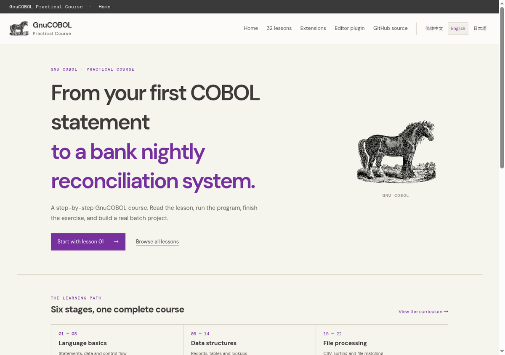
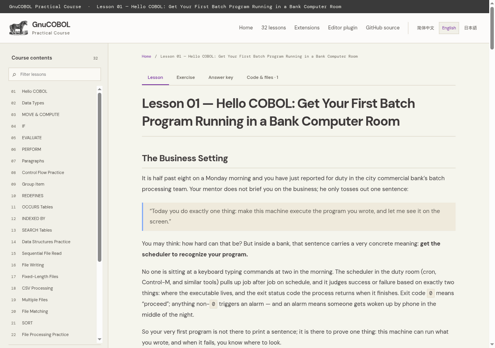
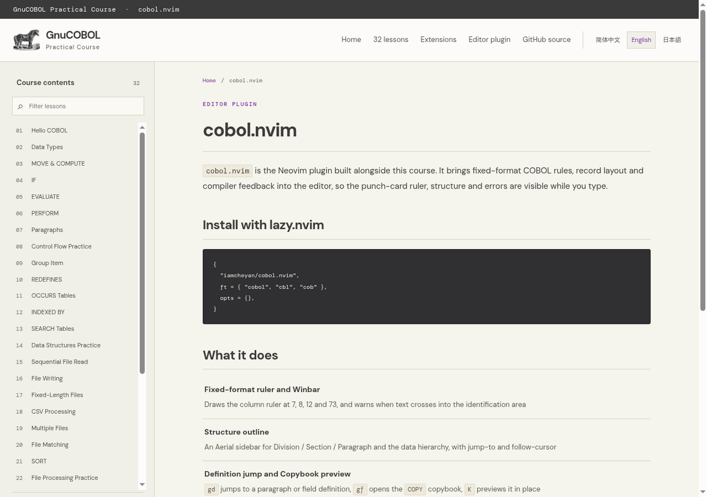

<div align="center">


# GnuCOBOL 实战课程

**从第一条 COBOL 语句，走到可运行的银行夜间对账系统。**

[](https://cobol.iamcheyan.com/zh-cn/)
[](lessons/DIRECTORY.md)
[](#三种语言)
[](https://gnucobol.sourceforge.io/)

[简体中文](README.zh-CN.md) · [日本語](README.ja.md) · [English](README.md)

</div>

---

## 这个仓库是什么

**这里是课程网站的源码**，不只是一堆示例程序。

你在 [cobol.iamcheyan.com](https://cobol.iamcheyan.com/zh-cn/) 上读到的每一课，都是本仓库里的 Markdown；它们被翻译成
三种语言，再由一个构建脚本渲染成静态站点，每次推送时在 GitHub Actions 里跑一遍。**你看到的网站，和这个仓库里的文件，
是同一件东西。**

课程本身是 32 课固定格式 GnuCOBOL，最后落到一个可运行的银行对账批处理：文件处理、排序、突合、嵌入式 SQL、
模块化批处理设计、错误处理、日志，以及一个毕业项目。

<table>
<tr>
<td width="50%"></td>
<td width="50%"></td>
</tr>
<tr>
<td align="center"><sub>课程首页：六个阶段，32 课</sub></td>
<td align="center"><sub>每课一个工作台：讲义、练习、答案、源码</sub></td>
</tr>
</table>

## 为什么做这套课

日本的基干系、保险和市政系统至今仍在跑 COBOL 批处理，能安全改动它们的工程师正以快于补充的速度退休。缺的不是
「学 COBOL 语法」，而是「能读懂一段固定格式批处理、说清它对数据做了什么、并且改动时不把夜间批次搞挂」。

所以每一课都围绕一个真实的批处理问题设计，每一句断言都有能编译、能运行的代码支撑：

- **不靠推测。** 每课的预期输出都是实际编译运行产生的，讲解里的字节数也是量出来的，不是估的。
- **边界讲清楚。** 某一课没处理什么，README 会直说，而不是让人误以为能力比代码更强。
- **失败也是教材。** 退出码、`FILE STATUS` 取值、Copybook 缺失时会怎样，和正常路径一起讲。

## 课程网站

网站为每种语言生成一整套页面树——`zh-cn/`、`en/`、`ja/`——带语言切换、明暗主题，以及手机上可折叠的课程目录。
每课把讲义、练习、答案和源码放在同一页，源码可逐文件预览与下载。

<table>
<tr>
<td width="60%"></td>
<td width="40%" valign="top">

**在 Markdown 之外，网站还提供了**

- 32 课 · 三种语言 · 共 562 个生成页面
- 每课四个标签页：讲义、练习、答案、源码
- 讲解字节布局、控制流与数据流转的内联 SVG 配图
- [`cobol.nvim`](https://github.com/iamcheyan/cobol.nvim) 配套页面，含真实截图
- 背景资料：COBOL 是什么、史话、GnuCOBOL 简介、速查手册、术语表

</td>
</tr>
</table>

## 快速开始

```sh
# 1. 安装 GnuCOBOL 与 make
sudo apt install gnucobol make
cobc --version          # 应为 GnuCOBOL 3.2.x

# 2. 从第一课开始读
open lessons/01_hello-cobol/README.md

# 3. 检查整套课程
make course-check       # 32 课交付物 + 01–28 语法检查 + 运行第 01 课
```

第 29–32 课使用嵌入式 SQL 工具链（GixSQL + SQLite）。先在第 29 课运行一次 `install-toolchain.sh`，然后：

```sh
make course-check-sql   # 29–32 的预编译检查，以及第 32 课的端到端场景
```

## 在本地构建网站

```sh
python3 -m pip install 'Markdown==3.7'
python3 scripts/build_site.py        # 渲染出 build/site/{zh-cn,en,ja}
python3 -m http.server -d build/site 8000
```

构建只依赖 Python 与 Markdown，没有 Node 工具链，也没有框架。`build/site/` 已被 Git 忽略——GitHub Actions 在每次
推送到 `main` 时构建并部署。

## 仓库结构

```text
lessons/            32 课主课程
  01_hello-cobol/     README.md · exercise.md · answer.md · lesson.cob · assets/
   ...
  32_bank-reconciliation-project/
  DIRECTORY.md      完整课程大纲：阶段、先修、耗时估算
  DIAGRAM-SPEC.md   配图的画法约定
extensions/         可选拓展：旧版课程、企业批处理、编辑器教程
scripts/
  build_site.py         渲染三语静态站点
  check_translations.py 覆盖率报告 + 结构保真校验
  diagram_i18n.py       生成每张配图的中/日版本
site-src/
  site.css, theme.css, site.js   样式与交互
  translations/                  讲义的中英日版本
  diagram-i18n.json              SVG 配图的译文
docs/screenshots/   本 README 使用的图片
Makefile            课程检查与扩展入口
```

## 三种语言

课程用中文、英文、日文三种语言编写。每课的讲义、注释和答案三种都有；代码标识符与程序输出保持原样，因为那才是
编译器和批次真正看到的东西。

- `README.md` — English（英文）
- `README.zh-CN.md` — 简体中文（本文件）
- `README.ja.md` — 日本語

翻译覆盖率是**校验**出来的，不是假设的：`scripts/check_translations.py` 会逐项比对标题数、代码围栏、表格行、
链接目标和 COBOL 非注释行，文件写成了错误语言也会直接判定失败。

## 课程检查

| 命令 | 作用 |
| --- | --- |
| `make course-check` | 检查全部课程交付物，对 01–28 做语法检查，编译并运行第 01 课 |
| `make course-check-sql` | 29–32 的预编译检查，加第 32 课端到端运行 |
| `make legacy-course-check` | 检查可选的旧版课程 |
| `make standalone-check` / `standalone-run` | `extensions/` 下的四个独立示例 |

## 参与贡献

课程既是代码也是文档，所以有价值的改动往往是修正一处解释，而不一定是加功能。

- **一课只有「跑起来」才算完成。** 编译它、运行它，确认输出与讲义所说一致。
- **守住固定格式。** 1–6 列留空，第 7 列 `*` 是注释，Area A 从第 8 列、Area B 从第 12 列开始，程序文本不越过第 72 列。
- **不要加 `-std=cobol85`。** 本课程用到 `COMP-3` 和 `FUNCTION TRIM`，严格 COBOL 85 不包含它们；用 `cobc -x` 直接编译。
- **译文必须忠实。** 提交翻译改动前先跑 `python3 scripts/check_translations.py`。

## 致谢

使用 [GnuCOBOL](https://gnucobol.sourceforge.io/) 构建。GnuCOBOL 最初是 OpenCOBOL，由日本开发者**西田圭介**于 2002 年发布；
它把 COBOL 源码翻译成 C，再交给系统的 C 编译器生成程序。现在项目在 GNU 名下由 Simon Sobisch 等人持续维护。
在 Debian/Ubuntu 上可以用 `sudo apt install gnucobol` 安装；这让学习者能在家用 Linux 上编译和运行课程中的固定格式代码，无需拥有大型机。它适合学习和验证 COBOL 代码，但不意味着大型机上的编译器方言、数据表示和生产环境行为都与 GnuCOBOL 完全相同。夏尔马标志来自 GnuCOBOL 项目。

配套的 Neovim 插件 [`cobol.nvim`](https://github.com/iamcheyan/cobol.nvim) 提供固定格式标尺、结构导航、
Copybook 预览、记录长度计算与编译器诊断，配合这套课程使用。
