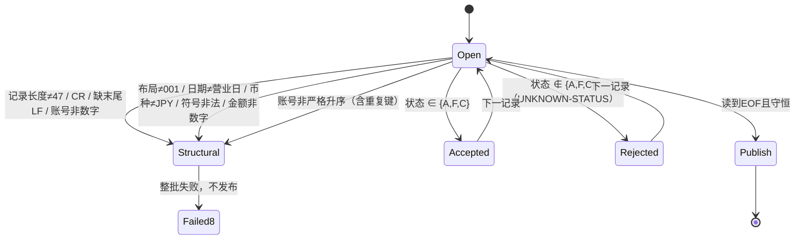

# 模块 01 设计：最小银行批处理入口

## 版本与归属

- 接口版本：ACCOUNT v1（**冻结**，47 字节），来源
  `curriculum/bank/copybooks/ACCOUNT-V1.CPY`，语义见
  [BANK-SYSTEM.md](../../../docs/curriculum/BANK-SYSTEM.md) 第 2 节。本模块只读，不改布局。
- 程序：`BANK-ENTRY`（学员入口 `starter/BANK-ENTRY.COB`，参考实现
  `instructor/modules/01-foundations/BANK-ENTRY.COB`）。
- JOB：`scripts/run.sh`（参数、输入快照、锁、校验、发布、日志、RC）。
- 平台：Linux x86-64、GnuCOBOL 3.2.0、默认方言（不得使用 `-std=cobol85`）。

## 输入来源与前提

上游每个营业日投放一份账户快照（本模块为合成数据）。文件为 ASCII、LF 终止、每条 47 字节。
营业日不作为文件内容推断，而由 JOB 参数显式给出。上游“已保证”的仅是“只投放本日数据”，
长度/字符/排序/重复键仍需本 JOB 独立验证。

## ACCOUNT v1 字段（1 起，字节偏移与长度）

| 偏移 | 长度 | 字段 | 编码/单位 | 合法值 |
|---:|---:|---|---|---|
| 1 | 10 | account_id | ASCII 数字 | 全数字，文件内严格升序且唯一 |
| 11 | 8 | customer_id | ASCII 数字 | 引用客户（本模块不校验存在性） |
| 19 | 3 | currency | ASCII 字母 | 仅 `JPY` |
| 22 | 1 | balance_sign | 文本符号 | `+` 或 `-` |
| 23 | 13 | opening_balance | ASCII 数字，JPY 最小单位整数 | 全数字，含符号范围 ±9,999,999,999,999 |
| 36 | 1 | account_status | 状态字母 | `A` 正常、`F` 冻结、`C` 关闭；其他为业务拒绝 |
| 37 | 8 | business_date | ASCII，`YYYYMMDD` | 等于作业营业日 |
| 45 | 3 | layout_version | ASCII | `001` |

## 校验状态图

营业日在 OPEN 之前先经 `TEST-DATE-YYYYMMDD` 校验；非法日历日期在读取前即 RC8。

## 拒绝码

| 码 | 级别 | 触发 | 结果 |
|---|---|---|---|
| `UNKNOWN-STATUS` | 业务拒绝（RC4） | 状态不在 `A/F/C` | 该条写入 `rejected.dat`，其余继续 |
| `INVALID-ACCOUNT-RECORD` | 结构（RC8） | 长度/字符/布局/日期/排序/重复键 | 整批失败，无输出 |
| `INVALID-BUSINESS-DATE` | 参数（RC8） | 营业日非日历日期 | 读取前失败，无输出 |
| `FILE-STATUS=..` | 系统（RC12） | OPEN/READ/WRITE/CLOSE 状态非 00/10 | 失败，无输出 |

## RC 与发布条件

| RC | 含义 | 输出政策 |
|---:|---|---|
| 0 | 无业务拒绝、守恒成立 | 发布 |
| 4 | 存在逐条业务拒绝，接口仍完整 | 发布含拒绝明细的已核对结果；调用 JOB 须显式允许 RC4 继续 |
| 8 | 接口/排序/重复键/营业日契约错误 | 整批失败，不发布 |
| 12 | 文件系统/构建/锁/发布错误 | 整批失败，不发布 |

发布目录内容：`control.txt`（固定宽度控制报告）、`accepted.dat`（47 字节 + LF）、
`rejected.dat`（47 字节 + `|` + 原因 + LF）、`inputs.sha256`、`outputs.sha256`、`run.txt`、
`compiler.txt`、`source.sha256`。发布前由 `verify-publish.py` 独立重算并比对；不一致即 RC12
且删除暂存、不产生输出目录。守恒式：`READ = ACCEPTED + REJECTED`。

## 源码到执行文件的关系

`cobc -x` 把 COBOL 翻译为 C，再调用系统 C 编译器链接为原生可执行文件；运行时依赖
`libcob`。`scripts/env-report.sh` 用 `cobc -V`、`file`、`ldd`、`readelf -h` 生成该关系的真实
证据。`build.sh` 与 `run.sh` 都在**私有暂存目录**内编译，只有全部校验通过才整体发布，
避免半成品二进制落入正式目录。
