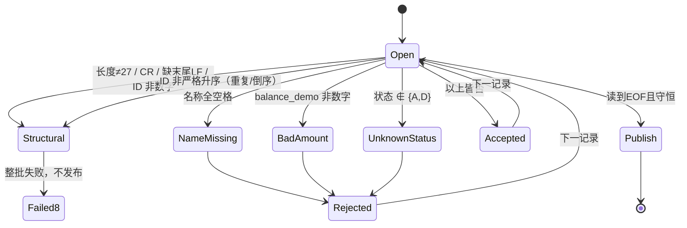

# 模块 02 设计：CUSTOMER v1 与数据表示

## 版本与归属

- 接口版本：CUSTOMER v1（**冻结**，27 字节）。实物 Copybook：
  [copybooks/CUSTOMER-V1.CPY](copybooks/CUSTOMER-V1.CPY)。语义见
  [BANK-SYSTEM.md](../../../docs/curriculum/BANK-SYSTEM.md) 第 2 节。
- 程序：`CUSTLOAD`（学员入口 `starter/CUSTLOAD.COB`，参考
  `instructor/modules/02-data/CUSTLOAD.COB`）；JOB：`scripts/run.sh`。
- 平台：Linux x86-64、GnuCOBOL 3.2.0、默认方言（禁止 `-std=cobol85`）。

## CUSTOMER v1 字段目录（1 起，偏移/长度/编码/单位）

| 偏移 | 长度 | COBOL 名（Copybook） | 逻辑类型 | PIC | 编码/单位 | 合法值 |
|---:|---:|---|---|---|---|---|
| 1 | 8 | CUSTOMER-ID | 数值文本 | X(8) | ASCII 数字，保留前导零 | 全数字，文件内严格升序且唯一 |
| 9 | 10 | CUSTOMER-NAME | 字母数字 | X(10) | ASCII，右侧空格补齐 | 必填，非全空格 |
| 19 | 8 | BALANCE-DEMO | 金额文本 | X(8) | ASCII 数字，单位“分”，无符号 | 全数字 0–99999999 |
| 27 | 1 | CUSTOMER-STATUS | 状态字母 | X | ASCII | `A` 有效、`D` 停用；其他拒绝 |

### 逻辑位数与实际存储字节的区别

`PIC 9(8)` 描述的是**逻辑数字位**与比较语义（可 `COMPUTE`、无前导零概念）；`PIC X(8)` 描述
的是**8 字节 ASCII 文本**（保留前导零，可直接切片）。CUSTOMER v1 是文本定宽接口，故 8 位
ID 用 `X(8)` 存储；若误用 `PIC 9(8)`，`COMPUTE`/比较会丢掉前导零语义，但磁盘上仍是 8 字节
数字字符。`PIC A(n)` 是字母类别声明，适合“纯姓名”实验，但 note：`MOVE` **不做类别校验**，
含数字的 `X` 数据移入 `PIC A(n)` 会原样保存，必须自己用 `IS ALPHABETIC` 校验，故 v1 名称用
`X(10)`。规律：`X(n)`/`A(n)`/`9(n)` 都是 **n 字节**（DISPLAY 字符型数字）；`S9(n)V9(m)` 逻辑
n+m 位、显示 n+m 字节；`S9(n) COMP-3` 为 `ceil((n+1)/2)` 字节；`S9(n) COMP` 为 2/4/8 字节。
本模块全部字段都是 DISPLAY 文本，字节数等于字符数。

### 与账户模型演进的关系

`balance_demo` 只用于教学：它是无符号“分”金额，无法表达符号、账户、币种或期初/期末。
进入账户模型后，余额移入 **ACCOUNT v1（47 字节）**，用 `balance_sign` + 13 位 `opening_balance`
表达带符号最小单位金额，并以 `layout_version=001` 版本化。CUSTOMER v1 **不静默改变文件
含义**：迁移分三步——(1) 客户文件保留身份/状态；(2) 余额读入 ACCOUNT；(3) 下游只消费
`customer_id` 引用。

第 27 字节 `CUSTOMER-STATUS` **只有状态语义（`A` 有效 / `D` 停用），不是客户区分**；
CUSTOMER v1 **没有**客户区分字段。模块 11 的“客户区分 1 位 → 2 位”维护**不得**改写这第 27
字节，也**不是** CUSTOMER v1 的 27→28 迁移：必须先在独立、版本化的**企业客户大记录**布局上做
影响调查，复用或对齐模块 07 L4 的 `ENTERPRISE-CUSTOMER-V1`（1778 字节固定二进制，
`CUSTOMER-CLASSIFICATION PIC X` 在 v1 为 A/B/C/D、v2 扩为 `PIC X(2)`、布局版本 001→002，见
[curriculum/bank/README.md](../../bank/README.md)），保留 27 字节教学接口并说明两者关系后再
迁移。

## 校验状态图

拒绝原因**优先级固定**：`NAME-MISSING` → `BAD-AMOUNT` → `UNKNOWN-STATUS`（同一条记录只报
第一个命中的原因）。

## 拒绝码

| 码 | 级别 | 触发 |
|---|---|---|
| `NAME-MISSING` | 业务拒绝（RC4） | 名称 10 字节全空格 |
| `BAD-AMOUNT` | 业务拒绝（RC4） | `balance_demo` 含非数字 |
| `UNKNOWN-STATUS` | 业务拒绝（RC4） | 状态不是 `A`/`D` |
| `INVALID-CUSTOMER-RECORD` | 结构（RC8） | 长度/LF/CR/ID 字符/排序/重复 |
| `FILE-STATUS=..` | 系统（RC12） | OPEN/READ/WRITE/CLOSE 非 00/10 |

## RC 与发布条件

| RC | 含义 | 输出政策 |
|---:|---|---|
| 0 | 无业务拒绝、守恒成立 | 发布 |
| 4 | 存在逐条业务拒绝，接口仍完整 | 发布含拒绝明细的已核对结果 |
| 8 | 长度/LF/CR/ID/排序等契约错误 | 整批失败，不发布 |
| 12 | 文件系统/构建/锁/发布错误 | 整批失败，不发布 |

发布目录：`control.txt`（`JOB|CUSTLOAD|V1` + `CONTROL|READ..|ACCEPTED..|REJECTED..|BALANCE-TOTAL..`，
计数 12 位、合计 18 位定宽）、`accepted.dat`（27 字节 + LF）、`rejected.dat`（27 字节 + `|` +
原因 + LF）、`inputs.sha256`、`outputs.sha256`、`run.txt`、`compiler.txt`、`source.sha256`。
守恒式 `READ = ACCEPTED + REJECTED`；`BALANCE-TOTAL` 仅累计**接收**记录的 `BALANCE-DEMO`
（被拒记录不计入），用 18 位 `ADD ... ON SIZE ERROR` 保护，溢出即 RC12 不发布。
发布前由 `verify-publish.py` 独立重算并比对。

## MOVE 实验表（02.2）

由 `experiments/move/MOVELAB.COB` 生成，`expected/movelab.txt` 为独立预期：

| 案例 | 源码 | 结果 | 规则 |
|---|---|---|---|
| A | `DISPLAY PIC 9(3)V99 VALUE 41.5` | `041.50` | 隐式小数在显示时补出小数点 |
| B | `MOVE 41.5(9V99) TO PIC 9(5)` | `00041` | 小数对齐，小数部分丢弃 |
| C | `MOVE PIC 9(5) TO PIC X(5)` | `00041` | 数值→字母数字保留显示数字 |
| D | `MOVE 'AB' TO PIC X(5)` | `AB   ` | 字母数字右补空格 |
| E | `DISPLAY S9(3) SIGN LEADING SEPARATE = -12` | `-012` | 前分隔符号占 1 字节 |
| F | `DISPLAY S9(3)V99 LEADING SEPARATE = -1.25` | `-001.25` | 符号 + 隐式小数 |
| G | `MOVE 'ABCDEFGH' TO PIC X(5)` | `ABCDE` | 右侧截断 |
| H | `MOVE 12345 TO PIC 9(3)` | `345` | 数值高位截断，保留低位 |
| I | `MOVE 12345.67 TO PIC 9(3)V99` | `345.67` | 高位截断，小数保留 |

**必须理解**：`MOVE` 不做四舍五入、不做范围检查；金额计算必须使用显式单位与 `ON SIZE ERROR`，
不得依赖浮点。

## 类型与层级实验（02.1）

`experiments/types/TYPESLAB.COB` 读 `fixtures/types/typeinput.dat`（3 条 5 字节记录），
`expected/typeslab.txt` 为独立预期：

| 记录 | 原始 `PIC X(5)` | `MOVE` 到 `PIC A(5)` | `IS ALPHABETIC` | 结论 |
|---|---|---|---|---|
| `ABCDE` | `ABCDE` | `ABCDE` | 真 → `A` | 纯字母：类别与内容一致 |
| `AB123` | `AB123` | `AB123` | 假 → `M` | **`MOVE` 不校验**：数字原样进入 `PIC A` |
| `AB CD` | `AB CD` | `AB CD` | 真 → `A` | 空格属于字母类别 |

同一程序还用 `78 WS-LIMIT VALUE 25` 常量（显示 `25`）、`77 WS-COUNT` 独立项、`88 CLS-ALPHA/
CLS-MIXED` 条件名与 `SET ... TO TRUE`、以及 `01/05` 组展示层级。两处可复现故障：(1) 含数字的
`X` 数据移入 `PIC A` 不被自动拒绝，必须用 `IS ALPHABETIC` 自行校验；(2) 数值项 `MOVE` 到
`PIC A` 直接**编译失败**，程序根本无法发布。`check.py` 编译运行并与 `expected/typeslab.txt`
逐字节比对，且断言数值→`A` 的 `MOVE` 编译非零退出。

## 布局实验（02.3）

`experiments/layout/LENGTH-PROBE.COB` 对 canonical 与**故意错写、非契约**的 Copybook 各编译
一次：

| 编译用的 `-I` | `LENGTH OF CUSTOMER-RECORD` | `LENGTH OF CUSTOMER-NAME` |
|---|---:|---:|
| `copybooks/`（canonical） | 27 | 10 |
| `experiments/layout/`（名称**故意错写** `X(11)`） | 28 | 11 |

这证明：改一个 `PIC` 会改变记录总长与其后所有字段偏移，必须同步评估长度校验、下游布局版本
与 JOB 契约。`experiments/layout/CUSTOMER-V1.CPY` 是**错误布局演示/非契约**：它不是 CUSTOMER
v1 契约，也不是 27→28 迁移；真实维护须先影响调查、版本化并保留旧接口。
