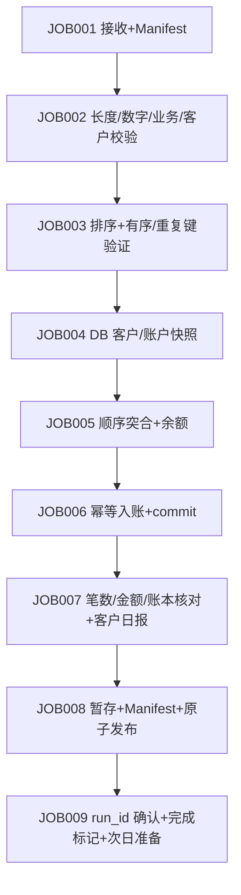

# 模块 12 设计：毕业综合项目（陌生版本银行系统）

对应大纲 12.1–12.4。本文件定义“陌生版本”的组成、依赖、四类日、RC、32 节点
与 12 逻辑表的映射；学员任务与验收见 [README](README.md)，讲师根因、答案与
评分见 `instructor/modules/12-capstone/`。

## 1. 陌生版本的组成（复用，不 fork）

`system/` 不重写模块 06/07/08/10 的 canonical 程序，而是把它们**编排**成
一个陌生版本的夜间系统：

| 组件 | canonical 来源 | 在 capstone 的角色 |
|---|---|---|
| 客户校验 CUSTV2 | 学员交付（`starter/CUSTV2.COB`，或 `CAPSTONE_STUDENT_CUSTV2`）；参考答案 `system/cobol/CUSTV2.COB` 仅在讲师仓 | JOB002d 归一化 v1/v2 |
| 交易校验 BANKVAL | 模块 10 学员交付（`starter/BANKVAL.COB`，或 `CAPSTONE_STUDENT_BANKVAL`）；仓库内参考 `instructor/modules/10-jobs/BANKVAL.COB` | JOB002c 业务校验 |
| 排序 SORTTX | `instructor/modules/07/02-sort-merge/SORTTX.COB` 经其 runner | JOB003b |
| 1:N 突合 BATCHL2 | `instructor/modules/07/03-one-to-many/BATCHL2.COB` 经其 runner | JOB005a |
| 客户日报 NIGHTRPT | capstone 新增（本仓库） | JOB007d |
| DB/账本/快照 | `system/lib/capdb.py`（12 逻辑表，离线检查点） | JOB004/JOB006 |
| 守恒/日报核对 | `system/lib/report.py`（独立） | JOB007a-c/e |

被编排但本模块未接入的 canonical：模块 06 `FILEVAL`、模块 07 `MATCH`/
`MERGETX`/`BATCHL3`/`BATCHL4`、模块 08 的 GixSQL/PostgreSQL 路径。它们属于
“陌生系统”的可读范围，但本模块的实际流水线用上面这张表。

## 2. 四类日（12.2）

| 日 | 布局 | 语义 | 期望 RC | 发布 |
|---|---|---|---|---|
| normal | v1 | 6 笔全入账 | 0 | 是 |
| abnormal | v1 | 4 笔校验拒绝 + 1 笔透支拒绝 | 4 | 是（核对后） |
| rerun | v1 | 与 normal 同 feed 对同一 DB 重跑 | 0 | 是（入账 0 笔） |
| extension | v2 | 企业客户区分 2 位，含 `D1` 客户 | 0 | 是 |

客户 feed 是**独立、版本化的 CAP-CUSTOMER-FEED 布局**：v1 31B（区分第
28 字节 A/B/C/D）、v2 32B（区分第 28-29 字节 A1..D1）。它内嵌 canonical
27 字节 CUSTOMER v1，故第 27 字节始终是**记录状态**（A/D），不是客户区分；
canonical CUSTOMER v1 的 27 字节不改。维护练习作用于本 feed 的
`CUSTOMER-CLASSIFICATION`（1→2 位）。

`CAP-CUSTOMER-FEED` 是刻意选择的**独立名称**：模块 04/07 的 canonical
`ENTERPRISE-CUSTOMER` 是 1778 字节 / 175 字段大记录，模块 11 是另一套实验布局，
三者互不兼容。共用同名 `ENTERPRISE-CUSTOMER-Vx` 会掩盖物理布局漂移，因此 capstone
不复用该名，并在 `CAP-CUSTOMER-FEED-V1/V2.CPY` 头注释与 README 说明二者关系。

附加（用于事故与硬门禁）：`broken`（重复 transaction_id）→ RC8 不发布；
layout 与物理宽度不符 → RC8 不发布；系统失败（mktemp/权限）→ RC12 不发布。

## 3. RC 政策（与 BANK-SYSTEM §6 一致）

| RC | 含义 | 继续 | 发布 |
|---:|---|---|---|
| 0 | 正常 | 是 | 是 |
| 4 | 契约允许的业务拒绝 | 是 | 是，须过 JOB007 |
| 8 | 业务/结构异常（宽度、重复键、守恒不符） | 否 | 否 |
| 12 | 系统异常（权限/mktemp/锁/意外子码） | 否 | 否 |
| 97 | 注入崩溃（实验），保留现场 | — | 否 |

非 0/4/8/12 的子进程码一律在 shell 边界映射为 12，不伪装成业务拒绝。

## 4. 32 节点映射（规模目标之一）

顶层 9 个 JOB 展开为 32 个可追踪节点：

| JOB | 节点 |
|---|---|
| 001 | 001a 接收 Manifest / 001b 校验 SHA256 / 001c 冻结快照 |
| 002 | 002a 原始宽度 / 002b 数字 / 002c 业务(BANKVAL) / 002d 客户(CUSTV2) / 002e 拒绝报告 |
| 003 | 003a 构建/校验 SORTER / 003b 重复键+排序 / 003c 有序性 |
| 004 | 004a DB 可达性+日历 / 004b 冻结客户 / 004c 冻结账户 |
| 005 | 005a Key Break+余额(L2) / 005b 接受/拒绝分类 / 005c 候选隔离 |
| 006 | 006a 读账本 / 006b 幂等入账 / 006c commit 标记 |
| 007 | 007a 笔数守恒 / 007b 金额守恒 / 007c 账本交叉 / 007d 客户日报(NIGHTRPT) / 007e 客户日核对 |
| 008 | 008a 暂存 / 008b Manifest / 008c 原子切换 / 008d CURRENT+登记 |
| 009 | 009a run_id 确认 / 009b 次日准备 / 009c 完成标记 |

每个节点写 `state/<node>.done`（含 rc），JOB 级写 `state/<JOBxxx>.done`；
重跑按标记续跑，已完成节点不重复执行。

## 5. 12 逻辑表

见 `system/lib/capdb.py` 头注释：customer、account、transaction_ledger、
batch_run、batch_commit、customer_snapshot、account_snapshot、reject_log、
control_total、publish_registry、idempotency_key、business_calendar。
**默认教学路线**：DB 层是离线文件检查点（幂等账本先写、余额由「期初快照 + 账本」
推导/自愈）。**真实 DB 路线（R01）**：`scripts/real-db.sh` 复用模块 10 canonical
harness（PostgreSQL17 + GixSQL + 模块 08 ESQL），在同一事务提交余额与幂等账本，
并用独立 psql 核对；不可用时报 `UNVERIFIED`。

## 6. 幂等、锁、快照、发布

- 幂等键 `(business_date, transaction_id)`，账本是唯一事实来源。
- 输出锁 `<output>.lock`；营业日锁 `<db>/locks/<date>.lock`（活 pid 拒绝，
  死 pid 回收）。
- 输入快照按 MANIFEST SHA256 冻结；当日快照不可被当日入账改写。
- 发布：私有 stage → 生成并校验 `manifest.json`/`MANIFEST.sha256` →
  `mv -T -n` 切换 → 最后移动 `publish/CURRENT`；JOB009 确认 CURRENT==run_id
  才写完成标记。

## 7. 维护（12.2）与事故（12.4）

- 维护：`maintenance/` 交付影響調査/対象一覧/方針/Test/Evidence，客户区分
  1→2 位；RED→GREEN 见 `maintenance/regression/red-green.sh`。
- 事故：`incidents/incident-01/` 发放材料不含根因；讲师根因与修复见
  `instructor/modules/12-capstone/INCIDENT-01.md`。

## 8. 平台与边界

仅 Linux x86-64、GnuCOBOL 3.2.0、Bash、GNU coreutils、Python 3 实际验证。
macOS/WSL/其他架构**未验证**。DB 层**未验证**真实数据库。JCL/JP1 仅阅读映射，
未在任何调度器上提交。
