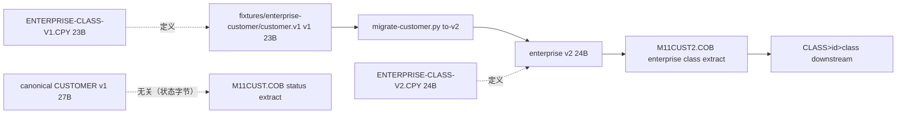

# 影響調査書（讲师参考，企业客户区分 1 位 → 2 位）

对象：模块 11 冻结快照的**独立、版本化企业客户布局** `ENTERPRISE-CLASS`
（`maintenance/copybooks/`），**不是** 27 字节 canonical CUSTOMER v1（其
第 27 字节是记录状态 A/D）。本文件是调查评审用的完整参考答案，学员先自行
完成再对照。

> **命名与关系**：课程 canonical 大记录是模块 07 L4 的
> `ENTERPRISE-CUSTOMER-V1`（175 字段 / 1778 字节）。本模块练习布局刻意
> 改用**独立名称** `ENTERPRISE-CLASS`，只保留同一 `CUSTOMER-CLASSIFICATION`
> 语义，避免同名却布局不同（版本漂移）。

## 1. 字段定义

| 字段 | PIC | 字节偏移（1 起） | 长度 | 合法值 | 版本 |
|---|---|---:|---:|---|---|
| `LAYOUT-VERSION` | `X(3)` | 1 | 3 | `001`→`002` | 001→002 |
| `CUSTOMER-ID` | `X(8)` | 4 | 8 | 8 位数字 | v1/v2 不变 |
| `RECORD-STATUS` | `X(1)` | 12 | 1 | `A` 有效 / `I` 停用 | v1/v2 不变 |
| `CUSTOMER-NAME` | `X(10)` | 13 | 10 | ASCII，右补空格 | v1/v2 不变 |
| `CUSTOMER-CLASSIFICATION` | `X(1)`→`X(2)` | 23 | 1→2 | `A/B/C/D`→`A1/B1/C1/D1` | 001→002 |
| （记录总长） | — | — | **23→24** | — | 001→002 |

分类字段在记录末尾，加宽只使记录变长 1 字节；V2 中偏移 23 之前的字段偏移
不变，但**记录总长**变化会影响一切定长读取与下游切片。`RECORD-STATUS` 是
另一业务语义，不能被当区分。

## 2. 所有使用位置（逐项）

| # | 位置 | 作用 | V1 | V2 处理 |
|---|---|---|---|---|
| U1 | `maintenance/copybooks/ENTERPRISE-CLASS-V1.CPY` | 基线接口定义 | 23B，`X(1)` | 新增 `ENTERPRISE-CLASS-V2.CPY`（24B，`X(2)`），**不改动 V1** |
| U2 | `M11CUST2.COB`（参考实现） | 读 v2 快照、输出抽取/报表 | — | 读 24B、版本 `002`，取 `(23:2)` |
| U3 | 企业区分读取链路 | 构建并调用读取程序 | — | 按版本选择宽度 |
| U4 | 下游接口 `CLASS\|<id>\|<class>` | 下游消费接口 | 1 字符 class | 2 字符 class（接口版本化） |
| U5 | `fixtures/enterprise-customer/customer.v1` | 输入（V1） | 23B | 迁移为新 V2 文件；**原文件不原地改写** |
| U6 | `migrate-customer.py` | 迁移/回滚/并行验证 | — | `to-v2`/`to-v1`/`verify` |
| U7 | 排序/比较键 | 区分是否参与键 | 不参与 | 仍不参与（无排序影响） |
| U8 | **canonical CUSTOMER v1（27B）** | **不受影响** | 第 27 字节 = 记录状态（A/D） | **不变**（本变更不涉及） |
| U9 | 夜间流 `M11CUST.COB` / `publish/<run>/customer-status.txt` | **不受影响** | `STATUS\|<id>\|<status>` | **不变** |

## 3. 依赖图

## 4. 未知项 / 未验证

- **真实 DB**：本快照未接入真实 PostgreSQL/DB2；若存在真实企业客户表列宽
  （如 `classification varchar(1)`），其迁移与约束**未验证**，需 DBA 确认。
- **外部消费方**：`CLASS|<id>|<class>` 的解析方是否按固定 1 字符切分、
  是否校验长度，**未知**，需接口方确认；切换需版本协商。
- **字符集**：仅验证 ASCII（`LC_ALL=C`）；EBCDIC/多字节未验证。
- 平台：仅 Linux x86-64 + GnuCOBOL 3.2 实测；macOS/WSL 未验证。

## 5. 影响结论

- 变更集中在“迁移版本 + 读取宽度 + 分类字段长度 + 下游行格式 + 输入迁移”。
- **无排序键影响**，但**记录总长**影响所有定长假设与校验和。
- V1 企业文件必须保留并可读（拒绝或转换），禁止原地改写。
- **与 canonical CUSTOMER v1 完全解耦**：本变更不触碰 27 字节教学接口，
  也不触碰夜间流的状态抽取；`check.sh` 以回归验证这一点。
