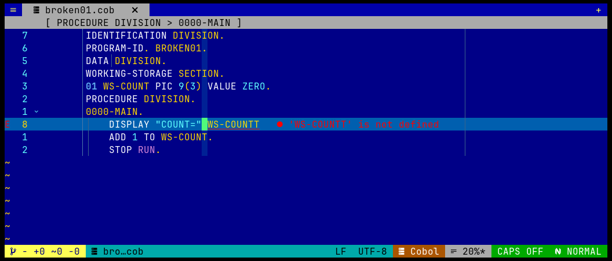

# GnuCOBOL 语法检查与 Neovim 诊断

COBOL 源码有固定格式、句点和声明规则。`cobol.nvim` 可调用 GnuCOBOL 对当前缓冲区做语法检查，并将可识别的问题显示为 Neovim diagnostics。

## 检查方式

- 默认在保存、文本变化防抖（600 ms）及离开 Insert 模式时触发异步检查。
- `<leader>cl` / `:CobolLint` 立即检查当前缓冲区。
- `<leader>cq` / `:CobolQuickfix` 将当前诊断放入 Neovim Quickfix 列表。
- `:CobolDiagnosticsToggle` 开关自动诊断。
- 尽可能将未保存的缓冲区内容通过标准输入交给 `cobc`。
- Copybook 的诊断尽可能关联到 Copybook 缓冲区和源程序 `COPY` 行。



图中未定义字段的编译器错误显示在源码旁。诊断范围取决于 GnuCOBOL 输出和插件的解析结果；`cobc` 缺失时不能进行实际编译器检查。

## 快速演练

在临时副本中创建以下小程序，然后运行 `:CobolLint`：

```cobol
       IDENTIFICATION DIVISION.
       PROGRAM-ID. CHECK-DEMO.
       DATA DIVISION.
       WORKING-STORAGE SECTION.
       01 WS-COUNT PIC 9(3) VALUE ZERO.
       PROCEDURE DIVISION.
           DISPLAY WS-COUNT.
           STOP RUN.
```

将 `WS-COUNT` 的引用临时改成 `WS-MISSING`，等待自动检查或再次运行 `:CobolLint`。若编译器将错误位置写到可识别的格式，Neovim 会出现诊断；用 `:CobolQuickfix` 查看列表，按 `<CR>` 跳到条目。修复名称并重新检查，确认诊断消失。

## 配置

```lua
{
  "iamcheyan/cobol.nvim",
  opts = {
    diagnostics = {
      enable = true,
      on_save = true,
      on_change = true,
      debounce_ms = 600,
      warnings = { "all", "no-obsolete" },
    },
  },
}
```

通过 `cobc_command` 指定编译器，通过 `cobc_extra_args` 添加参数；项目 profile 还可配置 `compiler`、`compiler_args`、`dialect` 和 `copybook_paths`。详情见插件帮助 `:help cobol-projects`。
