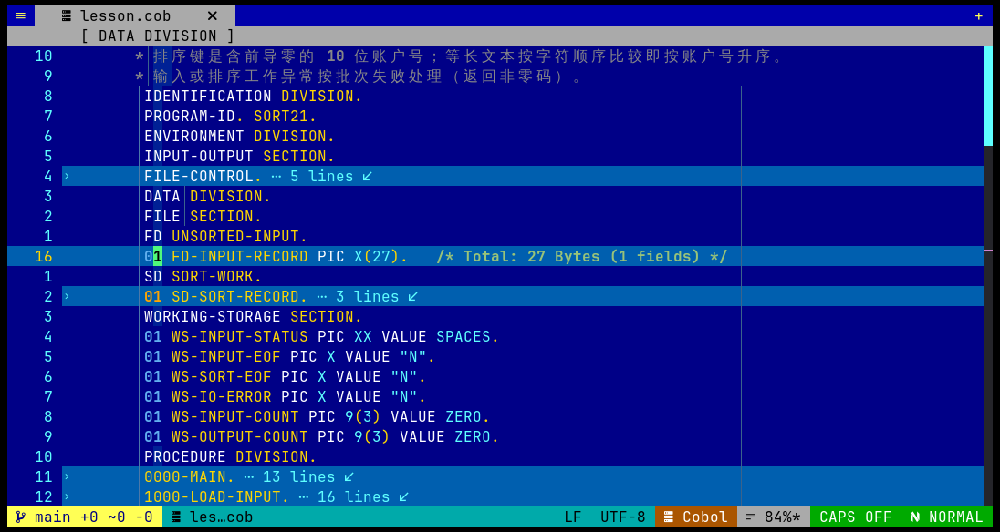

# GnuCOBOL 编译工作流与 cobol.nvim

`cobol.nvim` 可把 GnuCOBOL 的语法检查、构建与运行命令接入 Neovim。COBOL 编译器仍负责最终语法检查和生成程序；插件负责在编辑器中调用项目设置的命令并显示结果。

## 常用 GnuCOBOL 命令

| 命令 | 用途 |
| --- | --- |
| `cobc -fsyntax-only INPUTCSV.COB` | 只做语法检查 |
| `cobc -x -o INPUTCSV INPUTCSV.COB` | 编译链接可执行程序 |
| `cobc -I copy ...` | 指定 Copybook 搜索目录 |

## 独立示例工作流

在仓库根目录运行：

```sh
make -C extensions/standalone-examples check
make -C extensions/standalone-examples run-csv
```

`check` 检查四个独立程序。`run-csv` 编译并运行 `INPUTCSV.COB`，读入 `input.txt` 并生成 `output.csv`。示例目录的 Makefile 还提供 `run-fixed`、`run-table`、`run-report` 和 `clean`。



图中展示 Division、Section、Paragraph 与数据项的原生折叠和摘要。原生折叠不创建 IF/EVALUATE 控制块折叠；这些控制块若由其他 fold provider 创建，插件可提供结构摘要。

## 从 Neovim 执行

在 COBOL 缓冲区中：

- `:CobolLint` 或 `<leader>cl`：立即运行 GnuCOBOL 语法检查。
- `:CobolBuild`：运行项目 build 命令，或在单文件场景使用 `cobc`。
- `:CobolRun`：运行项目配置的程序；有 build 目标但无 run 入口时不会猜测可执行文件。
- `:CobolTest`：运行项目 test 命令或单文件语法检查。

项目命令从 `.cobol.json` 的 `commands` 或 Makefile 目标读取，执行前应先保存当前缓冲区，因为项目构建命令读取磁盘文件。命令使用参数数组，不经 shell 执行。没有 Makefile 或 profile 时，单文件构建/运行会尝试使用 `cobc`。

项目示例：

```json
{
  "compiler": "cobc",
  "source_format": "fixed",
  "copybook_paths": ["copy", "cpy"],
  "commands": {
    "build": ["make", "build"],
    "run": ["make", "run"],
    "test": ["make", "test"]
  }
}
```

更多 profile 选项见 `:help cobol-projects`。
