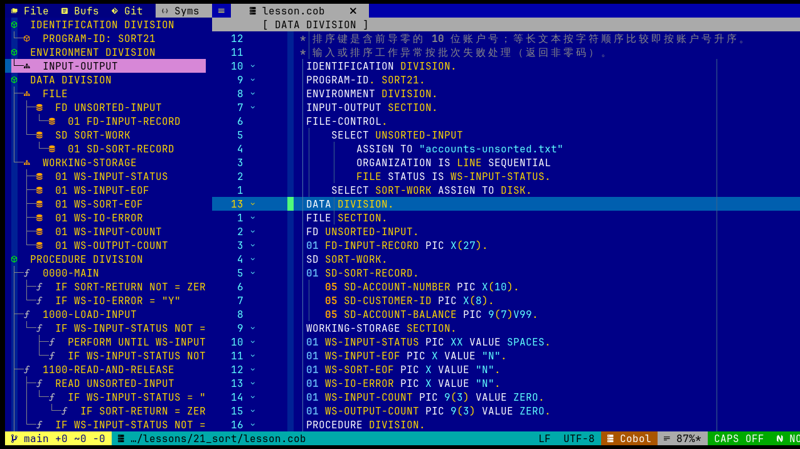

# COBOL 示例程序与插件功能演练

本页汇总仓库中四个可独立运行的 COBOL 示例，并指出适合演练的 `cobol.nvim` 功能。示例用于配合阅读插件，不是本插件必须安装的课程依赖。

---

## 1. 四大示例矩阵总览

| 范例程序 | 业务应用场景 | 核心 COBOL 技术考点 | 配合插件的关键操作体验 |
|---|---|---|---|
| **1. `INPUTCSV.COB`** | 管道符文本清洗与 CSV 导出 | • `ORGANIZATION IS LINE SEQUENTIAL`<br>• `UNSTRING ... DELIMITED BY` 拆分<br>• `STRING` 与 `FUNCTION TRIM` 裁剪<br>• Copybook 引入 (`EMP-REC.CPY`) | `gf` 跳入 Copybook、`K` 悬停浮窗预览、`gd`/`<C-o>` 段落秒级跳转 |
| **2. `FIXEDREC.COB`** | 80 列银行定长交易报文处理 | • 无分隔符纯位置物理读取<br>• **`REDEFINES` 内存共享与结构重定义**<br>• `88` 级交易状态条件名（`EVALUATE TRUE`）<br>• `COMP-3` 紧凑十进制金额高精度累加 | `<leader>cr` 计算含 `REDEFINES` 结构体内存排布（观察偏移量不递增）、行尾字节换算提示 |
| **3. `TBLSRCH.COB`** | 多币种汇率矩阵与二分查找 | • COBOL 内存表（数组）：`OCCURS n TIMES`<br>• 专属指针与下标：`INDEXED BY`<br>• **`SEARCH ALL`（语言级极速二分查找）**<br>• 浮点精度汇率乘法与四舍五入 | 查看基本字段的 OCCURS 大小估算；用 `gd` 搜索字段定义（组级 OCCURS 不完整计入子字段总长） |
| **4. `BATCHRPT.COB`** | 经典两级控制中断审计报表 | • **两级控制中断（Control Break）算法**<br>• 部门小计（Subtotal）与分公司总计<br>• 编辑型货币输出符（`PIC $$$,$$$,$$9.99`、`ZZ9`）<br>• 结构化分页与双重分隔符打印 | 段落跳跃（`gd` / `<C-o>` 在 Header、Detail、Break 间往返）、72 列越界防线测试 |

---

## 2. 范例 1：`INPUTCSV.COB` - 文本管道拆分与清洗

### 业务场景
数据仓库或外部合作方发来以 `|` 分隔的人员档案文件 `input.txt`，要求清洗多余空格，姓名包裹标准双引号，并导出为标准逗号分隔的 `output.csv`。

### 核心代码片段拆解
* **字符串拆分 (`UNSTRING`)**：
  ```cobol
  UNSTRING INPUT-RECORD
      DELIMITED BY "|"
      INTO IN-EMPLOYEE-ID
           IN-FULL-NAME
           IN-AGE
           IN-SALARY
      TALLYING IN WS-FIELD-COUNT
  END-UNSTRING
  ```
* **字符串拼接与空格裁剪 (`STRING` + `TRIM`)**：
  ```cobol
  STRING FUNCTION TRIM(IN-EMPLOYEE-ID) DELIMITED BY SIZE
         "," DELIMITED BY SIZE
         QUOTE DELIMITED BY SIZE
         IN-FULL-NAME DELIMITED BY SIZE
         QUOTE DELIMITED BY SIZE
         INTO CSV-LINE
  END-STRING
  ```

### 推荐动手实操
1. 打开文件：`nvim extensions/standalone-examples/INPUTCSV.COB`；
2. 光标停在 `COPY "EMP-REC.CPY".`，按 **`K`** 弹出浮窗就地预览结构，按 **`q`** 退出；
3. 光标停在 `PERFORM 1000-INITIALIZE` 上按 **`gd`** 直达定义，按 **`<C-o>`** 原路跳回；
4. 运行验证：`make run-csv`，查看终端打印与生成的 `output.csv`。

---

## 3. 范例 2：`FIXEDREC.COB` - 定长无分隔符报文与 REDEFINES

### 业务场景
银行核心系统的交易流水文件 `tx_input.dat`，每行严格 80 个字符，没有任何分隔符号。根据交易类型字段：
- 存款交易（`DEP`）使用账户、网点、柜员号；
- 转账交易（`XFR`）使用源账户、目标账户与渠道代号。

两类交易所包含的数据内容完全不同，但总长度一致。通过 **`REDEFINES`**，它们可以重叠复用同一块 42 字节的物理内存！

### 核心 Copybook 结构 (`TX-REC.CPY`)
```cobol
       01  TX-RECORD.
           05  TX-HEADER.
               10  TX-DATE             PIC 9(08).
               10  TX-TIME             PIC 9(06).
               10  TX-ID               PIC X(10).
               10  TX-TYPE             PIC X(03).
                   88  TX-DEPOSIT      VALUE "DEP".
                   88  TX-WITHDRAW     VALUE "WDR".
                   88  TX-TRANSFER     VALUE "XFR".
           05  TX-AMOUNT               PIC 9(09)V99.
           05  TX-BODY                 PIC X(42).
      *    -- 重定义分支 1：存款/取款专用 --
           05  TX-DEP-INFO REDEFINES TX-BODY.
               10  TX-DEP-ACCOUNT      PIC X(16).
               10  TX-DEP-BRANCH       PIC X(08).
               10  TX-DEP-TELLER       PIC X(06).
               10  FILLER              PIC X(12).
      *    -- 重定义分支 2：跨行转账专用 --
           05  TX-XFR-INFO REDEFINES TX-BODY.
               10  TX-XFR-FROM-ACCT    PIC X(16).
               10  TX-XFR-TO-ACCT      PIC X(16).
               10  TX-XFR-CHANNEL      PIC X(06).
               10  FILLER              PIC X(04).
```

### 推荐动手实操
1. 打开 Copybook 文件：`nvim TX-REC.CPY`；
2. 光标停在 `01 TX-RECORD` 上，按下 **`<leader>cr`**（或 `:CobolCalcRecord`）；
3. **观察内存排布 ASCII 表格**：
   - `TX-BODY` 的偏移量为 `+27`，长度为 `42 B`；
   - `TX-DEP-INFO` 的偏移量也是 `+27`！
   - `TX-XFR-INFO` 的偏移量依然是 `+27`！
   - *感悟*：这生动证明了 `REDEFINES` 在物理内存中不额外申请空间，而是与目标字段共享同一段内存！
4. 打开主程序：`nvim extensions/standalone-examples/FIXEDREC.COB`；
5. 光标停在 `TX-DEPOSIT` 上按 **`gd`**，直达 `TX-REC.CPY` 中的 `88` 级定义，按 **`<C-o>`** 跳回；
6. 运行验证：`make run-fixed`，查看生成的清算报表 `tx_report.txt`。

---

## 4. 范例 3：`TBLSRCH.COB` - 内存表格与二分查找 (SEARCH ALL)

### 业务场景
银行外汇实时清算中心，系统内存中维护着多国货币对 USD 的兑换基准汇率表。当批量交易到达时，系统必须以极高速度检索出目标货币对应的汇率并完成净值换算。

### 核心技术点
* **定义带二分查找键的表格（Table）**：
  ```cobol
  01  WS-CURRENCY-TABLE REDEFINES WS-CURRENCY-TABLE-DATA.
      05  CURR-ENTRY OCCURS 10 TIMES
                     ASCENDING KEY IS CURR-CODE
                     INDEXED BY CURR-IDX.
          10  CURR-CODE           PIC X(03).
          10  CURR-RATE-TO-USD    PIC 9(06)V9(06).
  ```
* **一键二分查找 (`SEARCH ALL`)**：
  ```cobol
  SEARCH ALL CURR-ENTRY
      AT END
          DISPLAY "  [FAIL] Currency not supported: " REQ-CURR (REQ-IDX)
      WHEN CURR-CODE (CURR-IDX) = REQ-CURR (REQ-IDX)
          PERFORM 1100-CALCULATE-USD
  END-SEARCH
  ```
  *(注：COBOL 编译器会自动基于 `ASCENDING KEY` 实现 $O(\log N)$ 二分查找，无需手动写折半循环)*

### 推荐动手实操
1. 打开文件：`nvim extensions/standalone-examples/TBLSRCH.COB`；
2. 查看声明附近的 PIC 估算，并用 `:CobolCalcRecord` 检查可识别的字段大小；计算器不会把组级 OCCURS 次数完整乘入所有成员。
3. 光标停在 `SEARCH ALL CURR-ENTRY` 上，体会 COBOL 原生二分查找语法的简洁；
4. 运行验证：`make run-table`，观察 EUR, JPY, CNY, GBP 成功换算，以及未知货币 `XYZ` 触发 `AT END` 分支。

---

## 5. 范例 4：`BATCHRPT.COB` - 经典两级控制中断报表 (Control Break)

### 业务场景
企业销售业绩报表生成：输入数据已按分公司（Branch）与部门（Dept）排好序。程序必须：
1. 每读一条销售记录，打印明细行并累加部门、分公司和全公司总计；
2. 当部门变化时，打印 **部门小计（* DEPT TOTAL）** 并重置部门累加器；
3. 当分公司变化时，先结算最后一个部门小计，再打印 **分公司中计（** BRANCH TOTAL）** 与分割线，并重置分公司累加器；
4. 文件读完时，结算最后一级中断，并打印 **全公司总计（*** COMPANY GRAND TOTAL）**。

### 控制中断算法模型
```cobol
    IF IN-BRANCH NOT = PREV-BRANCH
        PERFORM 2200-DEPT-BREAK
        PERFORM 2300-BRANCH-BREAK
        MOVE IN-BRANCH TO PREV-BRANCH
        MOVE IN-DEPT TO PREV-DEPT
    ELSE
        IF IN-DEPT NOT = PREV-DEPT
            PERFORM 2200-DEPT-BREAK
            MOVE IN-DEPT TO PREV-DEPT
        END-IF
    END-IF
```

### 货币编辑型 Picture 子句 (`PIC $$$,$$$,$$9.99`)
* `$$$,$$$,$$9.99`：美元符号会自动漂浮（Float）紧贴在第一位非零数字左侧，例如 `12500` 会被格式化为 `   $12,500.00`，自动添加千分位逗号，且前面的零自动抑制为空格！

### 推荐动手实操
1. 打开文件：`nvim extensions/standalone-examples/BATCHRPT.COB`；
2. 观察 `FMT-AMOUNT PIC $$,$$$,$$9.99.`；
3. 在安装并配置 Aerial 后，执行 `:AerialToggle` 浏览程序符号；也可在段落名上用 `gd` 查看定义。
4. 运行验证：`make run-report`，查看格式美观的 `sales_report.txt` 报表！

---



图中 Aerial 显示 COBOL 结构符号，可搜索并与源码联动。它是可选依赖；未安装时，其它核心功能仍可使用。

## 6. 一键综合运行测试

在仓库根目录运行示例 Makefile：

```bash
make -C extensions/standalone-examples check
make -C extensions/standalone-examples run
```
