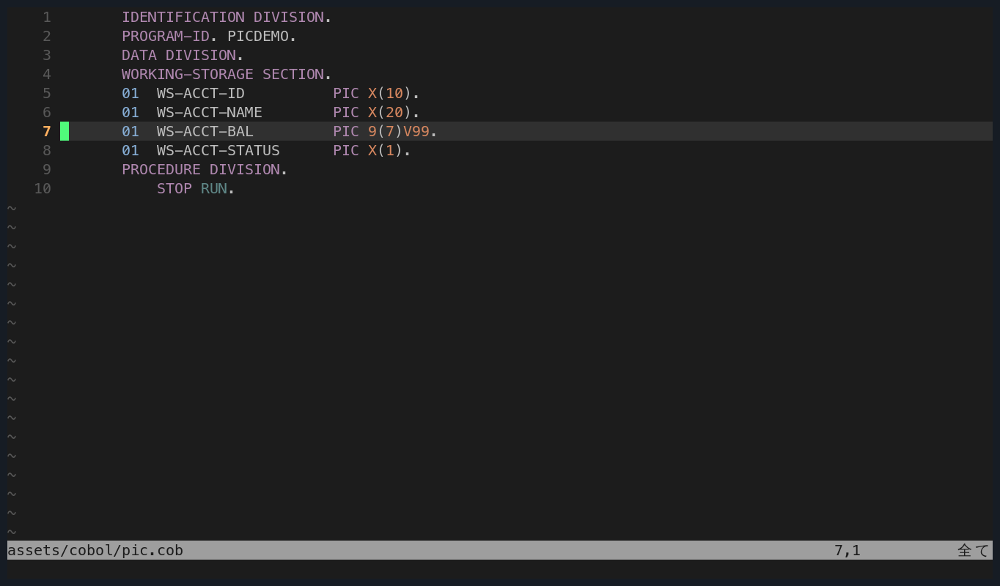

# 智能粘贴：smart-paste.nvim

把一段代码从浏览器、聊天窗口或另一个文件粘进 Neovim，最容易出的事是**缩进错乱**：粘贴内容带着原来的缩进，加上你当前的位置，变成锯齿状。

`smart-paste.nvim` 处理的是这件事：**保持块内的相对缩进，但把整块重新对齐到当前行。**

---

## 1. 它解决什么问题

| 粘贴方式 | 问题 |
|---|---|
| `p`（默认） | 字符级粘贴；多行内容的缩进按原样插入，逐层累积 |
| `P` | 同上，插在前面 |
| `:set paste` | 关掉所有缩进处理，但也会关掉补全和自动缩进 |
| `]p` | 按当前缩进调整，但会重排每一行 |

smart-paste 的做法：**保留块内部的相对缩进**，只把「第一行」对齐到当前行，其余按相对关系跟随。

## 2. 你的配置

`lua/plugins/smart-paste.lua`。这个插件的配置比其它长，因为它处理了三种粘贴来源：

1. **内部 yank**（vim 寄存器）
2. **系统剪贴板**（`+` 寄存器）
3. **终端粘贴**（`<C-S-v>` 或中键）

关键逻辑在配置注释里写得很清楚：

```lua
-- External clipboard registers are often characterwise. Keep their
-- relative indentation intact while rebasing the block to this line.
```

```lua
-- Characterwise yanks omit whitespace before the first selected byte.
-- Remember that missing prefix instead of guessing from nested lines.
```

**第二句是核心洞察**：字符级 yank 不包含行首空白。所以粘贴时必须记住「原来缺了多少空格」，而不是从内层行的缩进去猜。

## 3. 基本行为

### 内部 yank

```text
yy        复制一行
p         粘贴（自动对齐到当前缩进）
```

如果复制的是多行块：

```cobol
       IF WS-STATUS = "A"
           DISPLAY "ACTIVE"
       END-IF
```

在另一个同为 7 空格缩进的位置粘贴，结果是整块保持内部关系（`DISPLAY` 比 `IF` 多 4 空格），第一行对齐到粘贴点。

### 系统剪贴板

从浏览器复制一段 COBOL 代码，在 Neovim 里 `p`，同样会自动对齐。

### 终端粘贴

如果终端支持 bracketed paste，粘贴大段内容时同样走这套逻辑。




粘贴前的目标位置：字段在同一列，块内相对缩进必须保持。

## 4. COBOL 里的实际价值

### 场景一：从文档复制示例代码

课程 README 里有大量代码块。复制出来粘到 `.cob` 文件里时：

**没有 smart-paste**：README 里代码块缩进是 0，但 COBOL 要求 Area B 从第 12 列开始。粘进去后每行都要手动加 11 个空格。

**有 smart-paste**：把光标放到第 12 列，粘贴，整块自动从第 12 列开始。

### 场景二：复制一个 `IF` 块并改条件

```cobol
           IF WS-ACCOUNT-STATUS = "A"
               PERFORM 2000-POST-TRANSACTION
               ADD 1 TO WS-ACCEPTED-COUNT
           END-IF
```

复制这 4 行，粘到下面，整块的相对缩进保持不变（`PERFORM` 仍比 `IF` 多 4）。

### 场景三：从另一课搬代码

第 20 课的文件匹配逻辑搬到第 32 课，缩进层级一样，粘贴后不用重排。

## 5. 练习

### 练习 1：对比默认 `p` 和 smart-paste

```sh
cd ~/development/cobol
nvim lessons/17_fixed-length-files/lesson.cob
```

1. 找到一段有缩进的 `IF` 块，`V` 选中几行，`y`
2. 移到文件下方空行，`p`
3. `u` 撤销

**验收**：粘贴后块的内部缩进关系保持（子句比父句多几个空格），而不是全部顶到第 1 列。

### 练习 2：从 README 复制代码

1. 打开 `lessons/17_fixed-length-files/README.md`
2. 复制一个代码块内容（`V` 选中 + `y`）
3. 切到 `.cob` 文件
4. 光标移到第 12 列（`12|`）
5. `p`

**验收**：整块从第 12 列开始，而不是从第 1 列。

### 练习 3：系统剪贴板

1. 从浏览器或终端复制一段多行文本
2. 在 Neovim 里 `p`

**验收**：粘贴后没有出现逐行累加的锯齿缩进。

### 练习 4：粘贴整个函数到新文件

1. 复制一个完整的 `0100-INIT.` 段落
2. `:new` 打开新缓冲区
3. `p`

**验收**：段落的层级缩进完整保留。

## 6. 踩坑

### 粘贴后缩进反而多了

可能是终端把粘贴内容当作按键序列逐字符发送，触发了自动缩进。确认终端开启了 bracketed paste（多数现代终端默认开启）。

检查：

```vim
:set paste?
```

如果显示 `nopaste`，说明没被 `:set paste` 干扰——这是好事。

### 从剪贴板粘贴时首行缩进丢了

这是字符级 yank 的固有问题（配置注释提到的）。smart-paste 会记住「缺了多少」，但如果复制源本身就没缩进，它也只能按 0 处理。

**对策**：粘贴前把光标放到目标缩进位置，粘贴时以光标位置为基准。

### `p` 和 `P` 行为不同

`p` 粘在光标后/下一行，`P` 粘在光标前/上一行。多行块粘贴时这个差别很明显。**不确定时先 `u` 撤销再试另一个。**

### 大段粘贴很慢

smart-paste 要逐行处理缩进。几千行的粘贴可能卡顿一两秒，正常。

### 与 `:set paste` 冲突

`:set paste` 会关闭所有自动行为（包括 smart-paste 的调整）。**不要用 `:set paste`**，让插件处理。

## 7. 官方文档

仓库：<https://github.com/nemanjamalesija/smart-paste.nvim>

查看当前寄存器内容：

```vim
:reg +
:reg "
```

`+` 是系统剪贴板，`"` 是默认寄存器。

## 8. 边界

- 本插件的配置在你的 `lua/plugins/smart-paste.lua`，比其它插件长，因为它分别处理内部 yank、系统剪贴板、终端粘贴三种来源。
- 「保持相对缩进、重排到当前行」是它的设计目标；**不保证与任何特定缩进规则（如 `shiftwidth`）完全一致**。
- 从浏览器复制的内容可能带不可见字符（零宽空格、NBSP）。这些不是本插件能修的，需要 `:set list` 检查。
- 粘贴后仍建议用 `cobc -fsyntax-only` 验证，因为 COBOL 对列位置敏感。
