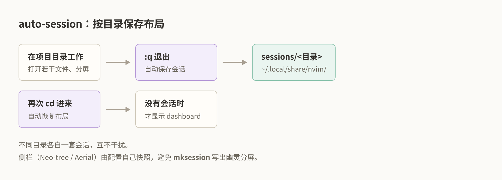

# 会话保存与恢复：auto-session

关掉 Neovim，第二天重新打开，**刚才开的 12 个文件、窗口布局、光标位置全没了**。

auto-session 按「项目目录」保存会话：每个目录一套布局，下次进这个目录自动恢复。

---

## 1. 它解决什么问题

| 需求 | 没有会话 | 有 auto-session |
|---|---|---|
| 恢复上次的文件 | 手动重开 | `cd` 进去自动恢复 |
| 保留窗口布局 | 重排分屏 | 布局保存 |
| 在多个项目间切换 | 各自重开 | 每个目录独立会话 |
| 找回上周的工作 | 靠记忆 | 会话列表 |

## 2. 你的配置

`lua/plugins/auto-session.lua`，`opts` 关键项：

| 选项 | 值 | 含义 |
|---|---|---|
| `auto_save` | `true` | 退出时自动保存 |
| `auto_restore` | `true` | 进入目录时自动恢复 |
| `auto_restore_last_session` | `false` | 不在启动时无条件恢复上次会话 |
| `args_allow_files_auto_save` | `true` | 用文件参数启动时也保存 |
| `git_auto_restore_on_branch_change` | `false` | 切分支不自动换会话 |

### 侧栏的额外处理

这个配置比默认复杂，因为它解决了 **Neo-tree / Aerial 侧栏在会话里的问题**。配置开头的注释说明了原因：

```lua
-- auto-session closes non-file windows in auto_save_session() *before*
-- pre_save_cmds. Snapshot first, keep neo-tree/aerial through that close
-- pass, then fold them ourselves so mksession cannot write ghost splits.
```

问题：`mksession` 会写出「幽灵分屏」——恢复后出现空白窗口。配置的解决办法是**先快照侧栏状态，再让 auto-session 正常关闭流程走完，最后自己重建侧栏**。

```lua
-- Restore is per-tab and per-file-window: a right-hand outline next to a
-- vsplit is not the same as "aerial is open".
```

恢复也是**按 tab、按窗口**的——右侧大纲配垂直分屏，和「Aerial 开着」不是一回事。

## 3. 按键

| 按键 | 命令 | 作用 |
|---|---|---|
| `<leader>wr` | `:AutoSession search` | 搜索/选择会话 |
| `<leader>ws` | `:AutoSession save` | 手动保存当前会话 |
| `<leader>wa` | `:AutoSession toggle` | 开关自动保存 |
| `<leader>wd` | `:AutoSession delete` | 删除当前会话 |

**注意这些键在 `<leader>w`（windows）组下**，因为会话本质是「窗口布局的保存」。



一个目录一套会话：退出时保存，回到该目录时恢复。

## 4. 工作方式

### 自动保存与恢复

1. 在 `~/development/cobol` 里工作，开了一堆文件
2. `:q` 退出 → **自动保存**该目录的会话
3. 下次 `cd ~/development/cobol && nvim` → **自动恢复**

每个目录一个会话，互不干扰。在 `cobol` 和 `cobol.nvim` 之间切换，布局各自保留。

### 会话存在哪

```sh
ls ~/.local/share/nvim/sessions/
```

文件名由目录路径编码。**不要手动改这些文件**——格式是 `mksession` 生成的，改错会导致恢复失败。

### 恢复失败会怎样

配置里有 `restore_missing_session_paths`，处理「会话里记录的文件已被移动/删除」的情况。它会尝试按会话记录的 cwd 重新解析路径。

## 5. 典型场景

### 场景一：跨天继续工作

```
晚上：改到一半，:q 退出
早上：cd ~/development/cobol && nvim
      → 昨天开的文件、分屏、光标位置全回来了
```

### 场景二：多个项目并行

```
~/development/cobol/        → 会话 A（课程编辑布局）
~/development/cobol.nvim/   → 会话 B（插件开发布局）
~/nvim/                     → 会话 C（配置编辑布局）
```

切目录就切布局，不用手动重开。

### 场景三：找回上周某个布局

```text
<leader>wr     搜索会话
```

按名字或路径模糊搜索，选中即恢复。

### 场景四：不要自动恢复

有时想干净开始：

```text
<leader>wa     关掉自动保存
:qa            退出
```

下次进入不会恢复。

## 6. 练习

### 练习 1：验证自动保存

```sh
cd ~/development/cobol
nvim
```

1. 打开两个文件（`:e lessons/17*/lesson.cob` 和 `:vsplit lessons/20*/lesson.cob`）
2. `:qa` 退出
3. 重新 `nvim`

**验收**：两个文件都恢复，分屏布局也恢复。

### 练习 2：手动保存

1. 打开一组文件
2. `<leader>ws`
3. `:qa`
4. 重新进入

**验收**：布局恢复。

### 练习 3：搜索会话

1. `<leader>wr`
2. 输入 `cobol` 看匹配

**验收**：能看到 `cobol` 目录的会话条目。

### 练习 4：验证目录隔离

1. 在 `~/development/cobol` 开文件 A
2. `:qa`
3. `cd ~/development/cobol.nvim && nvim`
4. 观察打开的是一套不同（或空）的布局

**验收**：两个目录的会话互不影响。

### 练习 5：删除会话

1. `<leader>wd`
2. 确认删除
3. 重新进入，布局是空的

**验收**：会话被清除。**这个操作不可撤销**，练习时注意选对目录。

## 7. 踩坑

### 恢复后出现空白分屏

配置专门处理了「幽灵分屏」问题，但如果你手动改过会话文件或用了其它插件，仍可能出现。解决：

```text
<leader>wd     删除该目录的会话
重新搭建布局
<leader>ws     重新保存
```

### 恢复后 Neo-tree / Aerial 不见了

配置会尝试恢复侧栏，但**恢复是按 tab 和窗口的**。如果你保存时的布局很特殊（比如两个 vsplit 各带一个大纲），可能部分丢失。

用 `<leader>fe` / `<leader>cs` 重新打开即可。

### 会话记录了已删除的文件

配置有 `restore_missing_session_paths` 处理，但如果整个目录被移动，还是会失败。删除会话重建。

### 想临时干净启动

```sh
nvim --clean      # 完全不用配置
```

或

```text
<leader>wa       关掉自动保存
:qa!
```

### 会话和 Git 分支

`git_auto_restore_on_branch_change = false`，所以切分支**不会**换会话。这是有意的——同一份文件在不同分支上布局通常相同。

## 8. 与其它插件的关系

| 插件 | 管什么 |
|---|---|
| auto-session | 文件、窗口布局、光标位置 |
| dashboard | 启动页（没有会话可恢复时显示） |
| neo-tree / aerial | 侧栏，由 auto-session 的扩展逻辑保存 |

配置注释提到：启动时若 Auto Session 找到项目会话，会先恢复会话；没有可恢复会话时才显示 Dashboard。

## 9. 官方文档

```vim
:h auto-session
:h auto-session-config
```

仓库：<https://github.com/rmagatti/auto-session>

## 10. 边界

- 本篇按键来自 `lua/plugins/auto-session.lua`：`<leader>wr`、`<leader>ws`、`<leader>wa`、`<leader>wd`（都在 `<leader>w` 组下）。
- 这个配置**显著复杂于插件默认**：它自己实现了侧栏（Neo-tree / Aerial）的快照与恢复，因为原生 `mksession` 会写出幽灵分屏。
- `<leader>wd`（删除会话）不可撤销。
- `rm -rf ~/.local/share/nvim/sessions/` 能清空所有会话，但会丢掉全部布局。
