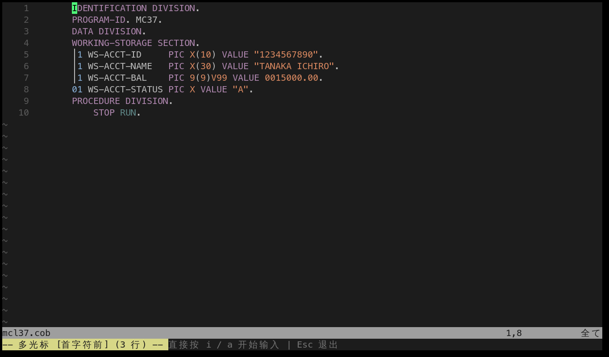

# 按行生成多光标：multicursor-line.nvim

`multicursor-line.nvim` 是自己开发的 Neovim 插件。它把 Vim 已经选中的行或矩形区域，转换成一组位置一致的光标：每行首个非空字符前、绝对行首、行尾，或行首尾交替。选好范围、按一次快捷键，就可以在这些位置同时编辑。

这是独立于 `multicursor.nvim` 的插件教程。本文以本机 `lua/plugins/multicursor-line.lua` 的配置和插件实现为准。

## 1. 先选范围，再生成光标

基本流程：

1. 用 Vim 原生动作选中要编辑的行：`Vj` 选两行、`vip` 选当前段落、`ggVG` 选整个文件。
2. 在可视模式按一种布局键，例如 `<leader>mh`。
3. 插件在每一行对应的位置生成多光标。
4. 按 `i` 或 `a` 同时输入；退格也会同步作用于所有光标。
5. 按 `<Esc>` 结束多光标编辑。

它的关键是“先选后按”：插件只处理选中的行，不会自行猜测要改哪些行。



这张实拍图使用 native 后端：每行缩进空格被跳过，光标落在 `01` 前。按 `i` 即可开始同步输入。

## 2. 五种光标布局

| 布局 | 位置 | 常用映射 |
|---|---|---|
| 智能行首（head） | 每行首个非空字符前，跳过缩进 | 可视模式 `<leader>h`；普通模式 `<leader>mh` |
| 绝对行首（bol） | 第 0 列，缩进空格之前 | 可视模式 `<leader>H` / `<leader>0`；普通模式 `<leader>mH` / `<leader>m0` |
| 行尾（tail） | 每行最后一个字符之后 | 可视模式 `<leader>t`；普通模式 `<leader>mt` |
| 首尾交替 | 行尾与首字符前交替 | 可视模式 `<leader>a`；普通模式 `<leader>ma` |
| 绝对首尾交替 | 行尾与第 0 列交替 | 可视模式 `<leader>A`；普通模式 `<leader>mA` |

可视模式快捷键适合先精确框出范围；`<leader>m…` 助记映射也注册在普通模式，会按当前行和计数前缀确定行范围。要修改不连续的行，可视块 `<C-v>` 也能作为选区来源。

## 3. 用 COBOL 行首批量插入

例如，需要给多行 COBOL 声明统一加前缀：

```cobol
       01 WS-ACCT-ID     PIC X(10).
       01 WS-ACCT-NAME   PIC X(30).
       01 WS-ACCT-BAL    PIC 9(9)V99.
```

1. 将光标移到第一行，按 `V`，再用 `j` 选中要改的声明。
2. 按 `<leader>mh`，在每行第一个非空字符前生成光标。
3. 按 `i` 并输入内容；所有光标会同步输入。
4. 按 `<Esc>` 结束。

如果要在 Area A 前、包括缩进位置一起插入，选择 `<leader>m0`（绝对行首）。普通模式下也可用 `2<leader>mh` 对当前行和下一行加光标；先从少量行开始确认范围，再输入。

## 4. 命令与范围

插件也提供 Ex 命令，可在命令行指定范围：

| 命令 | 布局 |
|---|---|
| `:[range]McLineHead` | 每行首个非空字符前 |
| `:[range]McLineBol` | 每行第 0 列 |
| `:[range]McLineTail` | 每行行尾 |
| `:[range]McLineAlt` | 行尾与首个非空字符前交替 |
| `:[range]McLineAltBol` | 行尾与第 0 列交替 |
| `:McLineClear` | 清除当前多光标会话 |

例如 `:10,15McLineTail` 在第 10 到 15 行生成行尾光标。提交编辑前，检查所有光标是否都落在预期列；不同长度或空白行会让行尾位置不同，这是 tail 布局的预期行为。

## 5. 后端与实现边界

本机配置使用 `backend = "native"`。native 后端根据每行计算位置并批量更新缓冲区，不需要为每个光标维护一处搜索高亮；插件也保留 `vm` 和 `multicursor` 后端选项，适用于需要对应后端功能的场景。

智能行首会跳过各行缩进；绝对行首则会把光标放到第 0 列。首尾交替的起始方向由 `alternate_start` 控制，本机设置为 `tail`。矩形块选择会使用矩形边缘生成对应位置。

插件负责生成光标位置；多光标模式下的同步输入与退格由所选后端提供。按 `<Esc>` 退出后再继续普通编辑。大范围编辑前建议先在少量行练习并检查结果。

## 6. 与现有多光标插件的分工

| 工具 | 适合的任务 |
|---|---|
| `multicursor-line.nvim` | 已知行范围内按首字符、行首、行尾或交替位置批量加光标 |
| `multicursor.nvim` | 按 motion、段落或匹配结果逐步加光标，例如 `gaip` |
| `vim-visual-multi` | 交互式选中重复单词、跳过匹配、移动或调整光标集合 |

它们可以配合使用，但解决的问题不同。行布局明确时，用 `multicursor-line.nvim` 最直接；按内容匹配时，`multicursor.nvim` 或 `vim-visual-multi` 更合适。

### 本机按键冲突

`lua/plugins/bookmark.lua` 与 `multicursor-line.nvim` 都注册普通模式 `<leader>mt`。加载顺序会决定普通模式下哪一个映射生效；可运行 `:verbose nmap <leader>mt` 查看实际来源。`multicursor-line` 的可视模式 `<leader>mt` 是单独注册的。需要避免歧义时，使用 `:McLineTail` 或调整本机映射。

## 7. 练习

### 练习一：智能行首

1. 选中三条 COBOL 数据声明。
2. 按 `<leader>mh`，确认每个光标都在 `01` 前，而不是缩进空格前。
3. 输入一个短前缀，然后按 `<Esc>`。

**验收**：三行都得到相同前缀，缩进没有被替换。

### 练习二：首尾交替

选中四行后按 `<leader>ma`，确认光标在行尾和首个非空字符前交替排列。按 `<Esc>` 清除，再用 `<leader>mA` 观察绝对行首的差别。

### 练习三：命令范围

运行 `:10,12McLineTail`，确认只在第 10 至 12 行生成行尾光标，再用 `:McLineClear` 清除。

## 8. 故障排查

- **按键没有反应**：确认仍在可视模式且选区非空；查看 `:verbose xmap <leader>mh`。
- **普通模式 `<leader>mt` 触发了书签**：运行 `:verbose nmap <leader>mt` 检查映射来源，或改用 `:McLineTail`。
- **光标位置不符合预期**：重新检查选择范围和布局模式；head 会跳过缩进，bol 会保留缩进前的绝对第 0 列。
- **不想继续批量编辑**：按 `<Esc>` 退出；需要显式清理时运行 `:McLineClear`。

## 9. 项目与文档

- 本机配置：`lua/plugins/multicursor-line.lua`
- 插件源码与说明：<https://github.com/iamcheyan/multicursor-line.nvim>
- Neovim 帮助：`:help multicursor-line`

本篇依据本机配置和插件文档编写。性能数字来自插件 README 的基准说明，未在本教程中独立复测。
