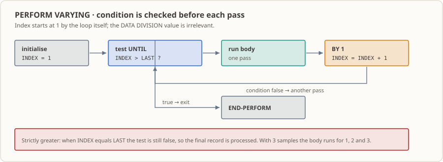

# 第 06 课：PERFORM 重复处理——让同一套逻辑跑完十二万笔

## 业务现场

凌晨 0:30，城商行的日终批次开始跑。白天柜面和手机银行产生的交易被导成一个文件，扔在共享目录里。

师父跟你说了一句话，你记住就行：**"到底多少笔，晚上七点跑汇总的时候才知道。"**

这句话的意思是，你写代码的时候，不能假设"就三笔"。可能是 120 笔，可能是 12 万笔，也可能某天一笔都没有——而你的程序都得一样地跑。

那你打算怎么办？把"处理一笔交易"的代码复制十二万遍？

现实里没人这么干。批处理的套路是：**写一遍"怎么处理一笔"，然后让机器照着跑 N 遍**。本课要学的就是那个"跑 N 遍"的写法。

顺便说个真实事故高发区。银行里循环出过的岔子几乎都卡在边界上：

- 上限那一笔到底算不算？写了"小于上限"就会永远少处理最后一笔，账上就少一笔钱；
- 某天一笔都没有，程序会不会还是傻乎乎地跑一轮，去读一条不存在的数据？
- 序号从 1 还是从 0 开始？上游按 1 编号，你按 0 开始，第一笔就直接对错位。

这三个问题不是语法问题，是**业务问题**。本课会把它们讲透。

## 为什么现在学

前一课你已经能用 `IF` 判断"这一笔该接受还是拒绝"。但那只处理了一笔：代码从上往下走一遍，结束。

银行批处理里没有"一笔"这回事。一个交易文件少则几百条、多则几十万条，程序必须能在不知道具体条数的前提下把整个文件走完。这就是"重复"这件事的用途——而 COBOL 给你的工具叫 `PERFORM VARYING`。

你可能会说，`for` 循环我熟啊。对，思路差不多，但有两个地方得改掉你的直觉：

1. **不检查条件就进循环体**。COBOL 的 `UNTIL` 是"每轮开始前先看一眼"，条件一真就根本不进去。所以"一笔都没有"的时候它就是老老实实一次都不跑——这恰好是我们要的。
2. **边界要靠你算清楚**。循环写"索引大于上限就退出"，那上限那一笔就会老老实实被执行；写成"大于等于"，最后一笔就永远丢了。这种一分钱都不差的地方，是审代码的人一眼就会盯的地方。

## 这个知识点是什么，它解决什么问题

**这个知识点是什么。** 一个带计数器的循环：给索引一个起点（`FROM`）、一个步长（`BY`）、一个退出条件（`UNTIL`），然后重复执行循环体直到条件成立。索引、步长、条件这三样东西共同决定"到底跑几轮"。

**它在业务里解决什么问题。** 把"处理一笔"的逻辑和"处理多少笔"的控制分开。业务代码只关心"一笔怎么处理"，数量交给循环。这样：

- 上游今天给 3 笔、明天给 12 万笔，程序代码一个字都不用改；
- 审批的人能在一处看到"边界到底是包含还是排除"，不用去十几个地方找；
- 出事的时候，加一个计数器就能回答"到底处理了多少笔"——这是对账的第一句话。

**什么时候不该用它。** 需要"按键查找"或者"内存里的小表"时，用循环硬找又慢又笨（那是第 11–13 课 `OCCURS`/`SEARCH` 的活）；需要遍历数据库结果集时，用的是游标而不是这个计数循环（第 30 课）。

## 本课完成后的能力与边界

学完本课后，你可以：

- 写出 `PERFORM VARYING <索引> FROM <起点> BY <步长> UNTIL <退出条件> ... END-PERFORM`，并说清每一部分管什么。
- 算出一段循环到底跑几轮，并解释起点、步长、退出条件各自如何影响轮数。
- 说清"索引大于上限才退出"为什么会让上限那一笔也被处理。
- 把上限改成 0、1、3、4 分别跑一遍，观察零笔、一笔、正常和"超出样例范围"四种情况下输出与计数怎么变。
- 用 `END-PERFORM` 划清循环范围，并在循环结束后报告实际处理笔数。

边界：本课的"交易"只有三笔，而且是写在程序里的固定样例——真实批次里它们来自文件（第 15 课起）。循环上界是一个字段，程序不会去校验"这个上界对应的数据到底存不存在"，这个坑本课会故意踩给你看。内存表格（`OCCURS`）在第 11 课，文件读取在第 15 课。

## 运行环境

- GnuCOBOL 3.2.0，默认方言（不加 `-std=cobol85`），源文件为固定格式。
- Linux 终端；本课不依赖数据库或附加工具。
- 语法检查与编译在 `build/` 下生成可执行文件，随时可以删掉重来。

## 循环到底怎么写



```cobol
PERFORM VARYING WS-SAMPLE-INDEX FROM 1 BY 1
    UNTIL WS-SAMPLE-INDEX > WS-LAST-SAMPLE
    ...循环体...
END-PERFORM
```

一行一行看：

- `FROM 1`：索引进门就从 1 开始。注意这是**循环自己设的**，跟你在 `DATA DIVISION` 里写的初值无关。
- `BY 1`：跑完一轮，索引加 1。想每次跳两个（比如只处理奇数笔）就写 `BY 2`。
- `UNTIL 索引 > 上限`：每轮开始前先检查。条件一旦成立，本轮不执行，循环结束。
- 用的是**严格大于**，所以"索引 == 上限"时条件还假着，这一轮照跑。这就是"上限那一笔也会被处理"的来源。
- `END-PERFORM` 把循环范围圈起来。别在循环体里随手写句号——句点会把更大的语句范围提前关掉，这种 bug 找起来很烦。

## 样例程序：三笔固定交易

完整源码见 [`lesson.cob`](./lesson.cob)，按固定格式编写。

这里要先交代一件事：**这一课还没教表格**（那是第 11 课），所以"第 1 笔、第 2 笔、第 3 笔"暂时是用 `EVALUATE` 按序号硬挑的：

| 序号 | 符号 | 金额 |
|---:|---|---:|
| 1 | `D`（存款） | 125.50 |
| 2 | `W`（取款） | 040.10 |
| 3 | `T`（转账） | 075.00 |

这只是脚手架——等第 11 课有了 `OCCURS` 表格，同样的循环会改成按序号去表里取，那才是真实批次的写法。

程序里三个字段的分工：

| 字段 | PIC / 初值 | 干什么用 |
|---|---|---|
| `WS-LAST-SAMPLE` | `9` / `3` | 最后一笔的序号，**包含**这个序号 |
| `WS-SAMPLE-INDEX` | `9` / `0` | 循环的计数器；一进门由 `FROM 1` 设成 1 |
| `WS-PROCESSED-COUNT` | `9(3)` / `0` | 每跑完一轮加 1，循环结束后就是"实际处理了多少笔" |

最后提醒一个数字上的细节：这个上界只管"跑几轮"，**它不检查数据到底存不存在**。你要是把上界改成 4，循环照样跑第四轮，`EVALUATE` 的 `WHEN OTHER` 会打印 `例=UNMAPPED`——一个不存在的样例。真实系统里这种"配置和数据不一致"就是要靠日志和计数抓出来的问题。

## 一轮一轮看它怎么跑

1. `WORKING-STORAGE` 先把"最后一笔序号"和"处理计数"设好。索引不用管，`FROM 1` 会设。
2. 先打印一行当前的上界，方便你对照。
3. `PERFORM VARYING` 开始：设置索引 → 检查 `UNTIL` → 条件假就进循环体。
4. 循环体里 `EVALUATE WS-SAMPLE-INDEX` 按当前序号挑出对应的符号和金额并打印。
5. 一轮结束，`COMPUTE` 把处理计数加 1。
6. 循环结束后打印处理笔数。上界是 0 的时候，第一次检查就是"1 > 0"成立，循环体一次都不跑，计数停在 `000`。
7. `STOP RUN.` 正常结束。

## 运行与观察

本课不读键盘、文件或数据库，所以在哪个目录跑结果都一样。

**输入：** 没有。三笔样例写死在程序里，循环跑几轮由 `WS-LAST-SAMPLE` 的初值决定。

**命令和各步在干什么：**

```sh
mkdir -p build
cobc -fsyntax-only lesson.cob                  # 只做语法检查
cobc -x -Wall -o build/lesson_06 lesson.cob    # 编译并生成可执行文件
./build/lesson_06                              # 运行，输出到标准输出
echo $?                                        # 查看退出码
rm -rf build                                   # 清理生成的可执行文件
```

**预期结果（上界默认是 3）：**

| 观察项 | 预期值 |
|---|---|
| `cobc -fsyntax-only` 退出码 | `0` |
| `cobc -x` 退出码 | `0`，没有编译诊断 |
| 标准输出 | 5 行，见下面代码块 |
| 进程退出码 | `0` |

```text
最終サンプル番号=3
例=001 符号=D 額=125.50
例=002 符号=W 額=040.10
例=003 符号=T 額=075.00
処理件数=003
```

**输出里那几个日文词：** `最終サンプル番号` 是"最后一笔序号"，`例` 是"第几笔"，`符号` 是交易符号（`D` 存、`W` 取、`T` 转），`額` 是金额，`処理件数` 是实际处理笔数。

**实际观察到的环境细节：** 运行时标准错误上会出现 `Warning: program compiled against libxml 212 using older 209`；这是运行环境的链接库警告，不是程序打印的业务内容。真正的输出在标准输出，退出码 0。

## 修改练习

从原始 [`lesson.cob`](./lesson.cob) 动手，把 `WS-LAST-SAMPLE` 的初值依次改成 `0`、`1`、`3`、`4`，每次都重新编译运行，记下：这次显示了几笔样例、`WS-PROCESSED-COUNT` 是多少、最后一轮有没有掉进 `UNMAPPED`。

这四种情况正好对应零笔、一笔、正常、超范围——真实批处理上线前必须逐个验证的就是这几个数。完整题目与预期见 [`exercise.md`](./exercise.md)，参考答案见 [`answer.md`](./answer.md)。

## 举一反三练习

把固定样例换成四笔支付记录，还是用 `PERFORM VARYING` 顺序处理：每轮输出序号、类别和金额，最后报告一共处理了多少笔；最后序号为 0 的时候一笔都不能处理。暂时照旧用 `EVALUATE` 按序号取样例，不要提前上表格或文件。题目见 [`exercise.md`](./exercise.md)，本题不提供答案。

## 走一遍真实流程

把它放进那个凌晨 0:30 的批次：

1. 前一天的交易被导成文件，落在共享目录（这一步在第 15 课变成你亲手读文件）。
2. 你的程序打开文件，读一条、处理一条——"处理一条"就是本课循环体里的事，"读多少条"由文件自己的结尾决定，而不是你写死的上界。
3. 跑完打印总笔数，写进日志（第 27 课）。这个数字第二天会有人拿它跟上游的笔数对账：**对不上就说明有记录被漏掉或者重复处理了**。

也就是说，本课这个小小的 `処理件数` 不是装饰，它是真实对账的第一道防线。

## 这份代码进了生产会怎样

- **谁调度它**：夜间批处理调度器，通常排在"文件就绪检查"之后。
- **谁看它的输出**：值班的人先看退出码，再看笔数。笔数不对，当晚就要查。
- **下一个系统怎么接**：处理完的结果会被写成结果文件交给下游（第 16 课），或者写进数据库（第 29 课起）。
- **第一个月最容易出的事故**：边界写错，最后一笔被漏掉。这种错在测试的十笔数据上看不出来，在十二万笔的晚上必然爆发——所以本课才逼着你把 0/1/3/4 四种情况都跑一遍。
- **它还没做的事**：读文件、校验记录、处理读取失败。上界错了它只会多跑一轮打印 `UNMAPPED`，并不会自己停下来报警。这些要到第 15 课和第 26 课才补上。

## 参考资料

- [GnuCOBOL Programmer’s Guide：PERFORM](https://gnucobol.sourceforge.io/HTML/gnucobpg.html#PERFORM)
- [GnuCOBOL Programmer’s Guide：Inline PERFORM](https://gnucobol.sourceforge.io/HTML/gnucobpg.html#Inline-PERFORM)
- [GnuCOBOL Manual：PERFORM loop example](https://gnucobol.sourceforge.io/doc/gnucobol.html)
- 仓库课程主页：[README.md](../../README.md)
