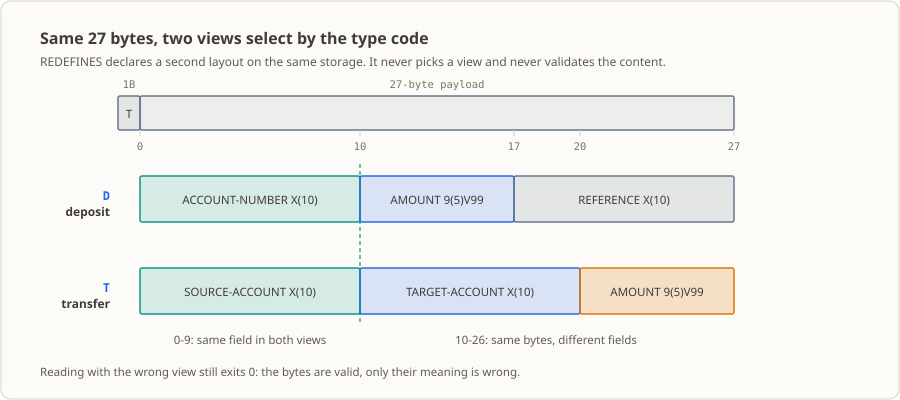

# 第 10 课：REDEFINES——同一段 27 字节，存款和转账两种读法

同一段 27 字节，交易码写 `D` 就按「账户号 + 金额 + 参考号」读，写 `T` 就按「来源账户 + 目标账户 + 金额」读。这一课把这两种读法塞进同一块存储、共用同一个偏移，然后再用**错的读法**读一遍——你会看到读错了程序照样正常结束，退出码还是 `0`。

## 业务现场

早上 7 点 50，你刚坐下，清算组的同事隔着工位喊你：昨天那批转账报文到了，十二万四千条，柜面 9 点开门之前得把金额汇总出来。

那份报文的接口文档只有一行格式说明：**1 字节类型码 + 27 字节定长负载**。类型码 `D`，后面 27 字节按「账户号 + 金额 + 参考号」读；类型码 `T`，同样这 27 字节按「来源账户 + 目标账户 + 金额」读。文档到此为止，剩下全没说——尤其没写「读错了会怎样」。

你手里只有上一课那点本事：一条记录、一种解释。要是老老实实把两个 `05` 负载并列声明，它们就各占 27 字节，整条记录从 28 字节涨到 55 字节，从第 2 字节起就跟报文对不上，读到的东西全错位。而错位这件事最阴的地方是它不叫：类型码明明是 `T`，程序却拿存款视图去读，读到一堆错位的字节，**程序照样正常结束，退出码 `0`**，日志干干净净。账错在没人看的地方，通常要等到有客户打电话来问余额才被发现。

这一课要学的，就是让两个视图老老实实压在**同一块存储**上，并且记住：谁选视图、谁校验内容，都不是 `REDEFINES` 的事。

（以上机构、金额、批次日都是为讲清问题编出来的教学演示，不对应任何真实机构或真实数据。）

## 这个知识点是什么，它解决什么问题

**这个知识点是什么。** 同一块内存，允许你挂两套字段名、两套布局，谁也不给谁让位。COBOL 里的写法就是在第二个声明后面加一句 `REDEFINES`：

```cobol
          05 WS-DEPOSIT-PAYLOAD.
             10 WS-ACCOUNT-NUMBER PIC X(10).
             ...
          05 WS-TRANSFER-PAYLOAD REDEFINES WS-DEPOSIT-PAYLOAD.
             10 WS-SOURCE-ACCOUNT PIC X(10).
             ...
```

人话就是：**`WS-TRANSFER-PAYLOAD` 这块地方，就是刚才那块**。存储只有一份，两个组名只是两个入口；你用哪个字段名去读，就得到哪一种解释。

**它在业务里解决什么问题。** 上游把不同业务塞进同一个定长报文（这是接口规范里最常见、也最容易出事的一种设计），接收方就得「一段字节、多种解释」。有了它，你才能：记录宽度跟上游文档一字节不差地对齐；不用为每种交易类型单独开一套字段、把记录撑成两倍；偏移表能写成一张纸，写测试时能拿字节位置手算预期值。

**什么时候不该用它。** 三种情况要绕开：

- 两份数据要**同时存在**（比如原值和新值都要留下），那就各占各的字节，别重定义——重定义是「叠写」，写第二个视图就把第一个视图的字节盖掉了。
- 想顺手做**格式转换**（数字变显示格式之类），别指望它：它一个字节都不动、一个字符都不转。
- 需要**判断该用哪个视图**，那是 `IF`/`EVALUATE`（第 [04](../04_if-conditions/README.md)/[05](../05_evaluate/README.md) 课）的活。`REDEFINES` 只声明布局，既不选视图，也不校验内容。

## 为什么现在学

你可能会想：上一课那棵层级记录树不是挺好吗，怎么又不够了？

是够用，但只管一种解释。第 [09](../09_group-items/README.md) 课你学会了把客户、账户、交易字段组织成一条记录，可那条记录从第 2 字节到最后，含义是写死的。现在同一条物理报文要按交易类型换布局：`D` 的负载是存款三件套，`T` 的负载是转账三件套。

把两个 `05` 组并列声明行不行？存不了——它俩会各占 27 字节，记录被撑成 55 字节，跟报文长度对不上；更要命的是**没有任何一行代码能表达「这两组其实在同一位置」**。维护的人读到第二组，只会以为那是另一块新地方。

`REDEFINES` 补的就是这一句声明，顺带把长度和声明位置的硬约束一起给了你。往后几课全踩着这个前提走：第 [11](../11_occurs-tables/README.md) 课用 `OCCURS` 把「交易码 + 金额」的出现项重复成表，第 [14](../14_data-structures-practice/README.md) 课把这份 27 字节负载放进内存账户匹配，第 [17](../17_fixed-length-files/README.md) 课把它落成真实定长文件，第 [23](../23_copybooks/README.md) 课用 Copybook 把布局共享给别的程序——它们的起点都是「一段字节、多种解释」。

## 本课完成后的能力与边界

学完本课后，你可以：

- 在一个 `01` 记录内为负载区声明两个同层 `05` 视图，说明它们从同一偏移开始、不额外占用存储。
- 用本课的字节清单核对 28 字节记录的偏移与长度，并解释 `9(5)V99` 为什么存储 7 字节却显示 8 个字符。
- 预测按第二个视图写入后，12 行输出里哪几行改变、哪几行不变，并用字节位置算出新值。
- 复现两类边界：重定义项更长会让编译失败；把字母放进 `9(5)V99` 覆盖的字节不会报错。
- 说明 `REDEFINES` 不拷贝、不转换、不校验——交易码与负载内容的相符关系只能由接口契约保证。

边界：本课不读终端、文件或数据库，样例值全是程序内常量；程序不按交易码分支，只是把两个视图各打印一次。`OCCURS` 表格见第 [11](../11_occurs-tables/README.md) 课，真实定长报文的读取见第 [17](../17_fixed-length-files/README.md) 课，共享布局见第 [23](../23_copybooks/README.md) 课，而负载内容的校验与拒绝策略要到第 [15](../15_sequential-file-read/README.md) 课之后有了真实输入、并在第 [26](../26_error-handling/README.md) 课才系统处理。

## 运行环境

- GnuCOBOL 3.2.0，默认方言（不加 `-std=cobol85`），源文件为固定格式：第 7 列指示符、Area A 从第 8 列、Area B 从第 12 列起，程序文本不越过第 72 列。
- Linux 终端，无需数据库、附加工具或第三方库。
- 命令在本课目录 `lessons/10_redefines/` 下执行；源码参数写的是 `lesson.cob`，换目录执行要自己改路径。

## 同一段字节，两种布局



`lesson.cob` 里只有一条 `01` 记录：第 1 字节是交易码（**不在**重定义区里），第 2–28 字节是那 27 字节负载区。存款（`D`）的负载是「账户号、金额、参考号」，转账（`T`）的是「来源账户、目标账户、金额」；两个视图都从负载区第 1 字节开始、都占 27 字节，所以它们对齐在同一块存储上。

`REDEFINES` 让重定义项（object）占用被重定义项（subject）的同一段物理存储。它不是第二份存储，也不是转换：**同一批字节，看你用哪个字段名去读**。写第二个视图，就是拿新字段名往那块老地方盖一遍。

跟第 [09](../09_group-items/README.md) 课的差别也在这儿。那一课讲层级本身（组项、基本项、用 `OF` 限定同名子项）；这一课讲**同一个层级位置上的两种解释**——两个视图的字段名之间没有 `OF` 前缀关系，读同一批字节，两组值可以完全不同，而且都「合法」。

## REDEFINES 的硬性约束

GnuCOBOL Programmer's Guide 6.9.37 列了下面几条，本课逐条满足。层级号和紧邻位置由编译器看着，等长、`OCCURS`、`VALUE` 这几条得你自己盯——实测里工具链只拦了等长的一个方向，这正是它容易出事故的原因：

- subject 与 object 层级号必须相同（本例同为 `05`），且不能是 66、78、88 级。
- object 必须紧邻 subject：两者之间不得插入同级的其他数据项（除非它们也是该 subject 的 `REDEFINES`），也不得插入层级号更小的项。本机把 `REDEFINES` 挪到其他数据项之后，诊断是 `error: REDEFINES 句は参照元の項目の直後になければなりません`，返回码 `1`。
- 两者的**总分配字节数必须相同**。这条千万别以为"编译器会拦住我"。本机实测这台 GnuCOBOL 3.2.0 只在 **object 更大**时报错：把 `WS-TARGET-ACCOUNT` 改成 `X(11)`（28 字节 > 27 字节）后 `cobc -fsyntax-only` 返回码 `1`，诊断 `error: larger REDEFINES used`；改成 `X(9)`（26 字节）却能编译通过（返回码 `0`），此时 subject 尾部多出的字节不在第二个视图的声明范围内。所以「等长」是**你要自己保证**的规则，编译通过不等于合规。
- subject 和 object 自身不得带 `OCCURS`；两者都是组项时，组内子项可以有。
- object 及其从属项不得写 `VALUE`（88 级条件名除外）。本机实测对 `WS-TRANSFER-PAYLOAD` 加 `VALUE "X"` 并没有在编译期被拒绝（返回码 `0`），可同一段共享字节被两个视图各自初始化，语义上是含混的——所以本课把负载初值老老实实留在过程部，用 `MOVE` 显式写入。

## 视图不会自动校验

`REDEFINES` 只声明布局，它不做三件事：不拷贝（第二次写入直接覆盖第一次的 27 字节）、不转换（`9(5)V99` 不会把 `X` 视图里的字母变成数字）、不校验（没人检查交易码跟哪个视图相符）。

本课最后 4 行输出就是故意破坏契约的样子：转账的字节被当成存款读，程序照样正常结束、退出码仍是 `0`。**那到底谁在选视图？** 业务类型码，也就是上游接口契约。你可以自己去 `lesson.cob` 里找——本课程序只把交易码原样打印出来，一个字都没拿它做判断。

## 输入与规则

**输入：** 无外部输入。样例值全部是 `lesson.cob` 过程部里的 `MOVE` 字面量，不读键盘、文件或数据库，所以每次运行结果完全一样。

**字节布局（本机用 `FUNCTION LENGTH` 实测）：** 记录 28 字节 = 交易码 1 字节 + 负载区 27 字节；`WS-DEPOSIT-PAYLOAD` 与 `WS-TRANSFER-PAYLOAD` 都是 27 字节。位置按负载区（或记录）第 1 字节起算：

| 视图 | 基本项 | `PIC` / 字节 | 负载区内位置 | 记录内位置 |
|---|---|---|---:|---:|
| 存款 `D` | `WS-ACCOUNT-NUMBER` | `X(10)` / 10 | 1–10 | 2–11 |
| 存款 `D` | `WS-DEPOSIT-AMOUNT` | `9(5)V99` / 7 | 11–17 | 12–18 |
| 存款 `D` | `WS-REFERENCE` | `X(10)` / 10 | 18–27 | 19–28 |
| 转账 `T` | `WS-SOURCE-ACCOUNT` | `X(10)` / 10 | 1–10 | 2–11 |
| 转账 `T` | `WS-TARGET-ACCOUNT` | `X(10)` / 10 | 11–20 | 12–21 |
| 转账 `T` | `WS-TRANSFER-AMOUNT` | `9(5)V99` / 7 | 21–27 | 22–28 |

`PIC 9(5)V99` 存 7 个数字位，`V` 是隐含小数点、**不占存储**，只在 `DISPLAY` 时按位置渲染，所以显示成 8 个字符的 `00125.50`。本课金额是两位小数的演示记账单位，没有币种字段；程序只做 `MOVE` 和 `DISPLAY`，不做算术，因此不涉及舍入与溢出。

**规则、前提与校验责任人：**

| 规则 / 前提 | 由谁保证 | 本课是否校验 |
|---|---|---|
| 两个视图总长相同（27 字节） | 手册规则；本工具链只在 object 更大时报错 | 部分——更长会编译失败，更短会静默通过 |
| object 紧邻 subject 且同为 `05` 级 | 编译器 | 是，违反则编译失败 |
| 交易码与负载布局的对应（`D`=存款、`T`=转账） | 上游接口契约 | **否**，程序只回显交易码 |
| 负载字节内容符合所选视图的字段类型 | 上游接口契约 | **否**——把字母放进 `9(5)V99` 覆盖的字节不会报错 |
| 存款负载被转账负载覆盖后不再是有效存款记录 | 使用者的解读纪律 | **否**，程序不做任何判断 |

演示数据说明：账户号、金额和参考号都是教学演示值，不代表任何真实业务政策。

## 完整示例源码

完整源码见 [`lesson.cob`](./lesson.cob)，按固定格式编写。

```cobol
       IDENTIFICATION DIVISION.
       PROGRAM-ID. REDEF10.
       DATA DIVISION.
       WORKING-STORAGE SECTION.
       01 WS-TRANSACTION-RECORD.
          05 WS-TRANSACTION-CODE PIC X.
          05 WS-DEPOSIT-PAYLOAD.
             10 WS-ACCOUNT-NUMBER PIC X(10).
             10 WS-DEPOSIT-AMOUNT PIC 9(5)V99.
             10 WS-REFERENCE PIC X(10).
          05 WS-TRANSFER-PAYLOAD REDEFINES WS-DEPOSIT-PAYLOAD.
             10 WS-SOURCE-ACCOUNT PIC X(10).
             10 WS-TARGET-ACCOUNT PIC X(10).
             10 WS-TRANSFER-AMOUNT PIC 9(5)V99.
       PROCEDURE DIVISION.
       0000-MAIN.
           PERFORM 1000-LOAD-DEPOSIT
           PERFORM 2000-LOAD-TRANSFER
           STOP RUN.
       1000-LOAD-DEPOSIT.
           MOVE "D" TO WS-TRANSACTION-CODE
           MOVE "0001234567" TO WS-ACCOUNT-NUMBER
           MOVE 125.50 TO WS-DEPOSIT-AMOUNT
           MOVE "TXN-000001" TO WS-REFERENCE
           DISPLAY "取引種別=" WS-TRANSACTION-CODE
           DISPLAY "入金口座=" WS-ACCOUNT-NUMBER
           DISPLAY "入金額=" WS-DEPOSIT-AMOUNT
           DISPLAY "入金参照番号=" WS-REFERENCE.
       2000-LOAD-TRANSFER.
           MOVE "T" TO WS-TRANSACTION-CODE
           MOVE "0001234567" TO WS-SOURCE-ACCOUNT
           MOVE "0007654321" TO WS-TARGET-ACCOUNT
           MOVE 250.75 TO WS-TRANSFER-AMOUNT
           DISPLAY "取引種別=" WS-TRANSACTION-CODE
           DISPLAY "振込元口座=" WS-SOURCE-ACCOUNT
           DISPLAY "振込先口座=" WS-TARGET-ACCOUNT
           DISPLAY "振込金額=" WS-TRANSFER-AMOUNT
           DISPLAY "同じバイト列の入金ビュー:"
           DISPLAY "口座=" WS-ACCOUNT-NUMBER
           DISPLAY "金額=" WS-DEPOSIT-AMOUNT
           DISPLAY "参照番号=" WS-REFERENCE.
```

上面省略了源码中的注释行。源码注释只写规则与契约（样例值固定在程序内、交易码由接口契约保证且 `REDEFINES` 不校验也不选择视图、重定义项必须紧邻且不得更长、最后 4 条 `DISPLAY` 是故意错读），不逐条复述 `DISPLAY` 的文本。

## 源码阅读路径

顺着「数据什么时候被改、谁在读它」看，五步就够：

1. `01 WS-TRANSACTION-RECORD`（28 字节）：第 1 字节是交易码，第 2 字节起才是负载区。两个视图都从负载区第 1 字节开始，所以后面改交易码动不到负载字节。
2. `05 WS-DEPOSIT-PAYLOAD` 与紧邻的 `05 WS-TRANSFER-PAYLOAD REDEFINES ...`：同为 `05` 级、连续声明、都是 27 字节。这两行就是「同长、同层、紧邻」的书面依据。
3. `1000-LOAD-DEPOSIT`：按存款视图写 4 个值并打印。这时转账视图的字段名已经指向同一批字节，只是还没人这么读。
4. `2000-LOAD-TRANSFER`：先改交易码（那是独立字节），再按转账视图写负载——这一写就把第一次的 27 字节**逐字节盖掉**，负载存储区自始至终只有一份。
5. 最后 4 条 `DISPLAY`：交易码仍是 `T`，却拿存款视图读同一批字节。`00076.54` 和 `3210025075` 这两个怪值怎么来的，下一节手算给你看。

## 运行与观察

**命令和各步在干什么：**

```sh
mkdir -p build                                   # 先建输出目录，否则 -o 会因目录不存在而失败
cobc -fsyntax-only lesson.cob                    # 只做语法检查，不生成可执行文件
cobc -x -Wall -o build/lesson_10 lesson.cob      # 编译并生成可执行文件
./build/lesson_10                                # 运行，两个视图的输出写到标准输出
echo $?                                          # 查看上一条命令的退出码
rm -rf build                                     # 清理编译产物
```

`-fsyntax-only` 只证明源码能通过语法解析；`-x`/`-o` 才生成可执行文件，返回码 `0` 且无诊断才表示编译通过；运行可执行文件才能看到两个视图对同一批字节的解释；`rm -rf build` 只删编译产物，本课不产生业务数据文件。

**预期结果（原始初值）：**

| 观察项 | 预期值 |
|---|---|
| `cobc -fsyntax-only` 退出码 | `0` |
| `cobc -x -Wall` 退出码 | `0`，无编译诊断 |
| 标准输出 | 下面 12 行 |
| 进程退出码（`echo $?`） | `0` |
| 生成文件 | 仅 `build/lesson_10` |

```text
取引種別=D
入金口座=0001234567
入金額=00125.50
入金参照番号=TXN-000001
取引種別=T
振込元口座=0001234567
振込先口座=0007654321
振込金額=00250.75
同じバイト列の入金ビュー:
口座=0001234567
金額=00076.54
参照番号=3210025075
```

中文对照：`取引種別` = 交易码，`入金口座` = 存款账户号，`入金額` = 存款金额，`入金参照番号` = 存款参考号，`振込元口座` = 转账来源账户，`振込先口座` = 转账目标账户，`振込金額` = 转账金额，`同じバイト列の入金ビュー:` =「同一字节序列的存款视图：」，`口座` = 账户号，`金額` = 金额，`参照番号` = 参考号（业务输出沿用仓库的日文约定；判断程序行为以实际输出与本节换算为准）。

最后 3 行由字节位置决定，拿纸也能算：目标账户 `0007654321` 占负载区 11–20，存款视图的金额读 11–17 位得 `0007654` → 显示 `00076.54`；参考号读 18–27 位，正好是目标账户最后三位 `321` 接上转账金额的 7 个数字 `0025075` → `3210025075`。这不是有效存款记录，只是同一批字节的另一种读法。

**实际观察到的环境细节：** 在本工作区运行 `./build/lesson_10` 时，标准错误会输出 `Warning: program compiled against libxml 212 using older 209`。这是运行环境链接库版本差异产生的警告，不是本程序的业务输出，触发组件尚未定位。业务输出全部在标准输出，退出码为 `0`。

### 证据来源与验证范围

本课所有可执行结论都在本工作区用 GnuCOBOL 3.2.0 实际执行过：`-fsyntax-only` 与 `-x -Wall` 返回码均为 `0`、无编译诊断，运行退出码为 `0`，标准输出与上面逐字节一致（12 行）。字节数（28 / 27 / 27 / 10 / 7 / 10 / 10 / 10 / 7）与两个视图的起始偏移由单独的 `FUNCTION LENGTH` 程序实测。四个边界各改一处实测：object 改成 `X(11)`（更长）编译返回码 `1`、诊断 `larger REDEFINES used`；改成 `X(9)`（更短）返回码 `0`；把 `REDEFINES` 挪到其他数据项之后编译返回码 `1`；把交易码改成 `X` 后 12 行里只有 `取引種別=` 一行变化，其余逐字节相同。另把 `WS-TARGET-ACCOUNT` 改成 `ABC7654321`（非数字）后程序仍返回 `0`，`金額=ABC76.54` 被原样打印——视图确实不做校验。

**未验证**的场景：文件或数据库输入、按交易码分支选择视图、负载内容与记录长度的校验逻辑——本课程序里都没有这些路径，所以无从运行。

## 这份代码进了生产会怎样

- **谁调度它**：夜间批处理调度器，排在「报文文件已送到」这道预检之后；它只认退出码，不会读你的屏幕。
- **谁看它的输出**：值班的人先看退出码，再看笔数和金额汇总。这里藏着最危险的情形——退出码 `0` 不代表账对，用错视图读出来的错值一样会安静地流进汇总。
- **出事谁被叫起来**：通常不是当晚。往往是第二天对账差额报出来，或者客户打电话问余额，才回头查是哪一段字节被读错了位。
- **下一个系统怎么接**：本课的 28 字节布局是后面几课的公共素材——第 [11](../11_occurs-tables/README.md) 课用 `OCCURS` 把「交易码 + 金额」的 8 字节出现项重复成表（容量、已装载数量、遍历上界），第 [14](../14_data-structures-practice/README.md) 课用同样的「交易码 + 27 字节负载」做内存中的账户匹配，第 [17](../17_fixed-length-files/README.md) 课把它落成真实定长文件（宽度、偏移、换行必须一起冻结），第 [23](../23_copybooks/README.md) 课用 Copybook 把这份布局共享给匹配程序，第 32 课的综合批次负责版本与内容校验。
- **第一个月最容易出的事故**：类型码与视图不匹配却没人拦。程序读了错位的字节，正常结束、干净退出，直到账目凑不平。
- **它还没做的事**：真实系统里这类记录通常还会带版本号、记录长度、校验位和交易码的合法值域，接收方要先按长度和类型码选定布局，再校验各字段格式，校验失败要拒收而不是照原样解释。`REDEFINES` 只负责「同一段字节可以有多个视图」，上面这些保证一条都不提供。

## 走一遍真实流程

把这一课放进那个「早上 7:50 的十二万四千条」，链路是这样的：

1. **上游清算系统**按接口文档产出定长报文，`1 字节类型码 + 27 字节负载`，同一份文档的接收方全按这个宽度写代码。
2. **你的接收程序**拿到一段字节，先声明两个视图（这就是本课干的事），再按交易码决定用哪个视图去读——**这一步本课还没写**：先得学会从文件里读记录（第 [15](../15_sequential-file-read/README.md) 课），再靠分类分支按交易码挑视图（第 [05](../05_evaluate/README.md) 课），两样凑齐才做得出来。
3. **校验环节**检查每个字段是不是符合所选视图的类型（`9(5)V99` 里出现字母就得拒收），失败记录走拒绝文件（第 [16](../16_file-writing/README.md) 课）并写日志（第 [27](../27_logging/README.md) 课）。
4. **汇总与交接**：金额落到账户主档对上余额，差额表交给对账的人；第 [32](../32_bank-reconciliation-project/README.md) 课的综合批次会把版本、长度、内容校验一起收口。

本课站在第 2 步的最开头——**先让同一段字节能被正确地读成两种东西**。没有这一句 `REDEFINES`，后面三步全是空中楼阁。

## 练习与参考

### 修改练习（有答案）

从本课原始 [`lesson.cob`](./lesson.cob) 开始，把 `2000-LOAD-TRANSFER` 中转账金额的 `MOVE` 值由 `250.75` 改为 `99.99`，只允许改这一处。预期 12 行输出里**只有两行变化**：`振込金額=00250.75` → `00099.99`，`参照番号=3210025075` → `3210009999`；`金額=00076.54` 保持不变，因为它只由目标账户的前七位决定。完整题目（基线、改动约束、命令、逐行预期差异、需要回答的问题）见 [`exercise.md`](./exercise.md)，参考答案见 [`answer.md`](./answer.md)。

### 举一反三练习（无答案）

为「现金取款」和「账户间转账」设计两个共用同一段负载的 `05` 视图：先写出每个基本项的 `PIC` 和总字节数，确认两个视图等长，再设置交易码、按所选视图写入样例值并打印；最后用另一个视图读一次，解释为什么那份输出不能当作有效的原交易。自己记录命令、输出和退出码。题目见 [`exercise.md`](./exercise.md)，本题不提供答案。

## 参考资料

- [GnuCOBOL Programmer's Guide：REDEFINES（6.9.37）](https://gnucobol.sourceforge.io/HTML/gnucobpg.html#REDEFINES)
- [GnuCOBOL Programmer's Guide：Data Definition Principles（6.1）](https://gnucobol.sourceforge.io/HTML/gnucobpg.html#Data-Definition-Principles)
- [课程总目录](../DIRECTORY.md)
- [仓库课程主页](../../README.md)
