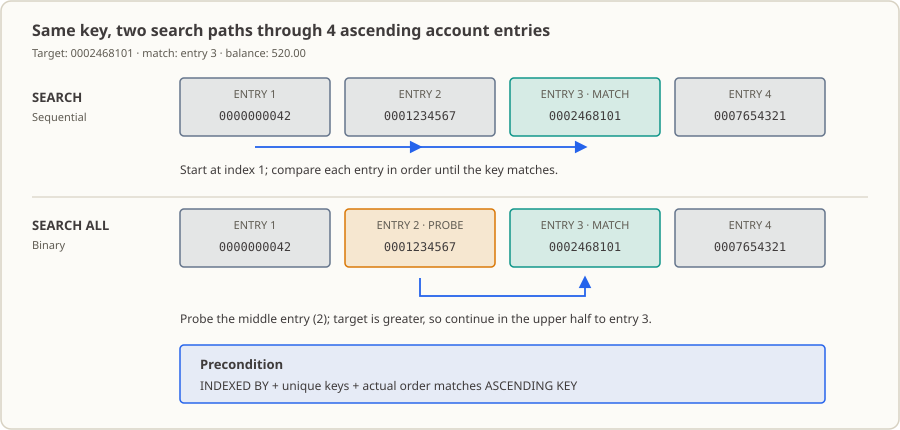

# 第 13 课：SEARCH 与 SEARCH ALL——把交易的账户号落到某个具体账户

交易文件里一笔记录只带账户号、不带余额；本课把四个账户装进内存表，用逐项查找 `SEARCH` 和二分查找 `SEARCH ALL` 各自把 `0002468101` 这个账户连同它的 `520.00` 余额找出来，再把“找不到账户”那条路径单独走一遍。

## 业务现场

对账日的早上七点半，昨晚的交易流水已经导成一个文件。你看一眼就知道麻烦在哪：每条交易只有一个账户号，比如 `0002468101`，**没有余额、没有状态、也没有客户名**。要判断这笔交易对不对，第一步得先拿这个账户号去账户主档里把那条账户记录找出来，后面才谈得上比对余额。

这一步找不找得到，直接决定这笔交易往哪走。找到了，正常比对；找不到，进人工队列——由人去查这个账户号是怎么回事（新开户？主档没同步？交易本身就录错了？）。

有人图省事，会说“找不到就当余额 0 处理”。别这么干。**“找不到”和“余额是 0”是两码事**：真按 0 算，一笔本该人工去查的钱就在报表上被悄悄抹平了，账面看着还是平的，等你发现的时候已经过了一个结账日。这就是为什么本课要专门跑一遍不存在的 `0005550000`，看清楚 `AT END` 到底走到哪里去。

账户主档一般是按账户号排好序在维护的，所以很多人的第一反应是“那直接上二分查找 `SEARCH ALL` 不就完了”。可以，但它有代价：`SEARCH ALL` 把“这张表真的有序、键还不重复”当成**你已经保证过的前提**。这个前提一旦不成立，它不会报错。本课做了两个探针给你看——把装载顺序整个反过来、甚至扩成五项按降序装，编译器一声不吭，本机跑出来的结果和基线逐行相同。所以这节课真正要记住的不是“二分更快”，而是：**一个查找能不能用，取决于它的前提由谁保证；测试兜不住的前提，只能靠流程兜。**

## 为什么现在学

前一课你已经能用 `INDEXED BY` 索引一项一项往后走。但那只是“遍历”，不是“按账户号找”。真要靠遍历去找，你就得自己写个循环一项项比，还得自己拿标志位记住“到底找到没有”——表一大就慢，标志位一漏就是错账。

COBOL 给你两条按值查找的路：

- `SEARCH`：从你指定的那项开始，一项一项往前比，比中或者走到表尾为止。
- `SEARCH ALL`：二分查找。比较次数一下少很多，代价是表格必须按你声明的那样有序，而且键不许重复。

你可能会想，二分我熟，查之前先排个序不就完了。方向是对的，但这里有个别扭的地方：COBOL 的“有序”是由两件事一起构成的——`ASCENDING KEY` 声明，加上装载那段代码**真的**照这个方向装。声明只是写给 `SEARCH ALL` 看的一句话，它不会替你把表排好。顺序错了编译器不管，本课会让你亲眼看见这一点。

## 这个知识点是什么，它解决什么问题

**这个知识点是什么。** 在一张已经装好的表格里“按键找一项”。找法有两种：逐项 `SEARCH`（不要求表有序，你给它一个起点就行）和二分 `SEARCH ALL`（要求表格声明了 `INDEXED BY`、键方向与 `ASCENDING KEY`/`DESCENDING KEY` 一致、键唯一）。找中之后，同一次访问里可以顺手把这一项的其它字段也读出来——本课就是账户号命中后立刻读余额。

**它在业务里解决什么问题。** 把“这笔交易属于哪个账户”“这个产品是什么费率”这类对照关系，从人工判断变成一次确定的查找。对账、计息、月结、资格判定，第一步几乎都是“按账户号/客户号/产品码去主档里找到那条记录”。少了这一步，后面的余额比对、状态判断都无从谈起。

**找不到的时候怎么办，也是这个知识点的一部分。** `AT END` 就是“表里没有”这条路径。业务上它不等于“余额 0”，而是一个要单独交代的结果：进人工队列、打日志、或者让这笔交易拒绝入账。写代码的人必须明确回答“没找到时算哪一类”，不能让它悄悄滑进正常路径。

**什么时候不该用它。** 表格没排序、或者键还可能重复的时候，只能用 `SEARCH`；数据每次都变、顺序根本稳不住的时候，硬上 `SEARCH ALL` 是给自己埋雷。而真正的大主档本来就不该整个塞进内存表——那是文件查找和 `SORT`（第 17、21 课）的活。

## 本课完成后的能力与边界

学完本课后，你可以：

- 用 `SEARCH` 从指定索引开始逐项查找表格键，并用 `AT END` 处理未找到。
- 用 `SEARCH ALL` 对声明了 `ASCENDING KEY` 和 `INDEXED BY` 的表格做二分查找。
- 说清 `SEARCH ALL` 对索引、键顺序和键唯一性的要求，以及这三者分别由谁维持。
- 用同一个账户号分别跑两种查找，核对它们返回相同的余额；对不存在的账户核对两种写法都输出 `NOT_FOUND`。
- 指出“声明了 `ASCENDING KEY` 不等于数据有序”，并说明本课如何观察（以及无法观察）这一风险。

边界：本课只用四项程序内固定的内存表，不读文件或数据库，也不涉及索引顺序文件。`SEARCH` 不要求表格有序，但 `SEARCH ALL` 要求键值与声明同序且唯一；装载与排序流程的完整性留到第 17、21 课的文件与 `SORT` 内容。

## 运行环境

- GnuCOBOL 3.2.0，默认方言（不加 `-std=cobol85`），源文件为固定格式。
- Linux 终端；本课不依赖数据库或附加工具。
- 无输入夹具、无输出数据文件；编译产物写在 `build/`，可直接删除重来。

## 样例账户表

完整源码见 [`lesson.cob`](./lesson.cob)。程序把四个账户按 `X(10)` 账户号递增顺序装进 `OCCURS` 表格：账户号唯一，第三项余额是 `520.00`。

表里这四项是写死在程序里的**演示数据**（由 `1000-LOAD-ACCOUNTS` 装入），不是从文件读进来的——这一点决定了本课能证明什么、不能证明什么。

| 表项 | 账户号 | 余额 |
|---:|---|---:|
| 1 | `0000000042` | 0.00 |
| 2 | `0001234567` | 1000.00 |
| 3 | `0002468101` | 520.00 |
| 4 | `0007654321` | 250.75 |

表格声明 `ASCENDING KEY IS WS-ACCOUNT-NUMBER`，并用 `INDEXED BY WS-ACCOUNT-IDX` 提供搜索索引。账户号是定宽文本、带前导零，长度一样，所以按字符顺序升序就等价于按账户号升序。

程序拿两个目标各查两遍：表里有的 `0002468101`，和表里没有的 `0005550000`。

## SEARCH 与 SEARCH ALL



`SEARCH WS-ACCOUNT-ENTRY` 是顺序查找。程序先 `SET WS-ACCOUNT-IDX TO 1` 把索引摆到第 1 项，然后每个 `WHEN` 拿当前项的账户号和目标比；没比中，`SEARCH` 自己往前走一项；全走完了还没中，就落到 `AT END`。一句话：**起点你给，路它自己走。**

`SEARCH ALL WS-ACCOUNT-ENTRY` 是二分查找。它自己决定先看表的哪个位置、下一次砍掉哪半边，所以比较次数少得多。代价全在前提上：表格要有 `INDEXED BY` 索引，要有 `ASCENDING KEY`（或 `DESCENDING KEY`）声明，而且**实际装进表的键值顺序必须和声明一致**，键还必须唯一。这四条少一条，结果就没有保证。

| 查找方式 | 怎么比 | 前提 |
|---|---|---|
| `SEARCH` | 从当前索引逐项检查，直到找到或到达表尾 | 不要求按键排序；执行前你得把索引摆到合理起点 |
| `SEARCH ALL` | 二分缩小有序表的查找范围 | 要求 `INDEXED BY`、与声明一致的键顺序、唯一键 |

**声明不等于排序。** `ASCENDING KEY` 只是写下一句“这张表如果拿去 `SEARCH ALL`，键要按这个方向排”。它不是排序指令，程序不会因为这句话帮你把表排好。真正把顺序排出来的是装载那段代码，本课就是 `1000-LOAD-ACCOUNTS`。

## 程序里谁管什么

- `1000-LOAD-ACCOUNTS`：用常量下标把四个账户写进表，账户号严格升序、没有重复。**本课唯一保证“表有序”的地方就是这一段**，不是那句 `ASCENDING KEY` 声明。
- `0000-MAIN`：先把目标设成 `0002468101`，顺序查一遍、二分查一遍；再把目标换成 `0005550000`，同样查两遍。
- `2000-SEQUENTIAL-SEARCH`：先打印 `検索=SEQUENTIAL` 和目标键，再 `SET WS-ACCOUNT-IDX TO 1` 把索引摆回第 1 项，然后才 `SEARCH`。这一步重置不能省——`SEARCH` 是从**当前**索引位置开始找的，不重置的话第二次查找会接着上次停下的地方走。
- `3000-BINARY-SEARCH`：打印 `検索=BINARY` 之后直接 `SEARCH ALL`，不指定起点，由它自己挑。
- 命中就打 `検出 口座=... 残高=...`；没命中就走自己的 `AT END`，打 `NOT_FOUND`。
- 索引 `WS-ACCOUNT-IDX` 只用来引用表项（`WS-ACCOUNT-NUMBER(WS-ACCOUNT-IDX)`），不参与普通算术运算。

## 运行与观察

本课不读输入文件、命令行参数或数据库，所以在本课目录或任意目录执行结果相同。下面按本课目录说明。

**输入：** 无外部输入。四个账户和两个搜索目标都是程序内固定数据。

**命令及作用：**

```sh
mkdir -p build
cobc -fsyntax-only lesson.cob                  # 只做语法检查，不生成可执行文件
cobc -x -Wall -o build/lesson_13 lesson.cob    # 编译并生成可执行文件
./build/lesson_13                              # 运行程序，查找结果写到标准输出
echo $?                                        # 查看退出码
rm -rf build                                   # 清理生成的可执行文件
```

**预期结果：**

| 观察项 | 预期值 |
|---|---|
| `cobc -fsyntax-only` 退出码 | `0` |
| `cobc -x` 退出码 | `0`，无编译诊断 |
| 标准输出 | 8 行，见下方代码块 |
| 进程退出码 | `0` |

```text
検索=SEQUENTIAL キー=0002468101
逐次検索=検出 口座=0002468101  残高=0000520.00
検索=BINARY キー=0002468101
二分検索=検出 口座=0002468101  残高=0000520.00
検索=SEQUENTIAL キー=0005550000
逐次検索=NOT_FOUND
検索=BINARY キー=0005550000
二分検索=NOT_FOUND
```

**输出字段对照（日文输出 → 含义）：** `検索` = 正在执行的查找方式（`SEQUENTIAL` 顺序 / `BINARY` 二分）；`キー` = 本次搜索键；`逐次検索` / `二分検索` = 该方式的查找结果；`検出` = 找到；`口座` = 命中的账户号；`残高` = 该账户余额（`PIC 9(7)V99`，`520.00` 补零显示为 `0000520.00`）；`NOT_FOUND` = 未找到。

**实际观察到的环境细节：** 在本工作区运行可执行文件时，标准错误会输出 `Warning: program compiled against libxml 212 using older 209`。这是运行环境的链接库版本警告，不是本程序的业务输出；其触发组件尚未定位。程序输出在标准输出，退出码为 0。

## 有序性前提在本机能不能观察

`SEARCH ALL` 靠的就是“表项顺序符合 `ASCENDING KEY`”。那这个前提能不能靠编译或者跑一遍测试发现？本工作区做了两个探针（探针不属于 [`lesson.cob`](./lesson.cob)，是临时副本）：

1. 把四项数据的装入顺序整体反过来（第四项先装），声明仍然是 `ASCENDING KEY`；
2. 把表格扩为五项、按降序装入，声明不变。

**观察结果：** 两次探针都编译通过（`cobc -x -Wall` 返回码 `0`，无诊断），运行的输出与上表逐行相同——`SEARCH ALL` 照样找到了 `0002468101`，不存在的键照样输出 `NOT_FOUND`。

**结论（限定在本机 GnuCOBOL 3.2.0 与这个表规模）：** 违反 `ASCENDING KEY` 在本课这个规模下，编译器不拦、运行时结果也不出错，所以“顺序到底对不对”没法靠跑一遍程序验证。有序性必须由装载或排序流程保证，并在评审时按数据来源单独核对；这也正是 `SEARCH ALL` 省了比较次数、却更难保证正确的原因。**别把这两次探针读成“顺序错了也没关系”**——它只说明测试这条防线在本课规模上看不见问题，不代表生产数据上不会出事。

## 修改练习

1. 从原始 [`lesson.cob`](./lesson.cob) 开始，把 `1000-LOAD-ACCOUNTS` 中账户 `0002468101` 的余额从 `520.00` 改为 `600.00`，运行两种查找并核对它们返回的余额。
2. 从原始 [`lesson.cob`](./lesson.cob) 开始，把账户表从四项扩为五项，在末尾追加账户 `0009999999`、余额 `75.00`，并把第二个搜索目标从 `0005550000` 改为 `0009999999`。保持键值唯一且递增，确认两种查找都找到新增账户。

完整题目与预期见 [`exercise.md`](./exercise.md)，参考答案见 [`answer.md`](./answer.md)。

## 举一反三练习

为五个产品代码和库存数量创建表格。先用 `SEARCH` 查找中间的产品和不存在产品；再为 `SEARCH ALL` 声明合适的键，确保所有产品代码唯一且实际按所声明方向排序，分别测试命中与未命中。最后说明：如果只改表格顺序而不同步键声明，会出现什么风险、为什么本课的探针无法自动发现它。使用固定内存表格，不添加文件或数据库。题目见 [`exercise.md`](./exercise.md)，本题不提供答案。

## 走一遍真实流程

把这个查找放回对账那条链路里，它站在很靠前的位置：

1. 上游把当天的交易导成文件，落在共享目录（第 15 课你开始亲手读这个文件）。
2. 账户主档先按账户号排好序装进内存表——这一步就是 `SEARCH ALL` 的前提（定长主档见第 17 课，排序见第 21 课）。
3. 每笔交易拿自己的账户号来查（**本课这件事**）：查到了就取余额交给比对环节，查不到就进人工队列。
4. 比对结果写成结果文件（第 16 课）或回写数据库（第 29 课起），同时记进日志（第 27 课）——日志里那些 `NOT_FOUND` 就是第二天人工要跟的东西。
5. 中间那一步“账户表和交易表拼起来跑”在第 14 课先做一遍内存版；到了第 20 课，同一套“有序 + 唯一”的前提会以文件匹配的形式再出现一次。

换句话说，本课这个查找是整个对账的入口。入口找错一笔，后面全歪。

## 这份代码进了生产会怎样

- **谁调度它**：夜间批处理，排在“交易文件就绪”和“账户主档装载/排序”之后。前一步没做完，这一步查出来的结果没有意义。
- **谁看它的输出**：值班的人先扫有没有 `NOT_FOUND` 这类异常；有就说明有交易挂不上账户，当晚要查，不能等。
- **下一个系统怎么接**：命中的账户连同余额交给比对环节（第 14 课的内存版，后续第 20 课的文件版）。
- **第一个月最容易出的事故**：装载顺序和 `ASCENDING KEY` 声明对不上。本课两个探针已经说明，这种事编译不报错、小表上也看不出来——所以上线前只能靠流程和评审去核（上游怎么排的、排序步骤有没有被跳过）。
- **同样要命的第二种错**：把“找不到账户”当成“余额 0”继续往下走。这种错不会让程序崩，只会让账目悄悄错，属于最难查的一类。
- **它还没做的事**：不读文件、不排序、不校验账户号格式、不打日志、不设计业务返回码。重复键政策与缺失记录分类在第 20 课正式展开，拒绝记录怎么写出见第 16 课；文件读取、排序、错误分类与日志分别在第 15、21、26、27 课补上。所以它现在是一份查找的教学样例，还不是能直接上线的对账程序。

## 参考资料

- [GnuCOBOL Programmer’s Guide：SEARCH](https://superbol.eu/gnucobpg/chapter7.html#search)
- [GnuCOBOL Programmer’s Guide：SEARCH ALL](https://superbol.eu/gnucobpg/chapter7.html#search-all)
- [GnuCOBOL Programmer’s Guide：OCCURS](https://superbol.eu/gnucobpg/chapter6.html#occurs)
- 仓库课程主页：[README.md](../../README.md)
