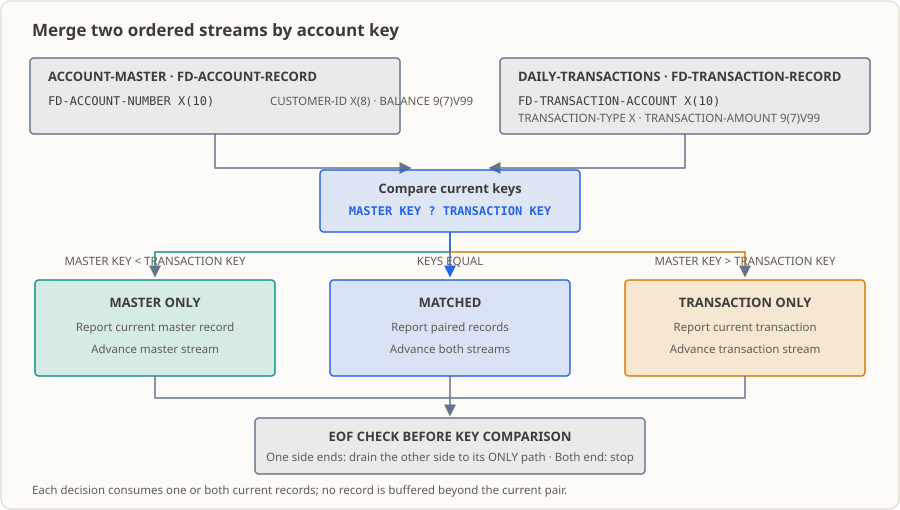

# 第 20 课：按账户号顺序匹配文件——一次归并扫描分出三类记录

账户主档和当日交易各自按账户号排好之后，对账这件事就只剩一句话：把两边的账对上。本课按同一个账户键从头到尾扫一遍两份有序文件，把每条记录归到“一致”“口座のみ（仅主档）”“取引のみ（仅交易）”三类并分别计数，再用两个计数等式证明一条都没漏——这套扫描就是后面所有对账批次的发动机。

## 业务现场

对账组的早会被问到的永远是同一个问题：昨天多少笔对上了，多少笔没对上？回答它要三个数——匹配几笔、只有主档的几笔、只有交易的几笔。你能当场报出这三个数，这一批就算交代清楚了；报不出来，就得回去把明细从头翻一遍。

现在把镜头拉近。你桌上摆着两份材料：一份是昨天日终导出的账户主档快照（教学演示里 3 行，真实场景是几万户），另一份是昨天柜面和手机银行产生的交易流水（演示里 4 行）。任务是理清两边的对应关系：哪些账户动了账、哪些账户只在主档里、哪些交易压根找不到账户。下面出现的时点、笔数都是编的教学材料，不是哪家真实机构的数据。

这件事听起来不难，难在"漏"。对账干久了的人都会告诉你：真出了差异没什么可怕的——差异摆在那里，迟早有人处理。**可怕的是差异没被发现**：一笔交易因为找不到账户被悄悄跳过，报表上看着还是平的，等到客户拿着流水来问"这笔钱去哪了"，你才发现整批结论都得重算。所以这份工作的验收标准不是"程序跑通了"，而是"我能证明它一条都没漏"。听着有点玄，落下来其实就是两个算术等式，本课会教你怎么用它给整批结论作证。

顺便说清量级：本课夹具只有 3 行主档、4 行交易，这是故意的——数字小到你能拿笔手算，正好用来核对每个分支到底走没走对。真实批次是这个量的几万倍，但算法本身一遍扫过去，读一条、比一条、放一条，内存占用不随文件增长。

## 为什么现在学

你可能会想：上一课我不是已经把账户主档和交易文件一起读进来了吗？两个文件同时开、各自处理 EOF，都能跑了，还缺什么？

缺的是**关系**。第 19 课解决的是"两条流谁也别拖停谁"——两份数据并排往前推，互不干扰。可它们始终是两条平行的流：一条主档记录到底该对应哪一笔交易？这件事第 19 课根本没回答，因为那时候你还没有比较的动作。

你要真拿第 19 课的办法硬凑，会立刻卡住：一边读完 3 行、一边读完 4 行，你怎么知道第 2 行该跟第 2 行配，而不是跟第 3 行配？行号在这件事上完全不算数——决定配对的是**账户号这个键**。本课给你的是按键比较的顺序归并扫描（merge），一次走完两份文件，还顺带把"没配上的都去哪了"分类说清楚。

这一课的分量在哪：银行对账、保险理赔对账、支付渠道对账、ERP 的存货与实盘比对，本质上都是"两份按键排好的数据走一遍归并"。这个动作你学会了，后面每个对账批次都用它。

## 这个知识点是什么，它解决什么问题

**这个知识点是什么。** 说人话：两个人手里各拿一份按同一列号码排好序的名单，各自只看自己最上面那一行，比号码大小。谁小，谁那一行走掉（因为对面那份里肯定没有它——对面当前最小的都比它大，后面只会更大）；号码一样，两条一起走掉，配成一对。两边都走到最后一行，扫完。这个动作在行业里叫**顺序归并扫描**，COBOL 里就是本课那两个 `READ` 段落加一个 `EVALUATE TRUE`。

术语到位了，但真正要你记住的是它的三个直接后果：

1. **每条记录只读一次**，不需要把整份主档装进内存。所以主档可以比内存大得多——这正是不用 `OCCURS` 表硬找的原因。
2. **一次比较只推进一边（或两边）**，结论完全由"当前键谁大"决定，不依赖行号、不依赖数量。
3. **没配上的记录不会消失**，而是落进"仅主档"或"仅交易"两个桶——这是本项目后面所有差异报告的源头。

**它在业务里解决什么问题。** 它把"把两边的账对上"这件手工活变成一次可控的扫描，而且给你留下了自证清白的工具。具体有三层：

- **分类**：匹配的、只有主档的、只有交易的，各自成一条明细。对账专员拿着"仅交易"清单去查为什么这个账户不在主档里；拿着"仅主档"清单去看今天哪些账户没动账。
- **计数**：三类各有多少条，是给组长和日志看的一句话结论。
- **不变量**：`匹配 + 仅主档 = 主档记录数`、`匹配 + 仅交易 = 交易记录数`。两个等式同时成立，才说明扫描没跳过记录、也没把一条记录算两次。这条比前面两条都重要——它让"我没漏"变成可以用计算器验的话，而不是一句保证。

**什么时候不该用它、用错会怎样。** 这套算法有个硬前提：两个文件必须**真的按键升序**，而且键必须**唯一**。它只往前比较，从不回头看一眼——翻遍整个程序，你找不到任何一处拿当前键跟"上一条键"比过，所以乱序和重复它都察觉不到，更不会报警。结论照样打印，退出码照样是 `0`，可算出来的东西不能信：

- 文件乱序 → "谁小谁先走"这步推理就不成立了：一条比前面小的记录，等它出现时对面该配的那条早就走掉了，再没机会回头配；
- 键有重复 → 同一户出现多条记录该怎么归类，本课压根没有定义过政策。

这两种情况具体会歪成什么样、程序会打印哪些行，本课**没有做注入实验**（本课范围就是"前提成立时怎么扫"），所以别拿这里的描述当预期输出。要正面对付它们，得靠上游契约和排序步骤（第 21 课 `SORT`）把前提坐实，或者靠校验环节拦下来（第 26 课以后）。本课把这两条写成前提，程序**不校验**——下面会专门列出来。

## 本课完成后的能力与边界

学完本课后，你可以：

- 用同一个排序键比较主档与交易记录的当前值，说明每个分支下一步只推进哪一边。
- 在一次顺序扫描中把记录分成“匹配”“仅主档”“仅交易”三类，并分别计数。
- 在一边提前到达 EOF 后，把另一边剩余记录全部归入对应的单边类别。
- 用计数不变量核对结论无遗漏：`匹配 + 仅主档 = 主档记录数`、`匹配 + 仅交易 = 交易记录数`。
- 说明升序、唯一键和等长字符键比较是算法前提，以及顺序归并为什么不需要把整份文件装进内存。

边界：程序只比较键、显示配对信息，不做金额累计、不改余额、不写结果文件；两个夹具都已在外部排好序且账户号唯一，程序**不校验**这两点（第 21 课用 `SORT` 产生有序输入，正式拒绝策略见第 26 课）。记录布局是定长字段拼接，字段解析与宽度核对见第 17 课。

## 运行环境

- GnuCOBOL 3.2.0，默认方言（不加 `-std=cobol85`），源文件为固定格式。
- Linux 终端；本课不依赖数据库或附加工具。
- `SELECT` 使用相对文件名，因此**从本课目录执行**；语法检查与编译在 `build/` 下生成可执行文件，程序不写任何数据文件。

## 输入记录布局



两个夹具都是按账户号升序排列的行顺序文本文件，每行由定长字段直接拼接、不含分隔符；行结束符只分隔物理行，不计入 `FD` 记录字段。

| 文件 | 字段 | 长度 | 示例行 |
|---|---|---:|---|
| [`accounts.txt`](./accounts.txt) | 账户号 `X(10)` + 客户号 `X(8)` + 余额 `9(7)V99` | 10 + 8 + 9 = 27 | `A000000001C0001001000100000` |
| [`transactions.txt`](./transactions.txt) | 账户号 `X(10)` + 类型 `X(1)` + 金额 `9(7)V99` | 10 + 1 + 9 = 20 | `A000000001D000012550` |

金额用 `PIC 9(7)V99`，`V` 是隐含小数点：九位数字 `000012550` 表示 `125.50`，`000004000` 表示 `40.00`，字段里没有小数点这个字符。本课只把余额和金额显示出来，**不做任何金额运算**——所以这一课就算金额显示得再漂亮，也还不等于"对上了账"。

主档 3 行、交易 4 行，账户号文本等长（都是 10 个字符）。账号里带着字母 `A`，本来就只能按字符比，比不了数值大小；而长度一律 10 个字符、前缀相同，所以"按字符顺序升序"和"按号码从小到大"在这里是同一个意思。要是哪天两边长度不一样，比较语义就变了——那属于夹具必须守住的约定，不是程序替你保证的事。

## 顺序匹配算法

再回到"两个人对名单"那个画面。程序开工时先各读第一条，之后每一轮只比较两个当前键：

1. 主档键较小：说明没有对应交易，输出 `口座のみ`（仅主档），只推进主档。
2. 交易键较小：说明没有对应账户，输出 `取引のみ`（仅交易），只推进交易。
3. 两键相同：输出 `一致`（匹配），推进两边。
4. 一边到 EOF：另一边剩余记录全部归入对应的单边类别。注意这一步放在比较键之前——到尾部时对面那些记录已经没有可比对象了，只能整批归到单边桶里。
5. 两边都到 EOF：结束扫描，输出三类计数。

比较用的是字符顺序（`<` / `>` / 相等后走 `WHEN OTHER`）。每条记录最多被读一次，工作存储不随文件长度增长——这就是顺序归并相对"整份装入内存再查找"的优势，也是它敢拿去跑几十万行的底气。

## 计数不变量：怎样证明无遗漏

夹具主档 3 行、交易 4 行，预期分类为：匹配 2、仅主档 1、仅交易 2。

| 不变量 | 代入本课 | 含义 |
|---|---|---|
| `匹配 + 仅主档 = 主档记录数` | `2 + 1 = 3` | 每条主档记录都被分类一次，没有漏读 |
| `匹配 + 仅交易 = 交易记录数` | `2 + 2 = 4` | 每条交易记录都被分类一次，没有漏读 |

只要两个等式同时成立，就能确认扫描既没有跳过记录，也没有把同一条记录算两次。这两个等式在流水线里可以独立核算，不依赖程序自述——别把它当装饰：它存在的意义就是让任何人一句话确认"没漏账"。摆在那里却没人核对的关系，比没有还危险，因为那会让人以为自己查过了。

## 正确性前提与文件错误

| 前提 | 由谁保证 | 本课是否校验 |
|---|---|---|
| 两个文件都按键**升序**排列 | 上游/排序步骤（第 21 课 `SORT`） | **否**，乱序会让归并结论失效 |
| 账户号**无重复** | 上游接口契约 | **否**，本课不处理重复主档行或同一账户的多笔交易 |
| 键为等长字符且比较规则一致 | 夹具设计 | 否，长度不等时比较语义会变 |
| `FD` 宽度与实际行长一致 | 夹具 | 主档 27 字符、交易 20 字符；不匹配会读错字节 |

**未验证项（说清为什么没验证）：** 乱序输入和重复键这两条路径，本课既没有实现检测，也没有做注入实验——因为本课的范围就是"前提成立时怎么扫"，检测和拒绝策略属于第 26 课以后。所以这里只说得出"结论不可信"，说不出"程序会报哪条错"，你不要照着自己想象的输出写成预期。

文件错误：任一输入 `OPEN` 失败则不开始匹配（第二个 `OPEN` 失败时会关闭已打开的主档）；`AT END` 处理状态 `10`，其他 `READ`/`CLOSE` 状态会报告并返回非零码。本工作区实测：输入文件不存在时 `OPEN` 报 `STATUS=35`、进程退出码 `1`，此时不会输出任何匹配结果。本课不提供重试或恢复。

## 运行与观察

**输入：** 本课目录下的 `accounts.txt`（3 行）与 `transactions.txt`（4 行）。程序按相对路径打开，所以要先 `cd` 到本课目录。

**命令及作用：**

```sh
mkdir -p build
cobc -fsyntax-only lesson.cob                  # 只做语法检查，不生成可执行文件
cobc -x -Wall -o build/lesson_20 lesson.cob    # 编译并生成可执行文件
./build/lesson_20                              # 运行，读取当前目录下的两个夹具
echo $?                                        # 查看退出码
rm -rf build                                   # 清理生成的可执行文件
```

**预期结果：**

| 观察项 | 预期值 |
|---|---|
| `cobc -fsyntax-only` 退出码 | `0` |
| `cobc -x` 退出码 | `0`，无编译诊断 |
| 标准输出 | 7 行，见下方代码块 |
| 进程退出码 | `0` |
| 生成的业务文件 | 无（本课只读） |

```text
口座と取引を開きました
一致 口座番号=A000000001 顧客番号=C0001001 残高=0001000.00 種別=D 金額=0000125.50
口座のみ 口座番号=A000000003 顧客番号=C0001003 残高=0000002.00
取引のみ 口座番号=A000000004 種別=D 金額=0000075.00
一致 口座番号=A000000005 顧客番号=C0001005 残高=0000250.75 種別=T 金額=0000040.00
取引のみ 口座番号=A000000006 種別=D 金額=0000020.00
照合件数=002 口座のみ=001 取引のみ=002
```

**输出字段对照（日文输出 → 含义）：** `口座と取引を開きました` = 账户与交易文件已打开；`一致` = 匹配；`口座のみ` = 仅主档；`取引のみ` = 仅交易；`口座番号` = 账户号；`顧客番号` = 客户号；`残高` = 余额；`種別` = 交易类型；`金額` = 金额；`照合件数` = 匹配记录数，`口座のみ` / `取引のみ` = 仅主档 / 仅交易计数。

“仅主档”行只带主档字段（没有 `種別`/`金額`），“仅交易”行只带交易字段（没有 `顧客番号`/`残高`），这与它们各自来自哪一份文件一致——看输出的时候顺手确认一下，别把某一行当成另一个类别的记录。

那 7 行是怎么来的，可以自己对着夹具走一遍：`A000000001` 两边都有、配对；`A000000003` 主档有、交易没有，落进"仅主档"；`A000000004` 反过来，落进"仅交易"；`A000000005` 配对；`A000000006` 交易单边。最后一行的 `002 / 001 / 002` 正好满足上面两个不变量（`2 + 1 = 3`、`2 + 2 = 4`）。

**实际观察到的环境细节：** 在本工作区运行可执行文件时，标准错误会输出 `Warning: program compiled against libxml 212 using older 209`。这是运行环境的链接库版本警告，不是本程序的业务输出；其触发组件尚未定位。判断对账结果时别把它算进去。

## 修改练习

两项都在**临时目录里的夹具副本**上做，不要改动仓库内的 `accounts.txt` / `transactions.txt`：

1. 从副本 `transactions.txt` 删除账户 `A000000004` 那一行。确认主档键 `A000000003` 与下一条交易键 `A000000005` 的比较结果，并记录三类计数。
2. 从原始夹具出发，把交易文件里的 `A000000004` 键改成 `A000000003`、金额改成 `000005000`（仍为 20 字符且保持升序），确认该笔与主档 `A000000003` 配对、两条流同时前进。

第一项让你亲眼看见"一方键小就说明对面没有"的那条分支；第二项把一条单边记录变成配对记录，你会看到三个计数怎么跟着挪。两次都要用不变量自查一遍。

完整题目与预期见 [`exercise.md`](./exercise.md)，参考答案见 [`answer.md`](./answer.md)。

## 举一反三练习

在两份输入中各加入一个重复账户键，并各加入一个违反升序的记录。扩展程序，检测重复键与降序键，写出你选择的拒绝策略，并制作夹具验证匹配、孤立、重复和未排序四类场景。把两份完整文件装入 `OCCURS` 表或调用 `SORT` 都不允许。题目见 [`exercise.md`](./exercise.md)，本题不提供答案。

这道题就是本课"未验证项"的正面进攻：既然乱序和重复不会报错，那你得自己决定什么时候拒绝、拒绝后批次算不算失败——这正是第 26 课要系统讲的东西。

## 走一遍真实流程

把本课放进一个对账日的链路里，它站在正中间：

1. **前一天日终**，核心系统导出账户主档快照（定长记录，宽度和偏移的核对见第 17 课）。
2. **当天早上**，交易流水被导成文件送过来。两份数据进来时怎么各自维护 EOF，是第 19 课的活。
3. **上游先排好序**——真实系统里这一步可能是上游导出时排的，也可能是你在批次里用 `SORT` 排的（第 21 课）。
4. **本课的扫描**开始工作：一遍归并，分出"一致""仅主档""仅交易"，报出三个计数。这是整条链路上第一次真正"把两边的账对上"。
5. **结果交给下游**：把孤立记录写成清单、把匹配结果写成文件、把控制计数写进批次报表，是第 22 课（文件综合）和第 27 课（日志）的活；要把对账结果回写数据库，答案在第 31 课。
6. **最终站**是第 32 课的银行对账项目：本课这段扫描会在那里被串进"校验 → 排序 → 匹配 → 写出 → 回写"的完整批次。

所以你现在写的这几十行，不是练习题，而是那个毕业项目的心脏。

## 这份代码进了生产会怎样

- **谁调度它**：夜间/清晨批处理的调度器，通常排在"两个输入文件就绪检查"之后。它只认退出码：`0` 放行，非 `0` 报警。
- **谁看它的输出**：值班的人先看 `照合件数 / 口座のみ / 取引のみ` 这三个数，再看不变量对不对得上。数字对不上，当晚就得翻明细。
- **谁被叫起来**：如果"仅交易"里出现大量本该匹配的账户，第一反应是查上游是不是发了一份没排序的文件——这正是本课不校验、却最容易在生产上出的事故。
- **下一个系统怎么接**：分类明细会被落成孤立记录清单和结果文件（第 22 课），计数进日志（第 27 课），差异回写数据库（第 31 课）。
- **第一个月最容易出的事故**：把"跑通且退出码 0"当成"账对上了"。本课的程序**不校验升序、不校验唯一键、不做金额核对、不写结果文件**，它只做键配对的分类——这也是它故意留给你自己核对的原因。

也要把话说清楚：主档对账在真实系统里，键的编码、排序规则、重复键政策、缺失记录分类和金额存储方式都必须先约定，扫描结果才有意义。本课不声称任何监管、审计或财务合规保证，也没有重跑、幂等或原子交付的设计。

## 参考资料

- [GnuCOBOL Programmer’s Guide：ORGANIZATION SEQUENTIAL](https://superbol.eu/gnucobpg/chapter5.html#organization-sequential)
- [GnuCOBOL Programmer’s Guide：LINE SEQUENTIAL](https://superbol.eu/gnucobpg/chapter5.html#organization-line-sequential)
- [GnuCOBOL Programmer’s Guide：Sequential READ 与 AT END](https://superbol.eu/gnucobpg/chapter7.html#sequential-read)
- 仓库课程主页：[README.md](../../README.md)
