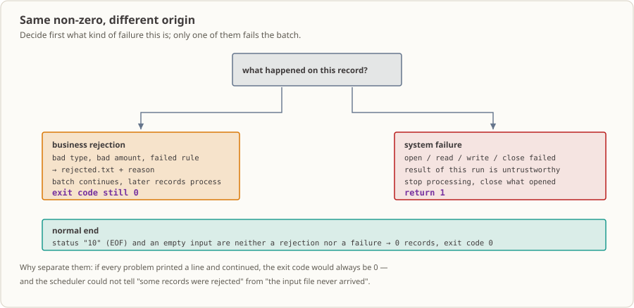

# 第 26 课：错误处理——用 `FILE STATUS` 区分业务拒绝、EOF 与系统故障

银行日终批次的输入文件可能整份缺失、可能混进坏记录，输出目录也可能不可写。本课给第 15–25 课的文件链路补上错误分类：逐条读取交易，把坏记录分流进拒绝文件后继续，遇到真正的文件 I/O 故障则停止、关闭已打开的文件并返回非零码。产出一份可核对的“哪些记录被拒绝、这个批次是否算失败”的证据，供第 27 课的日志与第 28、32 课的项目骨架复用。

## 业务现场

凌晨 2:15，调度器按计划拉起这个作业。上游导出的当日交易明细已经躺在共享目录里。程序一行行读进去，金额字段不对的挑出来写进拒绝文件，剩下的写进接受文件。这段时间操作台前没有人坐着，谁也没盯着它跑。

早上复核岗上班，第一件事是打开那份拒绝清单。上面有一条 `A00002|00X50`：金额第 3 位是个字母 `X`。这不是系统坏了，是录单时手滑打成了字母。这一笔今天挂起，柜面打个电话找客户核对就行，昨晚那批账照常入账——它属于**业务拒绝**，第二天有人处理，退出码保持 0 就对了。

再看另一天。磁盘满了，或者上游文件压根没导出来。程序如果也打印一句“有坏记录”然后退出码 0，调度器就当它跑成功了：复核岗拿到的是一份根本不完整的清单，下游过账程序拿着缺了大半的接受文件往下跑。真正该报的警没报，等对账对不上，已经是第二天甚至第三天的事——它属于**系统故障**，必须让退出码变成非 0，把值班的人叫起来。

所以本课这条分界线决定的其实是两件事：**谁会半夜被叫起来**，以及**第二天人工要花多少时间**。这两类混在一起，要么天天半夜假警报，要么真故障被当成“有坏数据”糊过去。（场景是教学演示，机构、时间、笔数只为了把问题说清楚，不代表某家真实机构的真实数据。）

## 为什么现在学

第 15–25 课你已经会打开/读取/写入顺序文件、按固定宽度切字段、排序匹配、用 Copybook 共享记录定义，并通过 `CALL ... USING` 传参。但这些课里文件操作默认都会成功：代码往往只在结束时打印一个汇总，回答不了运维最关心的那句话——**这次到底算跑成了没有？**

你可能会想：出错了我就 `DISPLAY` 一句报错，不就行了？问题恰恰在这——屏幕上的字没人看。半夜两点没有人在操作台前，看这段输出的是调度器，而调度器只认一个东西：进程退出码。你打印十行“错误”，只要退出码还是 0，它照样认为这个作业成功，接着拉下一个。

于是缺口变成三个很具体的问题：一是读到 EOF 之外的读错误时，`AT END` 不会触发，程序会带着上一笔数据继续跑；二是坏记录和文件故障都只被当成一条消息，调度器分辨不出来；三是故障发生后哪些文件还开着、还算不算数没人交代。本课用一个 12 字节/行的交易夹具把这三处补齐，而且每条结论都能从退出码和结果文件当场复算——不用你相信文档。

## 这个知识点是什么，它解决什么问题

**这个知识点是什么。** 一种给每次文件操作“查户口”的写法：`OPEN`、`READ`、`WRITE`、`CLOSE` 之后，立刻去看绑定在这个文件上的 `FILE STATUS` 字段。这个两字符的状态码告诉你刚才那一下是成了（`00`）、读到文件尾了（`10`）、还是出了别的事（`35`、`37`、`06`……）。然后你按状态码决定三件事：这条记录往哪儿走、还要不要继续读、最后退出码给 0 还是 1。

**它在业务里解决什么问题。** 它把“这批数据有问题”和“这批根本没跑成”分成两条完全不同的路。坏记录只是某一笔要人工复核，剩下的照常处理，退出码必须保持 0；文件打不开、读到一半出错，意味着这次的结果不可信，必须停止处理、返回非零，让调度器重跑或叫人。**这条线划在哪里，直接决定谁会半夜被叫起来、第二天人工要花多少时间**——划错了，不是天天假警报，就是真故障被静默吞掉。

**什么时候不该用它、用错会怎样。** 最常见的误用是“只要有错就返回非零”：一条客户金额录错就整批报警，值班的人连着几晚白起来，很快就不看报警了——这比不报警还危险。反过来的误用是“文件能打开就万事大吉”，把中途的读错误当成业务拒绝照常收尾，于是批次报告成功、数据却是残的。还有一种是想当然：以为 `FILE STATUS` 是 `00` 就等于数据已经落盘，这一点本课会用实测边界说明它并不成立（往下看“写失败边界”）。

## 本课完成后的能力与边界

学完本课后，你可以：

- 在 `OPEN`/`READ`/`WRITE`/`CLOSE` 之后分别读取本文件对应的 `FILE STATUS`，说出每个非零状态属于正常结束还是故障。
- 把宽度、分隔符、金额错误记为**业务拒绝**：写入 `rejected.txt` 后继续处理后续记录，进程返回码仍为 0。
- 把输入缺失、输出无法打开、非 EOF 读错误记为**系统故障**：报告文件操作与状态、停止后续处理、只关闭已成功打开的文件，并让 `RETURN-CODE` 为 1。
- 解释为什么 `AT END` 只覆盖状态 `10`，不能替代 READ 之后的状态检查。
- 用不变量 `输入记录数 = 受理数 + 拒绝数` 与两个结果文件的**行数**互相核对，确认每条记录只有一个去向。

边界：本课**不做**原子交付、不做重跑幂等，也无法在本环境注入可见的磁盘写失败（见下文“写失败边界”）。批次标识、拒绝记录的业务复核、日志与恢复策略分别属于第 27、31、32 课。

## 运行环境

- GnuCOBOL 3.2.0，默认方言（**不加** `-std=cobol85`），源文件为固定格式（第 7 列指示符、Area A 第 8 列、Area B 第 12 列起、正文不越第 72 列）。
- Linux 终端；本课不依赖数据库或附加工具。
- `SELECT` 用相对文件名，程序在**当前工作目录**读写三个文件：读 `transactions.txt`，写 `accepted.txt`、`rejected.txt`。
- 两个输出都用 `OPEN OUTPUT`，**每次运行都会覆盖同名旧文件**。因此本课在 `build/` 里放一份输入副本再运行，避免结果写进源码目录；`build/` 由 `lessons/.gitignore` 忽略。
- 运行可执行文件时标准错误会输出 `Warning: program compiled against libxml 212 using older 209`。这是本工作区动态库版本差异产生的**环境警告**，不是业务输出，与程序的 `FILE STATUS` 判断无关；标准输出里只有 7 行业务文本。

## 两类失败，两种下场




输入是当日交易明细文本，每行一条；程序按固定宽度校验后把记录分流到 `accepted.txt` 或 `rejected.txt`，最后打印一份计数摘要。本课新增的能力全部围绕“**同一个非零结果，来源不同**”：

- 业务拒绝（坏记录）只影响拒绝文件与拒绝计数，**不是批次失败**：后续记录照常处理，退出码 0。
- 系统故障（文件打不开、读不到、写不进、关不掉）意味着**这次批次的结果不可信**，要停止处理并返回 1，让调度器知道需要重跑或人工介入。
- EOF（状态 `10`）是**正常结束信号**，既不是拒绝也不是故障；空文件同样以 0 记录、退出码 0 结束。

与上一课的区别：第 25 课关心**参数怎么传**，本课关心**每一步文件操作的返回值怎么判**。之所以不沿用“出错就 `DISPLAY` 一句然后继续”，是因为那样退出码永远是 0，调度器无法把“有拒绝记录”和“输入文件丢了”分开。

## 输入、规则与输出契约

**输入夹具 [`transactions.txt`](./transactions.txt)：** 5 行、共 62 字节。1–4 行每行 12 字节，第 5 行 9 字节；换行符不计入记录。

| 记录 | 字段 | 宽度 | 单位/取值 |
|---|---|---:|---|
| `transactions.txt`（输入） | 账户号 + `\|` + 金额 | 6 + 1 + 5 = 12 | 金额为 5 位数字，单位是最小货币单位（分） |
| `accepted.txt`（输出） | 原样写回输入的前 12 字节 | 12 | 只有通过全部校验的记录 |
| `rejected.txt`（输出） | 账户号 + `\|` + 原因 | 6 + 1 + 12 | 原因左对齐、尾部补空格 |

逐行规则与夹具落点：

1. **宽度**：先去掉行尾填充空格，实际长度必须等于 12，否则 `BAD_WIDTH`。
2. **分隔符**：第 7 列必须是 `|`，否则 `BAD_FORMAT`。
3. **金额**：第 8–12 列必须全为数字，否则 `BAD_AMOUNT`；全为数字但等于 `00000` 则 `ZERO_AMOUNT`。
4. 以上检查**依次短路**：宽度不符时不再判断分隔符与金额。

| 夹具行 | 字节数 | 判定 | 原因 |
|---|---:|---|---|
| `A00001\|00125` | 12 | 受理 | — |
| `A00002\|00X50` | 12 | 拒绝 | `BAD_AMOUNT`（`X` 非数字） |
| `A00003\|00000` | 12 | 拒绝 | `ZERO_AMOUNT` |
| `A00004\|00999` | 12 | 受理 | — |
| `A00005\|50` | 9 | 拒绝 | `BAD_WIDTH` |

**什么算失败（政策边界）：**

| 情况 | 实测类别 | 程序行为 | 返回码 |
|---|---|---|---:|
| 坏记录（宽度/分隔符/金额） | 业务拒绝 | 写 `rejected.txt`，继续读 | 0 |
| 输入缺失、不可读 | 系统故障 | `OPEN` 后报状态，两个输出都不打开 | 1 |
| 输出路径不可写 | 系统故障 | 停在 `OPEN`，只关闭已打开的文件；可能留下已创建的空结果文件 | 1 |
| `READ` 返回非 `00`/非 `10` | 系统故障 | 报状态，停止循环 | 1 |
| `WRITE`/`CLOSE` 状态非 `00` | 系统故障 | 不把该记录计入受理，返回 1 | 1 |
| `READ` 返回 `10`（EOF） | 正常结束 | 退出循环、正常关闭 | 0 |

**不在契约内的前提：** 物理记录上限来自 `FD` 的 `PIC X(20)` 缓冲区，而不是 12 字节的业务宽度。**实测**：21 字节及更长的输入行让 `READ` 返回状态 `06`，程序按系统故障处理并返回 1（记录数不增加）；20 字节且带换行的行仍能读入，走业务宽度检查得到 `BAD_WIDTH`，但文件末行恰为 20 字节又没有换行时也会报 `06`（运行库无法判断该行是否被截断）。所以“坏宽度”只覆盖能读进来的行，超长行不是业务拒绝。夹具不含重复账户，程序也不检查重复；空文件是合法输入（0 记录、返回码 0）。

## 运行与观察

**输入：** 本课目录下的 `transactions.txt`（5 行、62 字节），下面被复制进 `build/`；程序在 `build/` 里运行，结果文件也写在那里。

```sh
mkdir -p build
cobc -fsyntax-only lesson.cob                    # 只做语法检查，不生成可执行文件
cobc -x -Wall -o build/lesson_26 lesson.cob      # 编译，可执行文件也放进 build/
cp transactions.txt build/                       # 输入副本（夹具只读，测试用副本）
(cd build && ./lesson_26)                        # 在 build/ 里运行
echo $?                                          # 查看退出码
rm -rf build                                     # 一次清掉可执行文件、输入副本与结果文件
```

**预期结果（实测）：**

| 观察项 | 预期值 |
|---|---|
| `cobc -fsyntax-only` 退出码 | `0` |
| `cobc -x -Wall` 退出码 | `0`，无编译诊断 |
| 标准输出 | 7 行，见下 |
| 标准错误 | 1 行 libxml 环境警告（非业务输出） |
| 进程退出码 | `0` |
| `build/accepted.txt` | 2 行、26 字节 |
| `build/rejected.txt` | 3 行、54 字节 |

```text
受理口座=A00001
拒否口座=A00002 REASON=BAD_AMOUNT
拒否口座=A00003 REASON=ZERO_AMOUNT
受理口座=A00004
拒否口座=A00005 REASON=BAD_WIDTH
集計 入力=005 受理=002 拒否=003
システムエラー=N
```

**关键输出的中文对照（程序输出为日文，属仓库既有约定）：** `受理口座=` 已受理账户；`拒否口座=` 已拒绝账户；`REASON=` 拒绝原因；`集計 入力=/受理=/拒否=` 汇总：输入/受理/拒绝计数；`システムエラー=N` 无系统故障（`Y` 表示有）。注意错误标签混用 ASCII 与片假名：输入打开失败是 `エラー=入力OPEN 状態=`（与第 27、31 课一致），两个输出打开失败用 `エラー=受理出力オープン`/`エラー=拒否出力オープン`。

`build/accepted.txt`（2 行 × 13 字节 = 26 字节）：

```text
A00001|00125
A00004|00999
```

`build/rejected.txt`（内容 17 + 18 + 16 字节，加换行后共 54 字节）：

```text
A00002|BAD_AMOUNT
A00003|ZERO_AMOUNT
A00005|BAD_WIDTH
```

**独立复算：** 夹具 5 行 → `A00001`、`A00004` 两行金额为数字且非零 → 受理；`A00002` 金额含 `X`、`A00003` 金额为零、`A00005` 只有 9 字节 → 拒绝。故 `输入 005 = 受理 002 + 拒绝 003`，`accepted.txt` 2 行、`rejected.txt` 3 行与计数一致。拒绝行只有 17/18/16 字节，因为 `LINE SEQUENTIAL` 写记录时去掉了尾部填充空格，比 `FD` 的 `PIC X(19)` 缓冲区短。

**`FILE STATUS` 含义（本课实测到的取值）：**

| 状态 | 出现位置 | 含义 | 本课处理 |
|---|---|---|---|
| `00` | 所有操作 | 成功 | 各自的分支继续 |
| `10` | `READ` | 文件结束 | 正常结束，返回码 0 |
| `35` | `OPEN INPUT` | 文件不存在 | 系统故障，返回码 1 |
| `37` | `OPEN` | 权限/访问被拒（输入或输出都可能） | 系统故障，返回码 1 |
| `06` | `READ` | 物理记录错误（本课观察到：输入行 21 字节及以上，或末行 20 字节且无换行） | 系统故障，返回码 1 |

## 源码阅读路径

按“状态从哪来、分流到哪去”的顺序读 [`lesson.cob`](./lesson.cob)，重点看每个检查点是怎么把状态码变成决定的：

1. `FILE-CONTROL` 为标准输入、受理输出、拒绝输出各绑定一个两字符状态字段（`WS-INPUT-STATUS`、`WS-ACCEPTED-STATUS`、`WS-REJECTED-STATUS`），后面每个检查点都读它。三个 `SELECT` 都是 `LINE SEQUENTIAL` + 相对文件名。
2. `1000-OPEN-FILES`：先开输入；输入成功后才 `OPEN OUTPUT` 两个结果文件。每个成功的 `OPEN` 记进对应的 `WS-*-OPEN` 标志——这组标志决定 `8000-CLOSE-FILES` 关谁。
3. `2000-PROCESS-INPUT`：循环条件是 `WS-END-OF-FILE = "Y" OR WS-SYSTEM-ERROR = "Y"`，所以系统故障会立刻停止后续读取。
4. `2100-READ-ONE-RECORD`：`AT END` 只标 EOF；READ 之后另外判断“既不是 `00` 也不是 `10`”的任意状态，打印状态并置系统故障——这是 `AT END` 覆盖不到的分支。
5. `3000-VALIDATE-RECORD`：按 1:6 / 7:1 / 8:5 的偏移取账户号、分隔符、金额，依次短路判定，只把原因写进 `WS-REJECT-REASON`，**不**碰系统故障标志。
6. `4000-WRITE-ACCEPTED` / `5000-WRITE-REJECTED`：`WRITE` 之后看各自状态，只有 `00` 才 `ADD 1` 到计数并 `DISPLAY`；否则置系统故障。所以**计数永远等于结果文件的行数**，不会出现“报了成功却没落盘”的自相矛盾。
7. `8000-CLOSE-FILES`：只关闭 `WS-*-OPEN` 为 `Y` 的文件，并检查每个 `CLOSE` 状态；关闭失败同样置系统故障。
8. `0000-MAIN`：`WS-SYSTEM-ERROR = "Y"` 时 `MOVE 1 TO RETURN-CODE`，否则保持 0。业务拒绝从不经过这条路径。

## 写失败边界（实测限制）

程序里确实写了 `WRITE` 与 `CLOSE` 的状态检查，但这里要把话说清楚：**在本工作区的 GnuCOBOL 3.2.0/Linux 上，注入不出可见的写失败**。

把受理输出直接 `ASSIGN TO "/dev/full"`（或把 `accepted.txt` 符号链接到 `/dev/full`）后运行，`WRITE` 与 `CLOSE` 仍报 `00`，摘要显示 `システムエラー=N`，进程返回 0，两笔“受理”记录被静默丢弃。所以本课**不**把 `/dev/full` 描述成成功的写失败测试，也不声称状态 `00` 等于数据已落盘。真正可复现的故障是本课实测的输入缺失（`35`）、输入/输出打开失败（`37`）和超长行读错误（`06`）。部署环境应使用其文件系统或运行库提供的故障注入手段，先确认运行库会把失败反映到 `FILE STATUS`，再依赖这段检查逻辑。

## 本课关注点与实测验证路径

第 26 课的核心追问是：**拒绝、文件故障、EOF 的返回码与资源清理分别怎样观察？** 下面每条都给出可重跑的路径，全部在 `build/` 下进行，结束后 `rm -rf build`。

**场景 1 · 正常路径（含业务拒绝）**

```sh
mkdir -p build
cobc -x -Wall -o build/lesson_26 lesson.cob
cp transactions.txt build/
(cd build && ./lesson_26); echo "rc=$?"
wc -l -c build/accepted.txt build/rejected.txt
```

实测：`rc=0`；摘要 `入力=005 受理=002 拒否=003 システムエラー=N`；两个结果文件 2 行/26 字节与 3 行/54 字节。**拒绝不改变退出码**——这是本课与“出错就返回非零”的最大区别。

**场景 2 · 文件故障：输入缺失**

```sh
mkdir -p build && cobc -x -Wall -o build/lesson_26 lesson.cob
mkdir -p build/empty && cp build/lesson_26 build/empty/ && (cd build/empty && ./lesson_26); echo "rc=$?"
```

实测：`エラー=入力OPEN 状態=35`，摘要 `入力=000 受理=000 拒否=000 システムエラー=Y`，`rc=1`，且 `build/empty/` 里**只有可执行文件**——两个输出从未打开，没有留下空结果文件。

**场景 3 · 文件故障：输出路径不可写**

```sh
mkdir -p build && cobc -x -Wall -o build/lesson_26 lesson.cob && cp transactions.txt build/
mkdir -p build/badacc && cp build/lesson_26 transactions.txt build/badacc/ && (cd build/badacc && mkdir accepted.txt && ./lesson_26); echo "rc=$?"
mkdir -p build/badrej && cp build/lesson_26 transactions.txt build/badrej/ && (cd build/badrej && mkdir rejected.txt && ./lesson_26); echo "rc=$?"
```

实测：`build/badacc` 报 `エラー=受理出力オープン 状態=37`，`rc=1`；清理段落只关闭实际打开过的输入（若 `CLOSE` 失败会打印 `エラー=入力クローズ`，本次未出现），拒绝输出从未打开。`build/badrej` 报 `エラー=拒否出力オープン 状態=37`，`rc=1`，但**已经留下了 0 字节的 `accepted.txt`**——这就是本课的残留产物边界：停止处理不会撤回已经打开或写出的内容。

**场景 4 · EOF（空输入）与超长行**

```sh
mkdir -p build && cobc -x -Wall -o build/lesson_26 lesson.cob
mkdir -p build/eof && cp build/lesson_26 build/eof/ && : > build/eof/transactions.txt && (cd build/eof && ./lesson_26); echo "rc=$?"
mkdir -p build/long && cp build/lesson_26 build/long/ && python3 -c "open('build/long/transactions.txt','w').write('A00001|00125'+'X'*20+'\n')" && (cd build/long && ./lesson_26); echo "rc=$?"
```

实测：空输入第一次 `READ` 就返回 `10`，摘要 `入力=000 受理=000 拒否=000 システムエラー=N`，`rc=0`，两个结果文件都是 **0 字节**——EOF 不是错误。上面这份 32 字节的长行则让 `READ` 返回 `06`，摘要 `入力=000 受理=000 拒否=000 システムエラー=Y`，`rc=1`，记录数不增加。对照：把长行缩到 20 字节（`'A00001|00125' + 'X'*8 + '\n'`）仍能读入，只是因为去尾空格后宽度不是 12 而记业务拒绝 `拒否口座=A00001 REASON=BAD_WIDTH`，`rc=0`；19 字节同理。

**未验证的注入：** 磁盘写满、`WRITE`/`CLOSE` 返回真实失败、`READ` 中途的硬件错误、并发覆盖同一输出文件——本环境无法稳定注入，均未验证，不能据本课代码断言这些情况已被正确分类。

## 走一遍真实流程

把这个程序放进一整条夜间链路里，它不是一个处理环节，而是给整条链路定的**报警规矩**：

1. **凌晨 0:30**，上游把当日交易导成文件扔进共享目录。把它读进来是第 [15](../15_sequential-file-read/README.md) 课的事，定长与 CSV 的字段解析分别在第 [17](../17_fixed-length-files/README.md)、[18](../18_csv-processing/README.md) 课。
2. **凌晨 1 点前后**，校验与匹配跑完，每条记录已经有了明确去向——顺序匹配的规则见第 [20](../20_file-matching/README.md) 课，“读入→校验→写出”串成完整链路是第 [22](../22_file-processing-practice/README.md) 课。
3. **本课这一步**，给这条链路装上岔路口的路牌：坏记录进 `rejected.txt`、退出码照旧 0；文件层面出问题就停下、报状态、退出码 1。它不改任何业务规则，只负责把两类失败分开。
4. **同一晚**，退出码非 0 就把值班的人叫起来，他得从日志里看出是哪个文件、哪个状态码——日志怎么记是第 [27](../27_logging/README.md) 课的事。
5. **第二天早上**，复核岗照拒绝文件处理业务拒绝；接受文件交给下游继续过账。
6. **再往后**，这套“业务拒绝不报警、系统故障必报警”的约定会被第 [28](../28_modular-batch-project/README.md) 课的模块化工程、第 [31](../31_data-synchronization/README.md) 课的文件/数据库同步和第 [32](../32_bank-reconciliation-project/README.md) 课的毕业项目继续沿用。

一句话：本课教的是以后每个批次都要回答的那个问题——**这次是“有坏数据”，还是“没跑完”？**

## 这份代码进了生产会怎样

- **谁调度它**：夜间批处理调度器，排在“输入文件就绪”之后。它只认可执行文件路径和退出码，不会去读你打印的 7 行文本。
- **谁看它的“输出”**：值班的人先看退出码，出事才回头翻日志（第 27 课）；复核岗看的是 `rejected.txt`，不是屏幕。
- **出事谁被叫起来**：`RETURN-CODE=1` 时值班的人要起来，第一步看状态码——`35` 是文件没到，`37` 是权限或路径类型不对，`06` 是记录物理读不出来。**最麻烦的一类恰恰是不报警的**：业务拒绝返回 0 是设计，但如果哪天真的写失败也被判成 0（见“写失败边界”），就没有人会知道。
- **下一个系统怎么接**：`accepted.txt` 由下游过账程序取走继续跑；`rejected.txt` 进人工复核队列。对账细节见第 [20](../20_file-matching/README.md)、[22](../22_file-processing-practice/README.md) 课，模块化接手见第 [28](../28_modular-batch-project/README.md) 课。
- **第一个月最容易出的事故**：把“有拒绝记录”也当成失败，让非零退出码天天响——报警一多就没人看了。反过来，把输入文件缺失当成“坏数据”静默返回 0，等对账差出来才发现整批没跑，这才是真正贵的那个错。

调度器能看到的只有可执行文件的退出码和几个结果文件，所以“输入读完了但有拒绝记录”与“文件 I/O 没完成”必须给出不同的码：前者返回 0 并留下拒绝文件，等待业务复核；后者返回 1，要求重跑或人工介入。本课的产物就是这条约定：`accepted.txt`/`rejected.txt` 交代每条记录的去向，`RETURN-CODE` 交代批次是否可信，`WS-*-OPEN` 与清理段落交代故障后哪些文件被关闭。

真实系统还要在此基础上补：批次标识与输入签名、失败后的重跑幂等、拒绝记录的业务复核流程、输出的原子交付（先写临时文件再改名）、以及磁盘故障注入测试。本课**都没有实现**：停止处理只保证“不再继续读”，不保证已写内容被撤回，也不保证重跑安全。拒绝对账细节见第 20、22 课，日志见第 27 课，模块化工程见第 28 课，文件与数据库同步及部分失败见第 31 课，完整项目见第 32 课。

## 修改练习（有答案）

从干净夹具出发，只改夹具副本、不改 `lesson.cob`：把 `transactions.txt` 第 2 行的 `A00002|00X50` 改成 `A00002|00150`，重新编译运行，核对计数与两个结果文件。预期差异：该记录由 `BAD_AMOUNT` 拒绝变为受理，摘要从 `入力=005 受理=002 拒否=003` 变成 `入力=005 受理=003 拒否=002`，`accepted.txt` 3 行/39 字节、`rejected.txt` 2 行/36 字节，返回码仍为 0。完整基线、命令与原因见 [`exercise.md`](./exercise.md)，参考答案见 [`answer.md`](./answer.md)；README、练习、答案三处的初始值与预期结果一致。

## 举一反三迁移练习（无答案）

换一个业务场景（例如保险理赔批次）自行设计 `claims.cob`：输入 14 字节/行（理赔号 + `|` + 类型 + `|` + 金额，类型只允许 `M`/`A`），自行确定接受/拒绝文件的布局、校验顺序与夹具，并让接受输出的父目录不存在，比较“业务规则拒绝”和“文件系统故障”在摘要与返回码上的区别；说明拒绝文件写失败时为什么不能继续把后续记录算作已成功处理。题目见 [`exercise.md`](./exercise.md)，本题不提供答案。

## 证据来源与验证状态

以下命令在本工作区实际执行（GnuCOBOL 3.2.0，Linux），上文的预期值均来自这些运行，而非推断：

| 命令 | 观察到的结果 |
|---|---|
| `cobc -fsyntax-only lesson.cob` | 退出码 0，无诊断 |
| `cobc -x -Wall -o build/lesson_26 lesson.cob` | 退出码 0，无诊断 |
| 正常夹具运行 | 7 行 stdout、退出码 0、结果文件 2 行/26 字节与 3 行/54 字节 |
| 空目录运行（缺输入） | `エラー=入力OPEN 状態=35`、退出码 1 |
| `chmod 000 transactions.txt` | `エラー=入力OPEN 状態=37`、退出码 1 |
| `mkdir accepted.txt` / `mkdir rejected.txt` | 状态 `37`、退出码 1；后者留下 0 字节 `accepted.txt` |
| 空输入 | `入力=000`、退出码 0、结果文件 0 字节 |
| 32 字节输入行 | `エラー=入力読取 状態=06`、退出码 1；20 字节行则记 `BAD_WIDTH`、退出码 0 |
| 受理输出指向 `/dev/full` | 状态仍为 `00`、退出码 0、数据被静默丢弃（未能注入写失败） |

固定格式按字节实测：`lesson.cob` 的可执行文本行长均不超过 72 字节，`01` 级字段在第 8 列、语句在第 12 列起、第 7 列为 `*` 的行是注释。本课没有 `05` 级子字段，因此不涉及“`05` 级从第 11 列开始”的约定。

**未验证：** 上述“未验证的注入”一节列出的故障类型；以及除本仓库夹具以外的输入规模（计数字段为三位数字，微型夹具上限 999 条）。

## 参考资料

- [GnuCOBOL Programmer’s Guide：FILE STATUS 与状态码](https://gnucobol.sourceforge.io/HTML/gnucobpg.html#SELECT)
- [GnuCOBOL Programmer’s Guide：AT END / NOT AT END](https://gnucobol.sourceforge.io/HTML/gnucobpg.html#AT-END-_002b-NOT-AT-END)
- [GnuCOBOL Programmer’s Guide：RETURN-CODE](https://gnucobol.sourceforge.io/HTML/gnucobpg.html#Special-Registers)
- [GnuCOBOL Programmer’s Guide：OPEN、READ、WRITE、CLOSE](https://gnucobol.sourceforge.io/HTML/gnucobpg.html#OPEN)
- 仓库课程主页：[README.md](../../README.md)
