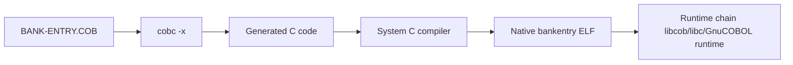

# Module 01 Design: Minimal Bank Batch Entry Point

## Version and ownership

- Interface version: ACCOUNT v1 (**frozen**, 47 bytes), from `curriculum/bank/copybooks/ACCOUNT-V1.CPY`; semantics in section 2 of [BANK-SYSTEM.md](../../../docs/curriculum/BANK-SYSTEM.md). Read-only in this module; do not change the layout.
- Program: `BANK-ENTRY` (student entry `starter/BANK-ENTRY.COB`, reference `instructor/modules/01-foundations/BANK-ENTRY.COB`).
- JOB: `scripts/run.sh` (parameters, input snapshot, lock, validation, publication, logs, RC).
- Platform: Linux x86-64, GnuCOBOL 3.2.0, default dialect (do not use `-std=cobol85`).

## Input source and assumptions

Upstream supplies one account snapshot per business date (synthetic data in this module). The file is ASCII, LF-terminated, 47 bytes per record. The JOB parameter explicitly supplies the business date; it is not inferred from file contents. The only upstream guarantee is “data for this business date”; this JOB independently validates length, characters, ordering, and duplicate keys.

## ACCOUNT v1 fields (1-based byte offsets and lengths)

| Offset | Length | Field | Encoding/unit | Valid values |
|---:|---:|---|---|---|
| 1 | 10 | account_id | ASCII digits | All digits, strictly ascending and unique within file |
| 11 | 8 | customer_id | ASCII digits | References a customer (existence is not checked here) |
| 19 | 3 | currency | ASCII letters | `JPY` only |
| 22 | 1 | balance_sign | Text sign | `+` or `-` |
| 23 | 13 | opening_balance | ASCII digits, integer in JPY minor units | All digits, signed range ±9,999,999,999,999 |
| 36 | 1 | account_status | Status letter | `A` active, `F` frozen, `C` closed; other values are business rejections |
| 37 | 8 | business_date | ASCII, `YYYYMMDD` | Must equal job business date |
| 45 | 3 | layout_version | ASCII | `001` |

## Validation state diagram

```mermaid
stateDiagram-v2
  [*] --> Open
  Open --> Structural: length≠47 / CR / missing final LF / nonnumeric account
  Open --> Structural: layout≠001 / date≠business date / currency≠JPY / invalid sign / nonnumeric amount
  Open --> Structural: account not strictly ascending (including duplicate key)
  Open --> Accepted: status ∈ {A,F,C}
  Open --> Rejected: status ∉ {A,F,C} (UNKNOWN-STATUS)
  Accepted --> Open: next record
  Rejected --> Open: next record
  Structural --> Failed8: fail whole batch; do not publish
  Open --> Publish: EOF reached and counts reconcile
  Publish --> [*]
```

Before OPEN, the business date is validated with `TEST-DATE-YYYYMMDD`; an invalid calendar date returns RC8 before reading.

## Rejection codes

| Code | Level | Trigger | Result |
|---|---|---|---|
| `UNKNOWN-STATUS` | Business rejection (RC4) | Status is not `A/F/C` | Write that record to `rejected.dat`; continue with others |
| `INVALID-ACCOUNT-RECORD` | Structural (RC8) | Length/character/layout/date/order/duplicate key | Fail whole batch; no output |
| `INVALID-BUSINESS-DATE` | Parameter (RC8) | Business date is not a calendar date | Fail before reading; no output |
| `FILE-STATUS=..` | System (RC12) | OPEN/READ/WRITE/CLOSE status is not 00/10 | Fail; no output |

## RC and publication conditions

| RC | Meaning | Output policy |
|---:|---|---|
| 0 | No business rejections; counts reconcile | Publish |
| 4 | Individual business rejections exist; interface remains complete | Publish reconciled result with rejection details; caller must explicitly allow RC4 to continue |
| 8 | Interface/order/duplicate-key/business-date contract error | Fail whole batch; do not publish |
| 12 | Filesystem/build/lock/publication error | Fail whole batch; do not publish |

Published directory contents: `control.txt` (fixed-width control report), `accepted.dat` (47 bytes + LF), `rejected.dat` (47 bytes + `|` + reason + LF), `inputs.sha256`, `outputs.sha256`, `run.txt`, `compiler.txt`, `source.sha256`. Before publication, `verify-publish.py` independently recalculates and compares the results; a mismatch returns RC12, removes staging, and creates no output directory. Reconciliation: `READ = ACCEPTED + REJECTED`.

## Source-to-executable relationship

`cobc -x` translates COBOL to C, then invokes the system C compiler to link a native executable. Runtime depends on `libcob`. `scripts/env-report.sh` uses `cobc -V`, `file`, `ldd`, and `readelf -h` to generate real evidence for this relationship. Both `build.sh` and `run.sh` compile in a **private staging directory** and publish atomically only after every check passes, preventing partial binaries from appearing in the final directory.
