# Module 02 Design: CUSTOMER v1 and Data Representation

## Version and ownership

- Interface version: CUSTOMER v1 (**frozen**, 27 bytes). Actual Copybook: [copybooks/CUSTOMER-V1.CPY](copybooks/CUSTOMER-V1.CPY). Semantics: section 2 of [BANK-SYSTEM.md](../../../docs/curriculum/BANK-SYSTEM.md).
- Program: `CUSTLOAD` (student entry `starter/CUSTLOAD.COB`, reference `instructor/modules/02-data/CUSTLOAD.COB`); JOB: `scripts/run.sh`.
- Platform: Linux x86-64, GnuCOBOL 3.2.0, default dialect (do not use `-std=cobol85`).

## CUSTOMER v1 field catalog (1-based offset, length, encoding, and unit)

| Offset | Length | COBOL name (Copybook) | Logical type | PIC | Encoding/unit | Valid values |
|---:|---:|---|---|---|---|---|
| 1 | 8 | CUSTOMER-ID | Numeric text | X(8) | ASCII digits, preserve leading zeroes | All digits, strictly ascending and unique in file |
| 9 | 10 | CUSTOMER-NAME | Alphanumeric | X(10) | ASCII, right-padded with spaces | Required, not all spaces |
| 19 | 8 | BALANCE-DEMO | Amount text | X(8) | ASCII digits, unit “cents”, unsigned | All digits, 0–99999999 |
| 27 | 1 | CUSTOMER-STATUS | Status letter | X | ASCII | `A` active, `D` inactive; other values rejected |

### Logical digits versus physical storage bytes

`PIC 9(8)` describes **logical numeric digits** and comparison semantics (it can be used with `COMPUTE` and has no leading-zero concept); `PIC X(8)` describes **8 bytes of ASCII text** (preserves leading zeroes and can be sliced directly). CUSTOMER v1 is a fixed-width text interface, so its 8-digit ID is stored as `X(8)`. If mistakenly represented as `PIC 9(8)`, `COMPUTE`/comparison loses leading-zero semantics, though the disk still contains 8 bytes of digit characters. `PIC A(n)` declares alphabetic category, useful for “letters-only name” experiments, but note: `MOVE` does **not** validate category. X data containing digits moved into `PIC A(n)` is preserved as-is, so validate with `IS ALPHABETIC` yourself; v1 therefore uses `X(10)` for names. In general `X(n)`/`A(n)`/`9(n)` are each **n bytes** (DISPLAY character numeric); `S9(n)V9(m)` has n+m logical digits and DISPLAY bytes; `S9(n) COMP-3` takes `ceil((n+1)/2)` bytes; `S9(n) COMP` takes 2/4/8 bytes. All fields in this module are DISPLAY text, so byte count equals character count.

### Evolution into the account model

`balance_demo` is for teaching only: an unsigned “cents” amount that cannot represent sign, account, currency, or opening/closing balance. In the account model, the balance moves into **ACCOUNT v1 (47 bytes)**, where `balance_sign` plus 13 `opening_balance` digits represents signed minor-unit amounts, versioned with `layout_version=001`. CUSTOMER v1's file meaning does **not** change silently. Migration has three steps: (1) retain identity/status in the customer file; (2) load the balance into ACCOUNT; (3) downstream systems consume only the `customer_id` reference.

Byte 27, `CUSTOMER-STATUS`, has **status semantics only (`A` active / `D` inactive), not customer classification**; CUSTOMER v1 **has no** customer-classification field. Module 11's “customer classification from 1 digit to 2” maintenance **must not** change this byte, and it is **not** a 27-to-28-byte migration of CUSTOMER v1. First investigate impact on a separate, versioned **enterprise customer record** layout, reusing or aligning with module 07 L4's `ENTERPRISE-CUSTOMER-V1` (1778-byte fixed binary record; `CUSTOMER-CLASSIFICATION PIC X` is A/B/C/D in v1 and expands to `PIC X(2)` in v2; layout version 001→002; see [curriculum/bank/README.md](../../bank/README.md)). Preserve the 27-byte teaching interface, explain the relationship, then migrate.

## Validation state diagram

```mermaid
stateDiagram-v2
  [*] --> Open
  Open --> Structural: length≠27 / CR / missing final LF / nonnumeric ID
  Open --> Structural: ID not strictly ascending (duplicate/out of order)
  Open --> NameMissing: name contains only spaces
  Open --> BadAmount: balance_demo is nonnumeric
  Open --> UnknownStatus: status ∉ {A,D}
  NameMissing --> Rejected
  BadAmount --> Rejected
  UnknownStatus --> Rejected
  Open --> Accepted: none of the above
  Rejected --> Open: next record
  Accepted --> Open: next record
  Structural --> Failed8: fail whole batch; do not publish
  Open --> Publish: EOF reached and counts reconcile
  Publish --> [*]
```

Rejection reason **priority is fixed**: `NAME-MISSING` → `BAD-AMOUNT` → `UNKNOWN-STATUS` (only the first matching reason is reported for a record).

## Rejection codes

| Code | Level | Trigger |
|---|---|---|
| `NAME-MISSING` | Business rejection (RC4) | Name is 10 spaces |
| `BAD-AMOUNT` | Business rejection (RC4) | `balance_demo` contains non-digits |
| `UNKNOWN-STATUS` | Business rejection (RC4) | Status is not `A`/`D` |
| `INVALID-CUSTOMER-RECORD` | Structural (RC8) | Length/LF/CR/ID characters/order/duplicate |
| `FILE-STATUS=..` | System (RC12) | OPEN/READ/WRITE/CLOSE is not 00/10 |

## RC and publication conditions

| RC | Meaning | Output policy |
|---:|---|---|
| 0 | No business rejections; counts reconcile | Publish |
| 4 | Individual business rejections exist; interface remains complete | Publish reconciled result with rejection details |
| 8 | Contract error such as length/LF/CR/ID/order | Fail whole batch; do not publish |
| 12 | Filesystem/build/lock/publication error | Fail whole batch; do not publish |

Published directory: `control.txt` (`JOB|CUSTLOAD|V1` + `CONTROL|READ..|ACCEPTED..|REJECTED..|BALANCE-TOTAL..`, fixed-width counts of 12 digits and total of 18 digits), `accepted.dat` (27 bytes + LF), `rejected.dat` (27 bytes + `|` + reason + LF), `inputs.sha256`, `outputs.sha256`, `run.txt`, `compiler.txt`, `source.sha256`. Reconciliation: `READ = ACCEPTED + REJECTED`. `BALANCE-TOTAL` sums `BALANCE-DEMO` for **accepted** records only (rejected records are excluded), using 18 digits and `ADD ... ON SIZE ERROR`; overflow returns RC12 and does not publish. Before publication, `verify-publish.py` independently recalculates and compares the result.

## MOVE experiment table (02.2)

Generated by `experiments/move/MOVELAB.COB`; `expected/movelab.txt` is the independent expected result:

| Case | Source | Result | Rule |
|---|---|---|---|
| A | `DISPLAY PIC 9(3)V99 VALUE 41.5` | `041.50` | Implied decimal appears when displayed |
| B | `MOVE 41.5(9V99) TO PIC 9(5)` | `00041` | Align decimals; fractional part is dropped |
| C | `MOVE PIC 9(5) TO PIC X(5)` | `00041` | Numeric to alphanumeric preserves displayed digits |
| D | `MOVE 'AB' TO PIC X(5)` | `AB   ` | Alphanumeric value right-padded with spaces |
| E | `DISPLAY S9(3) SIGN LEADING SEPARATE = -12` | `-012` | Leading separate sign occupies 1 byte |
| F | `DISPLAY S9(3)V99 LEADING SEPARATE = -1.25` | `-001.25` | Sign plus implied decimal |
| G | `MOVE 'ABCDEFGH' TO PIC X(5)` | `ABCDE` | Right-side truncation |
| H | `MOVE 12345 TO PIC 9(3)` | `345` | High-order numeric digits truncated; low digits retained |
| I | `MOVE 12345.67 TO PIC 9(3)V99` | `345.67` | High-order digits truncated; fraction retained |

**Must understand**: `MOVE` does not round or range-check. Amount calculations require explicit units and `ON SIZE ERROR`; never rely on floating point.

## Type and hierarchy experiment (02.1)

`experiments/types/TYPESLAB.COB` reads `fixtures/types/typeinput.dat` (three 5-byte records); `expected/typeslab.txt` is the independent expected result:

| Record | Raw `PIC X(5)` | Moved to `PIC A(5)` | `IS ALPHABETIC` | Conclusion |
|---|---|---|---|---|
| `ABCDE` | `ABCDE` | `ABCDE` | true → `A` | Pure letters: category and content agree |
| `AB123` | `AB123` | `AB123` | false → `M` | **`MOVE` does not validate**: digits remain in `PIC A` |
| `AB CD` | `AB CD` | `AB CD` | true → `A` | Spaces belong to alphabetic category |

The same program also demonstrates a `78 WS-LIMIT VALUE 25` constant (displays `25`), standalone `77 WS-COUNT`, `88 CLS-ALPHA/CLS-MIXED` condition names with `SET ... TO TRUE`, and 01/05 groups. Two reproducible failures: (1) X data containing digits moved to `PIC A` is not automatically rejected; validate with `IS ALPHABETIC`; (2) moving a numeric item to `PIC A` **fails compilation**, so the program cannot be published. `check.py` compiles/runs and compares byte-for-byte with `expected/typeslab.txt`, and asserts that numeric-to-`A` MOVE exits nonzero.

## Layout experiment (02.3)

`experiments/layout/LENGTH-PROBE.COB` compiles once with each of the canonical and **deliberately incorrect, non-contract** Copybooks:

| Compile `-I` directory | `LENGTH OF CUSTOMER-RECORD` | `LENGTH OF CUSTOMER-NAME` |
|---|---:|---:|
| `copybooks/` (canonical) | 27 | 10 |
| `experiments/layout/` (name **deliberately misstated** as `X(11)`) | 28 | 11 |

This proves that changing one `PIC` changes total record length and every later field offset, so length checks, downstream layout versions, and JOB contracts must be reviewed together. `experiments/layout/CUSTOMER-V1.CPY` is an **incorrect layout demonstration, not a contract**: it is neither the CUSTOMER v1 contract nor a 27-to-28 migration. Real maintenance requires impact investigation, versioning, and preserving the old interface.
