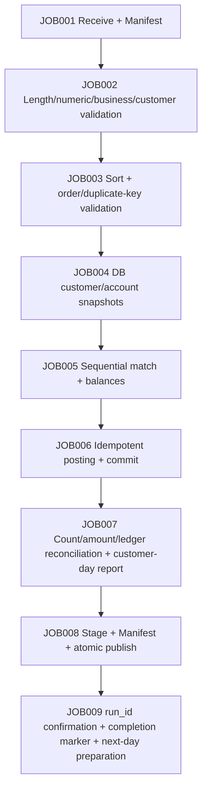

# Module 12 Design: Capstone Project (Unfamiliar-Version Banking System)

Corresponds to outline sections 12.1–12.4. This document defines the components and dependencies of the "unfamiliar version," mapping its four day types, RCs, 32 nodes, and 12 logical tables. Learner tasks and acceptance criteria are in [README](README.md); instructor root cause, solution, and grading are under `instructor/modules/12-capstone/`.

## 1. Components of the unfamiliar version (reuse, do not fork)

`system/` does not rewrite canonical programs from modules 06/07/08/10; it **orchestrates** them into an unfamiliar-version nightly system:

| Component | Canonical source | Capstone role |
|---|---|---|
| Customer validation CUSTV2 | Learner deliverable (`starter/CUSTV2.COB`, or `CAPSTONE_STUDENT_CUSTV2`); reference answer `system/cobol/CUSTV2.COB` exists only in instructor repository | JOB002d normalizes v1/v2 |
| Transaction validation BANKVAL | Module 10 learner deliverable (`starter/BANKVAL.COB`, or `CAPSTONE_STUDENT_BANKVAL`); in-repository reference `instructor/modules/10-jobs/BANKVAL.COB` | JOB002c business validation |
| Sorting SORTTX | `instructor/modules/07/02-sort-merge/SORTTX.COB` through its runner | JOB003b |
| 1:N matching BATCHL2 | `instructor/modules/07/03-one-to-many/BATCHL2.COB` through its runner | JOB005a |
| Customer-day report NIGHTRPT | Added for capstone (this repository) | JOB007d |
| DB/ledger/snapshot | `system/lib/capdb.py` (12 logical tables, offline checkpoint) | JOB004/JOB006 |
| Conservation/daily report reconciliation | `system/lib/report.py` (independent) | JOB007a-c/e |

Canonical components that are orchestrated elsewhere but not integrated into this module: module 06 `FILEVAL`, module 07 `MATCH`/`MERGETX`/`BATCHL3`/`BATCHL4`, and module 08's GixSQL/PostgreSQL path. They are within the readable scope of the "unfamiliar system," but the actual pipeline in this module uses the components in the table above.

## 2. Four day types (12.2)

| Day | Layout | Semantics | Expected RC | Publish |
|---|---|---|---|---|
| normal | v1 | All 6 transactions posted | 0 | Yes |
| abnormal | v1 | 4 validation rejections + 1 overdraft rejection | 4 | Yes (after reconciliation) |
| rerun | v1 | Rerun normal's same feed against the same DB | 0 | Yes (0 transactions posted) |
| extension | v2 | Enterprise customer classification is 2 characters, includes a `D1` customer | 0 | Yes |

The customer feed is an **independent, versioned CAP-CUSTOMER-FEED layout**: v1 is 31B (classification at byte 28: A/B/C/D), v2 is 32B (classification at bytes 28–29: A1..D1). It embeds the canonical 27-byte CUSTOMER v1, so byte 27 is always **record status** (A/D), not customer classification; canonical CUSTOMER v1 remains unchanged. The maintenance exercise changes `CUSTOMER-CLASSIFICATION` in this feed from 1 to 2 characters.

`CAP-CUSTOMER-FEED` is a deliberately **independent name**: canonical `ENTERPRISE-CUSTOMER` in modules 04/07 is a 1778-byte / 175-field large record, and module 11 has another experimental layout; all three are incompatible. Reusing the name `ENTERPRISE-CUSTOMER-Vx` would hide physical layout drift, so capstone uses a different name and explains the relationship in the headers of `CAP-CUSTOMER-FEED-V1/V2.CPY` and in README.

Additional cases (for incidents and hard gates): `broken` (duplicate transaction_id) → RC8, no publish; declared layout disagrees with physical width → RC8, no publish; system failure (mktemp/permissions) → RC12, no publish.

## 3. RC policy (consistent with BANK-SYSTEM §6)

| RC | Meaning | Continue | Publish |
|---:|---|---|---|
| 0 | Normal | Yes | Yes |
| 4 | Business rejection allowed by contract | Yes | Yes, after JOB007 passes |
| 8 | Business/structural anomaly (width, duplicate key, conservation mismatch) | No | No |
| 12 | System failure (permissions/mktemp/lock/unexpected child status) | No | No |
| 97 | Injected crash (experiment), preserve state | — | No |

Any child process code other than 0/4/8/12 is mapped to 12 at the shell boundary; it is never disguised as a business rejection.

## 4. JOB node mapping

The top-level 9 JOBs expand to 32 traceable nodes:

| JOB | Nodes |
|---|---|
| 001 | 001a receive Manifest / 001b validate SHA256 / 001c freeze snapshot |
| 002 | 002a raw width / 002b numeric / 002c business (BANKVAL) / 002d customer (CUSTV2) / 002e rejection report |
| 003 | 003a build/check SORTER / 003b duplicate keys + sort / 003c order validation |
| 004 | 004a DB reachability + calendar / 004b freeze customers / 004c freeze accounts |
| 005 | 005a Key Break + balances (L2) / 005b classify accepted/rejected / 005c isolate candidate |
| 006 | 006a read ledger / 006b idempotent posting / 006c commit marker |
| 007 | 007a count conservation / 007b amount conservation / 007c ledger cross-check / 007d customer-day report (NIGHTRPT) / 007e customer-day reconciliation |
| 008 | 008a stage / 008b Manifest / 008c atomic switch / 008d CURRENT + registry |
| 009 | 009a confirm run_id / 009b next-day preparation / 009c completion marker |

Each node writes `state/<node>.done` (including rc), and each JOB writes `state/<JOBxxx>.done`; reruns resume from markers and do not execute completed nodes again.

## 5. 12 logical tables

See the header comments in `system/lib/capdb.py`: customer, account, transaction_ledger, batch_run, batch_commit, customer_snapshot, account_snapshot, reject_log, control_total, publish_registry, idempotency_key, business_calendar.

**Default teaching path**: the DB layer is an offline file checkpoint (write the idempotency ledger first; derive/repair balances from "opening snapshot + ledger"). **Real DB path (R01)**: `scripts/real-db.sh` reuses the canonical module 10 harness (PostgreSQL17 + GixSQL + module 08 ESQL), commits balances and the idempotency ledger in one transaction, and reconciles using independent psql; reports `UNVERIFIED` when unavailable.

## 6. Idempotency, locks, snapshots, and publish

- Idempotency key `(business_date, transaction_id)`; the ledger is the sole source of truth.
- Output lock `<output>.lock`; business-date lock `<db>/locks/<date>.lock` (reject a live pid, reclaim a dead pid).
- Freeze the input snapshot using MANIFEST SHA256; the day's snapshot cannot be rewritten by that day's postings.
- Publish: private stage → generate and verify `manifest.json`/`MANIFEST.sha256` → switch using `mv -T -n` → move `publish/CURRENT` last; JOB009 writes the completion marker only after confirming CURRENT==run_id.

## 7. Maintenance (12.2) and incident (12.4)

- Maintenance: deliver impact investigation/target list/policy/Test/Evidence under `maintenance/`, changing customer classification from 1 to 2 characters; see `maintenance/regression/red-green.sh` for RED→GREEN.
- Incident: `incidents/incident-01/` contains issued materials without the root cause; instructor root cause and fix are in `instructor/modules/12-capstone/INCIDENT-01.md`.

## 8. Platform and boundaries

Actually verified only on Linux x86-64, GnuCOBOL 3.2.0, Bash, GNU coreutils, and Python 3. macOS/WSL/other architectures are **unverified**. The DB layer has **not been verified** against a real database. JCL/JP1 are reader-only mappings and have not been submitted to any scheduler.
