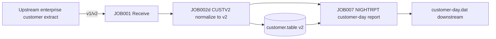

# Impact Investigation: Enterprise Customer Classification from 1 to 2 Characters

Investigation date: 20261010 (before any code changes). All conclusions come from read-only searches and byte-level checks.

## 1. Requirement

Expand **enterprise customer classification** from 1 character to 2. Classification resides in the separate, versioned `CAP-CUSTOMER-FEED` layout. This layout embeds canonical 27-byte CUSTOMER v1 (byte 27 = record status); **classification is a separate field immediately after it**:

- v1 (31 bytes, layout `001`): classification at **byte 28**, values `A`/`B`/`C`/`D`.
- v2 (32 bytes, layout `002`): classification at **bytes 28–29**, values `A1`..`D1`.

The enterprise layout record changes from 31 to **32 bytes**. The 27 bytes of canonical CUSTOMER v1 and the meaning of byte 27 **remain entirely unchanged**.

## 2. Field definitions (investigation starting point)

| Layout | Position | Length | Name | Rule |
|---|---|---:|---|---|
| v1 | 27 | 1 | record_status | `A` active / `D` disabled |
| v1 | 28 | 1 | customer_classification | `A`/`B`/`C`/`D` |
| v1 | 29-31 | 3 | layout_version | `001` |
| v2 | 27 | 1 | record_status | `A`/`D` (unchanged) |
| v2 | 28-29 | 2 | customer_classification | `A1`/`B1`/`C1`/`D1` |
| v2 | 30-32 | 3 | layout_version | `002` |

Classification begins **after byte 27 within the record**. Widening affects only later offsets and total length; offsets 1–27 (including status) do not change, so legacy readers that "read only the first 27 bytes" of the enterprise layout still receive the correct CUSTOMER v1 prefix. This is why the layout is extended rather than rewritten.

## 3. Usage locations (search command and matches)

```bash
rg -n 'customer|CUSTOMER|classification|CLASSIFICATION|status' \
  curriculum/modules/12-capstone/system \
  curriculum/modules/12-capstone/maintenance \
  curriculum/modules/12-capstone/fixtures
```

Matches and classification:

| Location | Use | Impact |
|---|---|---|
| `system/copybooks/CUSTOMER-V1.CPY` | Canonical interface definition (27B, byte 27 = status) | **Do not change** |
| `system/copybooks/CAP-CUSTOMER-FEED-V1.CPY` | Enterprise layout v1 (31B) | Reference baseline |
| `system/copybooks/CAP-CUSTOMER-FEED-V2.CPY` | Enterprise layout v2 (32B) | New delivery |
| `system/cobol/CUSTV2.COB` | Reads and normalizes enterprise customer data | Must support 32B and upgrade 31→32 |
| `system/cobol/NIGHTRPT.COB` | Customer-day report join | Must validate width against declared layout |
| `system/lib/capdb.py` | Customer table/snapshot (v2 storage) | Change `customer.table` to store 32B |
| `system/lib/validate.py` | Raw byte width guard | Enterprise layout width 31/32 |
| `system/jobs/job002-validate.sh` | Calls CUSTV2 | No change; follows CUSTV2 |
| `fixtures/*/customer.dat` | Synthetic input | Regenerate 31B/32B |
| `incidents/incident-01` | Incident materials | Customer file uses one layout; do not roll it back |

## 4. Dependency diagram



## 5. Unknowns (must be resolved with evidence)

- Could upstream send v1 and v2 together? — This course assumes one layout per entire file; mixed layouts are rejected by the JOB002a width check (RC8), an explicit boundary.
- Does downstream consume the old v1 view? — `NIGHTRPT` supports both v1/v2 reading, so v1 days remain usable.
- How should existing 31B customer rows in the DB be migrated? — See the migration steps in change-policy.

## 6. Conclusion

Impact: two COBOL programs, one DB storage format, and several interface/fixture/JOB descriptions; **do not change** canonical components from modules 06/07/10 or the 27 bytes of canonical CUSTOMER v1 or byte 27's status semantics. Risk is concentrated in the source of width declarations and v1 compatibility.
