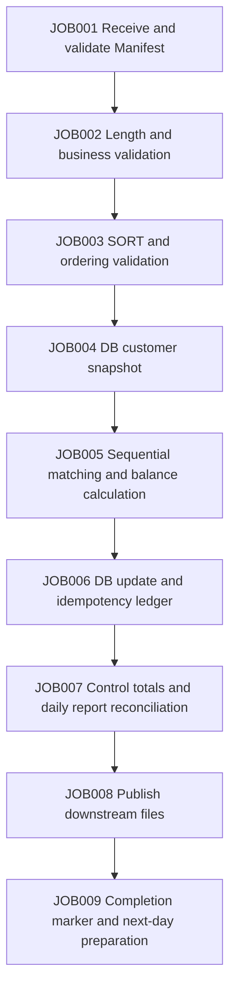

# Banking Overnight Batch Case Design

## 1. Business Model and Runtime Boundaries

A customer may have multiple accounts, and an account may have multiple transactions per day. The customer DB stores category, status, risk level, and version; the account Master stores opening balances; Transaction stores immutable transactions for the day. Overnight processing generates closing Master, rejected transactions, exception accounts, a daily report, and downstream files. Previous Day is used to compare with yesterday’s state; the DB Snapshot is the fixed customer view for this run.

The business date must be provided explicitly as a parameter; do not default to the machine’s current date. run_id identifies an attempt; the business idempotency key is defined by business_date, transaction_id, and business version. The initial course handles one currency; multi-currency extensions must reconcile separately by currency and must not simply sum amounts.

Specific business policies for closed, frozen, and overdrawn accounts must be specified in the relevant lab. Learners must not guess based on status letters.

## 2. Base File Contracts

Fixed-width text interfaces use synthetic ASCII data; name-field labs initially restrict names to ASCII so character count is not mistaken for byte count. Multibyte/EBCDIC is a separate lab. Each logical record ends with LF, which is not included in the record length. Packed Decimal/binary labs write raw-byte files and must not assume text line-by-line processing.

### CUSTOMER v1: 27 bytes

| Position (1-based) | Length | Field | Representation/rule |
|---|---:|---|---|
| 1–8 | 8 | customer_id | 8 digits, preserve leading zeros, unique |
| 9–18 | 10 | customer_name | ASCII, right-padded with spaces, required |
| 19–26 | 8 | balance_demo | Amount for basic labs, in minor units, unsigned; not the final account ledger |
| 27 | 1 | status | A active, D disabled; reject all others |

This layout is used for the supplied fixed-width sample. When moving to the account model, the balance moves into ACCOUNT; explain the reason for the evolution and the migration steps. Do not silently change the meaning of the file.

### ACCOUNT v1: 47 bytes

| Position | Length | Field | Rule |
|---|---|---|---|
| 1–10 | 10 | account_id | Numeric key, unique |
| 11–18 | 8 | customer_id | References a customer |
| 19–21 | 3 | currency | JPY for the first phase; the course uses a consistent minor unit, with no implicit conversion |
| 22–22 | 1 | balance_sign | + or -, explicitly stored in the text interface |
| 23–35 | 13 | opening_balance | Integer minor units; validate limits and overflow |
| 36–36 | 1 | account_status | A active, F frozen, C closed |
| 37–44 | 8 | business_date | YYYYMMDD, validated against the course calendar |
| 45–47 | 3 | layout_version | 001 |

### TRANSACTION v1: 55 bytes

| Position | Length | Field | Rule |
|---|---|---|---|
| 1–10 | 10 | account_id | Matching key |
| 11–26 | 16 | transaction_id | Part of the business idempotency key |
| 27–34 | 8 | business_date | Must match the job business date |
| 35–40 | 6 | sequence_no | Processing order within an account; do not rely on incidental SORT order |
| 41 | 1 | direction | C credit, D debit |
| 42–54 | 13 | amount | Minor units, nonnegative; zero-amount policy defined separately |
| 55 | 1 | status | N pending; duplicate/other status policy must be explicit |

Sort accounts by account_id; sort transactions by account_id, sequence_no, transaction_id. A duplicate account_id in Master is a business exception; do not arbitrarily choose one. A duplicate transaction_id must not be posted again.

Production labs must not rely only on the content after it has been received into a PIC field to determine the original record length; obtain the raw byte length at the validation boundary. Short/long records must not be silently padded or truncated and then treated as valid.

## 3. Requirements for Records with 150+ Fields

The extended business record must have at least 150 named leaf fields, grouped into areas such as identity, address/contact, account attributes, customer category, risk/compliance, limits, channel permissions, business dates, and version/audit. The field catalog must provide: stable field_id, COBOL name, business name, group path, PIC/USAGE, byte offset/length, unit, nullability, default, valid range, sensitivity level, comparison strategy, and interface version.

Do not invent a total length before this stage; publish it only after validating the complete field catalog against a locked ABI. Do not double-count REDEFINES/OCCURS; FILLER does not count toward the 150 business fields.

Use three explicit comparison strategies: raw-byte comparison, normalized-text comparison, and decoded-numeric comparison. Ignored fields (such as runtime timestamps) require a business reason. Difference output includes run_id, business key, field_id, field name, position, old/new values, strategy, and source version; provide redacted exercises for sensitive fields.

## 4. Sequential Matching Algorithm Contract

### L1: 1:1

Master and Transaction keys are unique and each stream is ordered. Compare the keys at two read pointers: if equal, output MATCH and advance both; if Master is smaller, output MASTER ONLY and advance Master; if Transaction is smaller, output TRANSACTION ONLY and advance Transaction. After one side reaches EOF, drain the remaining stream. Use a separate EOF state; do not use a sentinel value that might be a real key to represent EOF.

Count invariants: Master count = MATCH + MASTER ONLY; Transaction count = MATCH + TRANSACTION ONLY. Fixtures must cover empty/empty, empty/nonempty, nonempty/empty, leading/trailing orphan keys, all matched, and no matches.

### L2: 1:N

Master accounts are unique and transactions are grouped by account; consume the same-key transaction group and apply it in sequence_no order. Keep only the cumulative state for one account in memory; do not store the whole file. For each account, reconcile: closing balance = opening balance + accepted credits − accepted debits; rejected transactions must not enter the amount accumulation. Handle per-transaction and cumulative overflow separately.

### L3: Multiple Files and N:N

Master, Transaction, DB Snapshot, and Previous Day each have keys and cardinalities; write the relationship rules and state transition table before implementation. If both sides have multiple records for the same key, explicitly define pairing by sequence, aggregation before comparison, or a business-authorized many-to-many relationship; never assume a Cartesian product. Specify handling for missing customer, missing account, missing previous day, and mismatched snapshot date.

### L4: Large-Record Differences

Compare the key and layout version first, then compare fields. Raw value equality differs from numeric equality; do not conflate decimal scale, trailing spaces, signs, invalid bytes, or NULL. Acceptance uses an independently defined changed-field list and verifies every difference without extra false positives.

## 5. JOB Flow

| JOB | Input | Output/checkpoint | Principle after failure |
|---|---|---|---|
| 001 | Intake directory, Manifest | Immutable input snapshot, checksums | Do not proceed to validation |
| 002 | Snapshot, layout contract | Valid/rejected data, control totals | RC4 or RC8 according to rejection policy |
| 003 | Valid records | Sorted file, ordering evidence | Temporary-space failure RC12; no formal artifacts |
| 004 | Business date, DB | Snapshot with version/cutoff | On connection failure, do not present stale data as current |
| 005 | Four validated streams | Candidate closing Master, matching/difference reports | Isolate candidate; do not publish |
| 006 | Candidate changes, idempotency keys | DB commit identifier, application ledger | Check whether already committed before recovery |
| 007 | Details, rejections, DB identifier | Count and amount reconciliation evidence | Do not publish unless it passes |
| 008 | Reconciled candidate | Formal downstream files, publication Manifest | If DB committed, recover publication; do not debit again |
| 009 | Evidence of all completed work | Job completion state | State is queryable; do not overwrite original run records |

## 6. RC, Configuration, and Logs

RC0 is normal; RC4 is a Warning allowed by contract; RC8 is a business exception; RC12 is a system exception. Preserve unexpected process exit codes as raw values, map them to RC12 at the Shell boundary, and record them. Do not disguise an operating-system signal as a business rejection.

Each JOB declares its allowed set of prerequisite RCs; by default, only RC0 may continue. Parameter precedence is CLI > parameter file > explicit default; environment variables are only for agreed configuration. Required parameters include business date, run_id, input/output/temp/log paths, layout version, and DB configuration entry point. Credentials must not be written into source code, logs, or course data.

Logs must include time and timezone, business date, run_id, job_id, phase, source/output checksums, counts, amount summaries, raw/mapped RC, and start/end status. A success log does not replace business reconciliation.

## 7. Rerun and Recovery

Input snapshots are immutable; acquire locks by business date/system scope and record their owner and validity. Generate temporary output in a separate run directory, validate it, then switch the formal pointer through controlled publication. Atomic rename only solves problems within its applicable filesystem scope; it does not automatically ensure consistency between DB and files.

Four mandatory crash points: before DB commit, after commit but before writing the local checkpoint, after file generation but before publication, and after publication but before writing completion state. Verify facts using the DB idempotency ledger, commit identifier, output Manifest, and checksums; do not infer transaction state from the last line of a Shell log.

Reruns fall into three types: recover a failed phase, rebuild derived files from a snapshot, and run a business correction. A business correction requires a new business version and audit relationship; do not simply delete a completion marker and apply transactions again.

## 8. DB Model and Technical Validation

Course logical tables: customer, account, transaction_ledger, batch_run, batch_commit; seed data and constraints must be committed to the repository. transaction_ledger has an explicit unique business key. DB updates and idempotency records belong in the same transaction; specify the consistency strategy for Cursor snapshots.

The specific Embedded SQL installation, precompilation, and error codes must be locked after P1 validation. PostgreSQL is the recommended baseline; do not claim SQLCODE -803 from another DB as its actual error code. Include a unique-constraint root-cause exercise and a platform error-mapping table.

## 9. Scale and Correctness Tiers

- Micro: 0–20 rows, manually reconciled row by row, with all EOF and boundary cases.
- Medium: 10,000 accounts and 100,000 transactions, for flow and statistics acceptance.
- Stress: 100,000 accounts and 1,000,000 transactions, to verify bounded memory and temporary-space handling in core matching.

For each tier, record seed, business distribution, file size, checksum, expected counts, and amounts. Set specific time/RSS thresholds in P1 after documenting the hardware. Large-volume runs must not be accepted solely because “the program did not crash.”
