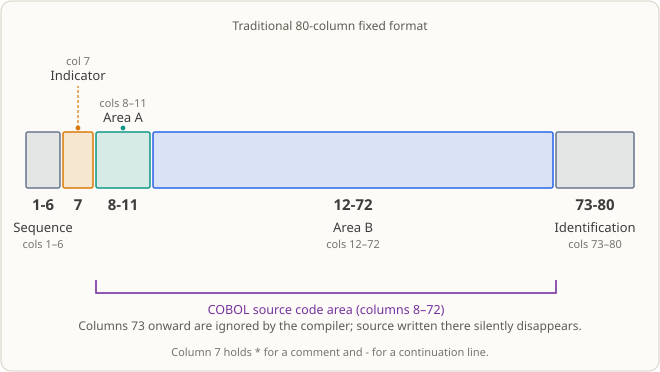

# Lesson 01 — Hello COBOL: Get Your First Batch Program Running in a Bank Computer Room

## The Business Setting

It is half past eight on a Monday morning and you have just reported for duty in the city commercial bank's batch processing team. Your mentor does not brief you on the business; he only tosses out one sentence:

> "Today you do exactly one thing: make this machine execute the program you wrote, and let me see it on the screen."

You may think: how hard can that be? But inside a bank, that sentence carries a very concrete meaning: **get the scheduler to recognize your program.**

No one is sitting at a keyboard typing commands at two in the morning. The scheduler in the duty room (cron, Control-M, and similar tools) pulls up job after job on schedule, and it judges success or failure based on exactly two things: where the executable lives, and the exit status code the process returns when it finishes. Exit code `0` means "proceed"; anything non-`0` triggers an alarm — and an alarm means someone gets woken up by phone in the middle of the night.

So your very first program is not there to print a sentence; it is there to prove one thing: this machine can run what you wrote, and when it fails, you know where to look.

## Why Learn This Now

You may be thinking: compiler, executable, exit code — I see these every day in Java and Python, so why spend a whole lesson on them?

The issue lies in those three words, "every day." COBOL does not look at all like the languages you are used to:

- Its source file is in **fixed format** — putting the same line of code in column 8 or column 12 changes its meaning, and the compiler will refuse it outright if you are in the wrong column.
- "Compile" and "run" are two distinct steps, with the produced executable file sitting in between.
- How each of these two steps can fail, and what to look at when they do, is completely different from running `python xx.py`.

This lesson does exactly one thing: walk the chain "source file → compile → executable → output → exit code" end to end. The remaining 31 lessons all rest on this chain — no matter whether later you process one hundred and twenty thousand transactions or connect to a database to fetch balances, you must first be able to compile, run, and understand why something exited.

## What This Knowledge Point Is, and What Problem It Solves

**What this knowledge point is.** A minimal COBOL program consists of four parts: the program identification (`IDENTIFICATION DIVISION` + `PROGRAM-ID`), the execution procedure (`PROCEDURE DIVISION`), the output statement (`DISPLAY`), and the ending statement (`STOP RUN`). This lesson also clarifies how to use `cobc` to turn it into a runnable executable on Linux.

**What business problem it solves.** Banks and insurance companies rely on nightly batch runs to close their books: transactions generated at teller windows and on apps during the day are processed job by job overnight. These jobs are not started by hand; they are pulled up by the scheduler. So every program must meet two minimum requirements — it must be automatically launchable, and it must report success or failure on its own. This lesson teaches exactly "how to get a program into this system": the compiler can find the entry point, the scheduler can start it, and the person on duty can tell from the exit code whether the run actually succeeded.

**When it is still not enough.** The program in this lesson does not read data, does not make decisions, and does not compute amounts. Do not underestimate this boundary: in a real batch, "it ran but produced wrong results" is far more dangerous than "it would not run" — the former might not be noticed, while the latter triggers an alarm that same night. The checks that decide whether a result is correct do not appear until the lessons that handle files and amounts (starting with lesson 03).

## Capabilities and Limits After Completing This Lesson

After finishing this lesson you will be able to:

- Use `cobc -fsyntax-only` to check whether a `.cob` source file will pass syntactic parsing.
- Use `cobc -x -o <name>` to compile a source file into an executable, and confirm from the command's return code whether the compile really succeeded.
- Run the executable, distinguish what goes to standard output from what goes to standard error, and use the exit code to judge whether the program ended normally.
- Point out, in a minimal program, which lines are the program identification, the execution entry, the output statement, and the normal-ending statement.
- Explain why a program that neither reads data nor defines fields does not need a `DATA DIVISION`.

Limits: this lesson does not define data items, does not read files / command line arguments / databases, and does not perform any computation. It also does not yet deal with runtime failures beyond syntax errors. Fields start in [lesson 02](../02_data-types/README.md); files start in lesson 15; error classification and return code semantics are covered systematically only in lesson 26.

## Runtime Environment

- GnuCOBOL 3.2.0, default dialect (do not pass `-std=cobol85`), source files in fixed format.
- A Linux terminal; this lesson needs no database, additional tools, or third-party libraries.
- The run will not create business data files; the only thing produced in `build/` is a single executable.

## From Punch Cards to Personal Computers: How Computing and COBOL Changed

First, a few terms that are easy to mix up. This section is about **punch cards** and **card readers**, not time clocks used to record attendance. A punch card was a stiff card with holes in fixed positions; combinations of holes encoded letters, digits or instructions, and a card reader fed that information into a computer. A **mainframe** was a large computer centrally purchased and maintained by an organization and shared by many people. They are different things: a card was one way to enter or store information, while a mainframe was the machine that did the computing.

Think of the history as four stages:

1. **Batch jobs and cards.** Early computers were expensive and often used centrally by organizations. Programmers wrote code on paper, then had each line transferred to a card. Data might be on another card deck or on magnetic tape. An operator submitted the cards to the mainframe, which processed jobs in batches and usually printed the results on paper. A “batch job” means collecting a group of tasks and letting the computer process them in sequence, usually without someone watching a screen and responding at every step.
2. **Mainframes with interactive terminals.** Later, people could type commands and view results using a keyboard and screen. Such a terminal was often just a “window” connected to the mainframe: programs ran and primary data stayed on the remote computer shared by many users. So **a screen did not mean a personal computer**. The screen changed how people interacted with the computer, while computing resources could still be centralized on a mainframe.
3. **Personal computers.** As personal computers spread, individuals and small teams could edit, save and run programs on their own computers. Code gradually moved from physical card decks to files on tape and disks; developers could edit source in an on-screen editor, then compile and run it. Personal computers did not immediately replace mainframes: organizations such as banks continued to use mainframes for large-scale, centralized processing.
4. **Several platforms today.** COBOL programs can still run on mainframes, and compilers for Unix, Linux, Windows and other platforms can compile and run them too. The GnuCOBOL used in this course lets you learn and run COBOL on Linux; you do not need physical cards or access to a mainframe.

COBOL changed along with these stages. It was created when large organizations needed to process many business records, so it emphasizes records, files and batch processing. Early source code was often laid out in fixed columns to fit the card format. Fixed format preserves those line-and-column conventions, but **it does not mean that cards are still used today**. Later, industry standards and compilers for different platforms made it possible to implement the same language on machines from different vendors, reducing the need to rewrite a program for every machine. The language standards also added capabilities; for example, the 2002 standard introduced free-format source, among other features. Old fixed-format programs remain in use, and newer free-format programs can be written too.

The key relationships are: **a punch card was a common input medium in the past; a mainframe is a centrally shared computer; a terminal is a connected keyboard and screen; and a personal computer brings computing to an individual's desk. COBOL is a programming language that has continued to be used and has evolved across these platforms and eras.** Portability helps source code move between machines, but real migrations still have to handle compiler dialects, operating systems, file formats and data representation.

## Breaking This Code Open

### What Is Actually In a Program

```cobol
       IDENTIFICATION DIVISION.
       PROGRAM-ID. HELLO01.
       PROCEDURE DIVISION.
           DISPLAY "こんにちは、COBOL！".
           STOP RUN.
```

Five lines, four concepts:

- `IDENTIFICATION DIVISION`: tells the compiler "this is a program unit; below it starts the description."
- `PROGRAM-ID. HELLO01.`: assigns it a name. This name is the program's identity; it affects more than compile — when you learn `CALL` later (lesson 24), other programs will locate you through this name.
- `PROCEDURE DIVISION`: only from here onward are the "steps that will actually execute." Everything before is declarations.
- `DISPLAY` writes a piece of text to standard output, and `STOP RUN` ends the run.

Note that **`DATA DIVISION` is missing here.** Not because it was forgotten, but because this program genuinely has no data to store — no balance, no account number, no counter. The COBOL rule is "declare what you use"; you will need `DATA DIVISION` for the first time in lesson 02.

### Comparing with Java / Python

`PROGRAM-ID` is roughly the equivalent of a Java class name or a Python module name; `DISPLAY` is roughly the equivalent of `System.out.println(...)` or `print(...)`. These analogies help you grasp the use quickly, but do not stretch them too far: a COBOL Division is **source program structure**, not a class, not a function; it has no "objects," and it does not rely on indentation to determine hierarchy.

### Fixed Format: Where COBOL Drives Beginners Away

When this language was young, input came through punched cards, so it carries hard rules about "which column" all the way to today:



- **Column 7**: the indicator area. Putting `*` here means this whole line is a comment; putting `-` here means line continuation.
- **Columns 8–11 (Area A)**: Division names, `FD`, `01`-level declarations, and paragraph names must begin here.
- **Columns 12–72 (Area B)**: statements such as `DISPLAY` and `MOVE` are written here.
- **Column 73 onward**: the identification area, which the compiler **completely ignores.** Code that lands here silently vanishes — one of the most painful traps for newcomers.

All source files in this course follow these rules. Your habit of "align everything to the leftmost edge" from other languages will fail immediately here.

### About the Japanese in the Output

This course has a convention: explanations and comments are written in Chinese, but the **business text printed by the program at runtime is in Japanese** (the teaching material follows the real practice of Japanese financial systems; the field names and status words in the output remain Japanese). So this lesson outputs `こんにちは、COBOL！`, which means "Hello, COBOL!" When judging program behavior, treat the actual output as the source of truth; if the meaning does not line up, come back to the Chinese mapping given in this README.

## Complete Example Source

The full source is [`lesson.cob`](./lesson.cob), written in fixed format.

## Line-by-Line Walkthrough

| Source line | Role | What happens at runtime |
|---|---|---|
| `IDENTIFICATION DIVISION.` | Declares "from here on, a program unit begins" | Used during compilation to parse the subsequent program declarations; produces no output |
| `PROGRAM-ID. HELLO01.` | Names the program unit | The compiler writes this name into the produced executable |
| `PROCEDURE DIVISION.` | Declares the start of the executable procedure | Runtime enters the program from here |
| `DISPLAY "こんにちは、COBOL！".` | Writes the literal to standard output | The terminal receives a line `こんにちは、COBOL！`; this lesson has no business fields yet |
| `STOP RUN.` | Ends the COBOL run unit normally | Returns control to the operating system; no COBOL statements follow |

There is almost no "data changing" here: there are no user-defined data items, and no balances or records are touched. The only output is that single greeting.

## Run and Observe

This lesson does not read an input file, command line arguments, or a database, so running it from inside the lesson folder versus from another folder gives the same result.

**Input:** none. The sentence on the screen comes from the literal in `lesson.cob`, not from external data.

**Commands and what each step does:**

```sh
mkdir -p build
cobc -fsyntax-only lesson.cob                    # syntax check only; does not produce an executable
cobc -x -Wall -o build/lesson_01 lesson.cob      # compile and produce the executable
./build/lesson_01                                # run the program; output goes to standard output
echo $?                                          # check the previous command's exit code
rm -rf build                                     # clean up the produced executable
```

**Expected results:**

| Observation | Expected value |
|---|---|
| `cobc -fsyntax-only` exit code | `0` |
| `cobc -x` exit code | `0`, with no compile diagnostics |
| Standard output (stdout) | one line `こんにちは、COBOL！` |
| Process exit code (`echo $?`) | `0` |
| Produced files | only `build/lesson_01` |

Two pitfalls mentioned up front. First, `-fsyntax-only` only checks syntax; it neither produces an executable nor runs the program, so **its passing does not mean the program will run**. Second, standard output and standard error are two distinct streams: in this workspace, at runtime a line `Warning: program compiled against libxml 212 using older 209` may appear on standard error. This warning comes from a version mismatch in the linked libraries inside the runtime environment, not from your program; the program's actual output is on standard output, and the exit code is 0. You will see this in every lesson from now on, so do not count it when judging business results.

## Modification Exercise

Change the greeting to `こんにちは、バッチチーム！`. Starting from the original [`lesson.cob`](./lesson.cob), redo the syntax check, compile, and run; confirm the terminal displays only the new sentence and the exit code is still 0. The full prompt and expectations are in [`exercise.md`](./exercise.md); the reference answer is in [`answer.md`](./answer.md).

## "Apply It Elsewhere" Exercise

Now switch to an insurance company: write a minimal program that uses two lines of output to indicate the batch name and the "waiting for input file" status. Use only the constructs taught in this lesson (program identification, string output, ending statement); do not introduce fields, conditions, loops, or file operations that have not been covered yet. Record your own compile commands, actual output, and exit code. The prompt is in [`exercise.md`](./exercise.md); this question does not provide a reference answer.

## Walking Through a Real Workflow

If you placed this program in a bank at night, it would look like this:

1. **01:50 a.m.** The scheduler pulls up `lesson_01` on schedule; it prints one line of "batch started"-style information and exits with code `0`.
2. Seeing `0`, the scheduler pulls up the next job (in a real batch, the next one reads the transaction file).
3. **One day the exit code is non-0.** The on-duty person gets called; the first thing to check is standard output and standard error — exactly the two streams this lesson teaches you to tell apart.

A real batch will, of course, not just print a single sentence. It will grow from here: lesson 03 starts computing amounts; lesson 15 starts reading files; lesson 26 starts distinguishing "business rejection" from "system failure" (only then does the exit code get a real design); lesson 32 brings everything together into a complete nightly reconciliation project.

## What Happens if This Code Goes to Production

- **Who schedules it**: the scheduler in the duty room or a shell job, which only honors the executable path and the exit code; it does not look at your screen.
- **Who reads its output**: ops and incident-response engineers read standard output / standard error; that is why "compile success," "run success," and "exit code 0" must be distinguishable.
- **The accident most likely to occur in the first month**: mistaking an environmental warning on standard error for a program error, or assuming the program will run simply because compilation passed.

To be clear: this lesson only proves the source can be compiled and can output. It does not yet read business data, does not check amounts, and is far from production-grade error handling — field definitions are in [lesson 02](../02_data-types/README.md), file reading begins in lesson 15, and the design of error classification and return codes is in lesson 26.

## References

- [GnuCOBOL Manual: Hello, world! and the compile commands](https://gnucobol.sourceforge.io/doc/gnucobol.html#Hello_002c-world_0021)
- Course home in the repository: [README.md](../../README.md)
