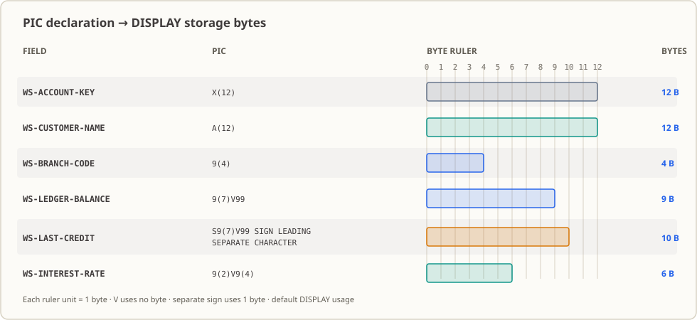

# Lesson 02: Use PIC to Describe the Field Types and Widths of an Account Snapshot

The first thing a bank's nightly batch grabs is an account snapshot: one line per account in fixed-length text; how many digits the account number has, how many decimal places the amount has, what the date looks like — all of it is fixed by agreement. This lesson declares this batch of fields (identifiers, quantities, amounts, interest rates, business codes) as data items inside the program using `PIC` and prints them, producing a field catalog that can be compared field by field against the upstream file. Lesson 03 then performs monetary arithmetic on these widths and precisions, and lesson 09 gathers these flat fields into record grouping.

## The Business Setting

At 23:40, the core system finishes the day's last posting cycle and exports the account snapshot to a file for the second half of the night batch. This file is fixed-length: one line per account. Which columns are the account number, which are the name, which are the balance — the upstream data dictionary spells them all out. Once your program gets hold of it, the very first thing it must do is not compute money, but "read that line correctly" — from byte to byte, and figure out what exactly is between which byte and which byte.

The easiest way to get in trouble here is not difficulty, but "looks right."

Take the account number first. A common scene: the next morning the teller desk answers a customer call saying money is missing from the account. Trace it down the line, and the problem is that the leading zeros of the account number got lost. The upstream sent the twelve-digit `000123456789`, but the program declared it a numeric field — numerics do not store leading zeros, so that string of zeros was quietly trimmed away. But those zeros are not "zeros in some numeric value"; they are the account number's actual appearance. Once the leading zeros go, the account number no longer matches the account master, and the reconciliation step marks the whole record as "account not found."

Now a quieter and more expensive accident. The upstream quietly widens "customer name" from 12 characters to 16. You never got the notification, so the program still counts 12 characters forward. The extra four characters are then treated as the start of the next field, shifting the balance, the date, and the status code right by four columns. The program does not raise a single error message, but every amount it outputs is wrong — mistakes like this are usually not discovered until someone audits the accounts.

Dates fool you in the same way. The opening date is just an eight-digit number in the file: `20261013` looks perfectly fine, but `20261399` (month 13, day 99) fits in just the same. Eight digits only guarantee "a shape of eight digits," not that a real day is on the calendar.

(The fields and numbers above are demonstration samples for the course; they exist to explain why field contracts matter, and do not correspond to any real institution or real account.)

## Why Learn This Now

You might think: field widths — isn't it enough just to write them out clearly? In Python `str` doesn't care how many characters; in Java `String` you don't declare a length; why does COBOL force you to spell out every digit up front?

Because here, "width" is not a suggestion, it is **what the file itself looks like.** When COBOL reads a fixed-length record, it cuts according to the widths you declared: declare the account number as `X(12)`, and it cuts away 12 characters from that line; declare `9(7)V99`, and it assumes the next 9 characters are a seven-digit integer with two decimals. If your declaration is wrong, what comes out is not what you wanted.

The lesson 01 program only prints fixed literals and has no business fields at all. That style stops being enough the moment we hit this scenario: literals cannot declare widths, and the later statements have no name to reference them by for arithmetic or comparison. So this lesson has to answer three questions — what type should a field that "looks numeric but is really an identifier" use; how should the integer and decimal parts of an amount be defined; what shape should codes like dates and status codes take. Once you have the answers, you have a **field catalog** both sides agree on: however upstream sends it, the program reads it that way.

Take one more step forward: lesson 03 uses this width and precision to do amount addition and subtraction, lesson 09 packs these flat fields into record grouping, lessons 17 and 18 use the widths and offsets here to parse real files. If widths are fuzzy here, downstream becomes a chain of broken accounts.

## What This Knowledge Point Is, and What Problem It Solves

**What this knowledge point is.** `PIC` (the short form of `PICTURE`) is a sketch you draw for a field: how many characters, letters or any characters, whether numbers, where the decimal point goes. `PIC X(12)` says "12 characters, anything can appear"; `PIC 9(7)V99` says "seven integer digits plus two decimal digits, and the decimal point occupies no position." A field name, this sketch, plus the optional initial `VALUE` form a complete data item declaration. The compiler allocates storage accordingly, and at runtime it interprets bytes by the same description.

**What business problem it solves.** An account snapshot is never used by one party alone: the upstream core system produces it, our batch reads it, downstream reconciliation and reporting pass the result on. For the parties to talk to each other, they must agree on each field's category, width and precision. `PIC` is the form that lives in the source — and it is **compile-time**; if the format doesn't match, it fails the compile gate, you don't have to wait until the nightly batch to discover it. The maintainer doesn't need to search the docs either — the account number takes 12 columns, the amount keeps only two decimals; that's literally written in the code.

**When it is still not enough.** The boundary must be stated clearly: `PIC` governs shape, not correctness. `PIC 9(8)` does not guarantee those eight digits form a legal date; `PIC X(12)` does not guarantee the account exists. This lesson already verified it: change the opening-date initial value to `20261399` (month 13, day 99), and the program compiles and prints the value as usual. The real checks — whether a date is legal, whether an amount is negative, whether a status code is recognized — have to wait until the business rules (from lesson 04) and error handling (in lesson 26).

## Capabilities and Limits After Completing This Lesson

After finishing this lesson you should be able to:

- Read what `PIC A(12)`, `PIC X(10)`, `PIC 9(7)V99`, and `PIC S9(7)V99` each allow in terms of characters, how many digits, and whether a sign is included.
- Decide whether a field uses `X` or `9` based on its business meaning, and explain why the account number must be text, never numeric.
- State that `VALUE` gives `WORKING-STORAGE` a compile-time initial value, not input from files, databases, or command lines.
- Explain that the implied decimal point declared by `V` occupies no storage characters, but `DISPLAY` in GnuCOBOL 3.2.0 still prints it.
- Figure out on your own why `125000.75` declared as `PIC 9(7)V99` prints as `0125000.75`, and explain why `SIGN LEADING SEPARATE` makes a field occupy one more character than a same-width unsigned amount.

Limits: this lesson only declares program-internal constants and prints them. It does not read files, connect to databases, take command line arguments, perform computation, or do business validation. There is no check on date values, currency codes, or status code ranges; `USAGE COMP` / `COMP-3` physical bytes and record grouping (`01` group items) are also out of scope. Assignment and arithmetic are in [lesson 03](../03_move-compute/README.md), business conditions and rejection rules are in [lesson 04](../04_if-conditions/README.md), record grouping is in lesson 09, file input is in lesson 15.

## Runtime Environment

- GnuCOBOL 3.2.0, default dialect (do not pass `-std=cobol85`).
- The source files are fixed format: column 7 is the indicator area, Area A starts at column 8, Area B starts at column 12, and program text must not pass column 72.
- The fixed-format right boundary in this machine's GnuCOBOL 3.2.0 is **byte** 72: anything from byte 73 onward is ignored (verified: a closing quote at byte 72 passes; at byte 73 the literal gets truncated). Japanese takes 3 bytes per character, so lines containing Japanese hit the boundary earlier than equivalent-width ASCII lines.
- Linux terminal; this lesson does not depend on a database, additional tools, or third-party libraries.
- The run produces no business data files; only one executable file is created inside the lesson's local `build/` directory.

## Writing Down This Field Contract

### Scenario: the field contract for an account snapshot

The account snapshot upstream sends (this lesson is simulated using in-program constants for now, before we have a real file) contains the account number, customer info, balance, interest rate and various business codes. To be able to read it, both sides must first settle each field: text or numeric, how many columns, where the decimal point is. COBOL expresses this agreement through a data description entry — a name + a `PIC`, plus the optional `VALUE` and `USAGE`. The compiler allocates storage accordingly and uses the initial value to check widths; at runtime it interprets bytes by the same description.

That easily-overlooked boundary must be repeated: `PIC` describes shape, not business validity. `PIC 9(8)` does not guarantee these eight digits are a legal date; `PIC X(12)` does not guarantee the account exists — this lesson has verified: change the date initial value to `20261399` (month 13, day 99), and the program still compiles and prints that value. Amount units and precision must also be agreed on first: this lesson declares all amounts on the implicit scale of "seven integer digits + two decimals" and interest rates on a four-decimal scale.

### The PIC symbols used in this lesson



- `A`: accepts only letters and blanks. Here it describes the customer name, customer type, and country code.
- `X`: an alphanumeric position that accepts letters, digits, punctuation, and blanks. Here the account number, customer number, postal code, currency, reference number, and batch number are all treated as text.
- `9`: a digit position. `9(4)` is four `9`s; the branch code, transaction count, sequence number, and date-digit fields all use it here.
- The `(n)` in `9(n)`: a repeat count. `X(12)` is twelve character positions, `9(7)V99` is seven integer digits plus two decimal digits.
- `S`: declares this numeric field carries a sign. Combined here with `SIGN LEADING SEPARATE CHARACTER`, it writes the positive/negative sign as a separate character.
- `V`: declares the implied position of the decimal point. It does not occupy storage; what `DISPLAY` prints is determined by `DISPLAY`.
- `VALUE`: gives a data item a compile-time initial value. The values here are demonstration samples, not runtime input.

### Comparing with Java / Python

`PIC X(n)` resembles a fixed-length string, `PIC 9(n)` resembles a fixed-length decimal integer, `PIC 9(n)V9(m)` resembles a fixed-point `Decimal`. The difference: `PIC` spells out character positions, decimal scale and storage layout all at once, and it's a compile-time contract. Java's `String` and Python's `int` declare no width. The analogy only helps with intent, not type equivalence.

### Several common traps

- Assume `PIC 9(8)` enforces a date. It only enforces the "eight-digit" shape; leap years and days-per-month require separate rules.
- Assume the account number uses `9`, so leading zeros can't show, so "you must use `X`." The real reason isn't display: on this lesson's `DISPLAY` path, `PIC X(10)` and `PIC 9(10)` look identical (both print `0002046819`, verified). `X` is chosen for semantics — the account number is an identifier stored character by character, not arithmetic data, and it needs no numeric width reserved for carries.
- Assume `V` occupies a byte. It does not occupy storage characters; only `DISPLAY` in GnuCOBOL 3.2.0 prints the decimal point.
- Assume `X(n)` and `A(n)` widths equal the byte count. Width is **character count**; only the default `DISPLAY` usage gives one byte per character position. `COMP` / `COMP-3` needs separate calculation, not covered in this lesson.
- Treat `VALUE` as a database default or runtime input. It is just the initial value the program itself writes.

## Inputs and Rules

**This lesson has no external input.** All data comes from the `VALUE` clauses of each data item in [`lesson.cob`](./lesson.cob) — they are compile-time-fixed demonstration samples: no standard input, no file, no command line argument, no database. So running the same executable any number of times always produces identical output.

The conventions already baked into the declarations:

- Identifiers (account number, customer number, postal code, reference number, batch number, product code) are stored character by character with `X` / `A`; leading zeros are part of the data.
- Quantities and amounts (branch code, transaction count, sequence number, statement day, balance, interest rate) use `9`, declared with an implied decimal position.
- Amount and interest rate `VALUE`s are written as decimal literals; the implied decimal point is given by `V`, and the initial value does not write the decimal place explicitly.
- Checks not yet done: date legality, legal values for currency codes and status codes, amount non-negativity, inter-field consistency — this lesson does not check any of them. These are business rules left for later lessons.

## Complete Example Source

The full source is [`lesson.cob`](./lesson.cob), written in fixed format. The program really only does three things: declare fields, assign initial values, and print them in order. Below are a few non-contiguous lines from the source so you can read the structure; the full field catalog is in the next section.

```cobol
       DATA DIVISION.
       WORKING-STORAGE SECTION.
      * 契約: 口座番号などの数字識別子は数量ではない。
      * 先行ゼロを失わないよう X で保存する。金額にだけ 9 を使う。
       01 WS-ACCOUNT-KEY PIC X(12) VALUE "000123456789".
       01 WS-LEDGER-BALANCE PIC 9(7)V99 VALUE 125000.75.
       PROCEDURE DIVISION.
           DISPLAY "口座キー=" WS-ACCOUNT-KEY
           DISPLAY "帳簿残高=" WS-LEDGER-BALANCE
           STOP RUN.
```

The excerpt omits the other twenty-plus fields and most of the `DISPLAY` statements; the run output is in Japanese. The line-by-line meaning is in "Run and Observe."

## Source Reading Path

Read in the order of data and state changes — do not translate line by line:

1. **`IDENTIFICATION DIVISION` / `PROGRAM-ID`**: identifies this executable program unit; this program is named `DATA02`.
2. **`DATA DIVISION` → `WORKING-STORAGE SECTION`**: persistent working data is declared here. This lesson's fields all live here; they are released when the program ends — there is no file record area.
3. **Field declarations (`01`-level flat layout)**: each `01 WS-...` is an independent elementary data item. The lesson deliberately keeps the layout flat without grouping, so we don't drag in lesson 09's group items early.
4. **`VALUE` clauses**: the compiler bakes the initial value in. The running program has no statement that mutates these fields, so the output equals the initial value — this lesson has no state changes, and state changes only start with `MOVE` / `COMPUTE` in lesson 03.
5. **`PROCEDURE DIVISION`'s `DISPLAY`**: prints fields in source order, with no paragraphs, conditions, or loops.
6. **`STOP RUN`**: ends the run unit normally, exit code 0.

### Field catalog

| Field | PIC / initial value | Category and business meaning |
|---|---|---|
| `WS-ACCOUNT-KEY` | `X(12)` / `000123456789` | text key; leading zeros are part of the key |
| `WS-CUSTOMER-NAME` | `A(12)` / `ADA LOVELACE` | letter-type customer name |
| `WS-CUSTOMER-TYPE` | `A(1)` / `P` | letter category code; values are defined by business rules |
| `WS-ACCOUNT-STATUS` | `X(1)` / `A` | status character; legal values not validated in this lesson |
| `WS-BRANCH-CODE` | `9(4)` / `2048` | four-digit numeric branch code |
| `WS-CURRENCY-CODE` | `X(3)` / `USD` | text currency code |
| `WS-OPEN-DATE-DIGITS` | `9(8)` / `20261013` | date digit shape, not a calendar check |
| `WS-CUSTOMER-NUMBER` | `X(10)` / `0002046819` | customer identifier; leading zeros are valid |
| `WS-PRODUCT-CODE` | `X(4)` / `SAV1` | mixed-character product code |
| `WS-LEDGER-BALANCE` | `9(7)V99` / `125000.75` | ledger balance, seven integer digits and two decimals |
| `WS-AVAILABLE-BALANCE` | `9(7)V99` / `123500.25` | available balance, same scale as the ledger balance |
| `WS-OVERDRAFT-LIMIT` | `9(7)V99` / `2500.00` | sample overdraft limit; non-negativity is decided by business rules |
| `WS-LAST-CREDIT` | `S9(7)V99 SIGN LEADING SEPARATE` / `1250.50` | latest credit amount, with separate sign character |
| `WS-LAST-DEBIT` | `S9(7)V99 SIGN LEADING SEPARATE` / `-75.25` | latest debit amount, negative shown by the sign position |
| `WS-INTEREST-RATE` | `9(2)V9(4)` / `0.0125` | interest rate, four decimals |
| `WS-FEE-RATE` | `9(2)V9(4)` / `0.0030` | fee rate, same scale as the interest rate |
| `WS-MONTHLY-TXN-COUNT` | `9(4)` / `18` | monthly transaction count, output left-pads to four digits |
| `WS-LAST-BATCH-SEQ` | `9(6)` / `521` | six-digit batch sequence number |
| `WS-STATEMENT-DAY` | `9(2)` / `25` | statement day, two digits |
| `WS-POSTAL-CODE` | `X(9)` / `00100-200` | code that contains leading zeros and a hyphen |
| `WS-COUNTRY-CODE` | `A(2)` / `JP` | two-letter country code |
| `WS-TRANSFER-REF` | `X(15)` / `TRF-20261013-01` | mixed-character reference number |
| `WS-BATCH-ID` | `X(14)` / `BATCH-20261013` | batch identifier |
| `WS-CUSTOMER-INITIAL` | `A(1)` / `A` | single-letter customer initial |
| `WS-LANGUAGE-CODE` | `A(2)` / `EN` | two-letter language code |

In this lesson every `X` / `A` initial value exactly fills the declared width, so no padding blanks appear in the output; numeric fields are always zero-padded to their declared integer positions (`9(6)` with `521` prints as `000521`).

## Run and Observe

Run inside the lesson directory. The program does not read files and does not depend on the current working directory; running the same executable from any directory gives the same result. The three commands each take care of their own job; none can substitute for another:

```sh
mkdir -p build
cobc -fsyntax-only lesson.cob                    # check: parses syntax/semantics only, no executable generated
cobc -x -Wall -o build/lesson_02 lesson.cob      # build: compile and link into an executable
./build/lesson_02                                # run: execute the business path; text writes to standard output
echo $?                                          # check the previous command's exit code
rm -rf build                                     # clean: delete the executable produced by this lesson
```

`-Wall` enables a set of common warnings; the source in this lesson produces no compile diagnostics whether or not `-Wall` is added. Width-overflow and the like are reported by GnuCOBOL's default settings (see "Boundary Observations"), independent of `-Wall`.

**Expected results (verified in this workspace):**

| Observation | Expected value |
|---|---|
| `cobc -fsyntax-only` exit code | `0`, no diagnostics |
| `cobc -x -Wall` exit code | `0`, no compile diagnostics |
| Standard output | 29 lines, contents below |
| Process exit code | `0` |
| Generated files | only `build/lesson_02` |

**Standard output:**

```text
口座データ型
テキストキーは定義文字を保持：
口座キー=000123456789
顧客名=ADA LOVELACE
顧客区分=P
口座状態=A
支店コード=2048
通貨コード=USD
口座開設日=20261013
顧客番号=0002046819
商品コード=SAV1
金額と利率（数値）：
帳簿残高=0125000.75
利用可能残高=0123500.25
当座貸越限度額=0002500.00
直近入金額=+0001250.50
直近出金額=-0000075.25
利率=00.0125
手数料率=00.0030
月間取引件数=0018
最終バッチ番号=000521
明細日=25
その他の口座項目：
郵便番号=00100-200
国コード=JP
振込参照番号=TRF-20261013-01
バッチID=BATCH-20261013
顧客イニシャル=A
言語コード=EN
```

Repository convention: this course's explanations are translated into Chinese, English and Japanese, while the business text the program outputs remains in Japanese. Line-by-line English meaning and observations:

| Output line | English meaning | Why it displays this way |
|---|---|---|
| `口座データ型` | Account data types (heading) | fixed literal |
| `テキストキーは定義文字を保持：` | Text keys preserve defined characters (subsection heading) | fixed literal |
| `口座キー=000123456789` | Account key | `X(12)`, initial value is exactly 12 characters, leading zeros preserved |
| `顧客名=ADA LOVELACE` | Customer name | `A(12)`, initial value is exactly 12 letters |
| `顧客区分=P` | Customer type | `A(1)`, category code defined by business rules; this lesson does not validate values |
| `口座状態=A` | Account status | `X(1)`, a single character; legal values not validated |
| `支店コード=2048` | Branch code | `9(4)`, four-digit number, no zero padding required |
| `通貨コード=USD` | Currency code | `X(3)` text, no currency-validity check |
| `口座開設日=20261013` | Account open date (digit shape) | `9(8)`, only guarantees eight digits |
| `顧客番号=0002046819` | Customer number | `X(10)`, leading zeros are part of the identifier |
| `商品コード=SAV1` | Product code | `X(4)`, mixed letters and digits |
| `金額と利率（数値）：` | Amounts and interest rates (numeric) (subsection heading) | fixed literal |
| `帳簿残高=0125000.75` | Ledger balance | `9(7)V99`: seven integer digits zero-padded to `0125000`, `V` position prints the decimal point, two decimals |
| `利用可能残高=0123500.25` | Available balance | same scale as above |
| `当座貸越限度額=0002500.00` | Overdraft limit | same scale as above; non-negativity is only a sampling for this lesson |
| `直近入金額=+0001250.50` | Latest credit amount | `S9(7)V99 SIGN LEADING SEPARATE`: sign `+` prints first, then seven-digit integer, decimal point, two decimals |
| `直近出金額=-0000075.25` | Latest debit amount | same declaration, sign position prints `-` |
| `利率=00.0125` | Interest rate | `9(2)V9(4)`: two integer digits zero-padded to `00`, four decimals |
| `手数料率=00.0030` | Fee rate | same scale; trailing zeros belong to the declared decimals |
| `月間取引件数=0018` | Monthly transaction count | `9(4)`, numeric left-padded with zeros |
| `最終バッチ番号=000521` | Last batch sequence number | `9(6)`, numeric left-padded with zeros |
| `明細日=25` | Statement day | `9(2)`, two-digit number, no zero padding needed |
| `その他の口座項目：` | Other account items (subsection heading) | fixed literal |
| `郵便番号=00100-200` | Postal code | `X(9)`, leading zeros and hyphen are part of the data |
| `国コード=JP` | Country code | `A(2)` |
| `振込参照番号=TRF-20261013-01` | Transfer reference number | `X(15)` text, no format validation |
| `バッチID=BATCH-20261013` | Batch identifier | `X(14)` text |
| `顧客イニシャル=A` | Customer initial | `A(1)` |
| `言語コード=EN` | Language code | `A(2)` |

**Standard error:** At runtime stderr will show `Warning: program compiled against libxml 212 using older 209`. This is an environmental warning caused by a libxml version mismatch between the linked libraries in this machine's GnuCOBOL runtime and the compile-time environment; it is not the program's business output. This lesson has not localized the triggering component any further. Judge business results by standard output and exit code; do not treat stderr as business output.

### Boundary observations: what field width and shape determine (verified)

The items below belong to the lesson's topic (the shape and width of `PIC`, and fixed-format line width). Each was reproduced using an independent small program in a temporary directory; this lesson's source was not modified:

| Scenario | Command and observation | Conclusion |
|---|---|---|
| Date shape is not the same as date validity | Change the opening-date initial to `20261399`; both `cobc -fsyntax-only` and `-x` return 0; the program prints `20261399` | `PIC 9(8)` only constrains digit count; calendar validity must be written separately |
| Initial value exceeding declared width | `PIC 9(4) VALUE 12345` produces `warning: value size exceeds data size [-Wothers]` at compile (with or without `-Wall`); the run prints `2345` and the exit code is still 0 | Width is a hard constraint; overflow is only a compile warning; high-order digits are dropped, no runtime error |
| Padding direction of text versus numeric | `X(8) VALUE "AB"` prints `AB` plus six blanks; `9(6) VALUE 521` prints `000521` | Text left-aligns with blanks; numeric right-aligns with zeros |
| Lines containing Japanese hit column 72 earlier | A `DISPLAY` line whose closing quote lands at byte 72 compiles fine; landing at byte 73 produces `error: continuation character expected` and the literal gets truncated. The same boundary is measured on pure-ASCII lines | The 72-column fixed-format boundary on this toolchain is byte-counted; Japanese is 3 bytes per character, so lines containing Japanese must end earlier than equivalent-width ASCII |

## Walking Through a Real Workflow

If you place this lesson's field catalog into a complete pipeline, it sits at the very front:

1. **Upstream** (the core system) exports the account snapshot file at night: one line per account, fixed-length, with field order and width as agreed by both sides. The fields declared in this lesson are the program's view of that agreement.
2. **This lesson's output** feeds into [lesson 17](../17_fixed-length-files/README.md) and [lesson 18](../18_csv-processing/README.md): those two lessons use the widths and offsets here to actually read the fields out of the fixed-length file and the CSV. If the widths are wrong, what comes out is misaligned garbage.
3. The account number column is then used as the **match key**: lesson 13 uses it to look up the account in the account master; lesson 20 uses it to match the master balance against today's transactions. That is exactly why it must be declared as text `X(12)` — treating it as numeric would drop the leading zeros and the key would break.
4. The amount columns advance into [lesson 03](../03_move-compute/README.md) for additions and interest accruals; the precision (two-decimal or four-decimal) directly decides how far the result is preserved.
5. By lesson 23, those scattered declarations inside each program become a shared Copybook: change the width in one place, and every program that reads it changes together. This lesson lays them out cleanly by hand first.
6. The endpoint is the nightly reconciliation project in [lesson 32](../32_bank-reconciliation-project/README.md) — the conventions for field width, amount precision, and date shape must agree across the whole chain, otherwise reconciliation results cannot be checked.

## What Happens if This Code Goes to Production

- **Who schedules it**: the nightly batch is pulled up on schedule by the scheduler; no one is staring at the screen; the program runs and exits; it is one link in the chain.
- **Who reads its output**: this lesson only prints field values for cross-check; in a real batch reconciliation and ops look at result files and logs. But whether the printed field values are right is exactly the most direct clue when tracing an upstream format change.
- **Who gets paged when there is trouble**: when the upstream quietly widens a field, or when an account number is declared as numeric and loses its leading zeros, the nightly batch usually runs silently and explodes at next-day reconciliation — the people paged are often the reconciliation team, not the one who wrote the original declaration.
- **How the next system picks it up**: file parsing, matching, and database writes all depend on this width and precision agreement; the declarations are the common anchor.
- **The accident most likely to occur in the first month**: declaring an identifier as numeric (losing leading zeros), widths disagreeing with the upstream file (whole record shifted), assuming `PIC 9(8)` incidentally validates the date.

To be clear: this lesson only proves that the source compiles, that fields print according to their declarations, and that those values are all hard-coded demonstration constants inside the program. It does not read any business data, does not validate any value, and is not a production interface specification. Database column type mapping, locale consistency, cross-platform character-set checks — all the things a real system has to handle — are out of scope here, and nothing in this lesson should be cited as evidence that this declaration set is a production interface specification.

## Exercises and References

### Modification exercise (with answer)

Starting from the original [`lesson.cob`](./lesson.cob), make three initial-value modifications: branch code `2048` → `3107`, currency code `USD` → `EUR`, customer number `0002046819` → `0000000042` (keep `PIC X(10)`). After recompiling and running, only the corresponding three output lines should change; the other fields stay put, exit code remains `0`. The prompt, commands, expected diff, and self-check steps are in [`exercise.md`](./exercise.md); the reference answer is in [`answer.md`](./answer.md).

### Apply it elsewhere (no answer)

Build a flat field catalog for an insurance policy: policy number (with leading zeros), policyholder name, currency, sum insured, premium, effective date, and status code. Use only this lesson's independent field declarations, `PIC`, `VALUE`, and `DISPLAY`. Pick each field's `PIC` and initial value yourself, and explain which fields are identifiers, which are quantities or amounts, and which still need business validation. Submit your source, the rationale, the compile commands, and the actual output. The prompt is in [`exercise.md`](./exercise.md); no answer is provided.

## Evidence Sources

The commands below and the observations were all actually executed on this machine while writing this lesson. Scenarios that were not executed are marked as unverified:

- This lesson's source: `cobc -fsyntax-only lesson.cob` (RC 0), `cobc -x -Wall -o build/lesson_02 lesson.cob` (RC 0), `./build/lesson_02` (RC 0, 29 stdout lines matching this README, stderr is only the libxml environmental warning).
- Modification exercise: a copy of `lesson.cob` in a temporary directory; only three `VALUE`s were replaced, recompiled and run; `diff` shows exactly three lines changed (`支店コード`, `通貨コード`, `顧客番号`), matching `answer.md`.
- Boundary observations: four temporary programs with `PIC 9(8)` initial `20261399`, `PIC 9(4)` initial `12345`, `X(8)` initial `"AB"`, and `9(6)` initial `521`; outputs and warnings as in the table above. A second set of placeholder literals placed the closing quote at byte 72 and byte 73 (one pure-ASCII pair and one with Japanese), confirming the right boundary is byte 72.
- Byte-count reference: a temporary program using `FUNCTION LENGTH(...)` measured `X(12)`=12, `9(7)V99`=9, `S9(7)V99 SIGN LEADING SEPARATE`=10, `9(2)V9(4)`=6 bytes (default `DISPLAY` usage). That intrinsic function is not lesson content; it only cross-checks the byte counts stated in this README.
- Line-width fact: a Japanese comment in the source before the rewrite reached 92 bytes; the compiler's diagnostic echoed truncated at byte 72 and escaped half a character — confirming that comment content past the byte boundary cannot be read by the compiler in full. The lesson's rewritten comments all stay within 72 bytes per line.
- Unverified: physical layout under other `USAGE` modes such as `COMP` / `COMP-3`; output format under other platforms and compile flags; encoding differences — this lesson does not cover them.

## References

- [GnuCOBOL Programmer's Guide: PICTURE](https://gnucobol.sourceforge.io/HTML/gnucobpg.html#PICTURE)
- [GnuCOBOL Programmer's Guide: VALUE](https://gnucobol.sourceforge.io/HTML/gnucobpg.html#VALUE)
- [GnuCOBOL Programmer's Guide: SIGN IS](https://gnucobol.sourceforge.io/HTML/gnucobpg.html#SIGN-IS)
- Course home in the repository: [README.md](../../README.md)
