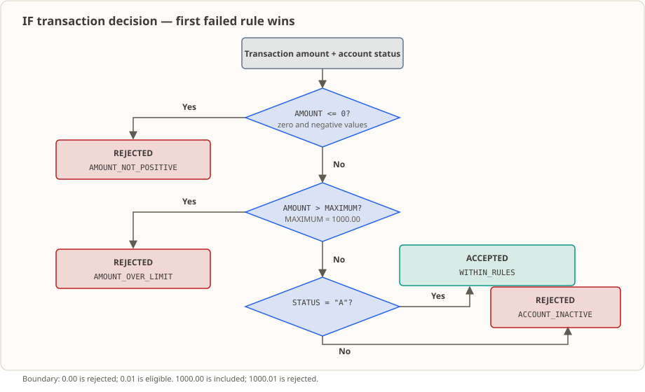

# Lesson 04 — IF Conditional Branching: Separating Acceptance from Rejection for a Transaction

When a transaction arrives, the program must first take a stand: pass, or fail; and if it fails, which rule stopped it. This lesson embeds a sample transaction fixed inside the program, uses three levels of nested `IF` statements to evaluate in sequence "amount must be positive → amount cannot exceed the single-transaction limit → account status must be active", and reports only the **first triggered** reason for failure.

## The Business Setting

It is 4:50 on a Friday afternoon, and the branch is about to close. A customer hands in a slip at the teller counter requesting an outgoing transfer; at almost the exact same moment, someone taps "Confirm Transfer" in the mobile app. Inside the system, these two actions take the exact same form: a transaction waiting to be validated. The program must return a decision on the spot. If it is released, all is well; the moment it is flagged as "rejected", the trouble has only just begun.

A rejection itself is never the end of the story. The teller's screen will never display just the word "Rejected"; the customer will inevitably follow up with "why?" There are only two kinds of answers: either **the amount itself is invalid** (it is not positive, or it exceeds the single-transaction limit), in which case the money was never touched, the teller explains on the spot, and the customer modifies the slip; or **the account status is wrong** (frozen, closed), in which case this transaction should not be handled at the counter in the first place and must be escalated to manual verification. For the same word "rejection", one can be resolved right then and there, while the other requires asking the customer to return another day — the difference hinges entirely on which reason the program reports.

What most easily leads to an incident is the **order**. If the evaluation order is written backwards, a transaction that is both over-limit and on a frozen account might be reported as "amount exceeds limit"; the teller will instruct the customer to reduce the amount and try again, only for it to be rejected once more; the customer makes an unnecessary trip, and the counter staff has to explain everything all over again. Therefore, this lesson requires not only that you can "distinguish acceptance from rejection", but also that you can articulate **why only the first triggered reason is reported, and who determines this order**.

There is another rule that is most prone to being glossed over: does the single-transaction limit mean "1000.00 is already over the limit", or "only strictly exceeding 1000.00 counts as over the limit"? Business requirements often state "single transaction not exceeding 1000 yuan", a single phrase with two interpretations. In code, `>` and `>=` differ by only a single character, placing the boundary endpoint on different sides. This ambiguity will not make the compiler report an error; it will merely cause two systems to implement their own interpretations, leading to irreconcilable accounts at month-end. This lesson treats the boundary endpoint as something that must be made explicit and verified.

(Note: This is a pedagogical scenario — institutions, amounts, and timestamps are fabricated to clarify rules and do not represent real data from any actual financial institution.)

## Why Learn This Now

You might be thinking: who doesn't know how to write conditions? I've been writing `if` for years.

The issue is that what you wrote in the past was mostly "run-once-and-done" scripts. The scenario here is different: **a COBOL program flows straight downward, with no place in the middle to 'stop and ask a question'**. In Lesson [02](../02_data-types/README.md) you learned how to describe account numbers, statuses, and amounts using `PIC`, and in Lesson [03](../03_move-compute/README.md) you learned how to calculate a result with them; but up to this point, the program merely executes the written statements from top to bottom.

Look back at that Friday afternoon transaction: amount `-5.00`, and the account is frozen. Without conditional logic, the program marches straight ahead anyway — it still "finishes calculating", and it still prints a completion message. It neither rejects the transaction nor tells you what went wrong. In business terms, this is far worse than a program crash: the batch job is green, but the books are wrong.

To put it in familiar terms: in real data, the account status field could contain any value imaginable. You must make the program inspect the data and decide which path to take, rather than relying on humans to pre-filter data into separate files before feeding it in.

The tools COBOL provides for this are relation conditions and `IF` / `ELSE` / `END-IF`. This sounds similar to other languages, but two traps must be firmly grasped in this lesson: which `IF` an `ELSE` belongs to depends entirely on **scope** rather than indentation; and **nesting order determines the priority of rejection reasons**. These two points will be used in every subsequent branching lesson — classifying by transaction type in Lesson [05](../05_evaluate/README.md), and tabulating acceptances and rejections across multiple transactions in Lesson [08](../08_control-flow-practice/README.md) both build on the foundation laid here.

## What This Knowledge Point Is, and What Problem It Solves

**What this knowledge point is.** In a sentence: letting the program **inspect the data and choose its own path**. Two mechanisms accomplish this — *relation conditions* (`=`, `<`, `>`, `<=`, `>=`, comparing two values to yield true or false) and *`IF` / `ELSE` / `END-IF`* (taking one branch if true and another if false, with `END-IF` sealing the scope). Compared to the arithmetic in Lesson [03](../03_move-compute/README.md), this is a different capability: no longer asking "how much does this compute to", but asking "does it qualify?"

**What business problem it solves.** In validation work, half the value lies in "judging correctly", and the other half lies in "explaining clearly". What tellers, customer service agents, and reconciliation clerks see is only a decision plus a reason: amount exceeded limit, invalid status, or approved. If the reason is reported incorrectly, everyone downstream will make incorrect decisions. `IF` combined with nesting is where you **encode business priorities into code** — who gets evaluated first and who gets evaluated second is visible directly in the source, allowing you to point to that specific line when an issue arises.

**When it is still not enough (and misusing it is more expensive).** Do not use conditional branching as a substitute for input validation. If the upstream amount field contains alphabetic characters or improper encoding, `IF` will merely perform an apparently correct judgment on corrupted data; it will not detect the corruption for you. Such checks must wait for later lessons. Nor should you forget: the rejection in this lesson is purely a **business decision**; the process exit code remains `0`. Treating a business rejection as a system failure that triggers an operational alarm is another common category of incident, handled systematically in Lesson [26](../26_error-handling/README.md).

## Capabilities and Limits After Completing This Lesson

After completing this lesson, you will be able to:

- Use `=`, `<`, `>`, `<=`, and `>=` to compare numeric and character fields, and state whether boundary endpoint values fall on the acceptance or rejection side.
- Use `IF` / `ELSE` / `END-IF` to write explicit acceptance and rejection paths for every condition, without guessing `ELSE` binding from indentation or periods.
- Nest three levels of evaluation in a fixed priority order, explain why this outputs only **one** rejection reason, and describe how three parallel `IF` statements would trigger multiple conflicting rules simultaneously.
- Predict and verify boundary sample cases: `0.00`, `-0.01`, `0.01`, `1000.00`, `1000.01`, and non-`A` statuses.
- Distinguish business rejection from system failure: the process exit code for all rejection paths in this lesson remains `0`.

Limits: This lesson does not read from terminals, files, or databases; sample values are fixed in `WORKING-STORAGE` via `VALUE` clauses; it contains only a single transaction, does not update balances, and performs no counting or aggregation; it does not handle rounding or arithmetic overflow (noted in Lesson [03](../03_move-compute/README.md), handled systematically in Lesson [26](../26_error-handling/README.md)); it does not classify transaction types (Lesson [05](../05_evaluate/README.md)) or process multi-transaction batches (Lesson [08](../08_control-flow-practice/README.md)). Nor does it implement account authorization, concurrency control, duplicate request detection, or persistence, none of which this lesson aims to prove.

## Runtime Environment

- GnuCOBOL 3.2.0, using the default dialect (without `-std=cobol85`), source file in fixed format.
- Linux terminal, requiring no database, additional tools, or third-party libraries.
- Commands are executed under this lesson's directory `lessons/04_if-conditions/`; because the source path is specified as `lesson.cob`, adjust paths accordingly if running from a different directory.

## Knowledge Explanation

### Relation Conditions: Comparing Values, Not How They Look on Screen

You already recognize the five operators `=`, `<`, `>`, `<=`, and `>=`; `THEN` is an optional noise word that makes no difference whether present or absent. What is truly worth remembering are two details.

First, when two numeric operands are compared, COBOL compares them by **actual algebraic value**, regardless of how many digits the field `PIC` specifies, whether it has an operational sign, or what `USAGE` is used. `+0000125.50` and `125.50` are identical.

Second, character fields are compared character by character according to the character collating sequence, with the shorter field padded with spaces on the right. Therefore `"A"` and `"a"` are two distinct characters — a detail that is particularly critical when handling account statuses.

This lesson uses three relation conditions:

```cobol
WS-TRANSACTION-AMOUNT <= ZERO
WS-TRANSACTION-AMOUNT > WS-MAXIMUM-AMOUNT
WS-ACCOUNT-STATUS = "A"
```

The first, `<= ZERO`, holds true for both zero and negative numbers; the second, `>`, holds true only when **strictly exceeding** the upper limit; the third is a character comparison where `a`, spaces, and `I` are all not equal to `A`.

The most common trap here is: **which side the boundary endpoint belongs to is determined entirely by the operator.** `<=` places `0.00` on the rejection side, while `>` keeps `1000.00` on the acceptance side. If you carelessly write `<` instead of `<=`, `0.00` will be passed; if you write `>=` instead of `>`, a transaction of exactly `1000.00` will be rejected. Therefore, boundary values cannot be reviewed in isolation; they must be inspected alongside their operators — precisely the classic area where "requirements are ambiguous and systems diverge."

Status comparison is an exact comparison. `WS-ACCOUNT-STATUS` is of type `X`; `a` (lowercase), spaces, and `I` do not equal `A` and will all fall into the rejection branch. If you truly wish to accept both uppercase and lowercase, that is an interface-layer convention that must be coded explicitly; COBOL will not normalize it for you automatically.

### IF / ELSE / END-IF and Scope Association

`IF` executes the immediately following statements when the condition is true, `ELSE` handles the false condition, and `END-IF` explicitly marks where the conditional statement ends.

Beginners often assume indentation dictates which `IF` an `ELSE` belongs to — COBOL ignores indentation. The compiler has only one rule: **an `ELSE` associates with the nearest preceding unclosed `IF`**. No matter how beautifully you indent, the compiler does not care.

All three `IF` statements in this lesson are paired with an `END-IF`, closing scopes layer by layer from the innermost to the outermost. The benefit is that which `ELSE` belongs to which `IF` is visible at a glance in the source code, without counting spaces or guessing with periods.

Speaking of periods, there is an even nastier pitfall: **a period is not just a sentence-ending dot; it terminates the entire sentence and closes all unclosed statement scopes along the way**. In this lesson, there is only one period from beginning to end: the final `STOP RUN.`. There are **no** periods between the opening four `DISPLAY` statements; they are multiple statements queued inside the same sentence, executed in sequential order. If you carelessly insert a period in the middle, statements intended to belong inside an `IF` might fall outside the conditional block entirely — and the compiler might not even report an error.

### Nesting Order Determines the Reported Rejection Reason

The nested order of the three rules represents the priority of rejection reasons:

```text
金额 <= 0            → AMOUNT_NOT_POSITIVE     （最外层，先判）
  否则 金额 > 上限   → AMOUNT_OVER_LIMIT
     否则 状态 = A   → 接受
        否则          → ACCOUNT_INACTIVE      （最内层，最后判）
```

The program outputs the reason at the **first failure condition that evaluates to true**, and then finishes; deeper checks will not execute at all. Therefore, a transaction with amount `-5.00` and status `I` will report only `AMOUNT_NOT_POSITIVE`, without mentioning that the status is also invalid.

This directly answers "why nesting is required." If the three checks were written as parallel `IF` statements, two failure conditions would trigger independently, producing two mutually contradictory reasons in the output, leaving anyone reading the logs unsure which to believe. In business, "what to say first" is a rule set by product and accounting teams, not an arbitrary order chosen by a programmer — changing the order alters the external explanation.

### Differences from Java / Python

For branching, Java uses `if` / `else if`, and Python uses `if` / `elif` / `else`; the underlying thinking is the same. The differences lie in two details: COBOL uses `END-IF` to explicitly mark statement termination; `ELSE` binds to the "nearest unclosed `IF`", ignoring indentation. Before comparing, types must likewise be verified: account status is text, and amount is a signed decimal number.

COBOL also supports combining multiple conditions into a compound condition using `AND` / `OR`, which this lesson deliberately avoids. The reason is that nesting places the priority of each rule directly in the source code, providing the exact feel for "which layer evaluates first." You can pick up compound conditions once you encounter that syntax later.

### Language of the Output Text

The repository follows a convention: source comments and README explanations use Chinese, but **business text printed during program execution follows Japanese conventions**. Fortunately, there is no need to guess — all information required for the decision is in the standard output `key=value` lines, where the two critical keys are `判定=` and `理由=`, with Chinese mappings provided in the next section.

## Complete Example Source

For the complete source code, see [`lesson.cob`](./lesson.cob), written in fixed format (column 7 indicator, Area A starting in column 8, Area B starting in column 12, program text not exceeding column 72).

```cobol
       IDENTIFICATION DIVISION.
       PROGRAM-ID. IF04.
       DATA DIVISION.
       WORKING-STORAGE SECTION.
       01 WS-TRANSACTION-REFERENCE PIC X(12)
          VALUE "TXN-00000001".
       01 WS-ACCOUNT-STATUS PIC X VALUE "A".
       01 WS-TRANSACTION-AMOUNT PIC S9(7)V99
          SIGN IS LEADING SEPARATE CHARACTER VALUE 125.50.
       01 WS-MAXIMUM-AMOUNT PIC 9(7)V99 VALUE 1000.00.
       PROCEDURE DIVISION.
           DISPLAY "取引参照番号="
               WS-TRANSACTION-REFERENCE
           DISPLAY "口座状態=" WS-ACCOUNT-STATUS
           DISPLAY "取引金額=" WS-TRANSACTION-AMOUNT
           DISPLAY "上限金額=" WS-MAXIMUM-AMOUNT
           IF WS-TRANSACTION-AMOUNT <= ZERO
               DISPLAY "判定=REJECTED"
               DISPLAY "理由=AMOUNT_NOT_POSITIVE"
           ELSE
               IF WS-TRANSACTION-AMOUNT > WS-MAXIMUM-AMOUNT
                   DISPLAY "判定=REJECTED"
                   DISPLAY "理由=AMOUNT_OVER_LIMIT"
               ELSE
                   IF WS-ACCOUNT-STATUS = "A"
                       DISPLAY "判定=ACCEPTED"
                       DISPLAY "理由=WITHIN_RULES"
                   ELSE
                       DISPLAY "判定=REJECTED"
                       DISPLAY "理由=ACCOUNT_INACTIVE"
                   END-IF
               END-IF
           END-IF
           STOP RUN.
```

The above omits comment lines from the source. Comments in the source describe only rules and contracts (amounts must be positive, upper limit includes endpoint, report only the first failure reason) without restating the text of each `DISPLAY`.

## Data and Rules

This lesson provides no inputs: the sample transaction is entirely fixed inside the program, with **no external input**, no input fixtures, and no output files. The decision involves just four values:

| Field | `PIC` / Storage Bytes | Initial Value | Role |
|---|---|---|---|
| `WS-TRANSACTION-REFERENCE` | `X(12)` / 12 bytes | `TXN-00000001` | Transaction reference, echoed only, does not participate in decisions |
| `WS-ACCOUNT-STATUS` | `X(1)` / 1 byte | `A` | Account status, only `A` is considered active in this lesson |
| `WS-TRANSACTION-AMOUNT` | `S9(7)V99`, `SIGN IS LEADING SEPARATE CHARACTER` / 10 bytes | `125.50` | Signed amount, participates in evaluation from the lower bound |
| `WS-MAXIMUM-AMOUNT` | `9(7)V99` / 9 bytes | `1000.00` | Single-transaction amount upper limit, endpoint inclusive |

The 10 bytes of the amount field = 1 separate leading sign character + 7 integer digits + 2 decimal digits; `V` is an assumed decimal point that **takes no storage**, rendered positionally only when `DISPLAY`ed. Thus storage is 10 bytes, while the `+0000125.50` seen on screen is 11 characters. The above four byte counts were measured directly on this machine using `FUNCTION LENGTH` and can serve as the baseline for checking record layouts in subsequent lessons. This lesson has no currency field; by demonstration convention amounts are treated as "yuan" with two decimal places, with no exchange rates or rounding involved.

Rules and boundary policies:

| Rule | Implementation Condition | Policy |
|---|---|---|
| Amount must be positive | `WS-TRANSACTION-AMOUNT <= ZERO` → Rejected | Zero and negative amounts are rejected; accepted from `0.01` upward |
| Single-transaction limit | `WS-TRANSACTION-AMOUNT > WS-MAXIMUM-AMOUNT` → Rejected | Limit is **endpoint inclusive**: equal to `1000.00` accepted, `1000.01` upward rejected |
| Account status | `WS-ACCOUNT-STATUS = "A"` required for acceptance | Only exact `A` is valid; `I`, `a`, space, and other characters report the same reason |

The three rules in the table above are all that the code validates. What is **not** validated: format and uniqueness of transaction reference (echoed only in this lesson), specific semantics of status codes (the program does not differentiate what `I` means), and origin of the amount limit itself (it is a demo constant in this lesson). Prerequisite note: `WS-MAXIMUM-AMOUNT` and the three sample values are educational demo data, not representing real business policies or regulatory limits.

## Where Boundary Values Branch



Remember one thing first: rejections here are all business rejections, and the process exit code is still `0`; there is no system failure branch in the program at all. Every line in the table below was compiled and run on this machine:

| Amount | Status | Where Comparison Branches | `判定=` | `理由=` |
|---|---|---|---|---|
| `125.50` (original initial value) | `A` | Passes all three conditions | `ACCEPTED` | `WITHIN_RULES` |
| `0.00` | `A` | Level 1 evaluates to true | `REJECTED` | `AMOUNT_NOT_POSITIVE` |
| `-0.01` | `A` | Level 1 evaluates to true | `REJECTED` | `AMOUNT_NOT_POSITIVE` |
| `0.01` | `A` | Right against lower bound, `<= ZERO` evaluates to false | `ACCEPTED` | `WITHIN_RULES` |
| `1000.00` | `A` | Level 2 evaluates to false (endpoint inclusive) | `ACCEPTED` | `WITHIN_RULES` |
| `1000.01` | `A` | Level 2 evaluates to true | `REJECTED` | `AMOUNT_OVER_LIMIT` |
| `125.50` | `I` | Level 3 evaluates to false | `REJECTED` | `ACCOUNT_INACTIVE` |
| `-5.00` | `I` | Level 1 evaluates to true, Level 3 **not executed** | `REJECTED` | `AMOUNT_NOT_POSITIVE` |

Who decides which branch:

| Observed Target | Deciding Comparison | Result |
|---|---|---|
| Lower bound | `AMOUNT <= ZERO` | `0.00` and negatives rejected, accepted from `0.01` upward |
| Upper limit | `AMOUNT > MAXIMUM` | Rejected only when strictly greater, equal to `1000.00` included |
| Status | `STATUS = "A"` | Exact `A` only; `a`, space, `I` all rejected |
| Which reason reported | Three-level nesting order | Reports only the first triggered failure rule |

## Source Reading Path

Reading along the flow of data is much faster than reading line by line:

1. First inspect the four fields in `WORKING-STORAGE`: status is `X(1)` text, amount is numeric with a separate sign — this is the root reason their comparison behaviors differ later.
2. Next look at the 4 `DISPLAY` statements following `PROCEDURE DIVISION`: they first print the inputs participating in the evaluation, making it easy to compare inputs against decisions. Note there are no periods between them; they are several statements within the same sentence.
3. The outermost `IF WS-TRANSACTION-AMOUNT <= ZERO`: its `ELSE` captures only the "amount is positive" case, so when the amount itself is invalid, it will not proceed to inspect limits or status.
4. The second level `IF WS-TRANSACTION-AMOUNT > WS-MAXIMUM-AMOUNT`: note the use of strict greater-than, which keeps the boundary endpoint included.
5. The third level `IF WS-ACCOUNT-STATUS = "A"`: the innermost `ELSE` is the status rejection.
6. The three `END-IF` statements close scopes layer by layer from the inside out, concluding with `STOP RUN.`. The entire code block has only this single period.

## Run and Observe

**Input:** None. All four values originate from the `VALUE` clauses in `lesson.cob`; no keyboard, file, or database inputs are read, so decisions will **reproduce deterministically** — a contrast with file-handling lessons starting from [Lesson 15](../15_sequential-file-read/README.md).

**Commands and roles:**

```sh
mkdir -p build                                   # 先建输出目录，否则 -o 会因目录不存在而失败
cobc -fsyntax-only lesson.cob                    # 只做语法检查，不生成可执行文件
cobc -x -Wall -o build/lesson_04 lesson.cob      # 编译并生成可执行文件
./build/lesson_04                                # 运行程序，判定结果写到标准输出
echo $?                                          # 查看上一条命令的退出码
rm -rf build                                     # 清理编译产物
```

The four commands prove different things: `-fsyntax-only` proves only that the source passes syntax parsing without generating or running a program; `-x` requests an executable, `-o` specifies the output path, and a return code of `0` without diagnostics indicates successful compilation; running the executable allows you to observe the decision outcome; `rm -rf build` merely removes compilation artifacts, and since this lesson generates no business data files, cleaning up incurs no data loss.

**Expected results (original initial values):**

| Observed Item | Expected Value |
|---|---|
| `cobc -fsyntax-only` exit code | `0` |
| `cobc -x -Wall` exit code | `0`, no compilation diagnostics |
| Standard output | 6 lines below |
| Process exit code (`echo $?`) | `0` |
| Generated files | `build/lesson_04` only |

```text
取引参照番号=TXN-00000001
口座状態=A
取引金額=+0000125.50
上限金額=0001000.00
判定=ACCEPTED
理由=WITHIN_RULES
```

Output lines and translation: `取引参照番号` = transaction reference number, `口座状態` = account status, `取引金額` = transaction amount, `上限金額` = single-transaction amount upper limit, `判定` = evaluation result, `理由` = evaluation reason. The 4 possible `理由` values: `WITHIN_RULES` indicates all three rules passed, `AMOUNT_NOT_POSITIVE` indicates amount is not positive, `AMOUNT_OVER_LIMIT` indicates amount exceeds single-transaction limit, and `ACCOUNT_INACTIVE` indicates account status is not `A`. When verifying program behavior, standard output's `判定=` / `理由=` is authoritative; the README explanations clarify these values.

**Observed environment details:** When executing `./build/lesson_04` in this workspace, standard error outputs `Warning: program compiled against libxml 212 using older 209`. This is a library version mismatch warning from the runtime environment, not business output of this program, and the triggering component has not been identified. The program's business output appears entirely on standard output, with an exit code of `0`.

### Evidence Sources and Verification Scope

The expected outputs in this lesson's README, the 8 rows in the `Where Boundary Values Branch` section, and every scenario in the exercise answer were compiled, executed, and verified on this workspace using `cobc 3.2.0`: `-fsyntax-only` and `-x -Wall` returned `0` without compilation diagnostics, run exit codes were all `0`, and standard output matched the documentation byte for byte. Field lengths of 12 / 1 / 10 / 9 bytes were verified directly with a separate `FUNCTION LENGTH` program. The statements in the knowledge explanation that "changing `<=` to `<` causes `0.00` to be accepted" and "changing `>` to `>=` causes `1000.00` to be rejected" were also verified by altering one operator at a time (yielding `ACCEPTED` and `AMOUNT_OVER_LIMIT` respectively). **Unverified** scenarios: multiple transactions, concurrency, amounts exceeding `S9(7)V99` capacity (arithmetic overflow is not handled here), and any file or database input — this lesson contains none of these paths.

## Modification Exercise

Starting from the original [`lesson.cob`](./lesson.cob), modify only the `VALUE` clauses of `WS-TRANSACTION-AMOUNT` and `WS-ACCOUNT-STATUS` to observe acceptance and rejection branching at boundaries. The seven scenario inputs and expected decisions:

| Scenario | Amount `VALUE` | Status `VALUE` | `判定=` | `理由=` |
|---|---|---|---|---|
| 1 | `0.00` | `"A"` | `REJECTED` | `AMOUNT_NOT_POSITIVE` |
| 2 | `-0.01` | `"A"` | `REJECTED` | `AMOUNT_NOT_POSITIVE` |
| 3 | `0.01` | `"A"` | `ACCEPTED` | `WITHIN_RULES` |
| 4 | `1000.00` | `"A"` | `ACCEPTED` | `WITHIN_RULES` |
| 5 | `1000.01` | `"A"` | `REJECTED` | `AMOUNT_OVER_LIMIT` |
| 6 | `125.50` (keep initial value) | `"I"` | `REJECTED` | `ACCOUNT_INACTIVE` |
| 7 | `-5.00` | `"I"` | `REJECTED` | `AMOUNT_NOT_POSITIVE` |

Reset to the original source code before each scenario to prevent values from one scenario carrying over into the next. For the complete problem statement (including baseline, modification constraints, recompile and run commands, per-scenario expected output, and questions to answer), see [`exercise.md`](./exercise.md); for the reference answer, see [`answer.md`](./answer.md).

## "Apply It Elsewhere" Exercise

Design validation rules for a transfer: minimum single-transaction amount `5.00`, maximum single-transaction amount `5000.00`, and destination account status must be `A`. Choose the amount field `PIC` yourself (two decimal places required; whether a sign is needed is for you to decide and explain), specify nesting order and rejection reason strings, and verify in turn which branch is taken for amounts below minimum, exactly equal to minimum, exactly equal to maximum, exceeding maximum, and for inactive recipient accounts, stating whether each comparison operator places boundary endpoints on the acceptance or rejection side. See [`exercise.md`](./exercise.md) for the prompt; no reference answer is provided for this exercise.

Constraints: Use only field declarations, `VALUE`, relation conditions, `IF` / `ELSE` / `END-IF`, `DISPLAY`, and `STOP RUN` learned in this lesson; do not use loops, paragraphs, tables, or `EVALUATE`. You must decide whether boundaries are inclusive and state which values you use for verification.

## Walking Through a Real Workflow

If you place this lesson's decision logic into a real processing chain, this is where it sits:

1. **Initiation at counter or app**: A teller submits a slip or a customer taps confirm; the upstream system first converts this business action into a transaction pending validation. This step is outside this lesson's scope.
2. **Validation program runs**: Reads amount and account status. In this lesson, both values are hardcoded in `VALUE` clauses; the real version switches to reading files starting in [Lesson 15](../15_sequential-file-read/README.md).
3. **Determines accept or reject, accompanied by a reason**: This is the deliverable of this lesson. Reasons are fixed short codes, such as `AMOUNT_OVER_LIMIT`.
4. **Reason returned to counter / customer service**: The counter system translates `AMOUNT_OVER_LIMIT` into human-readable words — "The transaction amount exceeds the single-transaction limit." The customer sees this sentence rather than the code; the teller decides accordingly whether to ask the customer to adjust the amount or escalate to manual review.
5. **Downstream handover**: Accepted transactions proceed to accounting and posting; rejected transactions remain in records for review or immediate return. How the two paths branch depends entirely on which reason was reported in step 3.

This lesson covers only step 3, with just one transaction and three rules. How the real chain ensures valid upstream status codes, where rejection records are stored, and who performs reviews are all outside this code — **yet the 'why it was rejected' information must be accurate right from this lesson**, because every subsequent step relies on it.

## What Happens if This Code Goes to Production

- **Who schedules it**: In a real system, it is a program in the upstream validation stage, triggered transaction-by-transaction by a scheduler or online transaction router. To keep things clear, this lesson simplifies invocation to direct execution.
- **Who reads its output**: Counter systems, customer service tickets, and reconciliation staff all read `理由=`. They do not read source code; they rely on the explanation corresponding to that code.
- **Who gets called when something breaks**: If the reason is reported incorrectly (for instance, reporting "account frozen" as "amount over limit"), first the teller gives an incorrect explanation and the customer wastes a trip, and then during reconciliation the transaction hangs unallocated — the person called in the middle of the night will be whoever wrote this validation.
- **Most common first-month incidents**: Two things. First, boundary conditions are ill-defined: business specifies "not exceeding 1000", but the program implements `>=`, and only during month-end reconciliation is a discrepancy discovered against another system for a pile of exactly 1000.00 transactions; second, treating business rejections as system failures: what was merely an invalid amount causes the entire batch job to turn red.
- **How the next system connects**: Lesson [05](../05_evaluate/README.md) introduces classification by transaction type, Lesson [08](../08_control-flow-practice/README.md) extends single-transaction evaluation to multi-transaction batches with acceptance/rejection tallies, and Lesson [26](../26_error-handling/README.md) completely decouples business rejections from system failures.

To be explicit: this code demonstrates only three local rules and one hardcoded account status. It has no currency, account authorized limits, duplicate request detection, trading window constraints, authorization, or persistence. Do not mistake "decision + reason" for "this transaction is ready to be posted."

## References

- [GnuCOBOL Programmer’s Guide: IF](https://gnucobol.sourceforge.io/HTML/gnucobpg.html#IF)
- [GnuCOBOL Programmer’s Guide: Relation Conditions](https://gnucobol.sourceforge.io/HTML/gnucobpg.html#Relation-Conditions)
- [GnuCOBOL Programmer’s Guide: END-verb Constructs](https://gnucobol.sourceforge.io/HTML/gnucobpg.html#Use-of-VERB_002fEND_002dVERB-Constructs)
- [GnuCOBOL Programmer’s Guide: Use of Periods](https://gnucobol.sourceforge.io/HTML/gnucobpg.html#Use-of-Periods)
- [Complete Course Directory](../DIRECTORY.md)
- [Repository Course Home](../../README.md)
