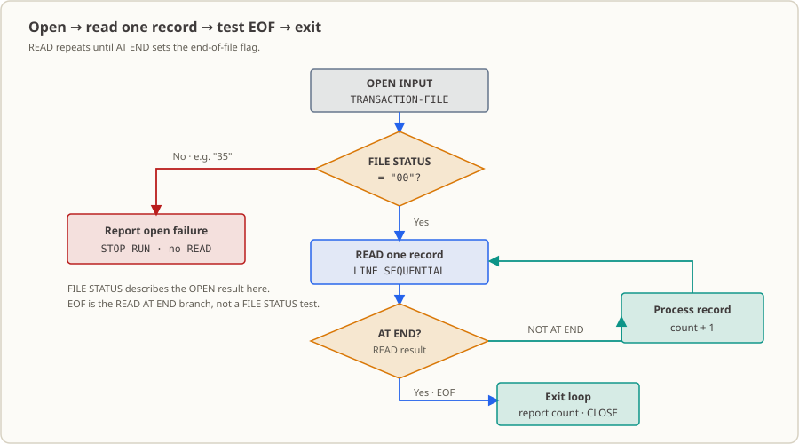

# Lesson 15: Reading a Sequential Transaction File — Distinguishing “File Missing” from “File Empty”

Every day, the bank delivers today’s transactions as a text file to the batch directory. The program must open it, read every line in delivery order, and report “read to the end” differently from “could not open the file.” This lesson builds that input flow using the four-line [`transactions.txt`](./transactions.txt): `SELECT` and `FD` bind the program to the real file, `OPEN INPUT` checks whether opening succeeded, `READ` with `AT END` walks to the end, and standard output reports the number of records actually read.

## The Business Setting

It is 2:00 a.m. There is no one at the console. The first overnight job has finished, and the second is waiting for an upstream system to export today’s transactions to a text file and place it in the agreed directory. **The first step in batch processing is often not accounting; it is waiting for the file.**

Two outcomes must not be reported as if they were the same:

- **The file never arrived.** The upstream job may have failed or the transfer may be stuck. This is an incident: the on-call operator needs to know immediately so the file can be retransmitted or the job rerun. If the program quietly reports success, the transactions disappear and nobody looks for them.
- **The file arrived, but it is empty.** This is valid: it may be a weekend, a holiday, or simply a day with no transactions. It should not wake anyone up.
- **There is a third, more insidious case: reading stops halfway through.** If the program fails to recognize the end, treats “read halfway” as “finished,” and reports success, some records are lost.

The acceptance criterion is simple: **“not delivered” and “empty” must be distinguishable, because they require completely different responses.** If they are confused, operators either wake up for false alarms every night or never learn that a real batch was lost. This lesson covers the pieces that make the distinction: `SELECT`/`FD`/`FILE STATUS` connect the program and file, `READ` retrieves lines in delivery order, and `AT END` recognizes the end.

(Educational demonstration: the times, institution, and transactions are fictional and are not real data from any institution. This lesson makes no claim of meeting audit or regulatory requirements.)

## Why Learn This Now

In Lessons 09–14, you learned to build record hierarchies, use `REDEFINES` to view the same bytes in different ways, create tables with `OCCURS`, and search them with `SEARCH ALL`. But the records in those lessons shared one trait: **they were all hard-coded in source**. Hard-coded data is never late or missing, and it does not suddenly triple in size one day.

The first gate in a real batch is here: data has to enter from outside the program.

You might think file reading is easy because you know `open()` and `readline()`. The idea is familiar, but COBOL spreads this work over several declarations, each tied to a business decision:

- The file’s name and location are specified by `SELECT ... ASSIGN TO`; the relative path is resolved from the **runtime working directory**, not from a command-line argument.
- The destination for each line is determined by the record item under `FD`; this lesson uses a `PIC X(100)` buffer.
- Whether an operation succeeded is reported by the two-character status code in `FILE STATUS IS`.
- Reaching the end is not an error code; it is the `AT END` branch of `READ`.

With all four pieces, you can answer the operator’s question: “Did today’s batch actually get read?”

## What This Knowledge Point Is and What Problem It Solves

**What it is.** This adds a new ability to the program: **read an external file line by line**. `SELECT` in `FILE-CONTROL` gives the file a COBOL name and associates it with a real path; `FD` in `FILE SECTION` declares the buffer for each record; `READ` retrieves one line at a time; `AT END` reports that there are no more lines; and `FILE STATUS` lets you ask whether the last file operation succeeded.

**What business problem it solves.** It turns “I think the file arrived” into a fact the program can determine and the operator can act on:

| Outcome | Program report | Operator response |
|---|---|---|
| Cannot open | `オープン=FAILED STATUS=35` + exit code `1`; no `READ` is performed | Alert: check whether upstream produced the file, then decide whether to retransmit or rerun |
| Opens, but has no records | `EOF=はい レコード数=00` + exit code `0` | No action needed; there were no transactions today |
| Opens and contains data | One `レコード=` line per record, then `レコード数=04` + exit code `0` | Compare the count with the number reported upstream |

The last column deserves emphasis. **The number of records actually read is the starting point for reconciliation.** If it differs from upstream’s count, something happened along the way. This lesson reports the count faithfully; reconciliation and its response are covered later.

**When not to treat this as proof that data was read correctly.** This lesson recognizes the file, reads lines, and detects the end. It does not inspect the content: it does not split fields on vertical bars, validate dates, type codes, account numbers, or amounts, or reject any record. Treating “read to the end” as proof that “the content is correct” is a common misuse. The program could silently read 120,000 lines of garbage and appear to finish normally. Field parsing and validation are covered in [Lesson 18](../18_csv-processing/README.md) and [Lesson 26](../26_error-handling/README.md).

## Capabilities and Limits After Completing This Lesson

After completing this lesson, you can:

- Use `SELECT ... ASSIGN TO "transactions.txt"` in `FILE-CONTROL` to bind a COBOL file to a real text file under the **runtime working directory**, and use `FILE STATUS IS` to store I/O status codes.
- Describe line-sequential input with `ORGANIZATION IS LINE SEQUENTIAL` and an `FD` item `01 FD-TRANSACTION-RECORD PIC X(100)`: line lengths vary, the FD buffer is fixed at 100 characters, shorter lines are padded on the right, and lines longer than 100 characters are split into multiple records.
- Read every record with `PERFORM UNTIL` and `READ ... AT END`, explaining that EOF is normal completion and the EOF branch does not increment the record count.
- Check three outcomes on standard output: the four-line fixture reports `EOF=はい レコード数=04`; an empty file reports `00`; a missing file reports `オープン=FAILED STATUS=35` and exits with code `1`.
- Use content comparison to verify that the program only reads the input and does not create or overwrite data files.

Limits: the program treats each line as text, only counts and displays it, and does not split vertical-bar fields, validate dates/type codes/account numbers/amounts, or reject records. Those checks belong in [Lessons 18](../18_csv-processing/README.md) and [26](../26_error-handling/README.md). If opening fails, the program ends before `READ` and does not execute `CLOSE`; there is no logging or resource cleanup. The record counter has two digits and wraps after 99; this lesson does not handle that limit.

## Runtime Environment

- GnuCOBOL 3.2.0, default dialect (do not add `-std=cobol85`); source is fixed format.
- Linux terminal; no database or additional tools required.
- The fixture [`transactions.txt`](./transactions.txt) must be in the **runtime working directory**. Its name is hard-coded in `ASSIGN TO`; the program does not accept command-line arguments or absolute paths.
- No business data file is generated. The executable can be placed in `build/` or a temporary directory and removed afterward.

## What Changes When You Read Files

### In-memory tables and file records are different

With an in-memory `OCCURS` table, you decide the number and contents while writing the source. A file’s record count, line lengths, and content come from outside the program, so the program can only retrieve them one by one at runtime. File lessons therefore introduce two problems to handle: **the record count is unknown** (it may be zero or hundreds of thousands) and **the outcome is unknown** (opening may fail). `PERFORM UNTIL` with `AT END` handles the first in the loop; `FILE STATUS` turns the second into a status code the program can inspect.

### Where does a line end? Line sequential is not fixed length

`ORGANIZATION IS LINE SEQUENTIAL` means the file is organized into **lines**. A line terminator (newline on Linux) marks the record boundary, so line lengths can vary. Another common format is fixed-length records, where each record has a fixed number of bytes and no newline:

| | What defines the record boundary | Line length | Lesson |
|---|---|---|---|
| Line sequential (this lesson) | Newline | Variable | Lesson 15 |
| Fixed length | Fixed byte count | Must be specified by the interface | [Lesson 17](../17_fixed-length-files/README.md) |

Here is the line that is easiest to misread in this lesson:

```cobol
FD TRANSACTION-FILE.
      * FD 记录区固定 100 字符，短行右侧补空格。
       01 FD-TRANSACTION-RECORD PIC X(100).
```

`PIC X(100)` does **not** mean “each line is 100 characters.” It is the **input buffer size**. Each successful `READ` places one full line into these 100 bytes; shorter lines are padded on the right with spaces. A line longer than 100 characters does not fit, so it is returned as successive 100-character records. `FUNCTION TRIM(... TRAILING)` removes padding spaces for display only; it does not change the record area or indicate that the file contained those spaces.

This can cause an incident: the maximum line length must be agreed with upstream, and this lesson does not validate it. If upstream adds a field and the line grows beyond 100 characters, the program will not report an error; it will silently split that line into multiple records. Counts will no longer match, and a field may be split in the middle.

### `FILE STATUS` and EOF are different



`FILE STATUS IS WS-FILE-STATUS` stores the status after each file operation in `WS-FILE-STATUS`. This lesson checks the value after `OPEN` and `CLOSE`:

| Operation | Status | Meaning |
|---|---|---|
| `OPEN INPUT` succeeds | `00` | The file is open and can be read |
| `OPEN INPUT` on a missing file | `35` | Observed with this toolchain; the program reports `オープン=FAILED` and exits with code `1` |
| `CLOSE` succeeds | `00` | The file has been closed |

EOF is not handled by a status-code branch. It is expressed by `READ`’s `AT END`: after the last record, the next `READ` cannot find another line, so it runs `AT END`, sets `WS-END-OF-FILE` to `"Y"`, and ends the loop. That is why EOF is not an error: it signals normal completion. Failure to open the file is an error. For reference, this toolchain also sets the file status to `10` at EOF (observed with a temporary probe; the lesson source does not read that value).

## Fixed Format and Source Conventions

The fixed-format rules have applied since Lesson 01. Here are their actual positions in [`lesson.cob`](./lesson.cob), measured in **bytes** with `LC_ALL=C awk`:

| Columns | Rule | Measured in this source |
|---|---|---|
| 1–6 | Sequence area, ignored by compiler | All blank |
| 7 | Indicator area: `*` marks a comment line | Seven comment lines have `*` in column 7 |
| 8–11 | Area A: `DIVISION`, `SECTION`, paragraph names, levels `01`/`77`, top-level `FD`/`SD` | `IDENTIFICATION DIVISION.`, `FD TRANSACTION-FILE.`, `01 FD-TRANSACTION-RECORD`, and `0000-MAIN.` all start in column 8 |
| 12–72 | Area B: ordinary statements and subordinate data items (`02`–`49`, `88`) | `SELECT` clauses start in column 12; `OPEN`, `READ`, `DISPLAY`, `CLOSE`, and `AT END` are in Area B |
| 73–80 | Identification area, ignored entirely by compiler | Empty |

The file has 54 lines. The longest line is 71 bytes (a comment); the longest non-comment is 68 bytes. All fit through column 72. Program text extending into columns 73–80 is truncated by the compiler; comments extending past the area silently lose their ending. Both are formatting errors.

This lesson does **not** use `-std=cobol85`: `FUNCTION TRIM` was introduced in COBOL 2002 and is not available in strict COBOL 85. Use the default dialect, as in the rest of the repository.

## Input and Rules

**Input fixture:** [`transactions.txt`](./transactions.txt), visible text with vertical-bar separators. This lesson does not parse its fields.

| Item | Value |
|---|---|
| File name and location | `transactions.txt` in the runtime working directory (hard-coded in `ASSIGN TO`) |
| Organization | `LINE SEQUENTIAL`, one record per line, newline terminator |
| Number of lines | 4 |
| Visible characters per line | 43, 53, 42, 53 (191 total) |
| Total file size | 195 bytes (191 visible characters + 4 newline characters) |
| Delimited fields | 5 or 6 per line (transfer lines have an extra receiving account); field count is not checked |
| FD record area | `PIC X(100)`; short lines are padded on the right to 100 bytes |
| Sort order and uniqueness requirements | None: records are read in physical order; no sorting or duplicate checks |

The original contents of the first fixture line (vertical bars are for readability; this lesson does not parse them):

```text
DAY-20261013|TXN-000001|D|0001234567|125.50
```

**Conditions checked by the code** (the source contains the corresponding branches):

- After `OPEN INPUT`, whether `WS-FILE-STATUS` is `00`. Otherwise the program prints the status, sets the exit code to `1`, and runs `STOP RUN` without any `READ`.
- Whether each `READ` reaches the end of the file (`AT END` / `NOT AT END`).
- Whether the status after `CLOSE` is `00`; otherwise it prints `クローズ=FAILED` and sets the exit code to `1`.

**Conditions guaranteed only by the fixture or upstream** (not checked here):

- The file exists, is readable text with lines no longer than 100 characters. This lesson assumes those conditions and does not check them.
- The number of fields and validity of dates, type codes, account numbers, or amounts. The lesson does not check any of them, not even the number of fields. Field parsing and validation are left to Lessons 18 and 26.

**Boundaries and failure policy:**

- **Empty input:** An empty file is valid. It opens successfully; the first `READ` immediately reaches `AT END`, the count is `00`, and the exit code is `0`.
- **Blank line:** A blank line in the file is a record. `READ` succeeds and increments the count; after `TRIM`, its displayed record is empty.
- **No newline at end of file:** The final line is still read; line-sequential input does not require a final newline.
- **Overlong input:** Lines longer than 100 characters are split into multiple records, so the count can exceed the physical line count. The maximum line length must be agreed upstream.
- **Open failure:** The program reports the actual status code and exits with code `1`; it does not close the file or write a log.

## Source Reading Path

It is easier to follow when each step is organized around when status changes. See [`lesson.cob`](./lesson.cob) for the full source and [`transactions.txt`](./transactions.txt) for the fixture.

| Location | Responsibility | Key statements | State change |
|---|---|---|---|
| `SELECT TRANSACTION-FILE` in `FILE-CONTROL` | Connect the external file to a status field | `ASSIGN TO`, `ORGANIZATION IS LINE SEQUENTIAL`, `FILE STATUS IS` | Every subsequent I/O operation refreshes `WS-FILE-STATUS` |
| `FD` and `01` record item in `FILE SECTION` | Define the 100-character input buffer | `FD`, `PIC X(100)` | Each successful `READ` replaces the 100-byte area |
| Start of `0000-MAIN` | Open and branch on result | `OPEN INPUT`, `IF WS-FILE-STATUS NOT = "00"` | Success → `00` and continue; missing file → `35` and end with exit code 1 |
| `0000-MAIN` loop | Drive record-by-record reads | `PERFORM UNTIL WS-END-OF-FILE = "Y"` | `AT END` sets the exit condition; count does not control the loop |
| `1000-READ-ONE-RECORD` | Read one record and branch on result | `READ`, `AT END`, `NOT AT END`, `ADD 1`, `FUNCTION TRIM` | Success → increment count and print line; EOF → set flag without changing count |
| End of `0000-MAIN` | Report and close | `DISPLAY "EOF=..."`, `CLOSE`, status check | EOF line prints before close; a close failure also sets exit code 1 |

## Run and Observe

The program looks for `transactions.txt` in the **runtime working directory**, so these commands copy the fixture to a temporary directory and run there. No generated files are left in the repository.

```sh
cd lessons/15_sequential-file-read                # 进入本课目录（或任意包含 lesson.cob 的路径）
scratch_dir=$(mktemp -d)
trap 'rm -rf "$scratch_dir"' EXIT                 # clean：退出 shell 时删除临时目录

cobc -fsyntax-only lesson.cob                     # check：只做语法分析，不生成可执行文件
cobc -x -Wall -o "$scratch_dir/lesson_15" lesson.cob   # build：生成可执行文件到临时目录
cp transactions.txt "$scratch_dir/"               # 复制夹具副本，不碰仓库文件
( cd "$scratch_dir" && ./lesson_15 )              # run：从夹具所在目录执行
echo $?                                           # 查看退出码
```

`-fsyntax-only` checks that the source parses; `-x` creates the executable. The runtime working directory must contain the fixture. `clean` here means removing the temporary directory at shell exit.

**Expected results (normal path):**

| Observation | Expected value |
|---|---|
| `cobc -fsyntax-only` exit code | `0` |
| `cobc -x` exit code | `0`, no compiler diagnostics |
| Standard output | 7 lines, shown below |
| Process exit code | `0` |
| Generated files | Only the executable and fixture copy in the temporary directory; no data files created by program |
| Fixture changes | None. Before running, `md5sum transactions.txt` is `a715090ba2436ed2a9feedf549558e77` |

```text
オープン=OK
レコード=DAY-20261013|TXN-000001|D|0001234567|125.50
レコード=DAY-20261013|TXN-000002|T|0001234567|0007654321|40.00
レコード=DAY-20261013|TXN-000003|D|0002468101|75.00
レコード=DAY-20261013|TXN-000004|T|0007654321|0009999999|20.00
EOF=はい レコード数=04
クローズ=OK
```

**Output guide (Japanese output → meaning):** `オープン=OK` = opened successfully; `オープン=FAILED STATUS=xx` = open failed and includes file status; `レコード=` = one successfully read original line; `EOF=はい レコード数=nn` = reached end of file and reports the number of records read; `クローズ=OK` / `クローズ=FAILED` = close result. `はい` means “yes.” Program output follows the repository’s Japanese convention; use the actual output and the English explanations here to assess behavior.

**Empty-file path:**

```sh
: > "$scratch_dir/transactions.txt"      # 清空夹具副本
( cd "$scratch_dir" && ./lesson_15 )     # 退出码 0
```

```text
オープン=OK
EOF=はい レコード数=00
クローズ=OK
```

The empty file still opens successfully, so there is no failure report. The difference is that there are no `レコード=` lines and the count is `00`.

**Missing-file path:**

```sh
rm -f "$scratch_dir/transactions.txt"    # 让当前目录里没有夹具
( cd "$scratch_dir" && ./lesson_15 )     # 退出码 1
```

```text
オープン=FAILED STATUS=35
```

The output stops at open failure: there is no `EOF=` or `クローズ=` line because the program ends before `READ`. Status code `35` and exit code `1` are the evidence that the file was missing, rather than present and read to the end—one outcome calls for a phone call, the other does not.

**Observed environment detail:** Running the executable in this workspace prints `Warning: program compiled against libxml 212 using older 209` to standard error. This runtime library warning is not business output (all business output is on standard output). The component causing it has not been identified.

## Modification Exercises

1. Starting with the original [`transactions.txt`](./transactions.txt), append `DAY-20261013|TXN-000005|D|0001234567|10.00` to a copy in a temporary directory. Rerun and confirm it appears as record 5, the count becomes `05`, and the exit code remains `0`.
2. Starting with the same original fixture, empty its copy in a temporary directory and rerun. Confirm that opening succeeds, no record lines appear, the count is `00`, and the exit code is `0`.

One checks that an additional record is read; the other checks that zero records is a valid result. Both are important cases to run before this step goes live. Full requirements, commands, and expected differences are in [`exercise.md`](./exercise.md); reference answers are in [`answer.md`](./answer.md).

## Apply It Elsewhere

Use a customer-service event file instead: create three lines of event text with fields of your choice, such as timestamp, event ID, level, and description. Read each line and report the count, then use `wc -c` to check the file size. Include one line exactly 100 characters long and one 101 characters long. **Before running the program**, write down the record count and expected `レコード=` lines; then run it, compare, and explain the difference. Use only the reading techniques from this lesson: do not parse fields or write to a database. See [`exercise.md`](./exercise.md); no answer is provided.

## Evidence and Verification Scope

The following commands were run in this workspace with GnuCOBOL 3.2.0 on Linux. Each row was checked against the current [`lesson.cob`](./lesson.cob) source and fixture. The EOF status code was checked with a probe program in a temporary directory; the probe is not in the repository.

| Scenario | Clean starting input | Independent expectation | Observed result | Conclusion |
|---|---|---|---|---|
| Syntax and compilation | This lesson’s `lesson.cob` | Syntax check and `-x` both produce no diagnostics | `-fsyntax-only` rc 0; `-x -Wall` rc 0 | Matches |
| Normal path | Original fixture copy (4 lines / 195 bytes) | 4 records, count `04`; 195 = 43+53+42+53+4 | 7 output lines, count `04`, rc 0 | Matches |
| Empty input | `: > transactions.txt` | Opens, 0 records, rc 0 | `オープン=OK`, `00`, `クローズ=OK`, rc 0 | Matches |
| Open failure | Fixture removed from working directory | Open fails, rc 1 | `オープン=FAILED STATUS=35`, rc 1 | Matches |
| Add one record | Original fixture plus one 42-character line | 5 records, count `05` | Fifth line shown in full, count `05`, rc 0 | Matches |
| Overlong input | Three-line file with a 104-character middle line | That line splits into 100 + 4, giving 4 records | Four `レコード=` lines, count `04` | Matches |
| Blank line | Three-line file with an empty middle line | Blank line is a record; count `03` | Count `03`; one empty `レコード=` line | Matches |
| No final newline | Three-line file with no newline after last line | Last line is still read; count `03` | Count `03` | Matches |
| Counter limit | 105-line file | `PIC 9(2)` wraps | `レコード数=05` | Matches; limit is not handled |
| EOF status code | Temporary probe (not in repository) | Status `10` at EOF | `EOF-ST=[10]` | Matches |

**Not verified or covered:** behavior for other `READ` failure statuses (such as record-length errors), consequences of not running `CLOSE` after open failure, and handling counter wrap in a real batch. These cases could not be injected reliably with this lesson’s toolchain and fixture; this document makes no claims about them.

## Walking Through a Real Workflow

Here is where this lesson fits into the overnight chain:

1. **Where the file comes from.** An upstream system exports the day’s transactions to text and puts them in an agreed directory. That upstream job is outside this course. Your program is only promised that the file will appear in the runtime working directory at some point.
2. **This lesson’s step.** Open the file, read each line, recognize the end, and report the count. The three results are whether it opened, how many records were read, and whether it closed.
3. **What happens next.** Records are written to accepted/rejected result files in [Lesson 16](../16_file-writing/README.md). Fixed-length records are covered in [Lesson 17](../17_fixed-length-files/README.md). Reading multiple streams and matching them in order are in [Lessons 19](../19_multiple-files/README.md) and [20](../20_file-matching/README.md). [Lesson 22](../22_file-processing-practice/README.md) connects these into an end-to-end batch; [Lesson 26](../26_error-handling/README.md) adds error classification and resource cleanup, [Lesson 27](../27_logging/README.md) records counts and failures, and [Lesson 32](../32_bank-reconciliation-project/README.md) is the endpoint of the chain.
4. **Who watches this path.** The operator checks the exit code. The next person asking about `レコード数` is comparing it with the upstream count. The chain is working only when those counts agree.

## What Happens If This Code Goes to Production

- **Who schedules it:** An overnight batch scheduler, usually after a “file ready” check. A real system waits for the file to appear and its size to stop changing before starting this job. This lesson has no such check; if the file is missing, it reports failure immediately.
- **Who reads the output:** The operator checks the exit code first; `0` means the file was read to its end. Someone compares `レコード数` with the upstream count.
- **Who is called if something goes wrong:** If the file is missing, the job exits with code `1` and the scheduler alerts the operator. They check whether upstream produced the file, then decide whether to retransmit or rerun. That is why this lesson distinguishes a missing file from an empty one: otherwise the overnight call would be wasted.
- **How the next system connects:** Records go to the result files in [Lesson 16](../16_file-writing/README.md), and counts and failures go to the logs in [Lesson 27](../27_logging/README.md).
- **Most likely first-month incidents:** Confusing an empty file with a missing file, causing either false alarms every night or a lost batch that nobody notices; or upstream exceeds the 100-character line limit, and the program silently splits a line into two records. The count mismatch may not be discovered until the following morning.
- **What it does not do:** Parse fields, validate records, write result files, log, define a retry policy, or clean up after a failed open. It does not even execute `CLOSE` when the file is missing. Field parsing and validation are covered in Lessons 18 and 26; error classification and cleanup in Lesson 26; result files in Lesson 16; logs in Lesson 27; retry policy begins in [Lessons 31](../31_data-synchronization/README.md) and [32](../32_bank-reconciliation-project/README.md).

This lesson demonstrates that, with a four-line fixture, opening, reading line by line, recognizing EOF, and reporting the count each work as intended. It does **not** demonstrate a production-ready batch entry point, nor does it provide any compliance or audit guarantee.

## References

- [GnuCOBOL Programmer’s Guide: SELECT and ASSIGN](https://superbol.eu/gnucobpg/chapter5.html#select)
- [GnuCOBOL Programmer’s Guide: LINE SEQUENTIAL](https://superbol.eu/gnucobpg/chapter5.html#organization-line-sequential)
- [GnuCOBOL Programmer’s Guide: FILE SECTION](https://superbol.eu/gnucobpg/chapter6.html#file-section)
- [GnuCOBOL Programmer’s Guide: Sequential READ and AT END](https://superbol.eu/gnucobpg/chapter7.html#sequential-read)
- Course prerequisites and project links: [Course Directory](../DIRECTORY.md)
