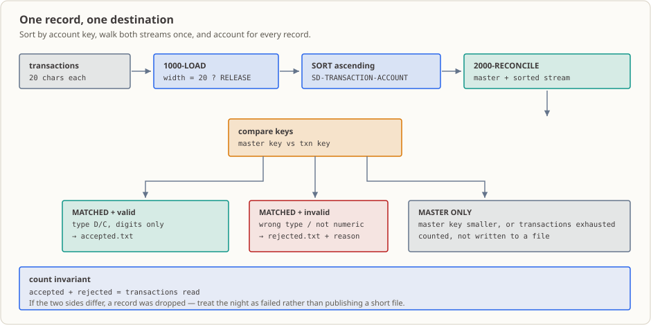

# Lesson 22: Integrated Practice — Sort, Validate, Match, and Account for Every Outcome

This lesson delivers a small batch: an unordered transaction file and an ordered account master go in; **accepted records, rejected records, a master-only list, and control counts** come out. All four deliverables must agree. No new syntax is introduced. Lessons 15–21 are joined into one pipeline, including what remains in the directory if a run fails partway through.

## The Business Setting

On Friday night, the end-of-day batch reaches reconciliation. The upstream jobs have placed two files in the working directory. The account master was extracted from the host and is sorted by account number. The transaction file contains the day’s teller and mobile banking entries in entry order. It is **unsorted**, and no one guarantees that every transaction has a matching master account.

The outputs go to people and systems, not just to the screen:

- Accepted details go to the next posting job.
- Rejected details go to operations. When a customer calls the next morning asking why a transaction did not post, the teller checks this file.
- Master-only accounts go to reconciliation staff: existing accounts with no activity that day.
- Counts are compared with totals reported by upstream jobs.

“The program finished” and “the batch is ready to hand off” are different claims. A finished process has exited. A valid handoff means **every record has one accountable destination, every master record is accounted for once, and the counts reconcile**.

Both result files are opened with `OPEN OUTPUT`, which **overwrites the previous contents on every run**. If the program fails halfway through—for example, while reading the master or writing to a full disk—the directory contains **partial new results**, neither the old results nor a complete new batch. There is no rollback. Check counts and row counts before delivery.

(This is an educational example. The institution, accounts, amounts, batch date, and times are invented.)

## Why Learn This Now

You have practiced reading, sorting, key matching, and writing output files separately. What you have not done is **connect them in one run**.

Earlier fixtures each isolated a concept: Lesson 21 used unordered input, Lesson 20 used two ordered inputs, and Lesson 16 began with records already classified. A real batch may contain unordered transactions, missing accounts, invalid transaction codes, letters in an amount, and an account with no transaction—all at once.

In one run, classify every case, leave evidence of each outcome, and answer: **“Where did this record go?”** and **“Did the batch account for every record?”** Rejection reasons and file rows answer the first; count invariants answer the second. This lesson practices delivering a complete batch, not just a syntax feature.

## What This Concept Is and the Problem It Solves

**What it is.** No new syntax. Arrange familiar operations in order: sort transactions by account number; make one sequential matching scan with the master; validate matches and route them to two result files; report counts. Equal keys match; the smaller key advances first.

**Every record needs an outcome.** Two equations express the destinations:

- `accepted count + rejected count = input transaction count`. Each transaction is accepted or rejected, never neither or both.
- `matched master count + master-only count = master record count`. Each master row is claimed once; unused accounts are master-only.

Anyone can verify these counts directly. When asked whether anything is missing, show the equations instead of searching logs.

**Know the output state after a failure.** The files are opened for replacement and written while the program runs. Mid-run failure leaves partial new results and destroys the old ones. This is why counts and line counts must be checked; exit code `0` by itself is not a delivery check.

**How it can fail or be misused:**

- This is not a posting program. It **classifies and writes**; it does not update balances or apply debit/credit rules.
- The program does not guarantee matching prerequisites. The master must be ascending and account numbers unique, but **the program checks neither**. Reversed order or duplicate keys can produce silent mismatches.
- Two output files do not provide **atomic delivery**. An `OPEN OUTPUT` or `WRITE` failure can leave incomplete results; this lesson makes no atomicity promise.

## Capabilities and Limits After This Lesson

After completing this lesson, you can:

- Use `SORT` and `INPUT PROCEDURE`/`RELEASE` to order transactions and check width before release.
- Classify transactions as accepted, rejected for missing master, or rejected for invalid fields; record remaining master accounts as master-only.
- Write `accepted.txt` and `rejected.txt` and verify their rows and widths.
- Check `accepted + rejected = input transactions` and `matched master + master-only = master records`.
- Explain that `OPEN OUTPUT` replaces old results and identify sorting/matching assumptions and missing accounting controls.

Scope: the program **classifies and writes**. It does not total balances, apply debit/credit rules, or atomically deliver both files. The master must be ascending with unique keys, but ordering and duplicates are not checked. Multiple transactions for one account are unsupported. Batch IDs, reruns, atomic delivery, and amount rules are covered in Lessons 26–32.

## Runtime Environment

- GnuCOBOL 3.2.0, default dialect (do not add `-std=cobol85`); fixed-format source.
- Linux terminal; no database or extra tools required.
- `SELECT` uses relative names. From the **current working directory**, read `transactions-unsorted.txt` and `accounts.txt`, write `accepted.txt` and `rejected.txt`.
- `OPEN OUTPUT` replaces same-named output files each time. Copy inputs into `build/` and run there to keep outputs out of the source directory; Git ignores `build/`.

## Input and Output Records

| File | Field order | Field widths | Record width |
|---|---|---:|---:|
| `transactions-unsorted.txt` (input) | account, type, amount digits | 10 + 1 + 9 | 20 |
| `accounts.txt` (input) | account, customer, balance digits | 10 + 8 + 9 | 27 |
| `accepted.txt` (output) | account, customer, type, amount digits | 10 + 8 + 1 + 9 | 28 |
| `rejected.txt` (output) | account, reason, type, amount digits | 10 + 10 + 1 + 9 | 30 |

Nine digits represent `PIC 9(7)V99`; `V` occupies no physical character. `000012550` means `125.50`. Each input row is one record; newline bytes are not part of FD width.

The master is ordered (`A000000001`, `A000000003`, `A000000005`, `A000000007`, `A000000009`); transactions are deliberately unordered. Fixtures include valid matches, missing accounts, an invalid type, a nonnumeric amount, and a master account with no transaction.

Rejection reasons are ten characters: `NO_ACCOUNT`, `BAD_TYPE__` (underscores pad to ten), and `BAD_AMOUNT`. **Check the master before validating fields.** A transaction with no master receives `NO_ACCOUNT`, even if its type and amount are also invalid. This precedence is intentional: field validity is irrelevant without an account.

## One Run: Where Every Record Goes




1. The main program invokes `SORT ... ON ASCENDING KEY SD-TRANSACTION-ACCOUNT`, combining sorting and classification in one flow.
2. `1000-LOAD-TRANSACTIONS` opens the transaction input and measures each row. Only a 20-character row is `RELEASE`d to sort. A short or long row stops the batch.
3. `2000-RECONCILE-TRANSACTIONS` opens the master and two output files, then reads the first master row.
4. The output procedure `RETURN`s sorted transactions one by one. If the master key is smaller, count it as master-only and read the next master. Equal keys proceed to validation. A smaller transaction key, or exhausted master, means no master exists for the transaction.
5. A matched record requires type `D` or `C` and all numeric amount characters. Valid rows go to `accepted.txt`; invalid rows go to `rejected.txt` with a reason.
6. After transactions finish, count unclaimed master accounts as master-only. Close files and display counts. Sorting, reading, writing, or closing errors set a nonzero return code.

## Count Invariants: Two Equations Answer “Was Anything Missed?”

This fixture has six transactions and five master rows.

| Invariant | This example | Meaning |
|---|---|---|
| `accepted count + rejected count = input count` | `3 + 3 = 6` | Every transaction has exactly one destination |
| `matched master count + master-only count = master count` | `4 + 1 = 5` | Every master row is accounted for once; matched = input − missing-master rejects = `6 − 2` |

Also verify file rows: `accepted.txt` has 3 and `rejected.txt` has 3. Compare standard output and both files. A summary number alone cannot reveal which record is missing.

## Errors and Boundaries

- Transaction rows must be 20 characters; master rows 27. A mismatch aborts with a nonzero code; the program does not guess.
- Transaction type must be uppercase `D` or `C`; amount characters must all be digits.
- `OPEN` / `READ` / `WRITE` / `CLOSE` statuses and `SORT` / `RELEASE` / `RETURN` results are checked. EOF status `10` is normal.
- Permissions or a full disk can make `OPEN OUTPUT` or writing fail. **A failed batch is not a successful handoff**; partial output may remain.
- Upstream guarantees master order and unique keys. The program does not check them and does not support multiple transactions per account.
- Count fields have three digits, limiting this fixture-sized program to 999 records. Revisit widths for production.
- No balance totals, atomic two-file delivery, duplicate-key policy, rollback, batch ID, or delivery policy are implemented here.

## Run and Observe

**Input:** `transactions-unsorted.txt` (6 rows) and `accounts.txt` (5 rows). Copy them into `build/`; run there so output files stay outside the lesson directory.

```sh
mkdir -p build
cobc -fsyntax-only lesson.cob                    # syntax check only
cobc -x -Wall -o build/lesson_22 lesson.cob      # compile into build/
cp accounts.txt transactions-unsorted.txt build/ # copy inputs
(cd build && ./lesson_22)                        # run and write results here
echo $?                                          # inspect exit code
rm -rf build                                     # remove executable, copies, and outputs
```

Expected results:

| Observation | Expected value |
|---|---|
| `cobc -fsyntax-only` exit code | `0` |
| `cobc -x` exit code | `0`, no compiler diagnostics |
| Standard output | 10 lines, shown below |
| Process exit code | `0` |
| Files created | `build/accepted.txt` (3 rows), `build/rejected.txt` (3 rows) |

Expected: syntax and build exit code `0`, no compiler diagnostics; process exit code `0`; 10 standard-output lines; 3 rows in each output file.

```text
ACCEPTED 账号=A000000001
ACCEPTED 账号=A000000003
被拒绝 账号=A000000004 REASON=NO_ACCOUNT
ACCEPTED 账号=A000000005
被拒绝 账号=A000000006 REASON=NO_ACCOUNT
被拒绝 账号=A000000007 REASON=BAD_AMOUNT
MASTER_ONLY账户 账号=A000000009
输入记录数=006 排序记录数=006
接受记录数=003
拒绝记录数=003 MASTER_ONLY账户记录数=001
```

`accepted.txt` (3 rows, 28 characters each; 87 bytes including newlines):

```text
A000000001C0001001D000012550
A000000003C0001003C000000200
A000000005C0001005D000004000
```

`rejected.txt` (3 rows, 30 characters each; 93 bytes including newlines):

```text
A000000004NO_ACCOUNTD000007500
A000000006NO_ACCOUNTX000000100
A000000007BAD_AMOUNTD00000X001
```

The `ACCEPTED` and `被拒绝` lines are interleaved by transaction account number because one merge scan emits both. The final three lines contain counts. Sorted accounts are `001, 003, 004, 005, 006, 007`: `001`, `003`, and `005` match valid master rows; `004` and `006` receive `NO_ACCOUNT`; `007` is present but its `X` amount gives `BAD_AMOUNT`. Master account `009` is master-only. Verify `3 + 3 = 6` and `4 + 1 = 5`.

`input records=006 sorted records=006` shows all six 20-character transactions passed width checking and were released. If these differ, inspect actual row widths at the `RELEASE` step.

The labels mix English and Chinese: `ACCEPTED` = accepted, `被拒绝` = rejected, `账号` = account, `REASON=` = rejection reason, `MASTER_ONLY账户` = master-only account. Remaining labels name their corresponding counters.

In this workspace, standard error includes `Warning: program compiled against libxml 212 using older 209`. It is a linked-library warning, not business output; its source has not been identified. Standard output contains the lesson result and exit code is `0`.

## Modification Exercises

Use fixture **copies** in `build/`; never edit repository fixtures. Start each run fresh because output files are overwritten.

1. Change transaction account `A000000004` to master account `A000000009`. Keep other fields unchanged. Confirm it enters accepted output, master-only count becomes zero, and both result files have the expected rows.
2. Start from original fixtures and change account `A000000007` amount from `00000X001` to `000000001`. Confirm it changes from rejected to accepted while the master row remains matched.

See [`exercise.md`](./exercise.md) for full prompts and expected results; [`answer.md`](./answer.md) has reference answers.

## Extension Exercise

Add a second valid transaction for the same account. Design a rule that lets one master row match multiple transactions. Define output order, balance changes, and rejection policy; test repeated transactions, missing account, master EOF, and invalid amount. Explain where this program consumes a master row and how state advancement changes. Do not load all input into `OCCURS`; include accepted and rejected file contents. See [`exercise.md`](./exercise.md); no answer is provided.

## Follow the Real Workflow

1. **Upstream:** transactions and master wait in the working directory. [Lesson 15](../15_sequential-file-read/README.md) covers reading, [Lesson 17](../17_fixed-length-files/README.md) fixed-record offsets, and [Lesson 18](../18_csv-processing/README.md) CSV boundaries. This lesson assumes files are already present.
2. **This stage:** sort transactions ([Lesson 21](../21_sort/README.md)), merge by ascending key with the master ([Lesson 20](../20_file-matching/README.md)), validate and route, then report counts. Outputs are two result files, a master-only list, and four counts.
3. **Rejections:** this lesson writes `rejected.txt`. [Lesson 16](../16_file-writing/README.md) covers writing and write failures; [Lesson 26](../26_error-handling/README.md) separates business rejection from system failure.
4. **Logging:** counts currently appear only on screen. [Lesson 27](../27_logging/README.md) records them for later comparison with upstream totals.
5. **Next:** database updates and a rerunnable batch are addressed in [Lesson 29](../29_embedded-sql/README.md) and [Lesson 32](../32_bank-reconciliation-project/README.md).

The guardrail is `accepted + rejected = input` and `matched master + master-only = master`.

## What Happens If This Code Goes into Production

- **Scheduler:** starts it after both inputs are ready and before posting. It checks exit status and generated files, not the screen.
- **Readers:** on-call checks exit code and accepted/rejected/master-only counts. Operations reviews `rejected.txt`; reconciliation compares upstream totals. Investigate mismatches that night.
- **Failure response:** unequal counts lead to matching/validation investigation; partial files lead to disk, permission, and output-status investigation. There is no rollback.
- **Consumers:** `accepted.txt` goes to posting; `rejected.txt` to operations; master-only list to reconciliation; counts to logs. Widths and reason codes are interface contracts.
- **Likely incidents:** wrong row width stops the batch; checking field validity before master existence assigns the wrong reason; trusting exit code `0` without checking file rows can deliver partial output.
- **Not implemented:** balance totals, debit/credit rules, validation of master order/unique keys, multiple transactions per account, batch ID, rerun strategy, atomic delivery, rollback, and logging. These begin in [Lesson 26](../26_error-handling/README.md), [Lesson 27](../27_logging/README.md), and Lessons 29–32.

This lesson demonstrates that for its fixtures, reading, sorting, matching, and writing connect correctly, counts reconcile, and results can be checked by hand. It does **not** establish production-ready accounting or atomic delivery.

## References

- [GnuCOBOL Programmer’s Guide: File-Based SORT](https://superbol.eu/gnucobpg/chapter7.html#file-based-sort)
- [GnuCOBOL Programmer’s Guide: RELEASE](https://superbol.eu/gnucobpg/chapter7.html#release)
- [GnuCOBOL Programmer’s Guide: RETURN](https://superbol.eu/gnucobpg/chapter7.html#return)
- [GnuCOBOL Programmer’s Guide: LINE SEQUENTIAL](https://superbol.eu/gnucobpg/chapter5.html#organization-line-sequential)
- [GnuCOBOL Programmer’s Guide: SORT file description](https://superbol.eu/gnucobpg/chapter6.html#fileasort-description)
- Course home: [README.md](../../README.md)
