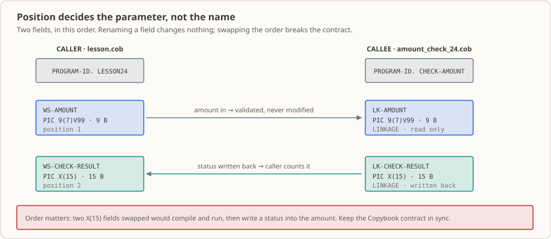

# Lesson 24: CALL — Move Amount Validation out of the Main Program into a Reusable Subprogram

## The Business Setting

At 4 p.m. on Thursday, customer service forwards a case to the batch team. A customer’s receipts show that the same 1,200.00 recurring debit was **accepted** by the direct-debit batch on Monday and **rejected** by the refund batch on Wednesday. You inspect the code and find the problem: both programs contain identical copies of the amount-limit rule. Three months ago, operations raised the limit from 1000.00 to 1200.00. The developer changed the program scheduled for that night’s release but forgot the other copy. **This is the predictable result of treating copy-and-paste as reuse:** one rule exists in two versions, and sooner or later they diverge.

The effects linger. The customer keeps asking, reconciliation staff manually compare the decisions from both batches, and someone must decide which result to trust. Either way, receipts already sent cannot be taken back.

(This is an educational example. Times, batches, customer, and amounts are fictional.)

This lesson moves the “may this amount be posted?” rule out of each main program and into a program unit that can be compiled and deployed independently and called by multiple batches. The three checks are implemented once. The benefit has a cost: COBOL call interfaces **match arguments by position**. Arguments have no names or types at the interface, and the compiler does not count them. If the caller omits an argument, compilation can be silent and execution can terminate on a signal; the observed exit code in this workspace was 139. Duplicated rules can produce “two answers”; a wrong call interface can produce an immediate crash, which can be harder to catch in tests.

## Why Learn This Now

Through Lesson 23, you have two reuse tools: paragraphs (`PERFORM`, [Lesson 7](../07_paragraphs/README.md)) and Copybooks ([Lesson 23](../23_copybooks/README.md)). Neither solves the case above.

A paragraph **cannot leave its program**. `PERFORM 2000-CHECK-AMOUNT` is meaningful only in `LESSON24`’s `PROCEDURE DIVISION`. Another program using the same name gets an “undefined paragraph” error.

A Copybook **contains declarations only**. `COPY` can make data descriptions consistent, but it copies what fields look like, not how to validate them. If you put the `EVALUATE` logic in a Copybook, that code is copied into each consumer. Each program still has its own copy to update.

You might think, “Then I’ll keep copy-and-pasting and remember to update them all.” The case above is the answer: people forget, and the missed update becomes a customer case months later.

The missing capability is **calling between program units**: give logic its own name and interface, pass data in, and receive a result. COBOL provides `CALL`.

## What This Concept Is and the Problem It Solves

**What it is.** `CALL` transfers control from one program unit to another. The called program returns control with `GOBACK`. Data is not shared through global variables; it is associated by position through the fields after `USING`: the first actual argument corresponds to the first linkage argument, the second to the second, and so on.

Remember two related pieces:

- A subprogram declares incoming arguments in `LINKAGE SECTION`. These fields **do not allocate storage inside the subprogram**; they are alternate names for the caller’s fields. Writing to them writes to the caller’s memory.
- If no passing mode is specified, the default is `BY REFERENCE`: the caller passes an **address**. Thus `MOVE "VALID" TO LK-CHECK-RESULT` in the subprogram changes the caller’s field. COBOL has no separate return value here; the result is brought back through the argument.

**The business problem it solves.** One thing: **one implementation of a shared rule**. Change the limit once and every caller gets the new rule on its next run. Reviewers also need to inspect only one implementation. Amount limits, customer eligibility, and transaction-code checks used by several batches are good candidates.

**When not to use it and what can go wrong.** These are central points of the lesson.

`CALL` trades the convenience of “change it once” for responsibility to maintain the interface:

- **Names do not match arguments; positions do.** The caller’s `WS-AMOUNT` and `WS-CHECK-RESULT` have no naming relationship to the subprogram’s `LK-AMOUNT` and `LK-CHECK-RESULT`. The compiler does not compare them. Swap two arguments and compilation may still pass, while the program treats the amount as a status and the status as an amount.
- **The compiler also does not check count or width.** Omitting an argument or declaring different widths for the corresponding fields may not be caught. This is demonstrated below.

## Capabilities and Limits After This Lesson

After completing this lesson, you can:

- Use `CALL "PROGRAM-ID" USING ...` to transfer control to another program unit and explain how execution resumes after `CALL`.
- Receive arguments in `LINKAGE SECTION` and align caller fields by position with `PROCEDURE DIVISION USING`.
- Return from a subprogram with `GOBACK` and explain why the main program’s `STOP RUN` still ends the run unit.
- Compile the main program and subprogram together into one executable, or compile the subprogram as a module and recognize the failure caused by omitting it.
- Interpret `VALID`, `ZERO-AMOUNT`, and `LIMIT-EXCEEDED`, and verify the eight-case counts (`008 = 005 valid + 003 rejected`).

Scope: this lesson uses the default `BY REFERENCE`. Data direction, `BY CONTENT` / `BY VALUE`, interface Copybooks, and ABI risk are in [Lesson 25](../25_using-parameters/README.md). The subprogram returns one **business-result field** only: no system-error return code ([Lesson 26](../26_error-handling/README.md)), no logging (Lesson 27), and no file or database I/O.

## Runtime Environment

- GnuCOBOL 3.2.0, default dialect (do not add `-std=cobol85`); fixed-format source.
- Linux terminal; no database or extra tools are required.
- The main program reports through standard output and **does not read or write business data files**. Build artifacts go in `build/` (ignored by Git); remove the directory after running.

## Two Files, One Interface Contract




This lesson has two source files with distinct responsibilities:

| File | Role |
|---|---|
| [`lesson.cob`](./lesson.cob) | Main program, `PROGRAM-ID. LESSON24`: sets up eight sample amounts, calls the subprogram, counts states, and displays a summary |
| [`amount_check_24.cob`](./amount_check_24.cob) | Subprogram, `PROGRAM-ID. CHECK-AMOUNT`: applies three rules and writes the state to a caller field |

There is one call site with two arguments. Their order in `USING` defines the interface; names do not:

| Position | Caller field | Subprogram linkage field | PIC | Bytes | Direction |
|---:|---|---|---|---:|---|
| 1 | `WS-AMOUNT` | `LK-AMOUNT` | `9(7)V99` | 9 | Caller supplies; subprogram reads |
| 2 | `WS-CHECK-RESULT` | `LK-CHECK-RESULT` | `X(15)` | 15 | Subprogram writes; caller reads |

```cobol
           CALL "CHECK-AMOUNT" USING WS-AMOUNT WS-CHECK-RESULT
```

With default `BY REFERENCE`, the subprogram receives the **address of the caller’s field**, not a copy. When it writes `"VALID"` through the second argument, the caller’s `WS-CHECK-RESULT` changes immediately. That is the result mechanism used in this lesson.

Consequently, interface mistakes fail at runtime. In this workspace, changing the call to pass one argument still let `cobc -fsyntax-only` and `cobc -x -Wall` finish with exit code `0`; linking succeeded. At the first call, the subprogram dereferenced the missing second-argument address, and the process terminated with signal, observed exit code `139`, and standard error `attempt to reference invalid memory address (signal)`. Likewise, compilation accepts a subprogram result field declared `X(20)` when the caller supplies only 15 bytes; the measured behavior is described at the end of the lesson.

A production safeguard is to put parameter declarations in a shared Copybook and compile both sides against it. That is [Lesson 25](../25_using-parameters/README.md). This lesson establishes that the interface is positional and the compiler does not verify it.

## Validation Rules: 1000.00 Is an Accepted Boundary

Subprogram [`amount_check_24.cob`](./amount_check_24.cob) evaluates `EVALUATE TRUE` from top to bottom; the first matching condition wins:

1. Amount equals zero → `ZERO-AMOUNT`.
2. Amount is greater than 1000.00 → `LIMIT-EXCEEDED`.
3. Otherwise → `VALID`.

Condition 2 uses **strictly greater than**, so **1000.00 itself is valid**. It does not satisfy `> 1000.00` and reaches condition 3. This boundary rule is tested in Exercise 1.

The amount field is unsigned `PIC 9(7)V99`, so it cannot represent negative numbers and needs no negative-amount check. `V` is an implied decimal point and takes no byte; the physical field width is nine bytes.

## Eight Sample Amounts You Can Verify by Hand

`1000-RUN-CHECK-CASES` in [`lesson.cob`](./lesson.cob) runs eight paragraphs in order. Each sets one amount and passes it to the shared `2000-CALL-AMOUNT-CHECK`.

| # | Paragraph | Amount | Expected state | Reason |
|---:|---|---:|---|---|
| 1 | `1100` | 125.50 | `VALID` | Nonzero and ≤ 1000.00 |
| 2 | `1200` | 0.00 | `ZERO-AMOUNT` | Equals zero |
| 3 | `1300` | 1000.00 | `VALID` | Boundary: not greater than 1000.00 |
| 4 | `1400` | 1000.01 | `LIMIT-EXCEEDED` | One cent above the limit |
| 5 | `1500` | 0.01 | `VALID` | Smallest positive amount |
| 6 | `1600` | 999.99 | `VALID` | One cent below the limit |
| 7 | `1700` | 9999999.99 | `LIMIT-EXCEEDED` | Maximum for `PIC 9(7)V99` |
| 8 | `1800` | 500.00 | `VALID` | Within range |

Count invariants: `8 checks = 5 valid + 3 rejected`, and `3 rejected = 1 zero amount + 2 over limit`. Cases 3 and 4 straddle the same limit; case 2 is the sole zero-amount case. These equations are the first checks when results differ.

## Run and Observe

**Input:** none. The eight amounts are constants in `lesson.cob`; `amount_check_24.cob` has no data fixture.

**Commands and purpose:**

```sh
mkdir -p build
cobc -fsyntax-only lesson.cob amount_check_24.cob                 # check both sources; create no executable
cobc -x -Wall -o build/lesson_24 lesson.cob amount_check_24.cob   # compile and link both sources together
./build/lesson_24                                                 # run; results go to standard output
echo $?                                                           # inspect exit code
rm -rf build                                                      # remove executable
```

`-fsyntax-only` checks syntax but cannot replace compiling and running. The subprogram is not an executable entry point, so both source files must be included in the `cobc -x` command; this puts `CHECK-AMOUNT` in `build/lesson_24`.

**Expected result:**

| Observation | Expected value |
|---|---|
| `cobc -fsyntax-only` exit code | `0` |
| `cobc -x` exit code | `0`, no compiler diagnostics |
| Standard output | 20 lines, shown below |
| Process exit code | `0` |
| Files created | only `build/lesson_24` |

```text
调用方：开始
调用前 金額=0000125.50
调用返回 状态=VALID
调用前 金額=0000000.00
调用返回 状态=ZERO-AMOUNT
调用前 金額=0001000.00
调用返回 状态=VALID
调用前 金額=0001000.01
调用返回 状态=LIMIT-EXCEEDED
调用前 金額=0000000.01
调用返回 状态=VALID
调用前 金額=0000999.99
调用返回 状态=VALID
调用前 金額=9999999.99
调用返回 状态=LIMIT-EXCEEDED
调用前 金額=0000500.00
调用返回 状态=VALID
调用方：子程序返回后继续
检查总数=008 有效=005 拒绝=003
零金额拒绝数=001 超限拒绝数=002
```

**Output labels:** `调用前 金額=` is the caller’s amount before `CALL`; `调用返回 状态=` is the result field after the subprogram writes it; `调用方：子程序返回后继续` confirms control returned to the caller; the final two lines are counts maintained by the main program. The amount uses edited `PIC 9(7).99`, so `125.50` displays as `0000125.50`.

**Environment detail observed:** running `./build/lesson_24` in this workspace writes `Warning: program compiled against libxml 212 using older 209` to standard error. This linked-library version warning is not business output and does not affect standard output or the exit code.

## A Source-Reading Path

Follow the data flow rather than reading every line in sequence:

1. `0000-MAIN` prints a start marker, performs `1000-RUN-CHECK-CASES`, prints that the caller continues, performs `3000-DISPLAY-SUMMARY`, and ends with `STOP RUN`.
2. Each paragraph from `1100` through `1800` moves one amount to `WS-AMOUNT` and performs `2000-CALL-AMOUNT-CHECK`. Their order is shown in the table above.
3. `2000-CALL-AMOUNT-CHECK` is the caller’s interface wrapper: clear `WS-CHECK-RESULT`, move the amount into display-only `WS-EDITED-AMOUNT` (`PIC 9(7).99`), display it, and issue `CALL`. After return, display the state and perform `2100-COUNT-CHECK-RESULT`.
4. `2100-COUNT-CHECK-RESULT` uses `EVALUATE WS-CHECK-RESULT` to count `VALID` or a rejection reason. `WHEN OTHER` also counts as rejected.
5. The subprogram [`amount_check_24.cob`](./amount_check_24.cob) has one paragraph, `0000-VALIDATE-AMOUNT`: evaluate `LK-AMOUNT`, write a state to `LK-CHECK-RESULT`, then `GOBACK`. It prints nothing and maintains no counts. **Rules live in the subprogram; display and totals live in the caller.**
6. The caller then prints `呼び出し方：子程序返回后继续` (caller continues after the subprogram), showing execution resumes at the statement after `CALL`. The run unit ends at the main program’s `STOP RUN`.

Two less obvious choices:

- **Why clear the result before each call?** All three current branches write a result, so clearing is defensive. If a future branch forgets, a blank value reaches `WHEN OTHER` and is counted as rejected instead of reusing the preceding case’s state.
- **Why use `FUNCTION TRIM(... TRAILING)` for display?** The result field is fixed at 15 bytes, and `MOVE "VALID"` pads it with trailing spaces. `TRIM` removes those spaces for clean output. Comparisons such as `WHEN "VALID"` need no trim: COBOL pads the shorter alphanumeric operand with spaces, so `"VALID"` matches the 15-byte field.

## Exit Codes: Business Rejection Is Not System Failure

The result field and process exit code are separate channels. `ZERO-AMOUNT` and `LIMIT-EXCEEDED` are **business rejections**; they affect counts only. The main program processes all eight cases, reaches `STOP RUN`, and exits with code `0`. `GOBACK` does not carry a status code; the state travels through the second argument.

A **system failure** produces a nonzero exit code. One simple example is omitting the subprogram from compilation:

```sh
cobc -x -Wall -o build/lesson_24 lesson.cob   # main program only
./build/lesson_24
```

Linking still succeeds because a literal `CALL` in GnuCOBOL looks up a module by `PROGRAM-ID` **at runtime**; it does not statically bind both source files. At the first call, lookup fails:

- Standard output stops after `调用前 金額=0000125.50` (line 2).
- Standard error: `libcob: error: module 'CHECK-AMOUNT' not found`.
- Exit code: `1`.

Business rejection returns `0`; a missing module returns `1`. Separating these outcomes is part of the error-handling contract in Lesson 26.

## Deploy Separately: Compile the Subprogram as a Module

The subprogram can be compiled as a module and loaded by the main program at runtime. The module filename must match its `PROGRAM-ID`: `CHECK-AMOUNT.so`, not `amount_check_24.so`.

```sh
mkdir -p build
cobc -m -Wall -o build/CHECK-AMOUNT.so amount_check_24.cob   # build a dynamically loadable subprogram
cobc -x -Wall -o build/lesson_24 lesson.cob                  # build the main program separately
COB_LIBRARY_PATH=build ./build/lesson_24                     # search this directory for the module
rm -rf build
```

This method produces the same standard output and exit code as compiling both sources together; this workspace compared the outputs byte-for-byte. A module can be replaced independently and shared by multiple main programs, at the cost of a lookup path and filename agreement. Lesson 28 turns this into a repeatable project build script.

## Modification Exercises

Both exercises use the original two sources. Recompile the main program and subprogram together after each change because the validation rule is in the subprogram.

1. Raise the subprogram limit from `1000.00` to `1500.00`. Observe the change for `1000.01`, then check total, valid, and over-limit counts.
2. Start from the original sources and change the amount in `1200-CHECK-ZERO-AMOUNT` from `ZERO` to `0.01`. Observe how the only zero-amount case disappears.

See [`exercise.md`](./exercise.md) for exact changes and expected results, and [`answer.md`](./answer.md) for answers.

## Extension Exercise

Write a second subprogram for customer activity status. The main program passes a customer-status field, and the subprogram returns different results for `ACTIVE`, `FROZEN`, and unknown status. Adjust the main flow so a failed customer check **does not** call the amount-validation subprogram. Define the `LINKAGE` layout and positional call interface, and explain the condition for the second `CALL`. Use only `CALL`, `LINKAGE`, `GOBACK`, and `EVALUATE` from this lesson; do not add files or a database. See [`exercise.md`](./exercise.md); no answer is provided.

## Follow the Real Workflow

The subprogram’s place in a complete chain:

1. **Upstream:** the overnight batch opens the day’s transaction file and reads records. File reading starts in [Lesson 15](../15_sequential-file-read/README.md), and writing results is [Lesson 16](../16_file-writing/README.md).
2. **This lesson:** each transaction amount is passed into `CHECK-AMOUNT`. The module is shared by more than one batch: direct debit, refunds, and fee calculations can call the same implementation.
3. **After the result returns:** the caller uses the returned state to route the transaction to accepted or rejected output files, as in [Lesson 22](../22_file-processing-practice/README.md).
4. **Wrap-up:** counts go into logs ([Lesson 27](../27_logging/README.md)), and system failures are distinguished from business rejections ([Lesson 26](../26_error-handling/README.md)).
5. **Interface contract:** this lesson aligns fields by position. Lesson 25 makes data direction explicit and moves declarations into a shared Copybook; [Lesson 28](../28_modular-batch-project/README.md) organizes programs and Copybooks into a repeatable build.

The deliverable is more than the 20 lines of output: it is an **interface**. Other batches depend on the `CHECK-AMOUNT` name, the three returned states, and the order “amount first, result second.” Once in use, changing it affects other consumers.

## What Happens If This Code Goes into Production

- **Scheduler:** starts the main program. `CHECK-AMOUNT` is a module, not an entry point, and must be included in the deployment package.
- **Who reads the output:** on-call checks exit code and counts. **Business rejections do not change the exit code**, so `0` means the run completed, not that there were no rejected transactions. Check the counts.
- **Who is called when it fails:** `module 'CHECK-AMOUNT' not found` signals a deployment issue: missing module, wrong search path, or stale version. It prevents the run and is usually straightforward to investigate. Positional mistakes can instead silently overwrite data or crash at runtime.
- **Downstream consumers:** the result field routes transactions to accepted/rejected files; counts go to logs; [Lesson 28](../28_modular-batch-project/README.md) assembles the project for deployment.
- **Most likely first-month incidents:** updating the limit in only one copy of the rule, as in the opening case; or changing a subprogram argument width without telling callers to rebuild.
- **What is not implemented:** explicit parameter directions and interface Copybooks ([Lesson 25](../25_using-parameters/README.md)), system error codes ([Lesson 26](../26_error-handling/README.md)), logs ([Lesson 27](../27_logging/README.md)), and a repeatable build script ([Lesson 28](../28_modular-batch-project/README.md)).

## What Was Tested and What Was Not

The limits matter; do not present an inference as a tested result.

- **Tested in this workspace (GnuCOBOL 3.2.0, default dialect):** normal path produces 20 standard-output lines and exit code `0`; compiling only the main program leads to exit code `1` and `libcob: error: module 'CHECK-AMOUNT' not found`; separately compiling with `-m` and setting `COB_LIBRARY_PATH` produces byte-for-byte identical output to the combined build; calling with one argument compiles with exit code `0` but runs with exit code `139`.
- **Not verified and not a lesson conclusion:** declaring the subprogram result as `X(20)` while the caller provides 15 bytes compiles and exits `0` in the observed run, with no visible anomaly, because the current status strings are only five bytes. A wider write overwriting adjacent storage is a layout-based risk, not an observed effect in this lesson.
- **No cross-platform promise:** ABI compatibility across compilers and platforms is outside scope ([Lesson 25](../25_using-parameters/README.md)). Statements about compiler checking refer to the verified GnuCOBOL 3.2.0 default dialect.

## References

- [GnuCOBOL Programmer’s Guide: CALL](https://gnucobol.sourceforge.io/HTML/gnucobpg.html#CALL)
- [GnuCOBOL Programmer’s Guide: PROCEDURE DIVISION USING](https://gnucobol.sourceforge.io/HTML/gnucobpg.html#PROCEDURE-DIVISION-USING)
- [GnuCOBOL Programmer’s Guide: GOBACK](https://gnucobol.sourceforge.io/HTML/gnucobpg.html#GOBACK)
- [GnuCOBOL Programmer’s Guide: LINKAGE SECTION](https://gnucobol.sourceforge.io/HTML/gnucobpg.html#LINKAGE-SECTION)
- Course home: [README.md](../../README.md)
