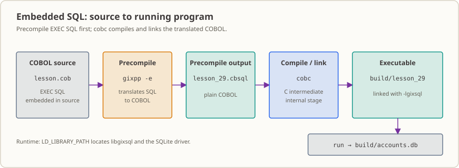

# Lesson 29: Embedded SQL—Connect a COBOL Program to a Database and Look Up an Account

In the first 28 lessons, your data lived in files, and `OPEN` → `READ` → `CLOSE` was enough to get it. Account balances do not live in those files; they live in a database. In this lesson, the COBOL program connects to a database (a local SQLite file database here), looks up one row by account number, retrieves the customer ID and balance, and handles “found,” “not found,” and “SQL error” as three distinct outcomes. Lesson 30 follows this path and replaces “fetch one row” with a cursor that scans the whole table.

## The business situation

At 1:10 a.m., the end-of-day reconciliation batch reaches its final step: a spot check. Customer support left a ticket during the day: what was the balance of account `A000000001` last night?

You only have the transaction file. It says who moved how much money and when, but not how much remains in the account now. The balance is in the account snapshot database exported from the core system (this lesson uses a small SQLite file to demonstrate a real engine and a real file, not a `DISPLAY` statement pretending to query a database).

This code differs from what you have written so far: instead of `OPEN ... READ`, it **connects to a database, sends a query, and receives the result**. The action looks small—you retrieve one row—but the database can give you three different answers:

- **A row was found**, exactly one.
- **No row was found**, zero rows.
- **The SQL did not run successfully**, and the database reported an error.

The first two are **business results**; the third is a **failure**. These outcomes can sound similar, but they require completely different handling.

Collapsing the three into two outcomes causes the two classic failures in this kind of program. In one, “not found” (`SQLCODE = 100`) is treated as an error: the program exits with a nonzero code, the on-call person is woken up in the middle of the night, and it turns out the account never existed. The other is more serious: the database is unreachable, the table name is wrong, or a column is missing, but the program still prints “account not found,” disguising a database failure as “this account really is absent today.” The balance mismatch can go unnoticed for a long time.

This lesson covers three things: read connection details from environment variables, use a primary-key lookup to retrieve one row, and send each of the three `SQLCODE` outcomes down its own path.

## Why learn this now

In lessons 15–22, you learned to read files and match their contents. Lessons 23–28 then broke that work into buildable, reusable modules—but the data source was always a text file. The problem with files is not that they are hard to read; it is that **the current state of an account is not in them**.

A file records “what happened”; a database stores “what is true now.” To look up a balance, account status, or customer ID, you have to ask the database. That raises questions you have not faced before:

- Where should the connection string come from: hard-coded source code or the deployment environment?
- Who translates `EXEC SQL`? Does `cobc` understand it?
- How does a database column get into a COBOL field?
- Are “no row found” and “SQL failed” the same outcome?

This lesson addresses the first three and focuses on the fourth. We will first make the simplest path work: a single-row `SELECT ... INTO`. Why only one row? Looking up one account by its primary key is one of the most common operations. When lesson 30 scans the entire snapshot table, `SELECT ... INTO` will no longer be enough, so you will switch to a cursor.

## What this concept is and what problem it solves

**What it is.** In short, it lets a COBOL program issue SQL directly. In COBOL source, write `EXEC SQL ... END-EXEC` around a regular SQL statement (a `SELECT ... INTO` in this lesson). COBOL fields prefixed with a colon are **host variables**: values returned by the database come in through them, and query criteria go out through them.

**Why it is needed.** Only the database knows the current state of an account. You can either have the batch program connect to it or manually export a balance file every day. That manual step will eventually be missed or fail halfway through, and no one will know exactly when the data was captured. There is another trap to call out: the GnuCOBOL compiler **does not understand** `EXEC SQL`. Those words are not COBOL to it. A precompiler must first translate `EXEC SQL` into regular COBOL, which the compiler can then process. I have seen people spend an afternoon assuming their SQL was wrong.

**Where it is used in real work.** Reconciliation, balance lookups, risk spot checks, and exporting status to downstream systems—all use this approach whenever a program needs to “take a quick look” at the current state in a database.

**What goes wrong if it is used incorrectly.** The incident described above: three outcomes get reduced to two. Treating `100` as a failure raises alarms for ordinary business cases every day. Treating a failure as `100` silently swallows real database problems. The compiler will not warn you about this distinction; it will make itself known through a phone call in the middle of the night.

**When not to use it.** Do not rush to connect to a database in either of these cases. First, if the data is already in a file (transaction details or an upstream export), connecting “because it is more modern” only adds a connection and another possible failure point to the batch. Second, if you need to scan a whole table in order: `SELECT ... INTO` handles only one row at a time and cannot retrieve multiple rows one by one. Lesson 30 uses a cursor for that.

## What you will be able to do—and the limits

After this lesson, you can:

- Explain that the GnuCOBOL compiler and the **precompiler** that translates `EXEC SQL` are separate tools.
- Read an SQLite connection string from environment variables, run `CONNECT`, and disconnect with `CONNECT RESET`.
- Use COBOL fields as SQL host variables (`:field-name`) and query a primary key with `SELECT ... INTO`.
- Use `SQLCODE` to distinguish one returned row (`0`), no matching row (`100`), and an SQL error (any other value), and end errors with a nonzero exit code.
- Compare the four standard output lines with [`expected-output.txt`](./expected-output.txt) and explain why connection details do not belong in source code.

Limits: this lesson only performs a single-row primary-key lookup. It does not loop, write to the database, or use transactions. Cursors are covered in lesson 30; synchronizing files and a database is covered in lesson 31. The sample database is a local SQLite file with a real SQL engine and a real file; its behavior **does not represent** Oracle, PostgreSQL, or DB2. The toolchain has only been verified on x86-64 Linux in this workspace with GixSQL v1.0.20b.

## Runtime environment

- GnuCOBOL 3.2.x (`cobc`) and the `sqlite3` command-line program.
- **Precompiler and runtime library**: [GixSQL](https://github.com/mridoni/gixsql) `v1.0.20b` (Ubuntu 22.04 package) and its `libfmt8` runtime. `./install-toolchain.sh` downloads two `.deb` files from the official release and an Ubuntu mirror, verifies fixed SHA-256 hashes, and extracts them into `build/toolchain/`. It does **not** modify system packages; the repository does not include these binaries.
- `curl`, `dpkg-deb`, and `sha256sum` are also required by the installer.
- On non-x86-64 Linux, or with another GixSQL version, install a compatible version yourself and point `GIXSQL_ROOT` to its `usr` directory.
- The lesson uses its `build/` directory (`BUILD_DIR` can override it); the repository ignores this directory.

## The toolchain: why a precompiler is needed



`cobc` does not parse `EXEC SQL`, so the data path for lessons 29–32 looks like this:

```text
lesson.cob --(gixpp -e)--> 预处理 COBOL --(cobc -fstatic-call -lgixsql)--> 可执行文件
                                              ↑
                                    运行期由 LD_LIBRARY_PATH 找到 libgixsql 与 SQLite 驱动
```

The three steps work in order: `gixpp` translates source containing `EXEC SQL` into plain COBOL (the output is named `lesson_29.cbsql`); `cobc` compiles and links that translation into an executable; at runtime, `LD_LIBRARY_PATH` locates `libgixsql` and the SQLite driver. The program will not run if any one of the three is missing.

Keep the three subcommands straight: `build.sh check` runs the precompiler and `cobc -fsyntax-only` only (it does not produce an executable); `build.sh build` links the executable; `build.sh run` rebuilds the database before running.

**Do not replace SQL with simulated output when the toolchain is unavailable.** Treating a fake result printed with `DISPLAY` as “queried the database” turns “not verified” into “implemented.”

## Build and run

```sh
./install-toolchain.sh    # 只需一次：下载并解包 GixSQL（写入 build/toolchain/）
./build.sh check          # 预编译 + 语法检查
./build.sh build          # 预编译 + 编译 + 链接
./build.sh run            # 重建 build/accounts.db 并运行
echo $?                   # 查看退出码
./build.sh clean          # 删除 build/（含工具链、预编译文件与数据库）与预编译器日志 gixsql.log
```

Yes, `clean` deletes the toolchain too. Lessons 30–32 reuse `build/toolchain/usr` from here by default, so if you clean and want to continue with those lessons, run `./install-toolchain.sh` again first.

`run` creates `build/accounts.db` from [`schema.sql`](./schema.sql), so every run starts with a clean database: `ACCOUNT_SNAPSHOT` has two rows, with balances `1250.75` for `A000000001` and `875.00` for `A000000002`.

**Expected results:**

| Check | Expected value |
|---|---|
| `./build.sh check` exit code | `0` |
| `./build.sh build` exit code | `0` |
| `./build.sh run` exit code | `0` |
| Standard output | 4 lines, matching [`expected-output.txt`](./expected-output.txt) line by line |
| Generated files | `build/accounts.db`, `build/lesson_29.cbsql`, `build/lesson_29`, and the toolchain log `gixsql.log` (the GixSQL precompiler writes it beside the source; the runtime appends in the process working directory; `.gitignore` covers it) |

```text
接続=成功
検索=A000000001 状態=FOUND 顧客=C0001001 BALANCE=01250.75
検索=A99999999X 状態=NOT_FOUND
切断=成功
```

**Output legend (actual label → meaning):** `接続=成功` = connection succeeded; `検索=` = lookup key; `状態=FOUND` / `状態=NOT_FOUND` = found / not found (`NOT_FOUND` comes from SQLCODE `100`); `顧客` = customer ID; `BALANCE` = balance; `切断=成功` = disconnect succeeded.

**Observed environment detail:** Running the executable in this workspace writes `Warning: program compiled against libxml 212 using older 209` to standard error. This is a linked-library version warning in the runtime environment, not program standard output; the component that triggers it has not been identified.

## The SQL–COBOL interface

### 1. Connection details come from the environment, not source code

`WS-DATASRC`, `WS-DBUSER`, and `WS-DBPASS` are ordinary COBOL fields. The program uses `DISPLAY ... UPON ENVIRONMENT-NAME` to specify which variable name to read, then `ACCEPT ... FROM ENVIRONMENT-VALUE` to retrieve its value, and only then executes `CONNECT`. The source and fixtures therefore do **not** store machine-specific paths or passwords; `build.sh run` injects them through environment variables such as `DATASRC=sqlite://<absolute-path>`. Production deployments should provide these values through the environment or a secrets manager too. Changing machines, databases, or passwords should not require changing the program.

### 2. Host variables and a single-row query

Fields prefixed with a colon in SQL are host variables (for example, `:WS-LOOKUP-ACCOUNT`). GixSQL converts them into SQLite parameters:

```cobol
           EXEC SQL
               SELECT ACCOUNT_NO, CUSTOMER_ID, BALANCE
                 INTO :WS-ACCOUNT, :WS-CUSTOMER, :WS-BALANCE
                 FROM ACCOUNT_SNAPSHOT
                WHERE ACCOUNT_NO = :WS-LOOKUP-ACCOUNT
           END-EXEC
```

The three items after `INTO` are the receiving fields: the database's three columns are written to the three COBOL fields in positional order.

Widths must match: the account number is 10 characters in both the table and COBOL, and the customer ID is 8 characters in both. Fixed-width `PIC X` fields preserve their width. A host variable's width must agree with the database field and the expected value; otherwise, strings may have trailing spaces or be truncated. COBOL receives the balance as `PIC 9(7)V99` (the source uses `PIC S9(7)V99 COMP-3`: seven integer digits and two decimal places). Before display, the value is moved into a `PIC 9(5).99` display field, so `1250.75` prints as `01250.75`: the integer part is zero-padded to five digits and the fractional part remains two digits.

One small detail is easy to miss: before querying, the program clears the receiving fields (`MOVE SPACES` / `MOVE ZERO`). Otherwise, if this query takes the “not found” path, the fields could still contain the previous row's values—and print somebody else's balance.

### 3. `SQLCODE`: keep the three outcomes separate

| `SQLCODE` | Meaning | Lesson behavior | Exit-code effect |
|---:|---|---|---|
| `0` | Query succeeded and returned one row | Display `状態=FOUND` and the customer ID and balance | None |
| `100` | No matching row | Display `状態=NOT_FOUND` (**not an error**) | None |
| Other | SQL error | Display `状態=エラー SQLSTATE=` and set the failure flag | `1` |

`SQLCODE = 100` is a normal business outcome. Treat it as a failure and routine “account not found” cases will stop the batch. Treat an SQL error as “not found” and real database problems will be hidden. That is why the code uses `EVALUATE SQLCODE` to keep the three outcomes separate; only values other than `0` and `100` reach `WHEN OTHER`.

The clearest way to see the difference is to put a counterexample and a correct example side by side (both are illustrative; the counterexample's output text is not actual output from this lesson):

```cobol
      * 反例：把"没查到"和"SQL 出错"压成同一个失败分支
      *       正常业务结果被当成故障，真故障也失去了轻重
           IF SQLCODE NOT = 0
               DISPLAY "查询失败"
               MOVE "Y" TO WS-FAILED
           END-IF

      * 正例：三种结果各走各的路（lesson.cob 就是这么写的）
           EVALUATE SQLCODE
             WHEN 0     ...查到一行，取客户号与余额
             WHEN 100   ...没匹配行，正常业务结果
             WHEN OTHER ...SQL 错误，置失败标志、退出码 1
           END-EVALUATE
```

In the correct example above, neither `WHEN 0` nor `WHEN 100` counts as a failure. That is why the two queries in this lesson (one match and one no-match) finish with exit code `0`; only `WHEN OTHER` returns `1`.

### 4. Cleanup

After a successful connection, `9000-DISCONNECT-DATABASE` runs `CONNECT RESET` and checks `SQLCODE`. A failure here also sets the failure flag, so the main flow ends with status `1` and shell jobs can detect it.

## Follow the real workflow

Here is where this lesson fits in the overnight chain:

1. Daytime branch and mobile-banking transactions are exported to a file in a shared directory. Reading files is covered in lessons 15–22.
2. The nightly batch processes the file side and prepares the results.
3. When it needs the current account state, **this lesson's code** connects to the database and retrieves one row by account number, including the customer ID and balance. This is only a “look up one row” operation; lesson 30 uses a cursor to scan the full account snapshot in order.
4. Once both the file and database sides are ready, they can be compared account by account and classified as `MATCH`, `CHANGED`, or `FILE_ONLY`, producing a differences file. That is lesson 31.
5. Lesson 32's capstone project connects the chain into a complete batch and adds count checks and an explanation of recovery after partial SQL failure.

So although this lesson appears to “retrieve one account,” it is the foundation for the next three lessons. Without a real database connection and a clear distinction among the three `SQLCODE` outcomes, the later comparisons and reruns have no reliable basis.

## Modify the exercise

Start both tasks from the original `lesson.cob`. After each change, run `./build.sh run` again; the script rebuilds the database so the previous run cannot affect the result:

1. Change the account number in the first query from `A000000001` to `A000000002`. Check the customer ID and balance (expected: `顧客=C0001002 BALANCE=00875.00`; the database stores `875.00` and the display field pads it to `00875.00`). Explain how `SELECT ... INTO` moves database columns into COBOL fields.
2. Start from the original source and change the account number in the second query from `A99999999X` to `A000000002`. Compare the `SQLCODE` branches and output of the two queries.

The full tasks and expected results are in [`exercise.md`](./exercise.md); see [`answer.md`](./answer.md) for sample answers.

## Apply the idea in another exercise

Add an opening date and account status to the table, then query an active account using host variables. Make “account does not exist” and “database schema error” appear as a business result and a system error, respectively, and explain why the database path and credentials should be supplied by the deployment environment. No answer is provided.

## What if this code were in production?

- **Who schedules it:** An overnight batch scheduler or shell job. It checks the exit code, not the screen.
- **Who reads the output:** On-call and troubleshooting staff check the exit code first, then the Japanese labels. `FOUND` means continue; `NOT_FOUND` is not alarming; `エラー` means someone needs to investigate.
- **How the next system uses it:** This lesson only prints the values. Next, the values are used for decisions (lessons 30 and 31), and ultimately feed reconciliation results and a differences file (lesson 32).
- **The most likely first-month incident:** Combining `100` and “SQL error” into one branch. Saving a few lines of `EVALUATE` makes “not found” and a real database failure indistinguishable in reports. The former happens every day; the latter is serious when it occurs.
- **What it still cannot do:** It only looks up one row; it does not write to the database or manage transactions. This lesson does not cover whether writes already made remain after SQL failure or how to rerun safely—those topics come in lessons 31 and 32. This lesson **does not** mean the program is production-ready.

**Unverified items (and why):**

- Cross-database dialects are unverified. This workspace has only been tested on x86-64 Linux with GixSQL v1.0.20b and SQLite file storage; this lesson makes no claim about Oracle, PostgreSQL, or DB2.
- There are no test records for the three SQL failure branches (`接続=エラー`, `検索=エラー`, `切断=エラー`). This lesson has no repeatable failure-injection setup (such as an unreachable data source or broken schema), so these paths are described from the code and the `SQLCODE` table above, not presented as tested.
- The `libxml 212 / older 209` standard-error warning comes from linked-library versions in the runtime environment. Its triggering component has not been identified. It is not program standard output, so do not count it when checking business results.

## References

- [GnuCOBOL FAQ: SQL database interfaces](https://gnucobol.sourceforge.io/faq/master.html#does-gnucobol-support-any-sql-databases)
- [GixSQL README: Embedded SQL, host variables, and SQLite connections](https://github.com/mridoni/gixsql/blob/main/README.md)
- [GixSQL GnuCOBOL/SQLite example](https://github.com/mridoni/gixsql/blob/main/gixsql-tests-nunit/data/TSQL037A-SQLITE.cbl)
- [GnuCOBOL Programmer’s Guide](https://gnucobol.sourceforge.io/HTML/gnucobpg.html)
- Course home in this repository: [README.md](../../README.md)
