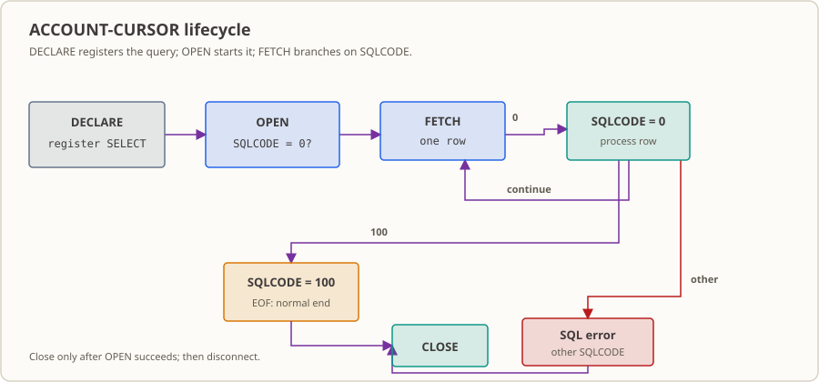

# Lesson 30: SQL Cursors — Open Once, Fetch Every Row to the End

At the start of month-end closing, the reconciliation program has to scan the entire account snapshot table, not just one account: at least tens of thousands of rows, and sometimes hundreds of thousands. It must finish before the branch opens and report “exactly how many rows were fetched” to the person on duty. What you need here is a way to open once and read row by row to the end, rather than a point query that names one account and returns one row.

This lesson adds that capability: use a cursor named `ACCOUNT-CURSOR` and follow its `DECLARE → OPEN → FETCH → CLOSE` lifecycle to read accounts one row at a time into COBOL host variables. Use `SQLCODE` to distinguish “a row was fetched,” “the result set has ended,” and “a real SQL error occurred.”

## The Business Setting

> Note: The institution, time, and volume below are fictional details in a demonstration scenario created to explain the concept. They do not correspond to real data from any institution.

At 2:10 a.m., the end-of-day accounting process has just saved that day’s account balance snapshot to the database. The scheduler starts your batch job with a one-line assignment: **scan the entire snapshot table**, fetch each account’s number, customer ID, and balance row by row, and pass them to the next reconciliation step. Nobody tells you how many rows there will be: on busy days, hundreds of thousands; in the quiet season, perhaps only a few thousand. The program cannot assume there will be “just two rows.”

You might think: didn’t we just learn how to query an account in the previous lesson? Why not use that? The previous lesson’s `SELECT ... INTO` is a point query: give it an account number and it returns one row. The situation now is exactly the opposite: **you do not know which accounts to look up; you need every row**. A point query cannot handle all the extra rows when you scan the whole table, and after fetching one row it cannot tell you whether there are more.

That is the problem a cursor solves. It turns a query into a **result set that is still being read**: data starts coming back only after `OPEN`, then you `FETCH` one row at a time until a later `FETCH` says “there are no more.” The most valuable—and easiest to get wrong—point is this: **“there are no more” means normal completion, not an error.** `SQLCODE = 100` means the result set has reached its end, which is a normal business outcome; `SQLCODE = 0` means this fetch returned a row. Only other values mean something really went wrong with SQL.

Let that sink in, because getting it wrong is costly. If you send `100` down the failure branch, the on-call person will see the batch report **“failure” every day**, even though every account was read correctly—the table was simply read to the end. This kind of “false failure” is exhausting in a real system: alerts keep ringing, people investigate and find nothing, and when something truly breaks, it gets lost in the pile of false alarms.

## Why Learn This Now

In the previous lesson ([Lesson 29](../29_embedded-sql/README.md)), you got GixSQL preprocessing working, connected to local SQLite, and used a host variable to retrieve one account. That is an excellent starting point, but it answers only one kind of question: “What is the balance of account X?”

Reconciliation has to answer a different question: **“Who is in this snapshot, and how much does each one have?”** In other words, the data comes as a batch, not one record.

You might say: why not write a loop in the program and query one account after another? You could, but first you would have to **know which accounts exist**—and that is exactly what you do not know yet. You would be forced to query once to get all account numbers, then query again for each account. Data that could have been read in one pass would be queried twice, and with many accounts you would also need extra memory.

COBOL’s answer is a cursor: the database keeps a result set that is “being read,” while your program fetches one row at a time until it reaches the end. You do not need to know the row count in advance or load all account numbers into memory first. A cursor also gives you three useful stages: `DECLARE` registers the query, `OPEN` actually sends the request, and every `FETCH` returns a clear status code. Together, these let you write a batch that reads the whole table and counts exactly how many rows it read.

The outcome of this lesson is the ability to process database-side data as a batch, one row at a time. The next lesson ([Lesson 31](../31_data-synchronization/README.md)) builds on this by comparing the database snapshot with a file snapshot by key and producing a discrepancy report; [Lesson 32](../32_bank-reconciliation-project/README.md) then brings the pieces together as a complete batch. If you get “when is the read finished?” wrong here, the whole chain after this will be wrong too.

## What This Knowledge Point Is and What Problem It Solves

**What it is.** A cursor is a handle for a database query: first declare it (`DECLARE`, which registers the query text without retrieving data), then open it (`OPEN`, which actually sends the request), repeatedly fetch (`FETCH ... INTO`, which advances one row per execution and writes the current row’s columns into COBOL fields), and finally close it (`CLOSE`, which returns the resources to the database). The order of these four steps matters. After each step, the value of `SQLCODE` is the only basis for deciding what to do next.

**What business problem it solves.**

- Let the data determine how many rows to read instead of hard-coding the count in the program. Today there may be 3 rows; tomorrow, 120,000. The code does not need to change.
- Make “finished reading” a **state you can detect** (`100`), rather than a guess. When the batch ends, it can report “002 rows fetched this time.” The next day, that number can be reconciled against the upstream report; a mismatch means rows were missed or duplicated.
- Distinguish an “empty result” from a real failure. A part of the table may legitimately have no records today; that is routine and should not trigger an alert. A database connection failure or a missing table is what should wake someone up.

**When not to use it, and what can go wrong.**

- For one record with a known primary key, the previous lesson’s `SELECT ... INTO` is enough; a cursor would add quite a bit of unnecessary code.
- If you are reading a batch of **files** rather than a database, use line-by-line file reading (starting in Lesson 15); that has nothing to do with cursors.
- The most dangerous misuse is the one described above: treating `SQLCODE = 100` as a failure turns “finished reading” into “failed.” The reverse is worse: treating a real SQL error as “finished reading” hides the problem—the accounts were not all read, but the batch carries on with a green status.

## Capabilities and Limits After Completing This Lesson

After completing this lesson, you can:

- Declare a cursor with `EXEC SQL DECLARE ... CURSOR FOR SELECT ... END-EXEC` and explain that the query is **not executed** when it is declared.
- Send the query with `OPEN`, write each fetched row’s columns into COBOL host variables with `FETCH ... INTO`, and release the cursor with `CLOSE`.
- Use `EVALUATE SQLCODE` to distinguish `0`, `100` (normal end of result set), and error values, and end the process with a nonzero exit code on an error.
- Run the two-row fixture and the empty-table fixture separately; compare the “multiple rows + EOF” and “empty result set” cases and explain why an empty result set is not itself an SQL failure.
- Identify two capacity limits: the display balance field has only 5 integer digits, and the row counter has only 3 digits (it wraps after 999 rows).

Limits: This lesson only reads a result set. It does not use `UPDATE/DELETE ... WHERE CURRENT OF` or `FOR UPDATE`, and it does not cover transactions, concurrency, commit, or rollback. Each process opens the cursor only once. The example database is a local SQLite file (a real SQL engine and a real file); its behavior **does not represent** cursor behavior in Oracle/PostgreSQL/DB2. The “empty table returns one blank record” behavior documented in “Empty, Single-Row, Multiple-Row, and EOF Cases” has only been reproduced with this workspace’s toolchain. The toolchain has only been verified on this workspace’s x86-64 Linux + GixSQL v1.0.20b.

## Runtime Environment

- GnuCOBOL 3.2.x (`cobc`), the `sqlite3` command-line program, and `gcc`; source is fixed format and does not use `-std=cobol85`.
- **Precompiler and runtime library:** Reuse GixSQL `v1.0.20b` and `SQLCA.cpy` installed in [Lesson 29](../29_embedded-sql/README.md); this lesson does not reinstall them.
- By default, `build.sh` reads the toolchain from `../29_embedded-sql/build/toolchain/usr`, so **complete Lesson 29’s `./install-toolchain.sh` first**. If the toolchain is installed elsewhere, override it with `GIXSQL_ROOT`:

  ```sh
  GIXSQL_ROOT=/opt/gixsql/usr ./build.sh run
  ```

- The build directory is `build/` inside this lesson (overridable with `BUILD_DIR`) and is ignored by the repository. `build.sh clean` deletes only this lesson’s `build/` and the precompiler log `gixsql.log`; it **does not delete the Lesson 29 toolchain**. Do not run `clean` in Lesson 29 either, as that would delete an installation shared by several lessons.

## Toolchain: Why Cursors Also Need Precompilation

The GnuCOBOL compiler does not understand the `EXEC SQL` line by itself. GixSQL’s precompiler must first replace it with ordinary COBOL calls. The pipeline is exactly the same as in Lesson 29:

```text
lesson.cob --(gixpp -e)--> 预处理 COBOL --(cobc -fstatic-call -lgixsql)--> 可执行文件
                                              ↑
                                    运行期由 LD_LIBRARY_PATH 找到 libgixsql 与 SQLite 驱动
```

Do not mix up what these commands do, or you can waste a lot of time:

- `build.sh check` stops after preprocessing and `cobc -fsyntax-only`; it **does not produce an executable**. Passing this check only means the syntax and preprocessing are okay, not that the program can run.
- `build.sh build` actually compiles and links the executable.
- `build.sh run` / `run-empty` rebuild the database before running.

**Do not substitute simulated SQL when the toolchain is unavailable.** That would document “not verified” as “implemented.”

## Build and Run

```sh
./build.sh check       # 预编译 + 语法检查
./build.sh build       # 预编译 + 编译 + 链接
./build.sh run         # 重建 build/cursor.db（两行）并运行
./build.sh run-empty   # 重建 build/cursor.db（空表）并运行
echo $?                # 查看退出码
./build.sh clean       # 删除 build/ 与预编译器日志 gixsql.log
```

`run` creates `build/cursor.db` using [`schema.sql`](./schema.sql): table `ACCOUNT_SNAPSHOT` has 2 rows, with balance `1250.75` for `A000000001` and `875.00` for `A000000002`. `run-empty` uses [`schema-empty.sql`](./schema-empty.sql) to create the same table **without inserting rows**. Both commands delete and recreate the database each time, so you can rerun them without results from a previous run remaining in the database. You should do the same when experimenting yourself.

**Expected results:**

| Observation | Expected value |
|---|---|
| `./build.sh check` exit code | `0` |
| `./build.sh build` exit code | `0` |
| `./build.sh run` exit code | `0` |
| `./build.sh run-empty` exit code | `0` |
| `run` standard output | 8 lines, matching [`expected-output.txt`](./expected-output.txt) line for line |
| `run-empty` standard output | 8 lines, matching [`expected-empty-output.txt`](./expected-empty-output.txt) line for line |
| Generated files | `build/cursor.db`, `build/lesson_30.cbsql`, `build/lesson_30`, and the precompiler log `gixsql.log` (written beside `lesson.cob` and ignored by the repository) |

Standard output for `run` (two rows):

```text
接続=成功
オープン=成功
行=A000000001 CUSTOMER=C0001001 BALANCE=01250.75
行=A000000002 CUSTOMER=C0001002 BALANCE=00875.00
取得=EOF SQLCODE=100
クローズ=成功
行数=002
切断=成功
```

Standard output for `run-empty` (empty table):

```text
接続=成功
オープン=成功
行=           CUSTOMER=         BALANCE=00000.00
取得=EOF SQLCODE=100
クローズ=成功
行数=001
切断=成功
```

**Output guide (actual label → meaning):** `接続=成功` = connection succeeded; `オープン=成功` = cursor opened; `行=` = one record, followed by the account number, customer number `CUSTOMER=`, and balance `BALANCE=`; `取得=EOF SQLCODE=100` = the cursor has reached the end of the result set; `クローズ=成功` = cursor closed; `行数=` = the record count fetched by this process; `切断=成功` = disconnected. Program output follows the repository convention of using Japanese; this guide explains its meaning in English.

**Environment detail observed in practice:** When the executable runs in this workspace, standard error prints `Warning: program compiled against libxml 212 using older 209`. This is a linked-library version warning from the runtime environment. It is not on standard output and does not affect the exit code; the component that triggers it has not been identified. Do not count it as part of the business result.

## Cursor Lifecycle and Source Reading Path



See [`lesson.cob`](./lesson.cob) for the source. The walkthrough below follows when the data actually moves, not source line numbers, so the timeline in your head matches the program.

### 1. `DECLARE` only registers the query; it has not read any rows yet

```cobol
           DECLARE ACCOUNT-CURSOR CURSOR FOR
               SELECT ACCOUNT_NO, CUSTOMER_ID, BALANCE
                 FROM ACCOUNT_SNAPSHOT
                ORDER BY ACCOUNT_NO
```

This `DECLARE` only registers the query text under the cursor’s name; the database has **not** started retrieving data, and not a single row has been read. This is the least intuitive step: when you write a statement, it feels as if it should do the work immediately, but the cursor does its work at `OPEN`.

A note about `ORDER BY ACCOUNT_NO`. It controls the **output order**, making the row order the same on every run. Do not underestimate it: relational databases do not guarantee return order. Remove this clause and one run may look correct, while the next returns a different order and leaves you wondering what changed. “Stable and reproducible” is something batch processing must secure; it is not the default.

### 2. `OPEN` is when the request is actually sent

`2000-OPEN-CURSOR` executes `OPEN ACCOUNT-CURSOR`. `WS-CURSOR-OPEN` is set to `"Y"` only when `SQLCODE = 0`. The source comment explains why this check matters: **only a cursor that opened successfully may be passed to `CLOSE`**. If `OPEN` fails, the program prints `オープン=エラー SQLSTATE=` and sets the failure flag.

Remember what the `WS-CURSOR-OPEN` flag is for: it enforces the rule “do not act on something that never opened.” Many real system problems start when a resource is used or closed even though opening it failed.

### 3. The `FETCH` loop: three `SQLCODE` outcomes, three paths

`3000-FETCH-ROWS` loops with `PERFORM UNTIL WS-DONE = "Y"`. Each iteration runs `FETCH ... INTO :WS-ACCOUNT, :WS-CUSTOMER, :WS-BALANCE` once, then branches on `SQLCODE`:

| `SQLCODE` | Meaning | Behavior in this lesson | Effect on exit code |
|---:|---|---|---|
| `0` | A row was fetched | Increment the count, display `行=...`, and continue the loop | None |
| `100` | End of result set (normal) | Display `取得=EOF SQLCODE=100` and set `WS-DONE` to end the loop | None |
| Other | SQL error | Display `取得=エラー SQLSTATE=` and set both `WS-FAILED` and `WS-DONE` | `1` |

`SQLCODE = 100` is a normal business outcome. Treating it as a failure would stop the batch for an everyday situation such as “there are no accounts in the table.” Conversely, treating an SQL error as “finished fetching” would hide a real database problem. That is why this lesson uses `EVALUATE SQLCODE` to keep the two cases separate. `GIXSQL_NOREC_CODE=100` is fixed in `build.sh` for `run` / `run-empty` so that “no data” is reported as 100.

**Failure paths (tested):** The error branches in this lesson are not just theoretical; both cases below were run:

| Injection method | Actual output | Exit code |
|---|---|---|
| `DATASRC` points to a nonexistent directory | `接続=エラー SQLSTATE=08001`, `行数=000` (the connection was not established, so there is **no** disconnect line) | `1` |
| The database has no `ACCOUNT_SNAPSHOT` table | `接続=成功`, `オープン=エラー SQLSTATE=HY000`, `行数=000`, `切断=成功` | `1` |

The chain of events in the second case is worth following: `OPEN` fails, so `WS-CURSOR-OPEN` remains `"N"`. The program skips `FETCH` and `CLOSE` (you cannot close a cursor that never opened). The connection did succeed, so it still disconnects. Finally, `WS-FAILED` sets the process exit code to `1`. Deciding “which steps can continue and which must be skipped” is the real challenge of the cursor lifecycle.

### 4. `CLOSE` and disconnecting

`4000-CLOSE-CURSOR` closes a cursor that **opened successfully** after normal EOF or a `FETCH` error; `9000-DISCONNECT-DATABASE` runs `CONNECT RESET`. A failure at any stage—connect, open, read, close, or disconnect—ends the process with status `1` (`STOP RUN RETURNING 1`), so a shell job can detect it immediately. The scheduler does not look at your screen; it only sees this number.

### 5. Compare with the single-row query in Lesson 29

| Dimension | Lesson 29 `SELECT ... INTO` | Cursor in this lesson |
|---|---|---|
| Number of rows | One row per query; multiple rows cause an error | Fetch row by row after opening, until 100 |
| When the query starts | The SQL statement executes the query | `DECLARE` registers it; `OPEN` runs it |
| End state | `SQLCODE = 100` means “no matching row” | `SQLCODE = 100` means “end of result set” |
| Resource release | No visible cursor | `CLOSE` is required, and only a successfully opened cursor is closed |

Notice the last row of the table: the same 100 has a different meaning. In Lesson 29, `100` means “not found”; here it means “finished reading.” The context changes how you handle it, so when checking `SQLCODE`, be clear whether the cursor is “looking up one row” or “reading a batch.”

## Empty, Single-Row, Multiple-Row, and EOF Cases

The subject of this lesson is result-set shape and branching on status, so all four shapes were actually run. The table shows the key observations (the number of `行=` lines is the number of records fetched):

| Case | Fixture / setup | Key observed output | Command used | Exit code |
|---|---|---|---|---|
| Multiple rows (2) | `schema.sql` | 2 `行=` lines, `取得=EOF SQLCODE=100`, `行数=002` | `./build.sh run` | `0` |
| Empty table | `schema-empty.sql` | **1 blank** `行=` line, `取得=EOF SQLCODE=100`, `行数=001` | `./build.sh run-empty` | `0` |
| Single row | Add `WHERE ACCOUNT_NO = 'A000000002'` to the query | 1 `行=` line (`A000000002`), `行数=001` | See [Modification Exercises](#modification-exercises), 2 | `0` |
| Multiple rows (3) | Temporary fixture with 3 inserted rows | 3 `行=` lines, `行数=003` | Run after creating the database manually | `0` |
| Multiple rows (1005) | Temporary fixture with 1005 inserted rows | 1005 `行=` lines, but `行数=005` | Run after creating the database manually | `0` |
| EOF | End of any fixture | `取得=EOF SQLCODE=100` (triggered by 100; not an error) | Same as above | `0` |

**Why does an empty table print one blank record?** This does not mean there is actually data in the table. Do not let it mislead you. Running `sqlite3 build/cursor.db "SELECT COUNT(*) FROM ACCOUNT_SNAPSHOT;"` on the empty database returns `0`, so the table really has no rows. However, the SQLite driver in GixSQL v1.0.20b returns `SQLCODE 0` on the **first** `FETCH` after `OPEN`, filling the account and customer numbers with spaces and the balance with `0`. It returns `100` only on the **next** `FETCH`. That blank record is displayed as a row and included in `行数=`, so the `行数=` count is one greater than the table’s actual row count (the source comment marks this special case). [`expected-empty-output.txt`](./expected-empty-output.txt) records the **actual** output from this toolchain, not the assumed `行数=000`.

**This behavior is specific to this toolchain.** The only confirmed statement is: “reproduced with GixSQL v1.0.20b + SQLite in this workspace.” You cannot infer that the first `FETCH` will return a blank record with another GixSQL version, Oracle/PostgreSQL/DB2, or the native SQLite C API. Before using a cursor for a query that may be empty, verify the first FETCH SQLCODE separately with the target driver. That is the engineering habit worth taking from this lesson.

## Capacity Limits (Tested)

Two source fields have less capacity than the data range. When they overflow, data is silently lost with no trace, so remember these limits:

| Field | Declaration | Limit and observed behavior |
|---|---|---|
| `WS-EDITED-BALANCE` | `PIC 9(5).99` | Only 5 integer digits. After inserting balance `1234567.89`, the actual display is `BALANCE=34567.89` (the high digits are lost). `WS-BALANCE` itself is `PIC S9(7)V99` and can hold the value; its **display copy** cannot. |
| `WS-ROW-COUNT` | `PIC 9(3)` | Only 3 digits. After inserting 1005 rows, all 1005 are still fetched one by one, but the final display is `行数=005` (only the low three digits remain). |

These are real limitations of the **implemented behavior**, not error handling: neither condition reports an error or sets the failure flag, so you cannot tell from the output that something went wrong. Comments beside the field declarations mark both limits. In production, a silently wrapped row count means the first step of reconciliation is already wrong—the number looks normal, but it is short by 1000 rows.

## Modification Exercises

Start both exercises from the original [`lesson.cob`](./lesson.cob), and complete them independently (do not continue from a version changed for the previous exercise). After each change, rerun `./build.sh run`; the script rebuilds the database, so the previous result will not affect this run:

1. Change the cursor query’s sort order to `ORDER BY ACCOUNT_NO DESC`. Confirm that the two rows reverse order while the total count and EOF status stay the same.
2. Add `WHERE ACCOUNT_NO = 'A000000002'` after `FROM ACCOUNT_SNAPSHOT`. Confirm that only one account is output and the next FETCH still reaches EOF with `SQLCODE 100`.

The complete exercises and expected differences are in [`exercise.md`](./exercise.md); the reference answers are in [`answer.md`](./answer.md). The two files agree on both the requested changes and expected results.

## Apply What You Learned

Add an `ACCOUNT_STATUS` column to `ACCOUNT_SNAPSHOT` (for example, `ACTIVE` / `CLOSED`) and make the cursor return only active accounts. Create zero-row, one-row, and multiple-row cases and run each one. Then explain the difference between “`FETCH` failed” and “`SQLCODE 100`,” and confirm that every cursor opened successfully is closed at the end. There is no answer for this exercise; its scope and verification steps are in [`exercise.md`](./exercise.md).

## Walk Through a Real Workflow

Placed in the month-end chain, this cursor batch fits in like this:

1. **2:10 a.m.** End-of-day accounting writes the account balance snapshot to the database table `ACCOUNT_SNAPSHOT`. The scheduler starts your batch, and this lesson’s cursor is the first step in the chain: it turns the entire snapshot into records that COBOL can process.
2. **Earlier that day or overnight,** the core system also exports an account snapshot as a file. Lesson 31 reads the file line by line, looks up each account in the database by account number, **compares the two sides by key**, and creates a discrepancy report that separates “present on both sides and matching,” “present on both sides but with a changed amount,” and “present on only one side.” Its database-side lookup is a single-row query by primary key, but the discipline of treating database data as a batch and processing it one row at a time comes from this lesson. In other words, this lesson reads every row on the database side; Lesson 31 matches the two sides.
3. **Keep a record of the run.** The final `行数=` line from this lesson goes into the log (the logging system from Lesson 27). The next day, the on-call person compares it with the upstream account count; a mismatch means rows may have been missed or read twice.
4. **Bring the pieces together.** The Lesson 32 bank reconciliation project joins these steps into a complete batch: read files, query/write the database, compare, write results, report, and rerun after failure. Lesson 32 uses a single-row primary-key query on the database side, but the discipline of processing a batch one row at a time and counting how many were processed starts here. Whether that project itself needs a cursor depends on whether it processes a batch or a single row.

In one sentence: **this lesson is not about how to write SELECT; it is about reliably reading an entire table and knowing exactly how far you got.** Every later lesson will use this skill.

## What Happens If This Code Goes into Production

- **Who schedules it:** A night batch scheduler, usually after the “database snapshot ready” check. It recognizes only two things: whether the executable exists and what exit code it returns.
- **Who reads its output:** The on-call person checks the exit code first, then `行数=`. A clearly wrong count (for example, 002 when there should be tens of thousands) needs investigation that night.
- **Who gets called when it fails:** A nonzero (`0`) exit code triggers an alert. This lesson deliberately exits with `1` for connection failure (`SQLSTATE=08001`), a missing table (`HY000`), and read errors so the alert fires when it should.
- **How the next system uses it:** The database row-by-row traversal practiced here lets Lesson 31 match the database snapshot with the file snapshot; it then feeds into the Lesson 32 reconciliation project. This lesson only retrieves data and does not modify the database.
- **The most likely incidents in the first month:**
  1. Treating `SQLCODE = 100` as a failure → the batch “fails” every day even though nothing is wrong, and people gradually stop taking alerts seriously;
  2. Seeing the blank row for an empty table with this toolchain and assuming every driver behaves the same → on another database, empty-result behavior may be completely different;
  3. The row counter wraps or the display balance is truncated → the output looks normal, but the numbers are wrong.

Be clear about the evidence: this lesson **only** proves that “on local SQLite + GixSQL v1.0.20b, this cursor flow works as expected and reads once.” Updatable cursors (`FOR UPDATE` / `WHERE CURRENT OF`), cursor behavior across database dialects, transaction boundaries and concurrency, and partial writes and rerun policy after SQL failures are outside the scope. Do not treat a working demonstration here as a production guarantee.

## Evidence and Unverified Items

**Evidence:** All “actual output/exit code” claims above come from running `./build.sh check`, `build`, `run`, and `run-empty` on `lesson.cob` in this workspace, plus manually created databases for one row, 3 rows, 1005 rows, and an oversized balance. `SQLCODE 100` and the error-branch `SQLSTATE` values (connection failure `08001`, missing table `HY000`) were observed in practice, not inferred.

**Not verified:** The `CLOSE` failure branch (`クローズ=エラー`) and a mid-stream `FETCH` error could **not be injected reliably** in this environment. The code paths exist, but they have not been run, so there is no observed result to report. It is also unverified whether the “blank record” occurs with other GixSQL versions or database drivers.

## References

- [GixSQL README: cursors, host variables, and the SQLite driver](https://github.com/mridoni/gixsql/blob/main/README.md)
- [GixSQL SQLite cursor example `TSQL037A-SQLITE.cbl`](https://github.com/mridoni/gixsql/blob/main/gixsql-tests-nunit/data/TSQL037A-SQLITE.cbl) (the original `examples/` path is no longer valid; this example uses an updatable cursor with `FOR UPDATE`, which this lesson deliberately does not use)
- [GixSQL SQLCA Copybook](https://github.com/mridoni/gixsql/blob/main/copy/SQLCA.cpy)
- [GnuCOBOL Programmer’s Guide](https://gnucobol.sourceforge.io/HTML/gnucobpg.html)
- Previous lesson: [Lesson 29: Embedded SQL](../29_embedded-sql/README.md); next lesson: [Lesson 31: Data Synchronization](../31_data-synchronization/README.md)
- Course home in the repository: [README.md](../../README.md)
