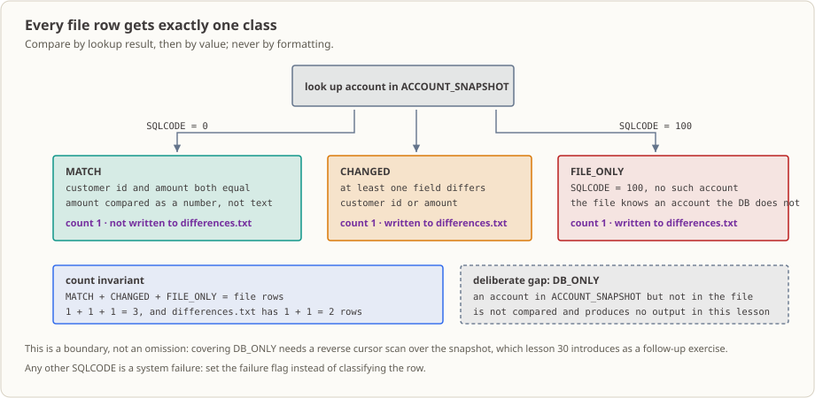

# Lesson 31: Data Synchronization — What Is the Difference Between a File Snapshot and a Database Snapshot?

At night, a bank exports account changes as a fixed-width snapshot file, while the system’s primary database (SQLite in this lesson) holds the baseline account snapshot. In this lesson, a real batch reads the file snapshot line by line, queries `ACCOUNT_SNAPSHOT` by account primary key, classifies each file record as `MATCH` / `CHANGED` / `FILE_ONLY`, and writes it to `RECON_RESULT`. Non-matching records are also exported to `differences.txt`. The lesson also explains the counting invariants, rerun behavior, and residual state after a failure.

## The Business Setting

At 8:00 a.m., someone from the business team walks over with two reports that do not match and asks the same question every time:

> **“Why are the numbers different?”**

One report is the account file exported upstream; the other is the account snapshot in the system’s primary database. “They do not match” is not a useful answer. The business team needs to know which of these three cases occurred: an account is in the file but not in the database; it is in both, but the amount or customer ID differs; or it is in the database but does not appear in the file at all. The first two cases mean the upstream data needs correction. The third often means upstream missed an export. The actions are completely different; combining them into “it does not match” says nothing.

A reconciliation program therefore has two jobs. First, classify every file record as exactly one of the three cases and write the result to a table so someone can look up the record by account number. Second, save the mismatches in a separate difference list for the business or operations team to investigate. The list does not solve the problem by itself, but without it, someone has to pull up both reports and compare them line by line.

There is one more fact to state plainly: this batch is **not atomic**. If SQL fails halfway through, the earlier `INSERT` statements have already taken effect; they are not automatically undone. To return to a clean state, rerun the batch from the beginning (`./build.sh run` deletes and recreates the database, then recalculates from the opening balances); this is not a rollback. This lesson demonstrates that boundary and explains what remains after a rerun. During acceptance, the person who wrote the code should say this up front instead of waiting for an incident.

## Why Learn This Now

You may be thinking: how hard can it be to look something up and compare it?

You already know how to query one record: in Lesson 29, you used `SELECT ... INTO` to retrieve a row from SQLite by primary key. In Lesson 30, you used a cursor to read the entire account table one row at a time. Put those two sides together, though, and three new questions appear:

1. **What kinds of mismatches are there, and where does each go?** A file record with no database row, a row in both with different values, and a database row missing from the file cannot all be called “errors,” and they do not have the same destination. You need a status field to record the classification.
2. **How do you make sure nothing was missed?** After the overnight run, someone will compare the totals the next morning. You need “records processed, count in each of the three categories, and number of difference-file lines” to reconcile arithmetically. That is the counting invariant in this lesson.
3. **What happens if the run fails?** If an insert fails midway, do earlier writes count? This is a recovery-boundary question, not a syntax question.

In Lesson 20, you saw ordered matching of two files by advancing pointers. That time, both sides were files. Here, one side is a file and the other is a database, so lookups use a primary-key query. Whether the file itself is sorted does not affect whether this program is correct. That is the biggest difference from Lesson 20.

## What This Knowledge Point Is and What Problem It Solves

**What it is.** In short, it means “consider one file record together with one database account”: split the account number, customer ID, and amount out of a fixed-width snapshot row; use the account number to query the database by primary key; compare the customer ID and amount if a row is found; otherwise classify it as file-only. Store the classification in a status field, then write a row to the result table.

**What business problem it solves.** It turns “Why are the numbers different?” into three specific, identifiable, countable outcomes. It provides three practical benefits:

- Business or operations staff can look up an account number and see what happened to that record without rerunning the batch and guessing.
- The three summary counts must add up to the number of file rows, so a missing record can be detected that same night.
- The mismatch list is written to a separate file that can be sent directly to upstream for review.

**When not to use it, and what happens if it is misused.** This lesson performs **one-way** reconciliation: the file is the driver, and each file row queries the database. Accounts that are in the database but not in the file are **not examined or output** in this lesson (there is no `DB_ONLY` classification). If you use this as a full reconciliation of both sides, the third kind of mismatch silently disappears. That is an intentional gap in this lesson; to fill it, use the cursor from Lesson 30 to scan in the reverse direction. Another pitfall is the unit: file amounts are in “fen,” while database amounts are in “yuan.” Convert before comparing. If you compare the text directly, `00100.00` and `100` will be treated as different, filling the difference list with false mismatches.

## Capabilities and Limits After Completing This Lesson

After completing this lesson, you can:

- Split account number (10), customer ID (8), and amount in fen (9) from a 27-byte fixed-width snapshot, and explain why fen must be converted to the database’s yuan unit before comparing.
- Use `EVALUATE SQLCODE` to separate three outcomes: `0` means an account was found and classified as `MATCH` / `CHANGED`; `100` means the record exists only on the file side (`FILE_ONLY`); any other value is a system failure that stops processing and returns a nonzero exit code.
- Write one `RECON_RESULT` row for every file record; append `CHANGED` / `FILE_ONLY` to `differences.txt`; and use the counting invariant to check that “file row count = result-table row count = sum of the three categories.”
- Explain and reproduce rerun behavior: `./build.sh run` recreates the database and is repeatable; running the executable directly against the same database again ends with exit code `1` because of a primary-key conflict.
- State what this lesson does **not** do: it does not scan database-only accounts (there is no `DB_ONLY` classification), modify `ACCOUNT_SNAPSHOT`, change account balances, or use transactions and rollback.

Boundary: this lesson performs **one-way** reconciliation (file → database). `RECON_RESULT` records the status of records on the file side; it does not update the account master. The demonstration database is a local SQLite file: a real SQL engine and a real file, but its behavior does **not** represent transaction or concurrency behavior in Oracle, PostgreSQL, or DB2. The toolchain has only been verified on x86-64 Linux with GixSQL v1.0.20b.

## Runtime Environment

- GnuCOBOL 3.2.x (`cobc`), the GixSQL precompiler (`gixpp`), the `sqlite3` command-line program, and `gcc`.
- The toolchain reuses the installation location from Lesson 29: by default, `GIXSQL_ROOT=$script_dir/../29_embedded-sql/build/toolchain/usr`, so the default path depends on Lesson 29’s [`install-toolchain.sh`](../29_embedded-sql/README.md#运行环境) having already run. For a custom installation, set `GIXSQL_ROOT=/path/to/usr`.
- Because the toolchain is shared across lessons, **do not run `./build.sh clean` in Lesson 29**; it would delete the shared GixSQL installation. Lesson 31’s `clean` only removes this lesson’s `build/`.
- Source files use fixed format (indicator in column 7, Area A from column 8, Area B from column 12); do not use `-std=cobol85`: `COMP-3`, `FUNCTION TRIM`, and `FUNCTION NUMVAL` require GnuCOBOL’s default dialect. Measured result: the 214 lines of program text in `lesson.cob` have a maximum length of 68 bytes and do not extend past column 72; column 7 is used only on `*` comment lines.
- The build directory is this lesson’s `build/` (ignored by `.gitignore`). The difference report `differences.txt` is written in this lesson’s directory. GixSQL’s runtime appends `gixsql.log` to the **process working directory** (`build.sh run` sets that directory to the lesson directory, so the log appears next to `lesson.cob`). Both are ignored as well.

## Input and Rules

### File-Side Snapshot: `snapshot.txt`

| Columns | Field | Width | Description |
|---|---|---:|---|
| 1–10 | Account number | 10 | Corresponds to `ACCOUNT_SNAPSHOT.ACCOUNT_NO` |
| 11–18 | Customer ID | 8 | Corresponds to `CUSTOMER_ID` |
| 19–27 | Amount in fen | 9 | Implied decimal point: `0000125075` = `1250.75` |

Each line is one record with no delimiters. The `FD` record is 27 bytes wide; the newline is not included in that width. The program **does not validate line length**, and different lengths behave differently:

- Exactly 27 bytes: processed normally.
- Fewer than 27 bytes: GnuCOBOL pads with spaces, so columns 19–27 become spaces; the amount field is nonnumeric, and the program stops as a system failure (exit code `1`). An empty line behaves the same way; the displayed account number is spaces.
- More than 27 bytes: `READ` returns file status `06`, and the program stops as a system failure (exit code `1`).

The amount field must contain digits. If it contains a nonnumeric character, the program does not treat it as a business rejection; it fails the batch with status `1`. The input is malformed; this is not a business decision. Ascending key order is **only a review assumption** (lookup uses database primary keys and does not depend on sort order). The upstream system guarantees key uniqueness; the program does not check for duplicates. A duplicate is stopped by the result-table primary key when the row is written (see “Failure, Residual State, and Recovery Boundary”).

### Database Tables and Keys (`schema.sql`)

```sql
CREATE TABLE ACCOUNT_SNAPSHOT (      -- 基准快照，来源表
    ACCOUNT_NO  TEXT PRIMARY KEY,    -- 主键：每个账号最多查到一行
    CUSTOMER_ID TEXT NOT NULL,
    BALANCE     NUMERIC NOT NULL     -- 单位：元
);
CREATE TABLE RECON_RESULT (          -- 核对结果，按文件键写回
    ACCOUNT_NO    TEXT PRIMARY KEY,  -- 每个文件键最多一行，重复即冲突
    FILE_STATUS   TEXT NOT NULL,
    FILE_CUSTOMER TEXT NOT NULL,
    FILE_BALANCE  NUMERIC NOT NULL
);
```

The demonstration database is recreated by each `run`: `ACCOUNT_SNAPSHOT` always starts with 2 rows—`A000000001` / `C0001001` / `1250.75` and `A000000002` / `C0001002` / `875.00`; `RECON_RESULT` starts empty. The fixture has one build-time row limit: the counter uses `PIC 9(3)`, so this small fixture supports at most 999 rows.

### Comparison Rules




| Case | Classification | Count | Write to `differences.txt`? |
|---|---|---|---|
| `SQLCODE = 0`; customer ID and amount are both equal | `MATCH` | Consistent | No |
| `SQLCODE = 0`; customer ID or amount differs | `CHANGED` | Changed | Yes |
| `SQLCODE = 100` (no matching account) | `FILE_ONLY` | File only | Yes |
| Any other `SQLCODE` | System failure; set failure flag | — | — |

Amount comparison is **numeric**: divide the file-side fen by 100 to convert to yuan, then compare with `BALANCE`; do not compare text. Customer IDs are compared as fixed-width 8-byte strings. Database-only accounts (in `ACCOUNT_SNAPSHOT` but not in the file) are **not compared and produce no output**. This is an explicit boundary of the lesson, not an omission.

## Run and Observe

```sh
./build.sh check          # gixpp 预编译 + cobc -fsyntax-only，不产出可执行文件
./build.sh build          # 预编译 + 编译 + 链接到 build/lesson_31
./build.sh run            # 重建 build/lesson31.db（重跑 schema.sql）、再运行
echo $?                   # 查看退出码
./build.sh clean          # 删除 build/、differences.txt 与 gixsql.log
```

**Expected results (measured baseline):**

| Observation | Expected value |
|---|---|
| `./build.sh check` exit code | `0` |
| `./build.sh build` exit code | `0` |
| `./build.sh run` exit code | `0` |
| Standard output | 6 lines, matching [`expected-output.txt`](./expected-output.txt) line by line |
| `differences.txt` | 2 lines, matching [`expected-differences.txt`](./expected-differences.txt) (126 bytes including newlines) |
| Database | `RECON_RESULT` goes from 0 rows to 3; `ACCOUNT_SNAPSHOT` remains at 2 rows |

```text
接続=成功
MATCH ACCOUNT=A000000001 CUSTOMER=C0001001 BALANCE=01250.75
CHANGED ACCOUNT=A000000002 CUSTOMER=C0001002 BALANCE=00100.00
FILE_ONLY ACCOUNT=A000000003 CUSTOMER=C0001003 BALANCE=00025.00
集計 行数=003 一致=001 変更=001 ファイルのみ=001
切断=成功
```

```text
CHANGED ACCOUNT=A000000002 CUSTOMER=C0001002 BALANCE=00100.00
FILE_ONLY ACCOUNT=A000000003 CUSTOMER=C0001003 BALANCE=00025.00
```

**Output guide (actual label → meaning):** Runtime output follows the repository’s existing Japanese convention. Its meanings are:

| Actual label | Meaning |
|---|---|
| `接続=成功` / `接続=エラー SQLSTATE=` | Database connection succeeded / failed (on failure, exit code `1`) |
| `MATCH` / `CHANGED` / `FILE_ONLY` | Match / changed / exists only on the file side |
| `ACCOUNT=` `CUSTOMER=` `BALANCE=` | Account number / customer ID / file-side amount (yuan, e.g. `01250.75`) |
| `集計 行数=` | Number of file rows processed (read and counted) |
| `一致=` `変更=` `ファイルのみ=` | Counts of `MATCH` / `CHANGED` / `FILE_ONLY` |
| `切断=成功` / `切断=エラー SQLSTATE=` | Disconnection succeeded / failed |
| `エラー=入力OPEN 状態=` | Failed to open input snapshot + COBOL file status code |
| `エラー=不正残高 口座=` | Nonnumeric amount field + account number |
| `エラー=入力読取 状態=` | Read failure + file status code (status `06` means a line longer than 27 bytes) |
| `エラー=挿入 SQLSTATE=` | Insert into `RECON_RESULT` failed (a duplicate key reaches this case) |
| `エラー=出力OPEN` / `エラー=出力書込` / `エラー=出力クローズ` | Failed to open / write / close the difference file |

**Environment detail observed in practice:** When the executable runs, standard error prints `Warning: program compiled against libxml 212 using older 209`. This is a runtime library-version warning, not business output from this program; the component that triggers it has not been identified.

**`02000: No data` in `gixsql.log` is not a batch failure:** Each time `SQLCODE = 100` occurs (exactly once in this lesson’s baseline fixture, for the `FILE_ONLY` query of `A000000003`), the GixSQL runtime appends one line to `gixsql.log` in its working directory:

```text
[2026-10-16 ...] [libgixsql] [error] move_to_first_record failed: -122 - 02000: No data
```

This lesson treats `100` as a **normal business result** (outputs `FILE_ONLY`, exit code `0`), so that log line is unrelated to whether the batch succeeds. Conversely, when every input is `MATCH`, the file gets no new lines (measured). The log is appended to on each run; `./build.sh clean` removes it along with `build/` and `differences.txt`.

**Database state before and after (`sqlite3 build/lesson31.db`):**

```text
运行前： RECON_RESULT 0 行
运行后： A000000001|MATCH     |C0001001|1250.75
        A000000002|CHANGED   |C0001002|100
        A000000003|FILE_ONLY |C0001003|25
```

Three points to note: `FILE_STATUS` is a fixed-width 10-character field and is stored with trailing spaces (`MATCH     `); `FILE_BALANCE` is numeric, and SQLite’s NUMERIC affinity stores `100.00` as `100` (the value is unchanged, but its displayed form changes); file-side amount `000010000` (fen) is stored in the result table as `100` (yuan).

## Counting Invariants and Rerun Behavior

The fixture in this lesson has 3 file rows and 2 `ACCOUNT_SNAPSHOT` rows.

| Invariant | Applied to this lesson | Meaning |
|---|---|---|
| File row count = `RECON_RESULT` row count | `3 = 3` | Every file record leaves exactly one result row; none is duplicated or missed |
| `一致 + 変更 + ファイルのみ` = file row count | `1 + 1 + 1 = 3` | The three categories are mutually exclusive and exhaustive |
| `differences.txt` row count = `変更 + ファイルのみ` | `2 = 1 + 1` | The difference file agrees with the category counts |
| Database-only account count = `ACCOUNT_SNAPSHOT` rows − (`一致 + 変更`) | `2 − 2 = 0` | This lesson does not detect `DB_ONLY`; the fixture happens to contain none |

The fourth item is a **gap in this lesson**, not a success criterion. Add `A000000099` to `ACCOUNT_SNAPSHOT` and rerun: standard output and the difference file are exactly the same as the baseline, the result table still has 3 rows, and that account does not appear in any output (measured; see the next section). Covering it requires a reverse scan with the Lesson 30 cursor; see “Exercises to Extend the Idea.”

**Rerun behavior:**

- Each `./build.sh run` first removes `build/lesson31.db` and recreates it with `schema.sql`. Repeating the run with the same fixture produces line-by-line identical standard output and difference-file contents. `OPEN OUTPUT` truncates and recreates `differences.txt`; it does not accumulate lines from the previous run.
- Running the executable directly a second time against the **same** database is not idempotent: the first record’s `INSERT` conflicts with the `RECON_RESULT` primary key. The batch ends with `エラー=挿入 SQLSTATE=HY000`, `集計 行数=001`, and exit code `1`. The 3 result rows from the first run **remain in the database**, while this run has truncated `differences.txt` to 0 bytes.

## Failure, Residual State, and Recovery Boundary

Every observation in the table below was reproduced in this workspace (the injection method is in the “How to reproduce” column and does not require changing the program):

| Scenario | How to reproduce | Key observed output | Exit code | Residual state |
|---|---|---|---:|---|
| Normal path | Original fixture, `./build.sh run` | The 6 lines shown above | `0` | 3 result-table rows, 2 difference-file rows |
| Database-only account | Add `A000000099` to `ACCOUNT_SNAPSHOT` in `schema.sql`, then rerun | Output and difference file match the baseline line by line | `0` | Still 3 result rows; `A000000099` appears in no output |
| Missing input | Rename `snapshot.txt` before running | `エラー=入力OPEN 状態=35`, `集計 行数=000` | `1` | Does not connect to the database or create or truncate `differences.txt`; 0 result rows |
| Nonnumeric amount | Change column 19 on line 2 to `X` | After `MATCH` on line 1: `エラー=不正残高 口座=A000000002`, `集計 行数=002` | `1` | Result for line 1 was already committed and remains; the invalid row is not stored; difference file contains only rows written during this run (measured as 0 bytes here) |
| Short line / blank line | Remove columns 19–27 from line 2 | Same as above: spaces are padded and the amount is nonnumeric | `1` | Same as previous row |
| Line longer than 27 | Append `EXTRA-DATA-…` after line 1 | `エラー=入力読取 状態=06`, `集計 行数=000` | `1` | No result rows; `READ` fails on the first record |
| Duplicate file key | Copy line 1 over line 2 | After `MATCH` on line 1: `エラー=挿入 SQLSTATE=HY000`, `集計 行数=002` | `1` | First row remains; duplicate row is not stored |
| Rerun without recreating database | Run `build/lesson_31` against the same database again | `エラー=挿入 SQLSTATE=HY000`, `集計 行数=001` | `1` | The first run’s 3 rows remain; `differences.txt` is truncated to 0 bytes |
| Partial commit | Preinsert the `A000000003` row into `RECON_RESULT`, then run | First two rows succeed; line 3 reports `エラー=挿入`, `集計 行数=003` | `1` | Rows 1 and 2 from this run are **committed and remain**; the difference file contains only the `CHANGED` line |

**Atomicity (understand this accurately):** The program has no `COMMIT`, no `ROLLBACK`, no batch ID, and no recovery marker. GixSQL executes SQL statements one by one; when a failure occurs, **earlier statements have already taken effect**. The “partial commit” case in the table is evidence: the batch exits with code `1`, but the database retains two rows newly inserted by this run. Therefore, do **not** describe this lesson as an atomic commit or claim that a failure automatically rolls back earlier work.

There are only two recovery methods after a failure, and both require external action: run `./build.sh run` again (delete and recreate the database to restore the clean fixture), or have operations explicitly clear `RECON_RESULT`. A real batch needs transaction boundaries, a batch identifier, and a reentrant design; those are part of the Lesson 32 capstone and are not implemented here.

## Source Reading Path

Read in the order “how data and state change”; the point where the two data flows meet is key:

1. **`FILE-CONTROL` / `FILE SECTION`**: `SNAPSHOT-FILE` (read, 27 bytes, `LINE SEQUENTIAL`) and `DIFFERENCE-FILE` (write, 80 bytes) each have a `FILE STATUS` field. Each later I/O operation relies on it to determine success.
2. **`MAIN-PROCEDURE`**: Resources are opened in this order: input → difference file → database. If any step fails, later business processing is skipped. During close, only resources that were actually opened are closed. Finally, counts are displayed **before disconnecting**; a disconnect failure also sets the failure flag.
3. **`3000-RECONCILE-ROW`**: `SNAPSHOT-RECORD(1:10)`, `(11:8)`, and `(19:9)` are the file-side field slices; `FUNCTION NUMVAL(...) / 100` converts fen to yuan; a nonnumeric value goes through the `エラー=不正残高` branch.
4. **`3100-LOOKUP-ACCOUNT`**: First clear the host variables (the driver does not overwrite receiving items on `SQLCODE 100`), then use `:WS-ACCOUNT` in the `WHERE` clause of `SELECT ... INTO`. The `0 / 100 / OTHER` branches of `EVALUATE SQLCODE` are the three business paths.
5. **`4000-WRITE-RESULT`**: The database write point is `INSERT INTO RECON_RESULT`. Only after a successful insert does the program assemble the display line and difference line. The file-side write point is `WRITE DIFFERENCE-RECORD` after `IF WS-STATUS NOT = "MATCH"`.
6. **`9000-DISCONNECT-DATABASE`**: Check `SQLCODE` after `CONNECT RESET`; on failure, run `STOP RUN RETURNING 1`.

The two flows meet in `3100`: file-side fields are split in `3000`, database-side columns are fetched by `SELECT ... INTO`, and the comparison occurs in the `IF WS-CUSTOMER = WS-DB-CUSTOMER AND WS-BALANCE = WS-DB-BALANCE` condition in `3100`.

## Modification Exercises

Start both exercises from the original `lesson.cob` / `snapshot.txt` / `schema.sql`. After making each change, rerun `./build.sh run` (the script recreates the database and difference file, so there is no need to clean them manually):

1. Change the amount on line 2 of `snapshot.txt` from `000010000` to `000087500`. Observe the key change from `CHANGED` to `MATCH`, then check the difference file and summary counts.
2. Add accounts `A000000003` and `A000000099` to `ACCOUNT_SNAPSHOT` in `schema.sql`, then rerun. Observe that `FILE_ONLY` becomes zero and `A000000099` does not appear in the output at all.

The complete expected output, difference-file contents, and explanations for both questions are in [`exercise.md`](./exercise.md) and the reference answers in [`answer.md`](./answer.md).

## Exercises to Extend the Idea

Add a duplicate account key to the input, then add several database accounts that do not appear in the file. Design a two-way reconciliation: use the Lesson 30 cursor to scan `ACCOUNT_SNAPSHOT` in reverse, add a `DB_ONLY` category, and preserve count relationships that can still be checked beyond “file row count = result-table row count.” Define how duplicate keys are rejected (business rejection or system failure), how failed runs are cleaned up for rerun, and how you would verify the behavior. The exercise requirements are in [`exercise.md`](./exercise.md); no answer is provided.

## Walk Through a Real Workflow

Place this batch back into the reconciliation pipeline:

1. The upstream system exports the day’s accounts to `snapshot.txt` overnight and places it in a shared directory. This lesson reads that file; fixed-width records and line boundaries were covered in Lesson 17.
2. `ACCOUNT_SNAPSHOT` in the system’s primary database is the “baseline version.” Lesson 29 shows how to connect and retrieve one row with `SELECT ... INTO`; Lesson 30 shows how to scan the whole table with a cursor.
3. This lesson’s program brings the two sides together, classifies each record, writes `RECON_RESULT`, and selects the non-matching rows for `differences.txt`.
4. The difference file goes to the business or upstream team for investigation; `RECON_RESULT` is where someone can look up a status by account number.
5. To also catch accounts that exist only in the database, add a reverse cursor scan. The Lesson 30 cursor combined with this lesson’s classification logic can do that.
6. To make the whole pipeline a project with transaction boundaries, a batch identifier, and a rerun design, see the Lesson 32 capstone.

A difference file can save a lot of manual comparison: without it, the business team has to pull up both reports and inspect them line by line. Its value is not in looking polished; it is in letting each record be found directly by account number.

## What Would Happen If This Code Went into Production?

- **Who schedules it:** The overnight batch scheduler, usually after the “file ready” check and upstream export.
- **Who reads its output:** The on-call operator first checks the exit code, then the counts in the summary line. If the three counts do not add up, someone needs to investigate that night.
- **How the next system consumes it:** `differences.txt` goes to the business or upstream system; downstream reports or manual lookups read `RECON_RESULT`.
- **The likeliest incident in the first month:** A nonnumeric amount is treated as “keep going” (this lesson stops correctly, but real programs can be changed incorrectly), or the fen-to-yuan conversion is forgotten and every row is classified as `CHANGED`. The difference list fills with noise, and the business team cannot get through it in a day.
- **What it does not yet do:** Database-only accounts, duplicate-key and key-format validation, transactions or reentrant rerun design, batch IDs and audit information, and delivery and retention policy for the difference file are all explicitly unimplemented. File matching is covered in Lesson 20, error routing in Lesson 26, cursors in Lesson 30, and the complete project in Lesson 32.

This lesson is the **smallest runnable version** of this part of the pipeline: a real file, real SQLite, real SQL, result rows and a difference file that can both be reconciled record by record, and observable traces for failure paths. Getting it to run is not the same as making it production-ready.

## References

- [GixSQL README: Embedded SQL, host variables, and SQLite connections](https://github.com/mridoni/gixsql/blob/main/README.md)
- [SQLite: Primary keys and PRIMARY KEY constraints](https://www.sqlite.org/lang_createtable.html)
- [GnuCOBOL Programmer’s Guide](https://gnucobol.sourceforge.io/HTML/gnucobpg.html)
- [Lesson 20: Ordered File Matching](../20_file-matching/README.md)
- [Lesson 26: File Status and Error Handling](../26_error-handling/README.md)
- [Lesson 29: GixSQL Embedded SQL and SQLite Toolchain](../29_embedded-sql/README.md)
- [Lesson 30: Cursors](../30_sql-cursors/README.md)
- [Lesson 32: Bank Reconciliation Capstone](../32_bank-reconciliation-project/README.md)
- Course home: [README.md](../../README.md)

## Evidence Sources

The lesson’s “measured” findings come from commands actually run in this workspace (x86-64 Linux + GnuCOBOL 3.2.x + GixSQL v1.0.20b + SQLite): exit codes and standard output from `./build.sh check|build|run`; checking the result and snapshot tables with `sqlite3 build/lesson31.db "SELECT ..."`; and failure cases injected after copying the fixture into a temporary directory (missing input, nonnumeric amount, line lengths of 18/43 bytes, blank line, duplicate key, preinserted result row, and rerunning directly against the same database). The baseline output matched [`expected-output.txt`](./expected-output.txt) line by line; the difference file matched [`expected-differences.txt`](./expected-differences.txt) line by line.

Not verified: failure paths when `differences.txt` or `build/` is not writable (the code reports status `1` with `エラー=出力OPEN` / `エラー=出力書込`, but a read-only directory was not tested in this workspace); larger boundary cases such as an empty `ACCOUNT_SNAPSHOT` or a full `RECON_RESULT` (the `PIC 9(3)` limit is 999); and the specific values returned for `SQLCODE = 100` and primary-key conflicts by database dialects other than SQLite.
