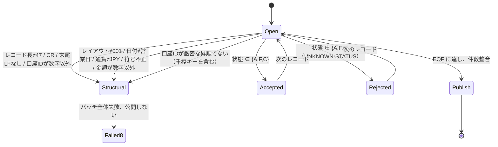
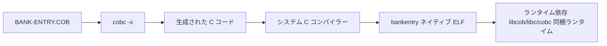

# モジュール 01 設計：最小限の銀行バッチ入口

## バージョンと位置づけ

- インターフェース版：ACCOUNT v1（**凍結済み**、47バイト）。出典は `curriculum/bank/copybooks/ACCOUNT-V1.CPY`、意味は [BANK-SYSTEM.md](../../../docs/curriculum/BANK-SYSTEM.md) 第2節。本モジュールでは読み取り専用で、レイアウトを変更しません。
- プログラム：`BANK-ENTRY`（学習者用入口 `starter/BANK-ENTRY.COB`、参照実装 `instructor/modules/01-foundations/BANK-ENTRY.COB`）。
- JOB：`scripts/run.sh`（パラメーター、入力スナップショット、ロック、検証、公開、ログ、RC）。
- プラットフォーム：Linux x86-64、GnuCOBOL 3.2.0、既定方言（`-std=cobol85` は使用禁止）。

## 入力元と前提条件

上流は営業日ごとに口座スナップショットを1つ配置します（本モジュールでは合成データ）。ファイルは ASCII、LF 終端で、各レコードは47バイトです。営業日はファイル内容から推定せず、JOB パラメーターで明示します。上流が保証するのは「当日データのみを配置する」ことだけです。長さ/文字/ソート順/重複キーは、この JOB が独自に検証する必要があります。

## ACCOUNT v1 フィールド（1始まり、バイトオフセットと長さ）

| オフセット | 長さ | フィールド | 符号化/単位 | 有効値 |
|---:|---:|---|---|---|
| 1 | 10 | account_id | ASCII 数字 | 数字のみ、ファイル内で厳密な昇順かつ一意 |
| 11 | 8 | customer_id | ASCII 数字 | 顧客参照（本モジュールでは存在確認しない） |
| 19 | 3 | currency | ASCII 英字 | `JPY` のみ |
| 22 | 1 | balance_sign | テキスト記号 | `+` または `-` |
| 23 | 13 | opening_balance | ASCII 数字、JPY 最小単位の整数 | 数字のみ、符号範囲 ±9,999,999,999,999 |
| 36 | 1 | account_status | 状態文字 | `A` 有効、`F` 凍結、`C` 解約。他は業務拒否 |
| 37 | 8 | business_date | ASCII、`YYYYMMDD` | ジョブ営業日と一致 |
| 45 | 3 | layout_version | ASCII | `001` |

## 検証状態図

OPEN の前に営業日を `TEST-DATE-YYYYMMDD` で検証します。不正な暦日は読取前に RC8 になります。

## 拒否コード

| コード | レベル | 発生条件 | 結果 |
|---|---|---|---|
| `UNKNOWN-STATUS` | 業務拒否（RC4） | 状態が `A/F/C` に含まれない | 該当行を `rejected.dat` に書き、残りは続行 |
| `INVALID-ACCOUNT-RECORD` | 構造（RC8） | 長さ/文字/レイアウト/日付/ソート/重複キー | バッチ全体失敗、出力なし |
| `INVALID-BUSINESS-DATE` | パラメーター（RC8） | 営業日が暦日として無効 | 読取前に失敗、出力なし |
| `FILE-STATUS=..` | システム（RC12） | OPEN/READ/WRITE/CLOSE の状態が 00/10 以外 | 失敗、出力なし |

## RC と公開条件

| RC | 意味 | 出力方針 |
|---:|---|---|
| 0 | 業務拒否なし、件数整合成立 | 公開 |
| 4 | レコード単位の業務拒否あり、インターフェースは完全 | 拒否明細を含む照合済み結果を公開。呼び出し側 JOB は RC4 継続を明示的に許可する |
| 8 | インターフェース/ソート/重複キー/営業日の契約違反 | バッチ全体失敗、公開しない |
| 12 | ファイルシステム/ビルド/ロック/公開エラー | バッチ全体失敗、公開しない |

公開ディレクトリの内容：`control.txt`（固定幅制御レポート）、`accepted.dat`（47バイト + LF）、`rejected.dat`（47バイト + `|` + 理由 + LF）、`inputs.sha256`、`outputs.sha256`、`run.txt`、`compiler.txt`、`source.sha256`。公開前に `verify-publish.py` が独立再計算して比較します。不一致なら RC12 となり、ステージングを削除して出力ディレクトリを作りません。件数整合式：`READ = ACCEPTED + REJECTED`。

## ソースから実行ファイルまで

`cobc -x` は COBOL を C に変換し、システム C コンパイラーを呼び出してネイティブ実行ファイルにリンクします。実行時には `libcob` に依存します。`scripts/env-report.sh` は `cobc -V`、`file`、`ldd`、`readelf -h` を用いて、この関係を実測した証拠を生成します。`build.sh` と `run.sh` はどちらも**非公開のステージングディレクトリ**でコンパイルし、すべての検証に通った場合だけ一括公開するため、未完成のバイナリが正式ディレクトリに残りません。
