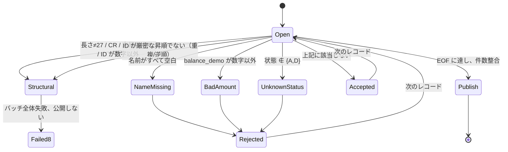

# モジュール 02 設計：CUSTOMER v1 とデータ表現

## バージョンと位置づけ

- インターフェース版：CUSTOMER v1（**凍結済み**、27バイト）。実物の Copybook は [copybooks/CUSTOMER-V1.CPY](copybooks/CUSTOMER-V1.CPY)。意味は [BANK-SYSTEM.md](../../../docs/curriculum/BANK-SYSTEM.md) 第2節。
- プログラム：`CUSTLOAD`（学習者用入口 `starter/CUSTLOAD.COB`、参照実装 `instructor/modules/02-data/CUSTLOAD.COB`）。JOB：`scripts/run.sh`。
- プラットフォーム：Linux x86-64、GnuCOBOL 3.2.0、既定方言（`-std=cobol85` 禁止）。

## CUSTOMER v1 フィールドカタログ（1始まり、オフセット/長さ/符号化/単位）

| オフセット | 長さ | COBOL 名（Copybook） | 論理型 | PIC | 符号化/単位 | 有効値 |
|---:|---:|---|---|---|---|---|
| 1 | 8 | CUSTOMER-ID | 数字テキスト | X(8) | ASCII 数字、先頭ゼロを保持 | 数字のみ、ファイル内で厳密な昇順かつ一意 |
| 9 | 10 | CUSTOMER-NAME | 英数字 | X(10) | ASCII、右側を空白で埋める | 必須、全バイト空白ではない |
| 19 | 8 | BALANCE-DEMO | 金額テキスト | X(8) | ASCII 数字、単位は「セント」、符号なし | 0〜99999999 の数字のみ |
| 27 | 1 | CUSTOMER-STATUS | 状態文字 | X | ASCII | `A` 有効、`D` 停止。他は拒否 |

### 論理桁数と実際の格納バイト数の違い

`PIC 9(8)` は**論理上の数字桁数**と比較の意味（`COMPUTE` が可能で先頭ゼロの概念はない）を表します。`PIC X(8)` は**8バイトの ASCII テキスト**（先頭ゼロを保持し、そのまま切り出し可能）です。CUSTOMER v1 は固定幅テキストインターフェースなので、8桁の ID は `X(8)` に格納します。誤って `PIC 9(8)` とすると、`COMPUTE`/比較で先頭ゼロの意味が失われますが、ディスク上では数字文字8バイトのままです。`PIC A(n)` は英字カテゴリの宣言で、「名前だけ」の実験に適します。ただし注意：`MOVE` は**カテゴリ検証をしません**。数字を含む `X` データを `PIC A(n)` に移してもそのまま格納されるため、`IS ALPHABETIC` で自分で検証する必要があります。このため v1 の名前には `X(10)` を使います。規則：`X(n)`/`A(n)`/`9(n)` はいずれも **nバイト**（DISPLAY 文字型数字）、`S9(n)V9(m)` は論理上 n+m 桁で表示時は n+m バイト、`S9(n) COMP-3` は `ceil((n+1)/2)` バイト、`S9(n) COMP` は2/4/8バイトです。本モジュールの全フィールドは DISPLAY テキストで、バイト数は文字数と同じです。

### 口座モデルへの発展

`balance_demo` は教材用です。符号なしの「セント」金額であり、符号、口座、通貨、期首/期末を表現できません。口座モデルでは残高を **ACCOUNT v1（47バイト）** に移し、`balance_sign` と13桁の `opening_balance` で符号付きの最小単位金額を表現し、`layout_version=001` でバージョン管理します。CUSTOMER v1 のファイルの意味を**暗黙に変更してはいけません**。移行は3段階です：(1) 顧客ファイルには ID/状態を残す、(2) 残高を ACCOUNT に読み込む、(3) 下流は `customer_id` 参照だけを消費する。

27バイト目の `CUSTOMER-STATUS` は**状態（`A` 有効 / `D` 停止）のみで、顧客区分ではありません**。CUSTOMER v1 に顧客区分フィールドは**ありません**。モジュール11の「顧客区分 1桁 → 2桁」保守で、この27バイト目を書き換えてはいけません。また、これは CUSTOMER v1 の27→28移行でもありません。まず独立してバージョン管理する**企業顧客の大規模レイアウト**で影響を調査します。モジュール07 L4 の `ENTERPRISE-CUSTOMER-V1`（1778バイト固定バイナリ。v1 の `CUSTOMER-CLASSIFICATION PIC X` は A/B/C/D、v2 で `PIC X(2)` に拡張し、レイアウト版を001→002に変更）を再利用または整合させてください。[curriculum/bank/README.md](../../bank/README.md) を参照します。27バイトの教材用インターフェースを維持し、両者の関係を説明してから移行します。

## 検証状態図

拒否理由の**優先順位は固定**です：`NAME-MISSING` → `BAD-AMOUNT` → `UNKNOWN-STATUS`（同じレコードには最初に該当した理由だけを付けます）。

## 拒否コード

| コード | レベル | 発生条件 |
|---|---|---|
| `NAME-MISSING` | 業務拒否（RC4） | 名前の10バイトがすべて空白 |
| `BAD-AMOUNT` | 業務拒否（RC4） | `balance_demo` に数字以外を含む |
| `UNKNOWN-STATUS` | 業務拒否（RC4） | 状態が `A`/`D` ではない |
| `INVALID-CUSTOMER-RECORD` | 構造（RC8） | 長さ/LF/CR/ID 文字/ソート/重複 |
| `FILE-STATUS=..` | システム（RC12） | OPEN/READ/WRITE/CLOSE が 00/10 以外 |

## RC と公開条件

| RC | 意味 | 出力方針 |
|---:|---|---|
| 0 | 業務拒否なし、件数整合成立 | 公開 |
| 4 | レコード単位の業務拒否あり、インターフェースは完全 | 拒否明細を含む照合済み結果を公開 |
| 8 | 長さ/LF/CR/ID/ソートなどの契約違反 | バッチ全体失敗、公開しない |
| 12 | ファイルシステム/ビルド/ロック/公開エラー | バッチ全体失敗、公開しない |

公開ディレクトリ：`control.txt`（`JOB|CUSTLOAD|V1` + `CONTROL|READ..|ACCEPTED..|REJECTED..|BALANCE-TOTAL..`、件数12桁、合計18桁の固定幅）、`accepted.dat`（27バイト + LF）、`rejected.dat`（27バイト + `|` + 理由 + LF）、`inputs.sha256`、`outputs.sha256`、`run.txt`、`compiler.txt`、`source.sha256`。件数整合式は `READ = ACCEPTED + REJECTED` です。`BALANCE-TOTAL` は**受理された**レコードの `BALANCE-DEMO` のみを合計します（拒否レコードは含めません）。18桁の `ADD ... ON SIZE ERROR` で保護し、オーバーフロー時は RC12 で公開しません。公開前に `verify-publish.py` が独立再計算して比較します。

## MOVE 実験表（02.2）

`experiments/move/MOVELAB.COB` が生成し、`expected/movelab.txt` が独立した期待値です：

| ケース | ソース | 結果 | 規則 |
|---|---|---|---|
| A | `DISPLAY PIC 9(3)V99 VALUE 41.5` | `041.50` | 表示時に暗黙小数点を補う |
| B | `MOVE 41.5(9V99) TO PIC 9(5)` | `00041` | 小数位置を合わせ、小数部分を破棄 |
| C | `MOVE PIC 9(5) TO PIC X(5)` | `00041` | 数値→英数字で表示数字を保持 |
| D | `MOVE 'AB' TO PIC X(5)` | `AB   ` | 英数字を右側空白で埋める |
| E | `DISPLAY S9(3) SIGN LEADING SEPARATE = -12` | `-012` | 先頭分離符号が1バイトを占める |
| F | `DISPLAY S9(3)V99 LEADING SEPARATE = -1.25` | `-001.25` | 符号 + 暗黙小数 |
| G | `MOVE 'ABCDEFGH' TO PIC X(5)` | `ABCDE` | 右側を切り捨て |
| H | `MOVE 12345 TO PIC 9(3)` | `345` | 数値の上位桁を切り捨て、下位桁を残す |
| I | `MOVE 12345.67 TO PIC 9(3)V99` | `345.67` | 上位桁を切り捨て、小数は保持 |

**必ず理解すること**：`MOVE` は丸めも範囲検査もしません。金額計算には単位を明示し、`ON SIZE ERROR` を使ってください。浮動小数に依存してはいけません。

## 型と階層の実験（02.1）

`experiments/types/TYPESLAB.COB` は `fixtures/types/typeinput.dat`（5バイトレコード3件）を読み込みます。`expected/typeslab.txt` が独立した期待値です：

| レコード | 元の `PIC X(5)` | `PIC A(5)` への `MOVE` | `IS ALPHABETIC` | 結論 |
|---|---|---|---|---|
| `ABCDE` | `ABCDE` | `ABCDE` | 真 → `A` | 純粋な英字：カテゴリと内容が一致 |
| `AB123` | `AB123` | `AB123` | 偽 → `M` | **`MOVE` は検証しない**：数字がそのまま `PIC A` に入る |
| `AB CD` | `AB CD` | `AB CD` | 真 → `A` | 空白は英字カテゴリに含まれる |

同じプログラムで `78 WS-LIMIT VALUE 25` 定数（表示は `25`）、独立項目 `77 WS-COUNT`、`88 CLS-ALPHA/CLS-MIXED` 条件名と `SET ... TO TRUE`、`01/05` グループによる階層も確認します。再現可能な障害は2つです：(1) 数字を含む `X` データを `PIC A` に移しても自動拒否されないため、`IS ALPHABETIC` で独自に検証する必要がある、(2) 数値項目を `PIC A` に `MOVE` すると直接**コンパイル失敗**し、プログラムを公開できない。`check.py` がコンパイル・実行し、`expected/typeslab.txt` とバイト単位で比較します。また数値から `A` への `MOVE` が非ゼロ終了することも検証します。

## レイアウト実験（02.3）

`experiments/layout/LENGTH-PROBE.COB` は正規 Copybook と、**意図的に誤記された契約外**の Copybook をそれぞれ使ってコンパイルします：

| `-I` に指定するディレクトリ | `LENGTH OF CUSTOMER-RECORD` | `LENGTH OF CUSTOMER-NAME` |
|---|---:|---:|
| `copybooks/`（正規） | 27 | 10 |
| `experiments/layout/`（名前を**意図的に誤記**して `X(11)`） | 28 | 11 |

これは `PIC` を1つ変更するとレコード全長と後続フィールドの全オフセットが変わることを示します。長さ検証、下流レイアウトのバージョン、JOB 契約を一緒に評価する必要があります。`experiments/layout/CUSTOMER-V1.CPY` は**誤ったレイアウトのデモで、契約ではありません**。CUSTOMER v1 契約でも27→28移行でもありません。実際の保守では、まず影響を調査し、バージョン管理して旧インターフェースを維持します。

