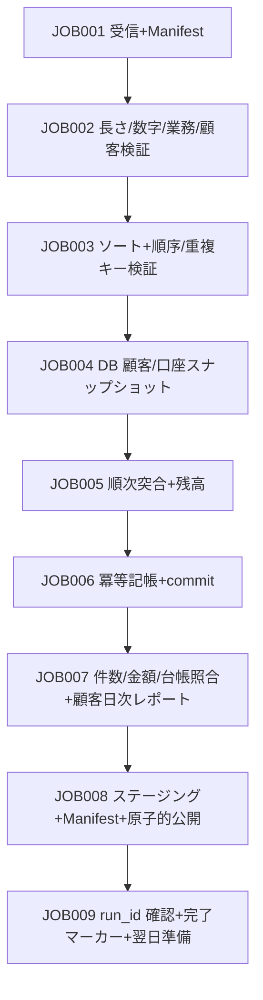

# モジュール 12 設計：卒業総合プロジェクト（未知バージョンの銀行システム）

シラバス 12.1–12.4 に対応します。本書では「未知バージョン」の構成、依存関係、4 種類の営業日、RC、32 ノードと 12 論理テーブルの対応を定義します。学習者の課題と評価基準は [README](README.md)、講師向けの根本原因、解答、採点基準は `instructor/modules/12-capstone/` を参照してください。

## 1. 未知バージョンの構成（fork せず再利用）

`system/` はモジュール 06/07/08/10 の canonical プログラムを書き直さず、それらを**オーケストレーション**して未知バージョンの夜間システムを構成します。

| コンポーネント | canonical の所在 | capstone での役割 |
|---|---|---|
| 顧客検証 CUSTV2 | 学習者の成果物（`starter/CUSTV2.COB` または `CAPSTONE_STUDENT_CUSTV2`）；参考解答 `system/cobol/CUSTV2.COB` は講師用リポジトリのみ | JOB002d で v1/v2 を正規化 |
| 取引検証 BANKVAL | モジュール 10 の学習者成果物（`starter/BANKVAL.COB` または `CAPSTONE_STUDENT_BANKVAL`）；リポジトリ内の参考実装 `instructor/modules/10-jobs/BANKVAL.COB` | JOB002c の業務検証 |
| ソート SORTTX | `instructor/modules/07/02-sort-merge/SORTTX.COB` を runner 経由で実行 | JOB003b |
| 1:N 突合 BATCHL2 | `instructor/modules/07/03-one-to-many/BATCHL2.COB` を runner 経由で実行 | JOB005a |
| 顧客日次レポート NIGHTRPT | capstone で追加（本リポジトリ） | JOB007d |
| DB/台帳/スナップショット | `system/lib/capdb.py`（12 論理テーブル、オフライン・チェックポイント） | JOB004/JOB006 |
| 整合性/日次レポート照合 | `system/lib/report.py`（独立実装） | JOB007a-c/e |

オーケストレーション対象外の canonical：モジュール 06 `FILEVAL`、モジュール 07 `MATCH`/`MERGETX`/`BATCHL3`/`BATCHL4`、モジュール 08 の GixSQL/PostgreSQL 経路。これらは「未知システム」の閲覧範囲ですが、本モジュールの実際のパイプラインでは上表のコンポーネントを使います。

## 2. 4 種類の営業日（12.2）

| 日 | レイアウト | 意味 | 期待 RC | 公開 |
|---|---|---|---|---|
| normal | v1 | 6 件すべて記帳 | 0 | はい |
| abnormal | v1 | 4 件を検証で拒否 + 1 件を残高不足で拒否 | 4 | はい（照合後） |
| rerun | v1 | normal と同じ feed を同じ DB に再実行 | 0 | はい（記帳 0 件） |
| extension | v2 | 企業顧客の区分を 2 桁に拡張、`D1` 顧客を含む | 0 | はい |

顧客 feed は**独立したバージョン管理対象の CAP-CUSTOMER-FEED レイアウト**です。v1 は 31B（区分は第 28 バイトの A/B/C/D）、v2 は 32B（区分は第 28–29 バイトの A1..D1）です。canonical な 27 バイト CUSTOMER v1 を内包しているため、第 27 バイトは常に**レコード状態**（A/D）であり、顧客区分ではありません。canonical CUSTOMER v1 の 27 バイトは変更しません。保守演習の対象はこの feed の `CUSTOMER-CLASSIFICATION`（1 桁から 2 桁）です。

`CAP-CUSTOMER-FEED` は意図的に選んだ**独立した名前**です。モジュール 04/07 の canonical `ENTERPRISE-CUSTOMER` は 1778 バイト/175 フィールドの大きなレコードで、モジュール 11 は別の実験用レイアウトです。3 者は互換性がありません。同じ `ENTERPRISE-CUSTOMER-Vx` 名を共用すると物理レイアウトのずれが隠れるため、capstone では別名にし、`CAP-CUSTOMER-FEED-V1/V2.CPY` の先頭コメントと README で関係を説明します。

事故およびハードゲート用の追加ケース：`broken`（transaction_id 重複）→ RC8 で公開なし、宣言レイアウトと物理幅の不一致 → RC8 で公開なし、システム障害（mktemp/権限）→ RC12 で公開なし。

## 3. RC ポリシー（BANK-SYSTEM §6 と一致）

| RC | 意味 | 続行 | 公開 |
|---:|---|---|---|
| 0 | 正常 | はい | はい |
| 4 | 契約上許容される業務拒否 | はい | はい、JOB007 の通過が必要 |
| 8 | 業務/構造異常（幅、重複キー、整合性不一致） | いいえ | いいえ |
| 12 | システム異常（権限/mktemp/ロック/想定外の子プロセスコード） | いいえ | いいえ |
| 97 | 注入したクラッシュ（実験用）、現場を保持 | — | いいえ |

0/4/8/12 以外の子プロセスコードは、すべて shell 境界で 12 に変換し、業務拒否に見せかけません。

## 4. JOB ノード対応

最上位の 9 個の JOB は、追跡可能な 32 ノードに展開されます。

| JOB | ノード |
|---|---|
| 001 | 001a Manifest 受信 / 001b SHA256 検証 / 001c スナップショット凍結 |
| 002 | 002a 生データ幅 / 002b 数値 / 002c 業務（BANKVAL） / 002d 顧客（CUSTV2） / 002e 拒否レポート |
| 003 | 003a SORTER 構築/確認 / 003b 重複キー+ソート / 003c 順序検証 |
| 004 | 004a DB 到達性+カレンダー / 004b 顧客凍結 / 004c 口座凍結 |
| 005 | 005a Key Break+残高（L2） / 005b 受理/拒否分類 / 005c 候補隔離 |
| 006 | 006a 台帳読取 / 006b 冪等記帳 / 006c commit マーカー |
| 007 | 007a 件数整合性 / 007b 金額整合性 / 007c 台帳突合 / 007d 顧客日次レポート（NIGHTRPT） / 007e 顧客日次照合 |
| 008 | 008a ステージング / 008b Manifest / 008c 原子的切替 / 008d CURRENT+登録 |
| 009 | 009a run_id 確認 / 009b 翌日準備 / 009c 完了マーカー |

各ノードは `state/<node>.done`（rc を含む）を書き、JOB 単位でも `state/<JOBxxx>.done` を書きます。再実行時はマーカーに従って続行し、完了済みノードを再実行しません。

## 5. 12 論理テーブル

`system/lib/capdb.py` の先頭コメントを参照：customer、account、transaction_ledger、batch_run、batch_commit、customer_snapshot、account_snapshot、reject_log、control_total、publish_registry、idempotency_key、business_calendar。

**標準の教材ルート**：DB 層はオフライン・ファイル・チェックポイントです（冪等台帳を先に書き、残高は「期首スナップショット + 台帳」から導出/自己修復します）。**実 DB ルート（R01）**：`scripts/real-db.sh` はモジュール 10 の canonical harness（PostgreSQL17 + GixSQL + モジュール 08 ESQL）を再利用し、同一トランザクションで残高と冪等台帳をコミットし、独立した psql で照合します。利用できない場合は `UNVERIFIED` を出力します。

## 6. 冪等性、ロック、スナップショット、公開

- 冪等キー `(business_date, transaction_id)`。唯一の正本は台帳です。
- 出力ロック `<output>.lock`；営業日ロック `<db>/locks/<date>.lock`（稼働中 pid は拒否し、終了済み pid は回収）。
- 入力スナップショットは MANIFEST SHA256 に従って凍結し、当日のスナップショットを当日の記帳で書き換えません。
- 公開：非公開 stage → `manifest.json`/`MANIFEST.sha256` の生成と検証 → `mv -T -n` で切替 → 最後に `publish/CURRENT` を移動。JOB009 は CURRENT==run_id を確認してから完了マーカーを書きます。

## 7. 保守（12.2）と事故（12.4）

- 保守：`maintenance/` に影響調査/対象一覧/方針/Test/Evidence を提出し、顧客区分を 1 桁から 2 桁にします。RED→GREEN は `maintenance/regression/red-green.sh` を参照。
- 事故：`incidents/incident-01/` の配布資料には根本原因を含みません。講師向けの根本原因と修正は `instructor/modules/12-capstone/INCIDENT-01.md` を参照。

## 8. プラットフォームと制約

Linux x86-64、GnuCOBOL 3.2.0、Bash、GNU coreutils、Python 3 のみ実動確認済みです。macOS/WSL/他アーキテクチャは**未検証**です。DB 層は実データベースで**未検証**です。JCL/JP1 は読み替えの確認のみで、どのスケジューラにも投入していません。
