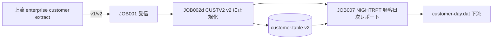

# 影響調査書：企業顧客区分を 1 桁から 2 桁へ

調査日：20261010（コード変更前）。すべての結論は読み取り専用の検索とバイト検査に基づきます。

## 1. 要件

**企業顧客区分**を 1 桁から 2 桁に拡張します。区分は独立したバージョン管理対象の `CAP-CUSTOMER-FEED` レイアウトにあります。このレイアウトは canonical CUSTOMER v1 の 27 バイトを内包します（第 27 バイト = レコード状態 status）。**区分はその後ろにある独立フィールドです**：

- v1（31 バイト、layout `001`）：区分は**第 28 バイト**、値は `A`/`B`/`C`/`D`。
- v2（32 バイト、layout `002`）：区分は**第 28–29 バイト**、値は `A1`..`D1`。

変更により企業レイアウトのレコードは 31 バイトから **32 バイト**になります。canonical CUSTOMER v1 の 27 バイトと第 27 バイトの意味は**一切変更しません**。

## 2. フィールド定義（調査の出発点）

| レイアウト | 位置 | 長さ | 名前 | 規則 |
|---|---|---:|---|---|
| v1 | 27 | 1 | record_status | 有効=`A` / 停止=`D` |
| v1 | 28 | 1 | customer_classification | `A`/`B`/`C`/`D` |
| v1 | 29-31 | 3 | layout_version | `001` |
| v2 | 27 | 1 | record_status | `A`/`D`（変更なし） |
| v2 | 28-29 | 2 | customer_classification | `A1`/`B1`/`C1`/`D1` |
| v2 | 30-32 | 3 | layout_version | `002` |

区分は**レコード内の第 27 バイトより後ろ**にあります。幅の拡張はその後のオフセットと総長だけに影響します。第 1–27 バイト（状態を含む）の位置は変わらないため、企業レイアウトの先頭 27 バイトだけ読む旧 reader は引き続き正しい CUSTOMER v1 の接頭部を読めます。これが「書き換えずに追加」するレイアウトを選んだ理由です。

## 3. 使用箇所（検索コマンドと該当箇所）

```bash
rg -n 'customer|CUSTOMER|classification|CLASSIFICATION|status' \
  curriculum/modules/12-capstone/system \
  curriculum/modules/12-capstone/maintenance \
  curriculum/modules/12-capstone/fixtures
```

該当箇所と分類：

| 所在 | 用途 | 影響 |
|---|---|---|
| `system/copybooks/CUSTOMER-V1.CPY` | canonical インターフェース定義（27B、第 27 バイト = status） | **変更しない** |
| `system/copybooks/CAP-CUSTOMER-FEED-V1.CPY` | 企業レイアウト v1（31B） | 参照基準 |
| `system/copybooks/CAP-CUSTOMER-FEED-V2.CPY` | 企業レイアウト v2（32B） | 新規成果物 |
| `system/cobol/CUSTV2.COB` | 企業顧客を読み込み正規化 | 32B と 31→32 アップグレードに対応が必要 |
| `system/cobol/NIGHTRPT.COB` | 顧客日次レポート join | 宣言された layout に基づく幅検証が必要 |
| `system/lib/capdb.py` | 顧客テーブル/スナップショット（v2 保存） | customer.table を 32B 保存に変更 |
| `system/lib/validate.py` | 生バイト幅 guard | 企業レイアウトの幅 31/32 |
| `system/jobs/job002-validate.sh` | CUSTV2 呼び出し | 変更なし、CUSTV2 の変更に追随 |
| `fixtures/*/customer.dat` | 合成入力 | 31B/32B を再生成 |
| `incidents/incident-01` | 事故資料 | 顧客ファイルは単一レイアウトだが、ロールバックしてはいけない |

## 4. 依存関係図



## 5. 未確定事項（証拠で解消すること）

- 上流が v1 と v2 を同時に送る可能性はあるか？——本コースでは「ファイル全体が同一レイアウト」とし、混在は JOB002a が幅不一致として拒否します（RC8）。明示的な制約です。
- 下流が v1 の旧ビューを使っているか？——`NIGHTRPT` は v1/v2 両方の読み取りに対応し、v1 の日も処理できます。
- DB に既存の 31B 顧客行がある場合どう移行するか？——change-policy の移行手順を参照してください。

## 6. 結論

変更範囲：COBOL 2 個、DB 保存 1 個、複数のインターフェース/fixture/JOB 説明。06/07/10 の canonical コンポーネントは**変更せず**、canonical CUSTOMER v1 の 27 バイトと第 27 バイトの状態の意味も**変更しません**。リスクは「幅の情報源」と「v1 互換性」に集中します。
