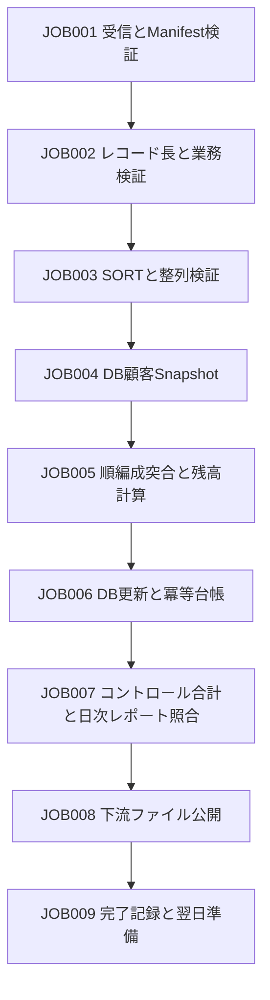

# 銀行夜間バッチのケース設計

## 1. 業務モデルと実行境界

1人の顧客が複数の口座を持ち、1つの口座では1日に複数の取引が発生します。顧客DBには区分、状態、リスクレベル、バージョンを保存します。口座Masterには開始時残高を保存し、Transactionには当日の変更不可な取引を保存します。夜間処理では、期末Master、拒否取引、例外口座、日次レポート、下流ファイルを生成します。Previous Dayは前日の状態との比較に使い、DB Snapshotは今回の実行で固定した顧客ビューです。

営業日はパラメーターで明示し、マシンの現在日付を既定値にしてはいけません。run_idは試行回数を識別します。業務冪等キーはbusiness_date、transaction_id、業務バージョンで定義します。初回の課程では1通貨のみを扱います。多通貨に拡張する場合は通貨別に照合し、単純に合算してはいけません。

口座の閉鎖、凍結、当座貸越などの具体的な業務ルールは、該当する演習の説明に記載する必要があります。学習者が状態コードから推測してはいけません。

## 2. 基本ファイル契約

テキスト固定長インターフェースでは、ASCIIの合成データを使います。名称フィールドの演習では、文字数をバイト数と取り違えないよう、まずASCIIに限定します。マルチバイト文字/EBCDICは独立した演習です。各論理レコードの後にはLFを置き、LFはレコード長に含めません。Packed Decimal/二進数の演習では生バイトファイルを書き出し、テキストを行単位で処理する前提を置いてはいけません。

### CUSTOMER v1：27バイト

| 位置（1始まり） | 長さ | フィールド | 表現/ルール |
|---|---:|---|---|
| 1–8 | 8 | customer_id | 8桁の数字、先頭のゼロを保持、一意 |
| 9–18 | 10 | customer_name | ASCII、右側を空白で埋める、必須 |
| 19–26 | 8 | balance_demo | 基礎演習用の金額、単位はセント、符号なし。最終的な口座台帳ではない |
| 27 | 1 | status | Aは有効、Dは停止。それ以外は拒否 |

このレイアウトは、利用者が提供する固定長サンプルで使います。口座モデルに進むと残高はACCOUNTに移ります。変更理由と移行手順を明確にし、ファイルの意味を黙って変更してはいけません。

### ACCOUNT v1：47バイト

| 位置 | 長さ | フィールド | ルール |
|---|---:|---|---|
| 1–10 | 10 | account_id | 数字キー、一意 |
| 11–18 | 8 | customer_id | 顧客への参照 |
| 19–21 | 3 | currency | 初期段階はJPY。課程では最小単位を統一し、暗黙の為替換算はしない |
| 22–22 | 1 | balance_sign | +または-。テキストインターフェースに明示して保存 |
| 23–35 | 13 | opening_balance | 最小整数単位。範囲とオーバーフローを検証する |
| 36–36 | 1 | account_status | Aは通常、Fは凍結、Cは閉鎖 |
| 37–44 | 8 | business_date | YYYYMMDD。課程のカレンダーに照らして検証 |
| 45–47 | 3 | layout_version | 001 |

### TRANSACTION v1：55バイト

| 位置 | 長さ | フィールド | ルール |
|---|---:|---|---|
| 1–10 | 10 | account_id | 突合キー |
| 11–26 | 16 | transaction_id | 業務冪等キーの構成要素 |
| 27–34 | 8 | business_date | JOBの営業日と一致すること |
| 35–40 | 6 | sequence_no | 同一口座内の処理順。SORTの偶然の順序に依存しない |
| 41 | 1 | direction | Cは入金、Dは出金 |
| 42–54 | 13 | amount | 最小単位、非負。ゼロ金額の扱いは別途定義 |
| 55 | 1 | status | Nは処理待ち。重複やその他の状態の扱いを明記 |

口座はaccount_id順、取引はaccount_id、sequence_no、transaction_id順に並べます。同じaccount_idを持つMasterの重複は業務上の例外であり、どれか1件を任意に選んではいけません。transaction_idが重複する取引を再計上してはいけません。

本番相当の演習では、PICで受け取った後の内容だけで元レコードの長さを判定してはいけません。検証境界で生バイト長を取得します。短い/長いレコードを黙って埋めたり切り詰めたりして有効データとして扱ってはいけません。

## 3. 150以上のフィールドを持つレコードの要件

業務拡張レコードには、ID、住所/連絡先、口座属性、顧客分類、リスク/コンプライアンス、限度額、チャネル権限、業務日付、バージョン/監査などのグループに分けた、名前付きの葉フィールドを少なくとも150個含めます。フィールド一覧には、安定したfield_id、COBOL名、業務名、グループ階層、PIC/USAGE、バイトオフセット/長さ、単位、NULL可否、既定値、有効範囲、機密レベル、比較方法、インターフェースバージョンを記載します。

この段階で架空の総レコード長を先に手書きしません。完全なフィールド一覧と固定したABIを検証してから総長を公開します。REDEFINES/OCCURSを重複して数えず、FILLERは業務フィールド150個に含めません。

差分比較には、元バイト比較、正規化テキスト比較、デコード後の数値比較という3つの明示的な方法があります。無視するフィールド（実行時刻など）には業務上の理由が必要です。出力する差分にはrun_id、業務キー、field_id、フィールド名、位置、旧/新値、比較方法、元バージョンを含めます。機密フィールドにはマスキング演習を用意します。

## 4. 順編成突合アルゴリズムの契約

### L1：1対1

MasterとTransactionのキーはそれぞれ一意かつ整列済みとします。2つの読み取りポインターでキーを比較します。一致したらMATCHを出力して両方を進めます。Master側が小さければMASTER ONLYを出力してMasterを進め、Transaction側が小さければTRANSACTION ONLYを出力して取引側を進めます。一方がEOFになった後は、残る側のストリームを最後まで処理します。実在するキーにも使えるセンチネル値でEOFを代用せず、独立した状態で管理します。

件数の等式：Master件数 = MATCH + MASTER ONLY、Transaction件数 = MATCH + TRANSACTION ONLY。空/空、空/非空、非空/空、先頭/末尾の孤立キー、全件一致、全件不一致の各ケースにfixtureが必要です。

### L2：1対多

Masterの口座は一意、取引は口座ごとにグループ化します。同じキーを持つ取引グループを処理し、sequence_no順に適用します。メモリには1口座分の累積状態だけを保持し、ファイル全体を保存しません。口座ごとに次の式を照合します：期末残高 = 期首残高 + 受け付けた入金 − 受け付けた出金。拒否した取引を金額累計に含めてはいけません。単一取引と累計のオーバーフローは別々に扱います。

### L3：複数ファイルと多対多

Master、Transaction、DB Snapshot、Previous Dayそれぞれのキーと多重度を定義します。実装前に関連ルールと状態遷移表を作成します。同じキーを両側で複数件持つ場合は、順番ごとに対応させる、集約後に比較する、または業務が承認した多重関連にするなどの方針を明示し、デカルト積を既定にしてはいけません。顧客なし、口座なし、前日データなし、スナップショット日不一致の処理も明記します。

### L4：大規模レコードの差分

最初にキーとレイアウトバージョンを比較し、次にフィールドごとに比較します。元の値と数値としての等価性は異なります。小数スケール、末尾空白、符号、不正バイト、NULLを混同してはいけません。受け入れ確認では、独立して定義した変更フィールド一覧を使い、すべての差分を検出し、余分な誤検出がないことを検証します。

## 5. JOB Flow

| JOB | 入力 | 出力/チェックポイント | 失敗後の原則 |
|---|---|---|---|
| 001 | 受信ディレクトリ、Manifest | 不変入力Snapshot、チェックサム | 検証に進まない |
| 002 | Snapshot、レイアウト契約 | 有効/拒否データ、コントロール合計 | 拒否方針に従いRC4またはRC8 |
| 003 | 有効レコード | ソートファイル、整列証跡 | 一時領域の失敗はRC12、正式成果物を作らない |
| 004 | 営業日、DB | バージョン/基準時点付きSnapshot | 接続失敗時に古いデータを当日分として扱わない |
| 005 | 検証済みの4ストリーム | 候補期末Master、突合/差分レポート | 候補を隔離し、公開しない |
| 006 | 候補変更、冪等キー | DBコミット識別子、適用台帳 | 復旧前にコミット済みか判定 |
| 007 | 明細、拒否情報、DB識別子 | 件数と金額の照合証跡 | 合格しなければ公開しない |
| 008 | 照合済み候補 | 正式な下流ファイル、公開Manifest | DBコミット済みなら公開を復旧し、再度引き落とさない |
| 009 | 全完了証跡 | JOB完了状態 | 状態を参照可能にし、元の実行記録を上書きしない |

## 6. RC、設定、ログ

RC0は正常、RC4は契約で許された警告、RC8は業務上の異常、RC12はシステム異常です。契約外のプロセス終了コードは元の値を保持し、Shell境界でRC12に対応付けて記録します。OSシグナルを業務拒否として扱ってはいけません。

各JOBは許可する先行RCの集合を宣言します。既定ではRC0のみ続行できます。パラメーターの優先順位はCLI > パラメーターファイル > 明示的な既定値です。環境変数は合意された設定だけに使います。必須パラメーターには営業日、run_id、入力/出力/一時/ログの各パス、レイアウトバージョン、DB設定の参照先を含めます。認証情報をソースコード、ログ、課程データに書いてはいけません。

ログには、時刻とタイムゾーン、営業日、run_id、job_id、段階、入力元/出力のチェックサム、件数、金額集計、元/変換後RC、開始/終了状態を最低限記録します。成功ログは業務照合の代わりにはなりません。

## 7. 再実行と復旧

入力Snapshotは変更不可とします。ロックは営業日またはシステムの範囲で取得し、保持者と有効性を記録します。一時出力は独立したrunディレクトリに生成し、検証後に制御された公開切り替えで正式な参照先を更新します。アトミックな名前変更が解決するのは該当ファイルシステム内の問題だけであり、DBとファイルの整合性まで自動的に保証するものではありません。

必須のクラッシュポイントは4つです。DBコミット前、コミット後でローカルチェックポイントを書き込む前、ファイル生成後で公開する前、公開後で完了状態を書く前です。復旧ではDB冪等台帳、コミット識別子、出力Manifest、チェックサムで事実を確認し、Shellログの最終行からトランザクション状態を推測してはいけません。

再実行は、失敗した段階からの復旧、Snapshotからの派生ファイル再構築、業務訂正の実行の3種類です。業務訂正には新しい業務バージョンと監査上の関連付けが必要です。完了マーカーを単純に削除して取引を再適用してはいけません。

## 8. DBモデルと技術検証

課程の論理テーブルはcustomer、account、transaction_ledger、batch_run、batch_commitです。seedデータと制約はリポジトリに含めます。transaction_ledgerには明確な一意業務キーを持たせます。DB更新と冪等記録は同一トランザクション内で行います。Cursor Snapshotの一貫性方針も記載します。

Embedded SQLの具体的なインストール、プリコンパイル、エラーコードはP1で検証してから確定します。推奨する基準はPostgreSQLです。他のDBのSQLCODE -803を、そのままPostgreSQLの実際のエラーコードとして記述してはいけません。一意制約違反の根本原因を調査する演習を行い、プラットフォームごとのエラー対応表を用意します。

## 9. 規模と正確性の段階

- マイクロ：0～20行。全行を手作業で照合でき、すべてのEOFと境界ケースを含む。
- 中規模：口座1万件、取引10万件。フローと統計の受け入れ確認に使う。
- 負荷：口座10万件、取引100万件。中核の突合でメモリ上限と一時領域の処理を検証する。

各段階でseed、業務データの分布、ファイルサイズ、チェックサム、期待件数と金額を記録します。具体的な実行時間/RSSのしきい値は、ハードウェアを明記した上でP1で決めます。大量データを「プログラムがクラッシュしなかった」だけで検証してはいけません。
