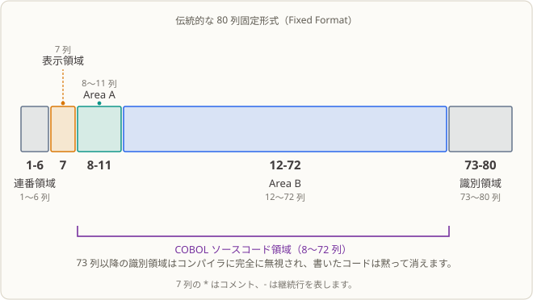

# 第 01 課：Hello COBOL —— 銀行コンピューター室で最初のバッチプログラムを走らせる

## 業務現場

月曜日の朝八時半、あなたは地方銀行の夜間バッチチームに出勤したばかりです。先輩は業務の説明をしてくれず、ただ一言、こう言いました。

> 「今日、お前に頼むのはただ一つだ。マシンがお前の書いたプログラムを実行するようにしてくれて、それがおれの画面で見えるようにしてくれてくれ。」

簡単そうに思えるかもしれません。でも銀行において、この言葉にははっきりした意味があります。**スケジューラーに自分のプログラムを認知させる**ということです。

深夜二時に誰も端末の前でコマンドを打っているわけではありません。当直室のスケジューラー（cron、Control-M など）が時間どおりにジョブを一つずつ起動し、成功も失敗も次の二点だけで判定します。実行ファイルがどこにあるかと、プロセス終了時のステータスコードだけです。終了コードが `0` なら次へ進む、`0` 以外なら警報が出る。警報が出れば誰かが夜中に電話で叩き起こされます。

ですから最初のプログラムは、ある一行を印刷するためではありません。**このマシンは君が書いたものを実行できる。そして失敗したときに、どこを見ればいいかが分かる**——そのことを証明するためにあるのです。

## なぜ今これを学ぶか

こう考えるかもしれません。「コンパイラー、実行ファイル、終了コードなんて、Java や Python で毎日見ているものじゃないか。一課まるごと費やす価値があるのか」と。

問題は「毎日見ている」の三文字にあります。COBOL はあなたが慣れた言語とは見た目がまるで違います。

- ソースファイルは**固定書式**です。同じ行のコードでも、8 列目に置くか 12 列目に置くかで意味が変わり、列を間違えればコンパイラーは即座に拒絶します。
- 「コンパイル」と「実行」は別々のステップで、間に生成された実行ファイルが挟まります。
- この二段階がそれぞれどう失敗し、失敗時に何を見ればよいかは、`python xx.py` を走らせるのとはまったく別世界です。

この課がやることはただ一つ。**「ソース → コンパイル → 実行ファイル → 出力 → 終了コード」**という連鎖を最後まで通すことです。残り 31 課はすべてこの連鎖の上に成り立っています。後に 12 万件のトランザクションを処理しようが、データベースに接続して残高を取りに行こうが、まずはコンパイル・実行ができ、そしてなぜ終了したかが分からなければ話になりません。

## この知識項目とは何か、何を解決するか

**この知識項目とは。** 最小の COBOL プログラムは四つの要素から成ります。プログラム識別（`IDENTIFICATION DIVISION` + `PROGRAM-ID`）、実行手順（`PROCEDURE DIVISION`）、出力文（`DISPLAY`）、終了文（`STOP RUN`）。この課では `cobc` を使ってそれを Linux 上で動く実行ファイルにする手順もはっきりさせます。

**業務上の何を解決するか。** 銀行や保険会社では夜間バッチで帳を締めます。日中に窓口やアプリで発生したトランザクションを、夜間にジョブ単位で処理していくのです。これらのジョブは手で叩き起こすものではなく、スケジューラーが起動します。したがってすべてのプログラムは二つの最低条件を満たす必要があります。自動で起動できること、自分自身で成否を報告できること。この課が教えるのは「プログラムをこの仕組みに乗せる方法」そのものです。コンパイラーがエントリーポイントを見つけられ、スケジューラーが起動でき、当直の人間が終了コードで実行が成功したかどうかを判断できる。

**それでもまだ足りない場面。** この課のプログラムはデータを読みませんし、判定もしませんし、金額の計算もしません。この境界を甘く見ないでください。本物のバッチでは「動いてはいるが結果が間違っている」ほうが「動かない」よりもはるかに危険です。前者は気づかれないまま流れるかもしれませんが、後者はその夜のうちに警報を出します。結果が正しいかを判定する検査が出てくるのは、ファイルやお金を扱う課（03 課以降）を待たなければなりません。

## この課を終えたときに身につくことと限界

この課を終えると、あなたは次のことができるようになります。

- `cobc -fsyntax-only` を使って `.cob` ソースファイルが構文解析に通るかを確認する。
- `cobc -x -o <name>` を使ってソースファイルを実行ファイルへコンパイルし、コマンドのリターンコードから本当にコンパイルできたかを確認する。
- 実行ファイルを動かし、標準出力と標準エラーのどちらに何が出るかを区別し、終了コードでプログラムが正常に終了したかを判断する。
- 最小のプログラムの中で、プログラム識別・実行入口・出力文・正常終了文がそれぞれどの行かを指摘する。
- データも読まず、フィールドも定義しないプログラムがなぜ `DATA DIVISION` を必要としないのかを説明する。

限界：この課はデータ項目を定義せず、ファイル／コマンドライン引数／データベースも読みませんし、計算も行いません。構文エラー以外の実行時障害はまだ扱いません。フィールドは[第 02 課](../02_data-types/README.md)から、ファイルは 15 課から、エラー分類と終了コード体系は 26 課でまとめて扱います。

## 実行環境

- GnuCOBOL 3.2.0、デフォルト方言（`-std=cobol85` は付けない）、ソースファイルは固定書式。
- Linux ターミナル。この課はデータベースや追加ツール、サードパーティライブラリを必要としません。
- 実行で業務データファイルは生成されず、`build/` 配下に実行ファイルが一つだけ作られます。

## パンチカードからパソコンへ：コンピューターと COBOL の変化

まず、混同しやすい言葉を整理しましょう。ここで説明するのは**パンチカード**と**カード読取装置**で、出退勤を記録するタイムレコーダーではありません。パンチカードは決まった位置に穴を開けた硬いカードで、穴の組み合わせで文字・数字・命令を表し、カード読取装置が情報をコンピューターに読み込ませます。**メインフレーム**は、大きな組織が一括して購入・管理し、多くの人で共有する大型計算機です。カードは情報を入力・保存する媒体の一つ、メインフレームは計算を行う機械で、別のものです。

この変化は世界中で同じ日に起きたわけではなく、組織によって異なる方式が長く併存しました。おおよその年代に沿って、作業方法がどう現れたかを見てみましょう。

1. **1950 年代：バッチ処理とカード。** コンピューターは高価で、組織が集中して購入・利用するのが一般的でした。プログラマーはコードを紙に書き、一行ずつカードに転記しました。データも別のカード束や磁気テープに保存されることがありました。オペレーターがカードをメインフレームに渡すと、機械はジョブをまとめて処理し、結果は紙に印刷するのが一般的でした。「バッチ処理」とは、仕事をまとめて順番に処理することです。通常、各手順で人が画面を見ながら応答する必要はありません。COBOL は 1959 年に設計が始まり、こうした組織の業務データ処理を想定していました。
2. **1950 年代末〜1960 年代：メインフレームと対話型端末。** 人々はキーボードと画面から命令を入力し、結果を確認できるようになりました。このような端末はメインフレームにつながる「窓口」にすぎない場合が多く、プログラムの実行や主要データの保存は、離れた場所にある共有メインフレームで行われました。つまり、**画面があるからといってパソコンとは限りません**。操作方法が変わっても、計算資源はメインフレームに集中していることがあります。この時期に COBOL は初版から標準化へ進み、業務計算に採用されていきました。
3. **1970 年代以降：パソコンの登場と普及。** 個人や小さなチームも、自分のコンピューターでプログラムを編集・保存・実行できるようになりました。コードは物理カードの束から磁気テープやディスク上のファイルへと徐々に移り、画面上のエディターでソースを編集してコンパイル・実行できるようになりました。この変化は一気に起きたのではなく、パソコンがメインフレームをすぐに置き換えたわけでもありません。銀行などは大規模な業務を集中処理するため、引き続きメインフレームを使い、多くの COBOL システムがそこで稼働し続けました。
4. **今日：複数プラットフォームの併存。** COBOL プログラムは現在もメインフレームで動き、Unix、Linux、Windows などのコンパイラーでもコンパイルできます。このコースで使う GnuCOBOL なら Linux 上で COBOL を学び、実行できます。実物のカードもメインフレームへのアクセスも必要ありません。

COBOL もこの変化とともに進化しました。1959 年に設計が始まり、初期版は大規模組織の業務処理に適し、カード入力にも合う固定列形式を採用しました。1960 年に初版が登場した後、言語は標準化されていきました。共通標準によって各メーカーが COBOL を実装しやすくなり、機種変更のたびにプログラムを書き直す必要を減らしましたが、すべてのプログラムが自動的に互換になるわけではありません。ソースがカードからファイルへ移った後も、固定書式は多くの旧プログラムやコンパイル環境に残りました。2002 年の COBOL 標準では自由形式ソースなども追加されました。現在も両方の形式が使われています。**ソース形式はコードの書き方を定めるもので、保存媒体や実行するコンピューターとは別の問題です。**

大切な関係をまとめると、**パンチカードは過去によく使われた入力媒体、メインフレームは集中共有型の計算機、端末は接続先のキーボードと画面、パソコンは個人の机に計算能力を持ち込んだものです。COBOL は、これらのプラットフォームと時代をまたいで使われ続け、進化してきたプログラミング言語です。** 移植性があればソースを別の機械へ移しやすくなりますが、実際の移行ではコンパイラー方言、OS、ファイル形式、データ表現への対応も必要です。

## このコードを開いて見る

### プログラムには実際に何が書かれているか

```cobol
       IDENTIFICATION DIVISION.
       PROGRAM-ID. HELLO01.
       PROCEDURE DIVISION.
           DISPLAY "こんにちは、COBOL！".
           STOP RUN.
```

五行で、概念は四つ。

- `IDENTIFICATION DIVISION`：コンパイラーに「これはプログラムユニットであり、ここからその記述が始まる」と伝える。
- `PROGRAM-ID. HELLO01.`：名前を付ける。この名前はプログラムのアイデンティティそのもので、コンパイルだけでなく、後で `CALL` を学ぶとき（24 課）、他のプログラムはこの名前であなたを見つけにきます。
- `PROCEDURE DIVISION`：ここから先は「実際に実行する手順」。前はあくまで宣言です。
- `DISPLAY` は文字列を標準出力に書き出し、`STOP RUN` は実行を終了する。

ここでは **`DATA DIVISION` がありません。** 書き忘れたのではなく、このプログラムにはそもそも格納すべきデータがないからです。残高も口座番号もカウンタもありません。COBOL のルールは「使うものを宣言する」。`DATA DIVISION` が必要になるのは 02 課が初めてです。

### Java / Python と比べてみる

`PROGRAM-ID` はおおむね Java のクラス名や Python のモジュール名に相当し、`DISPLAY` は `System.out.println(...)` や `print(...)` に相当します。この類推は用途を手早く掴む助けになりますが、広げすぎないでください。COBOL の Division は**ソースプログラムの構造**であって、クラスでも関数でもありません。「オブジェクト」は存在せず、階層をインデントで決めもしません。

### 固定書式 —— COBOL が初心者を遠ざける最大の壁

この言語が若い頃、入出力はパンチカードで行われていました。そのため「何列目か」に対する厳格なルールが今日まで残っています。



- **第 7 列**：指示子エリア。ここに `*` を書くと行全体がコメントになり、`-` を書くと継続行になります。
- **第 8〜11 列（Area A）**：Division 名、`FD`、`01` レベルの宣言、パラグラフ名の開始位置。
- **第 12〜72 列（Area B）**：`DISPLAY`、`MOVE` などステートメントはこの範囲に書きます。
- **第 73 列以降**：識別エリア。コンパイラーは**一切見ません。** ここに書かれたコードは静かに消えます。初心者が最も痛い目に遭う落とし穴の一つです。

このコースのソースコードはすべてこのルールに従って書かれています。他の言語から持ち込まれた「全部左端に揃える」習慣は、ここで即エラーを招きます。

### 出力に日本語が出るのはなぜか

本コースの解説は中国語・英語・日本語に翻訳されていますが、**プログラム実行時の業務テキストは日本語のまま**です。日本の金融システムで使われる用語を教材にも反映しているためです。この課では `こんにちは、COBOL！` と出力します。意味は「こんにちは、COBOL！」です。プログラムの動作は実際の出力と、この README の日本語の説明を合わせて確認してください。

## 完全なサンプルソース

完全なソースは [`lesson.cob`](./lesson.cob)、固定書式で書かれています。

## 行ごとの解説

| ソース行 | 役割 | 実行時に起きること |
|---|---|---|
| `IDENTIFICATION DIVISION.` | 「ここからプログラムユニットが始まる」と宣言する | コンパイル段階で以降のプログラム宣言を解析するために使われるだけで、何も出力しない |
| `PROGRAM-ID. HELLO01.` | プログラムユニットに名前を付ける | コンパイラーがこの名前を生成された実行プログラムに書き込む |
| `PROCEDURE DIVISION.` | 実行可能手順の開始を宣言する | 実行時はここからプログラムに入る |
| `DISPLAY "こんにちは、COBOL！".` | リテラルを標準出力に書き出す | 端末に `こんにちは、COBOL！` という一行が届く。この課にはまだ業務フィールドがない |
| `STOP RUN.` | COBOL 実行単位を正常に終了する | 制御を OS に返し、これ以降の COBOL 文はない |

ここでは「データが変化した」ということはほぼ起こりません。利用者が定義したデータ項目もなく、残高やレコードも触っていません。出力はその挨拶の一行だけです。

## 実行と観察

この課は入力ファイルもコマンドライン引数もデータベースも読みませんので、課のディレクトリ内で走らせても、別のディレクトリで走らせても結果は同じです。

**入力：** なし。画面の一文は `lesson.cob` 内のリテラルであって、外部データではありません。

**コマンドと各ステップの意味：**

```sh
mkdir -p build
cobc -fsyntax-only lesson.cob                    # 構文チェックのみ。実行ファイルは作らない
cobc -x -Wall -o build/lesson_01 lesson.cob      # コンパイルして実行ファイルを生成する
./build/lesson_01                                # プログラム実行。出力は標準出力へ
echo $?                                          # ひとつ前のコマンドの終了コードを見る
rm -rf build                                     # 生成された実行ファイルを掃除する
```

**期待結果：**

| 観察項目 | 期待値 |
|---|---|
| `cobc -fsyntax-only` の終了コード | `0` |
| `cobc -x` の終了コード | `0`、コンパイル診断なし |
| 標準出力（stdout） | `こんにちは、COBOL！` が 1 行 |
| プロセス終了コード（`echo $?`） | `0` |
| 生成ファイル | `build/lesson_01` のみ |

二つの落とし穴を先に伝えます。第一に、`-fsyntax-only` は構文チェックしかしませんし、実行ファイルも作らずプログラムも走らせないので、**通っただけではプログラムが動くとは限りません。** 第二に、標準出力と標準エラーは別のストリームです。このワークスペースでは実行時、標準エラーに `Warning: program compiled against libxml 212 using older 209` という行が出ることがあります。これは実行環境でリンクされているライブラリのバージョン不一致による警告で、プログラムが出したものではありません。プログラムの真の出力は標準出力にあり、終了コードは 0 です。これは今後の課でも必ず遭遇しますので、業務結果の判定には含めないでください。

## 修正演習

挨拶を `こんにちは、バッチチーム！` に変えてみましょう。元の [`lesson.cob`](./lesson.cob) から手を入れて、もう一度構文チェック、コンパイル、実行を行い、端末に新しい一文だけが表示され、終了コードが依然 0 であることを確認してください。完全な課題文と期待値は [`exercise.md`](./exercise.md) に、参考答えは [`answer.md`](./answer.md) にあります。

## 発展演習（別ドメインへの適用）

今度は保険会社设定に切り替えましょう。バッチ名と「入力ファイル待機中」状態を二行で出力するだけの最小プログラムを書いてください。利用してよいのはこの課で学んだ構造（プログラム識別、文字列出力、終了文）のみで、まだ教えていないフィールド・条件・ループ・ファイル操作は入れないでください。コンパイルコマンド、実際の出力、終了コードを自分で記録してください。課題は [`exercise.md`](./exercise.md) にあります。この問題には参考解答はありません。

## 実運用フローをたどる

このプログラムを銀行の夜に放り込むと、次のような流れになります。

1. **午前 1:50**、スケジューラーが計画どおり `lesson_01` を起動し、何らかの「バッチ開始」を示す一行を出力して、終了コード `0` で終わります。
2. スケジューラーは `0` を見て、次のジョブを起動します（本物のバッチなら次は取引ファイルを読み込むジョブです）。
3. **ある日、終了コードが 0 以外になる。** 当直担当が呼び出されます。最初に確認するのは標準出力と標準エラー——まさにこの課で区別を覚えた二つのストリームです。

本物のバッチはもちろん一行だけ出力して終わりません。ここから先、03 課で金額の計算が始まり、15 課でファイルの読み込みが始まり、26 課で「業務上の拒否」と「システム障害」を区別し始め（その段階でようやく終了コードが本格的な設計を持ち）、32 課で完全な夜間照合プロジェクトとして収束します。

## このコードが本番に出たらどうなるか

- **誰が起動するか**：当直室のスケジューラーまたはシェルジョブ。実行ファイルのパスと終了コードだけを評価し、画面を見たりはしません。
- **誰が出力を見るか**：運用担当者とインシデント対応者。彼らは標準出力／標準エラーを読むので、「コンパイル成功」「実行成功」「終了コード 0」の三つをきちんと区別できなければなりません。
- **最初の月に最も起こりやすい事故**：標準エラーに出る環境警告をプログラムエラーと勘違いする、もしくはコンパイルが通っただけでプログラムが動くと早合点すること。

はっきりさせておきます。この課が証明しているのは、ソースがコンパイルできて、出力ができ、ということだけです。業務データの読み込みも金額の照合もなければ、本番レベルのエラー処理にはまだほど遠い——フィールド定義は[第 02 課](../02_data-types/README.md)、ファイル読み込みは 15 課、エラー分類と終了コード設計は 26 課、と続きます。

## 参考資料

- [IBM：The punched card](https://www.ibm.com/history/punched-card) — パンチカードの形状とデータ保存媒体としての歴史。
- [IBM：The IBM 1401](https://www.ibm.com/history/1401) — パンチカードと磁気テープを併用した 1959 年のメインフレームの例。
- [IBM：Time-sharing](https://www.ibm.com/history/time-sharing) — バッチ処理と複数利用者による共有計算の背景。
- [Computer History Museum：Many People, One System](https://www.computerhistory.org/revolution/story/399) — 共有コンピューターに接続する端末の説明。
- [Computer History Museum：1975 年のコンピューター史](https://www.computerhistory.org/timeline/1975/) — Altair 8800 と初期のパーソナルコンピューター。
- [GnuCOBOL マニュアル：Hello, world! とコンパイルコマンド](https://gnucobol.sourceforge.io/doc/gnucobol.html#Hello_002c-world_0021)
- リポジトリのコースホーム：[README.md](../../README.md)
