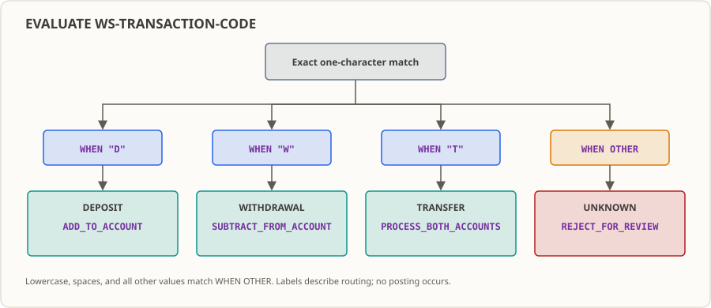

# 第 05 課：EVALUATE——取引コードを明確な処理分岐に分類する

取引が 1 件入ってきたとき、それに対して何を行うかを決めるには、まずそれが「何であるか」を知る必要があります。本課で学ぶのはまさにそのステップです：`EVALUATE` を使って同一フィールドの複数の値をそれぞれの処理分岐に振り分け、「認識できない値」にも明確な出口を用意します。この分類手法は、[第 06 課](../06_perform-loops/README.md) のループ内で添字ごとに再利用され、第 08 課で複数取引の件数集計へと統合されます。

## 業務現場

まず具体的な場面を見てみましょう（機関名、時刻、取引量は教育用のデモであり、実在する特定の機関のデータではありません）。

ある銀行の夜間バッチ処理は、日中に窓口やアプリで発生した取引を深夜 2 時から処理し始めます。上流の勘定系システムから渡される取引ファイルでは、各取引が何であるかを示す情報はわずか 1 文字しかありません：`D` は預金、`W` は引出、`T` は振替です。このフィールドの値をどう解釈するかはあなたの一存では決められません——それは上流の業務部門が決めることであり、値を追加するかどうか、いつ追加するかも、バッチ処理側としては従うことしかできません。

このロジックは、最初は `IF` の連鎖で書かれていました：1 つ目の `IF` で `D` を判定し、`ELSE IF` で `W` を判定し、最後の `ELSE` でその他を回収する。書いたその日は問題なくても、修正する日が悪夢の始まりです。業務部門がまず `F`（手数料）を追加し、誰かが場所を見つけてコードを差し込みました。翌年には `R`（組戻）が加わり、別の担当者がネストのさらに奥に 1 層ねじ込みました。監査担当や障害調査のエンジニアから「現在ハンドリングされていない取引コードには他に何があるのか」と尋ねられたとき——そのコードを指差して自信を持って答えられる人はいませんでした。3 層も積み重なった後では、最後の `ELSE` が一体何を拾っているのか、書いた本人ですら上から下まで読み直さなければならなかったのです。

そして金融システムには、絶対に譲れない一線があります：**認識できない入力を、正常な取引として黙って処理してはならない。** 種類の分からない取引が、預金として口座にそのまま記帳されてしまうような事態は、プログラムがその場でエラーを吐くよりもはるかに深刻です——誤りに誰もすぐには気づかず、照合で発覚したときには手遅れになっているからです。

したがって、必要なのは「`IF` をもっとたくさん書き連ねること」ではなく、全体を一目で把握でき、「残りはどこへ行ったのか」を明確に答えられる振り分け構造なのです。

## なぜ今これを学ぶか

[第 04 課](../04_if-conditions/README.md) で、あなたはすでに `IF` / `ELSE` / `END-IF` を使って 2 つのことを行えるようになりました：金額の範囲に応じて取引を受け入れるか拒絶するか、そして口座状態に応じて処理を進めるかどうかを判断することです。しかし、その 2 箇所の判定対象は数値範囲と単一の状態であり、いずれも行き先は 2 通りしかありませんでした。

「値の候補が増えたなら、`ELSE IF` をいくつか書き足せばいいのではないか」と思うかもしれません。

まず、それがどう見えるかを見てみましょう。`IF` の連鎖で `D`/`W`/`T` とフォールバックを表現すると、概ね次のような雰囲気になります：

```cobol
IF WS-TRANSACTION-CODE = "D"
    ...
ELSE IF WS-TRANSACTION-CODE = "W"
    ...
ELSE IF WS-TRANSACTION-CODE = "T"
    ...
ELSE
    ...   *> 到这一步，兜的是"其他所有码"还是"我漏写的那个"，说不清
END-IF
```

動きはしますが、具体的に 3 つの違和感が生じます：

1. **subject を毎回書き直さなければならない。** 同じ `WS-TRANSACTION-CODE` がこのブロック内で 3 回も比較されており、将来フィールド名が変わった場合、1 箇所ずつ修正しなければなりません。
2. **新しいコードを追加する際、どこに挿入すべきかを自分で判断しなければならない。** 外側に挟むか内側にねじ込むかによって、後続の `ELSE` が誰の管轄になるかが直接影響を受けます。第 04 課で説明したように、`ELSE` は直前のまだ終了していない最も近い `IF` とペアになります——ネストが深くなると、この規則が牙を剥き始めます。
3. **最も致命的なのは、フォールバックが何を拾っているのか説明がつかないこと。** 最後の `ELSE` は名目上「既知の 3 つ以外のすべて」を受け止めますが、この箇所だけを見て「ハンドリングされていないコードは他に何があるか」に答えることはできません。ブランチを追加する人が挿入場所を間違える可能性があり、読む側も上から下まで追いかける必要があります。監査が求めているのは「すべて網羅しているはずです」という主観ではなく、一目で数え上げられる明確なリストです。

`EVALUATE` はまさにこの 3 つ目の問題を解決するために登場します：subject は 1 度だけ書き、既知の値は横並びにフラットに列挙し、フォールバックのルートも白日の下に晒されます。**「どのコードが明示的に認められており、残りはどのルートへ行くのか」が一目で分かります。**

## この知識項目とは何か、何を解決するか

**これは何か。** 平たく言えば、`EVALUATE` とは「1 つのフィールド、複数の候補値、値ごとにそれぞれのブロックを実行する」選択構造です。subject を 1 度書くだけで、あとは配下の各 `WHEN` に候補値を 1 つずつ並べ、最後に `WHEN OTHER` で締めくくります。

**業務において何を解決するか。** 上流から提供されるコード空間は、固定された閉じたリストを渡してくれたりはしません。今日は `D`/`W`/`T` でも、来月には業務部門が `F` を追加し、半年後には見たこともないコードが突如紛れ込んでくるかもしれません——上流が新業務をリリースしたのに通知を忘れたのかもしれませんし、ファイルが破損して不正な文字が混ざったのかもしれません。「起こり得るすべての値」を事前に書き切ることは不可能です。そのため必要なのは「今日のコードを暗記すること」ではなく、「残りはどこへ行ったのか」を明確に言える構造です。本課で教えるのはまさにこれです：既知のコードにはそれぞれ明確な処理区分を持たせ、未知のコードは一律で人手による確認待ちへ回し、通常のルートでそのまま処理を進めさせないようにします。

**いつ使うべきでないか、誤用するとどうなるか。** よくある 2 つの誤用は、文法エラーよりもはるかに高くつく業務上の代償をもたらします。

一はそれを万能の判定として使ってしまうことです。`EVALUATE` の強みは「1 つのフィールドに対する一連の完全一致の値」にあります。判定したいのが金額の範囲であったり、複数フィールドの複合条件であったりする場合、無理にねじ込むとかえって煩雑になります。GnuCOBOL は条件式と組み合わせる `EVALUATE TRUE` もサポートしていますが、それは発展的な用法であり、本課ではまず subject と完全一致の定数を突き合わせるシンプルな形式を学びます。

二は `WHEN OTHER` をゴミ箱のように扱ってしまうことです。本課におけるその責務はただ 1 つ、規約外の値を受け止めて未知としてマークすることです。ついでに「空値チェック」「フォーマット検証」「大文字小文字の正規化」まで何でもかんでも詰め込んではいけません——そんなことをすれば、「規約上有効だが未定義のコード」と「そもそも壊れているゴミデータ」の区別がつかなくなり、トラブルシュート時に最も必要とされる手掛かりを失うことになります。

## 本課修了時の能力と限界

本課を修了すると、以下のことができるようになります：

- `EVALUATE <フィールド>` と複数の `WHEN "<値>"` を組み合わせて、同一の文字フィールドの複数の完全一致の値に対して分岐処理を行える。
- `WHEN OTHER` を用いて、規約に記載されていない値を受け止め、それらが黙って通過してしまわないようにできる。
- プログラムを実行し、`D`、`W`、`T` がそれぞれ出力する分類ラベルと処理ラベルを読み取れる。
- 小文字の `d`、空白、その他の文字がなぜすべて `WHEN OTHER` に入るのかを説明できる（文字比較は完全一致であるため）。
- 本課は分類ラベルと処理ラベルを出力するだけであり、口座への記帳・勘定転記は一切行っていないことを説明できる。

限界：本課ではファイルの読み込み、算術演算、残高の変更、ログや拒否ファイルの書き出しは行いません。大文字小文字の正規化も行わず、空値／フォーマットエラー専用の検証ブランチもありません——それらは単に `WHEN OTHER` に落ちるだけです。ファイル読み込みは [第 15 課](../15_sequential-file-read/README.md) から、拒否結果のファイル出力は第 16 課から、業務上の拒否とシステム障害の分離は第 26 課から始まります。

## 実行環境

- GnuCOBOL 3.2.0、デフォルト方言を使用（`-std=cobol85` は付与しない）、ソースファイルは固定形式。コンパイラおよび対象プラットフォームの挙動は実測検証結果を基準とします。
- Linux 端末。本課はデータベース、追加ツール、サードパーティ製ライブラリに依存しません。
- 入力はすべて `WORKING-STORAGE` 内のプログラム内定数であり、本課には入力フィクスチャはありません。実行時は `build/` 配下に実行ファイルを生成するだけです。

## 知識解説

### EVALUATE の書き方



バッチ処理の上流はインターフェース規約に従って 1 文字の取引コードを渡してきます。プログラムは同一の箇所で既知の各コードを対応する処理区分にマッピングし、処理対象外のコードにも明確な出口を用意しなければなりません。その書き方が「1 つの subject に対する複数の定数」です：

```cobol
EVALUATE WS-TRANSACTION-CODE
    WHEN "D"
        DISPLAY "分類=DEPOSIT"
    WHEN "W"
        DISPLAY "分類=WITHDRAWAL"
    WHEN OTHER
        DISPLAY "分類=UNKNOWN"
END-EVALUATE
```

- subject は `WS-TRANSACTION-CODE` であり、1 度に 1 つのフィールドのみを取ります——これが `IF` の連鎖よりも手間が省ける理由です。
- 各 `WHEN` はそのフィールドの候補値を 1 つ提示します。プログラムは最初に一致した分岐を実行し、`END-EVALUATE` に達した時点でこの選択処理は終了します。
- `WHEN OTHER` は明示的な `WHEN` のいずれにも一致しなかった場合に実行される、本課のフォールバック経路です。

### 悪い例 → 良い例

先ほどの `IF / ELSE IF / ELSE` がまさに悪い例です：動きはするものの、「他にどのコードが放置されているか」に答えられず、コードを 1 つ追加するたびにどこに挟むべきか頭を抱えることになります。

これを `EVALUATE` に置き換えます（良い例）：

```cobol
EVALUATE WS-TRANSACTION-CODE
    WHEN "D"   ...
    WHEN "W"   ...
    WHEN "T"   ...
    WHEN OTHER ...   *> 契约之外的码，全在这
END-EVALUATE
```

2 つの利点は一目瞭然です：subject は 1 度書くだけでよく、各条件で同じフィールドを繰り返し比較する必要がありません。既知の値とフォールバックの値がフラットに並んでおり、「どのコードが明示的に認められており、残りはどの道を進むのか」が可視化されています。新しい取引コードを追加する際も、`WHEN "T"` と `WHEN OTHER` の間に `WHEN` を 1 行挿入するだけで済み、`ELSE` の所属関係を気にする必要は一切ありません。第 04 課で強調したように、`ELSE` は直前のまだ終了していない `IF` と結びつきますが、`EVALUATE` は `END-EVALUATE` で明確なスコープを区切るため、そのようなネストのリスクを綺麗に回避できます。

### 文字比較は厳密であり、「だいたい同じ」は通用しない

`WS-TRANSACTION-CODE` は `PIC X` のテキストフィールドであり、`WHEN "D"` が比較するのは文字そのものです：小文字の `d` は大文字の `D` と等しくなく、空白、数字、その他の文字も `D`/`W`/`T` とは等しくありません。これらの値はすべて例外なく `WHEN OTHER` に落ち、`UNKNOWN` としてマークされます。本例のインターフェース規約は大文字の `D`、`W`、`T` です。

この点は実際のバッチ処理で大事故を引き起こし得ます：上流がある日突然コードを小文字に変更して送信してきた場合、正常な取引がバッチ丸ごと未知としてマークされてしまいます。大文字小文字のバリエーションやエイリアスを受け入れたいのであれば、まず規約に明記し、その上でプログラム内で正規化を行わなければならず、勝手に特定の文字に意味を追加してはなりません。本課ではあえて正規化を行っていません——これは意図的に残した境界です。

### 出力テキストの言語について

リポジトリ規約：ソースファイルのコメントと README の解説には中国語を使用し、プログラム実行時に出力される業務テキストは日本語を踏襲します。本課で出力される `取引参照番号` は「取引参照番号」、`取引コード` は「取引コード」、`分類` は「分類」、`処理` は「処理ラベル」（例えば `処理=ADD_TO_ACCOUNT` は「処理推奨=口座へ入金加算」を意味します）です。プログラムの挙動を判断する際は、実際の出力と本節の説明を基準としてください。

## 完全なサンプルソースコード

[`lesson.cob`](./lesson.cob) は固定の定数 `D` を用いて預金ブランチの挙動を示します：まず取引参照番号とコードを表示し、次に分類ラベルと処理ラベルを 1 つずつ出力します。

```cobol
      * 合法取引コード D/W/T 由接口契约定义；本课把它当作输入前提，不在程序内校验取值。
       IDENTIFICATION DIVISION.
       PROGRAM-ID. EVAL05.
       DATA DIVISION.
       WORKING-STORAGE SECTION.
       01 WS-TRANSACTION-REFERENCE PIC X(12)
          VALUE "TXN-00000001".
       01 WS-TRANSACTION-CODE PIC X VALUE "D".
       PROCEDURE DIVISION.
           DISPLAY "取引参照番号="
               WS-TRANSACTION-REFERENCE.
           DISPLAY "取引コード=" WS-TRANSACTION-CODE.
           EVALUATE WS-TRANSACTION-CODE
               WHEN "D"
                   DISPLAY "分類=DEPOSIT"
                   DISPLAY "処理=ADD_TO_ACCOUNT"
               WHEN "W"
                   DISPLAY "分類=WITHDRAWAL"
                   DISPLAY "処理=SUBTRACT_FROM_ACCOUNT"
               WHEN "T"
                   DISPLAY "分類=TRANSFER"
                   DISPLAY "処理=PROCESS_BOTH_ACCOUNTS"
      * 契约外取值统一归入待人工核对；本课只输出分类标签，不做任何过账。
               WHEN OTHER
                   DISPLAY "分類=UNKNOWN"
                   DISPLAY "処理=REJECT_FOR_REVIEW"
           END-EVALUATE
           STOP RUN.
```

### データ項目

| フィールド | PIC / 初期値 | 意味 |
|---|---|---|
| `WS-TRANSACTION-REFERENCE` | `X(12)` / `TXN-00000001` | 取引参照番号テキスト。算術演算には関与しない |
| `WS-TRANSACTION-CODE` | `X(1)` / `D` | 1 文字の取引コード。本課の規約で認められた `D`/`W`/`T` をとる |

### 手順の詳細解説

1. `IDENTIFICATION DIVISION`、`PROGRAM-ID` でプログラムを命名します。`WORKING-STORAGE SECTION` で `VALUE` を用いて固定の参照番号と取引コードを与えます。プログラムに外部入力はありません。
2. 最初の `DISPLAY` で取引参照番号（`X(12)` テキスト、算術演算には関与しない）を出力し、2 つ目で取引コードを出力して、現在の固定サンプルを確認しやすくします。
3. `EVALUATE WS-TRANSACTION-CODE` で多分岐を開始します。subject はその 1 文字のコードです。
4. `WHEN "D"` は `分類=DEPOSIT` と `処理=ADD_TO_ACCOUNT` を出力します。`WHEN "W"` は引出ラベルを、`WHEN "T"` は振替ラベルを出力します。各ブランチは 2 つの静的ラベルのみを出力します。
5. `WHEN OTHER` は `分類=UNKNOWN` と `処理=REJECT_FOR_REVIEW` を出力し、`D`/`W`/`T` 以外のすべての値をカバーします。
6. `END-EVALUATE` で選択範囲を明示的に終了し、`STOP RUN.` でプログラムを終了します。

分類ラベルと処理ラベルはいずれも `DISPLAY` による静的テキストであり、プログラムは預金、引出、振替を実行せず、残高を書き換えることもありません。

## 実行と観察

本課はキーボード、ファイル、コマンドライン引数、データベースを読み込まず、データファイルも生成しないため、本課のディレクトリでも任意のディレクトリでも実行結果は同じです。以下では本課のディレクトリを基準に説明します。

**入力：** 外部入力はありません。表示されるすべての行は `lesson.cob` 内のプログラム内定数および `DISPLAY` リテラルから来ており、ファイルやデータベースのデータではありません。

**コマンドとその役割：**

```sh
mkdir -p build
cobc -fsyntax-only lesson.cob                    # 只做语法检查，不生成可执行文件
cobc -x -Wall -o build/lesson_05 lesson.cob      # 编译并生成可执行文件
./build/lesson_05                                # 运行程序，业务输出写到标准输出
echo $?                                          # 查看上一条命令的退出码
rm -rf build                                     # 清理生成的可执行文件
```

`-fsyntax-only` は構文解析パスのみを検証し、プログラムの生成や実行は行わないため、コンパイルや実行観察の代わりにはなりません。`-x` は GnuCOBOL に実行可能プログラムの生成を指示し、`-o` は出力パスを指定します。`rm -rf build` は本課で生成された実行ファイルのみを削除し、ソースコードには触れません。

**期待される結果：**

| 観察項目 | 期待値 |
|---|---|
| `cobc -fsyntax-only` 終了コード | `0` |
| `cobc -x` 終了コード | `0`、コンパイル診断なし |
| 標準出力（stdout） | 下記の 4 行を参照 |
| プロセス終了コード（`echo $?`） | `0` |
| 生成ファイル | `build/lesson_05` のみ |

標準出力：

```text
取引参照番号=TXN-00000001
取引コード=D
分類=DEPOSIT
処理=ADD_TO_ACCOUNT
```

**分岐を実際に目で確認する。** `lesson.cob` 内の `01 WS-TRANSACTION-CODE PIC X VALUE "D".` の初期値をそれぞれ `W`、`T`、`X`、`d` に変更して 1 回ずつ実行してみてください。次の結果が確認できます：`W` → `分類=WITHDRAWAL` / `処理=SUBTRACT_FROM_ACCOUNT`、`T` → `分類=TRANSFER` / `処理=PROCESS_BOTH_ACCOUNTS`、`X` と `d` は両方とも `WHEN OTHER` に落ちて `分類=UNKNOWN` / `処理=REJECT_FOR_REVIEW`。4 つのケースいずれも終了コードは `0` です。**`d` が未知のルートへ進むことこそ、「厳密な比較」の最も直接的な証拠です。** 確認を終えたら、初期値を忘れずに `D` に戻し、変更をファイルに黙って残さないようにしてください。

**実際に観察された環境の詳細：** 本ワークスペースで `./build/lesson_05` を実行した際、標準エラー出力に `Warning: program compiled against libxml 212 using older 209` が出力されます。これは実行環境の共有ライブラリのバージョン差異による警告であり、本プログラムの業務出力ではありません（トリガーコンポーネントは未特定）。プログラムの正常な出力は標準出力に書き込まれ、終了コードは 0 です。

## 修正演習

元の [`lesson.cob`](./lesson.cob) から出発し、インターフェースに追加された取引コード `F`（手数料）のために `WHEN "F"` ブランチを 1 つ追加し、観察のためにサンプルコードを `F` に変更します：`EVALUATE` 内の `WHEN "T"` ブランチの後、`WHEN OTHER` の前に `分類=FEE` / `処理=CHARGE_FEE` を出力するブランチを挿入し、同時に `WS-TRANSACTION-CODE` の初期値 `VALUE "D"` を `VALUE "F"` に変更します。制約は、`D`/`W`/`T` ブランチの出力を変更しないこと、`WHEN OTHER` の意味と出力を変更しないこと、固定形式を維持することです。完全な課題、期待される差分、および理由については [`exercise.md`](./exercise.md) を、参考解答は [`answer.md`](./answer.md) を参照してください。

この演習は、前述の「上流が `F` を追加した」という状況の最小限の実践演習です：「コードの追加 = `WHEN` を 1 つ挿入するだけ」であることを自らの手で体験し、その後でフォールバックのルートが壊れていないことを検証します。

## 応用演習

バッチレコードの支払方法を分類してください：`C` 現金、`B` 銀行振込、`K` 小切手。規約外のコードは一律で人手確認待ちと出力します。本課で学んだフィールド、`EVALUATE`、`WHEN`、`WHEN OTHER`、`DISPLAY`、および `STOP RUN` のみを使用し、`EVALUATE` でコードをマッピングして区分と処理推奨を出力してください。課題は [`exercise.md`](./exercise.md) にあります。本問には解答は提供されません。

## 本番フローをたどる

上流から実際に「来月から取引コード `F`（手数料）が 1 つ増える」という通知が届いたと想定しましょう。通知を受け取ってからリリースするまでに踏むべき手順は、おおむね次のようになります：

1. **まず規約を動かし、コードは動かさない。** 業務部門／上流に `F` の値と意味を明確に記述させます：勘定転記が必要か、手数料率を適用するか、`D`/`W`/`T` と排他か。規約が定まらなければ、コードを書いても推測にすぎません。
2. **ブランチを 1 つ挿入する。** `EVALUATE` 内の `WHEN "T"` の後、`WHEN OTHER` の前に `WHEN "F"` を追加し、新しい分類ラベルと処理ラベルを出力します。これこそが本課の修正演習で行うことです。
3. **サンプルを新コードに切り替えて 1 回走らせる。** 初期値を `F` に変更して再コンパイル・実行し、`取引コード=F`、`分類=FEE`、`処理=CHARGE_FEE` となり、終了コードが依然として `0` であることを確認します。
4. **立ち返ってフォールバックを検証する。** さらに初期値を `X` と `d` に変えてそれぞれ 1 回ずつ実行し、それらが変わらず `UNKNOWN` / `REJECT_FOR_REVIEW` に落ちることを確認します。**新しいブランチを追加してもフォールバックを壊していないこと、このステップを経て初めて真に検証できたと言えます。** 最後に初期値を `D` に戻します。
5. **この課の付属ドキュメント類を同期する。** フィクスチャ（ここではプログラム内定数）、`exercise.md`、`answer.md`、および README 内の期待出力をまとめて修正します。プログラムだけを変更してはいけません——設問と解答の期待値が食い違うと、引き継いだ後任者が丸一日振り回されることになります。
6. **下流システムへ引き渡す。** 処理ラベルを実際のアクションに変えるには、さらにいくつかの課を経る必要があります：複数取引をインデックスでループ処理するのは [第 06 課](../06_perform-loops/README.md)、受け入れ／拒否の件数集計は [第 08 課](../08_control-flow-practice/README.md)、拒否明細をファイルに書き出すのは [第 16 課](../16_file-writing/README.md)、業務上の拒否とシステム障害を区別するのは [第 26 課](../26_error-handling/README.md)、バッチ番号と元のコードを含むログ出力は [第 27 課](../27_logging/README.md) の役割です。

## このコードが本番に入るとどうなるか

- **誰がスケジュールするか：** 夜間バッチのスケジューラが計画に従って起動し、実行ファイルパスと終了コードのみを認識します——本課ではすべてのブランチで終了コードが `0` であり、スケジューラからはこの取引が未知としてマークされたかどうかは見えません。
- **誰がその出力を参照するか：** 障害調査や運用の担当者が標準出力を参照します。`分類=UNKNOWN` / `処理=REJECT_FOR_REVIEW` という行こそが、「なぜこの取引が入金されていないのか」を追跡する出発点となります。
- **未知のコードは最終的にどこへ行くか：** 本課では単に `DISPLAY` された 2 つのラベルにすぎず、人手確認待ちキューに実際に入るわけでもなく、拒否ファイルが書き出されるわけでも**ありません**。これを本物のアクションにするには、第 16 課（拒否明細のファイル出力）と第 26 課（業務上の拒否とシステム障害の分離）を待つ必要があります。
- **トラブル時に誰が呼び出されるか：** 最も危険なのはエラーが出ることではなく、**エラーが出ないこと**です。もし未知のコードが通常のルートとして黙って処理されてしまった場合、照合で金額の不一致が発覚するまで誰にも気付かれない可能性があります。そのため、「未知のコードは必ず可視化されたフォールバック経路を通す」という規則は、見た目以上に重大です。
- **後続システムはどう引き継ぐか：** 下流（第 06、08 課のループと件数カウント）は、ここで出力される分類ラベルに依存してディスパッチを行います。ラベルが変われば、下流の集計基準も連動して変わります。
- **運用開始の初月に最も発生しやすい事故：** 1 つは上流がコードを追加したのに通知がなく、バッチ全体が `UNKNOWN` に落ちること。もう 1 つは上流がある日小文字に変更して送信し、正常な取引が丸ごと未知としてマークされること——この 2 つは本課のコードでは防ぎようがなく、規約とログに頼るしかありません。

はっきりさせておきます：本課はファイルの読み込み、算術演算、残高の変更、ログや拒否ファイルの書き出しは行わず、処理ラベルは単に `DISPLAY` されたテキストにすぎません。実際の記帳、拒否、監査フローは実装しておらず、いかなる本番稼働、監査、規制遵守の保証も主張しません。この処理チェーンを真に完成させるには、さらにいくつかの課を先に進める必要があります（前節参照）。

## 参考資料

- [GnuCOBOL Programmer’s Guide：EVALUATE](https://gnucobol.sourceforge.io/HTML/gnucobpg.html#EVALUATE)
- [GnuCOBOL Manual：EVALUATE TRUE と WHEN OTHER の例](https://gnucobol.sourceforge.io/doc/gnucobol.html)
- リポジトリコース総合目録：[DIRECTORY.md](../DIRECTORY.md)
