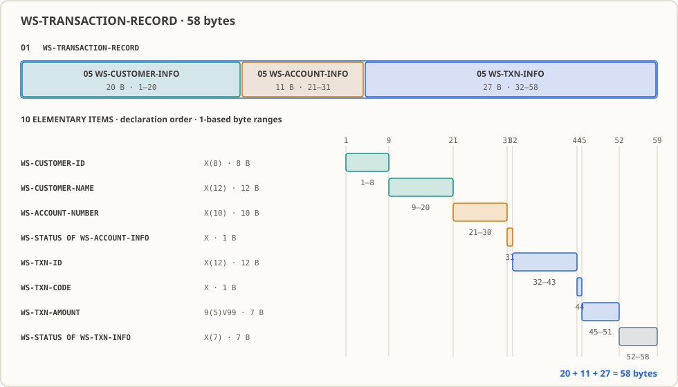

# 第 09 課：集団項目——顧客・口座・取引フィールドを 58 バイトの 1 レコードにまとめる

上流がバッチ処理に引き渡すものは、決して「ばらばらのフィールド群」ではなく、1 つの完結したレコードです：どのフィールドが誰に属し、先頭から何バイト目に並び、レコード全体で何バイトあるのか、すべてインターフェース仕様書に厳密に規定されています。本課では顧客、口座、取引の各フィールドを 58 バイトの `WS-TRANSACTION-RECORD` にまとめ、`OF` を使って 2 つの同名 `WS-STATUS` を区別し、集団全体の `MOVE` によって同じ幅の固定長受取領域 `WS-EXPORT-LINE` へそのまま転送します。このレコードのバイト構造こそが、後の [第 17 課](../17_fixed-length-files/README.md) で固定長ファイルを読み込む際に照合すべき基準の形となります。

## 業務現場

（あらかじめ断っておきますが、本節の機関名、時刻、取引件数は教育用のデモ素材であり、実在する特定の機関や特定の日付の実データではありません。）

深夜 1:40、地方銀行（デモ想定）の日次締めバッチが走り始めます。上流の勘定系システムは、当日の約 12 万件の取引を固定長レコードファイルとして出力し、共有ディレクトリに配置し終えています。インターフェース仕様書の 1 ページ目には表が掲載されています：第 1–8 バイトは顧客番号、第 9–20 バイトは顧客名、第 21–30 バイトは口座番号……1 レコードあたり 58 バイト（本課のデモ用長）。この取り決めの主語に注目してください：**上流があなたに渡すのは「1 つのレコード」であり、個別のフィールドではありません。** あなたが受け取るのも全体なら、後続へ引き渡すのも全体でなければなりません。

では、もし誰かがオフセットの計算を 1 バイト見誤ったらどうなるでしょうか？ 具体例を挙げましょう。このレコードには 2 つの状態フィールドが含まれます：口座状態は 1 バイト（本課のサンプル値 `A`）、取引状態は 7 バイト（サンプル値 `PENDING`）です。もし口座状態を誤って 2 バイトとして計算してしまったら、第 32 バイト以降のすべてのフィールドが 1 バイトずつずれてしまいます——しかし、画面や帳票に出力された結果は一見すると正常に見えます：口座番号の文字列は依然として数字ですし、取引番号もそれらしく見えます。**プログラムはエラーを出しません。ただ静かに、位置がずれているのに「一見正当に見える」値を出力し続けるだけです。**

さらに先にあるのが、フィールド名を間違えて参照してしまう代償です。実在のレコードでは、同じ状態フィールドが 2 度登場することがあります：一方はその口座の現在の状態を示し、もう一方はその取引自体の状態を示します。どちらか一方を取り違えると、後から報告される拒否理由が誤ったものになります——翌朝 9 時に窓口が開き、顧客が支払拒絶の記録を持って「なぜ出金できないのか」と尋ねてきたとき、あなたが提示する理由は別のフィールドに入っていた値になってしまいます。本課ではまだ着金や拒否の判定は行いませんが（それは実際の入力を持ち、エラー振り分けを学んだ後の [第 16 課](../16_file-writing/README.md) や [第 26 課](../26_error-handling/README.md) を参照）、「2 つの同名の状態を明確に区別できなければならない」という点は、今まさに身につけておく必要があります。

## なぜ今これを学ぶか

「フィールドなら前の 8 課で自分で名前を付けて宣言してきたし、何の問題もなく動いていた。なぜわざわざ『グループ化』を学ばなければならないのか？」と思うかもしれません。

「1 つのレコードを扱う」段階に入ると、これまでのやり方は通用しなくなります。ファイル処理に向き合う際、真っ先に答えなければならない 3 つの問いがあります：**誰が誰に属しているのか、何番目に並んでいるのか、全体で何バイトなのか。** 手元にある独立したフィールド群では、この 3 つの問いのどれ一つとして答えられません。さらに厄介な問題があります——名前の重複です：仕様書上で 2 つの異なるフィールドがいずれも「状態」と書かれていた場合、両方に `WS-STATUS` という名前を付けたくなるのは自然ですが、フラットに宣言するとその場で名前の衝突が起きてしまいます。

したがって、ここで学ぶべきは 3 つの要素です：層級番号が与える親子関係（`01` / `05` / `10`）、業務上の帰属を示すグループ名、そして「外部レコードの候補形状」を成す集団項目の連続バイト列です。これはコードを美しく見せるための装飾ではありません。この後、[第 10 課](../10_redefines/README.md) では同一のバイト列に対して別のビューを宣言し、[第 15](../15_sequential-file-read/README.md)–[17 課](../17_fixed-length-files/README.md) ではこの形状に基づいて実際のファイルを読み込み、[第 23 課](../23_copybooks/README.md) ではこのレイアウトを他のプログラムと共有します——この 3 つの作業はすべて、「この連続したバイト列が 1 つのレコードである」という大前提の上に成り立っているのです。

## この知識項目とは何か，何を解決するか

**この知識項目とは何か。** 一言で言えば、複数のフィールドを名前の付いた 1 つの「箱」に入れ、その箱の中にさらに箱を入れ子にできるようにすることです。集団項目（group item）自身には `PIC` を書かず、単に親子関係の階層を表します。基本項目（elementary item）には必ず `PIC` を書き、それこそが実際にバイト領域を占有するフィールドとなります。これに伴って獲得できる 2 つの能力があります：**グループ名を 1 つのまとまりとして扱えること**（整組 `MOVE`、整組 `DISPLAY`）、そして**同名の子項目を `OF` で親グループを指定して曖昧さ解消できること**です。

**業務において何を解決するか。** 「1 つのレコード」を、プログラム内でまとめて搬送でき、各フィールドのオフセットも算出可能な実体へと昇華させます。上流が固定のオフセットで書き出し、あなたが同じオフセットで読み込み、下流へも同じオフセットで書き出す——いわゆるインターフェース規約とは、コードに落とし込めばこの階層構造の宣言そのものです。引き渡しの際も整組 `MOVE` を 1 つ書くだけで完了し、「8 つのフィールドをどの順序でコピーし、合計何バイトになるか」を自分で管理する必要がなくなります。

**どんなときに使うべきでないか、誤用するとどうなるか。** 肝に銘じておくべき点が 2 つあります。第 1 に、**集団項目は何のバリデーションも提供しない**ということです：バイト列にある内容がそのまま読み取られ、`PIC 9(5)V99` が覆う領域に英字が詰め込まれていても誰も止めてくれません（[第 10 課](../10_redefines/README.md) でこの点についてより掘り下げます）。第 2 に、**階層構造を業務ルールと混同してはならない**ということです：フィールドを `WS-ACCOUNT-INFO` の中に入れたからといって、プログラムが口座状態の妥当性をチェックしてくれるわけではありません。それは [第 04 課](../04_if-conditions/README.md) から始まる条件判断や後続の検証処理に頼る必要があります。誤用による最も一般的な被害はコンパイル時ではなく、「グループ化したから構造的な保証が得られた」と思い込み、バイトごとのオフセットの突き合わせを怠ってしまうことにあります。オフセットの整合性は、インターフェース仕様書と照らし合わせる以外に確認する方法はありません。

## 本課修了時の能力と限界

本課を修了すると、以下のことができるようになります：

- `01`／`05`／`10` を用いて親子関係を構築し、集団項目（`PIC` を持たない）と `PIC` を持つ基本項目を正しく区別できる。
- このレコードが全体で 58 バイトであることを計算し、口座番号が第 21–30 バイトに位置することを説明できる。
- `WS-STATUS OF WS-ACCOUNT-INFO` のような修飾名を用いて、2 つの同名 `WS-STATUS` のうち必要な方を一意に指定できる。
- 集団項目全体を `DISPLAY` した場合に元の生バイト列のみが出力され、金額フィールドを個別に表示したときに初めて小数点が表示される理由を説明できる。
- 整組 `MOVE` を用いてレコードを同じ幅の `WS-EXPORT-LINE PIC X(58)` に複製し、それが純粋なバイト単位の転送であることを説明できる。

限界：レコードの内容はすべてソースコード内の定数であり、本課ではファイルの読み書きや業務ルールの検証は行いません。実際のファイルレコードの幅やオフセットの扱いは第 [15](../15_sequential-file-read/README.md)–[17 課](../17_fixed-length-files/README.md) から、このレイアウトを Copybook として外部ファイルに切り出すのは [第 23 課](../23_copybooks/README.md) です。

## 実行環境

- GnuCOBOL 3.2.0、デフォルト方言（`-std=cobol85` は付加しない）、ソースファイルは固定形式。
- 固定形式の判定はバイト単位で行われます：第 7 列は注記標識領域、Area A は第 8 列から、Area B は第 12 列から開始し、プログラムテキストは第 72 列を超えてはなりません。本課の各行はすべて 72 バイト以内に収まっています。
- 実測：本ワークスペースにおいて日本語を含む計 89 バイトのテストソースを実行したところ、`cobc` により 72 バイト目で切り詰められ、`invalid literal` が発生しました。したがって「見た目が揃っているか」ではなく、バイト数を数えなければなりません。
- Linux 端末。データベースや追加ツールには依存せず、`build/` 配下に実行可能ファイルを生成するだけです。

## 知識解説

### 層級番号が管轄するのは親子関係であり、インデントではない

`01`、`05`、`10` は単に親子関係を表すためのものです：子項目の階層番号は親項目より大きく、同じ階層の兄弟項目は同じ番号を繰り返します。インデントは純粋に人間のためのものであり、コンパイラはインデントを解釈しません。同じ宣言をまったくインデントを付けずに書いても、プログラムの挙動は 1 バイトたりとも変わりません——ただし、そんな書き方をすれば後任者に恨まれることになります。

集団項目と基本項目の境界も極めて明確です：`PIC` を書かないものが集団項目（例：`WS-CUSTOMER-INFO`）であり、`PIC` を書いたものこそが実際に記憶領域を占めるフィールド（例：`WS-CUSTOMER-ID PIC X(8)`）です。

### 2 つの WS-STATUS：名前重複の正当な解決策は OF

本課には `WS-STATUS` という名前のデータ項目が 2 つ存在します：口座状態 `PIC X`、値 `A` と、取引状態 `PIC X(7)`、値 `PENDING` です。

記述の手間を省こうとして、単に `WS-STATUS` とだけ書きたくなるかもしれません。しかしそれは不可能です——COBOL はプログラマの意図を推測せず、コンパイラはその場でエラーを出力します（本ワークスペースでの実測）：

```text
error: 'WS-STATUS' is ambiguous; needs qualification
```

この場合、`WS-STATUS OF WS-ACCOUNT-INFO` または `WS-STATUS OF WS-TXN-INFO` と記述しなければなりません。ここでの `OF` と `IN` は同一の意味を持ちます。これは単に「どちらの項目を指しているか」を指定しているだけであり、幅も、初期値も変更せず、記憶領域の位置も動かしません——2 つのフィールドはそれぞれ本来のバイト位置をそのまま占有し続けます。

### 悪い例 → 良い例

**反例：8 つのフィールドをフラットな一連の `01` として並べる**、誰が誰に属するかも分からず、グループ名もありません。

```cobol
       01 WS-CUSTOMER-ID      PIC X(8)    VALUE "C0001042".
       01 WS-CUSTOMER-NAME    PIC X(12)   VALUE "ADA LOVELACE".
       01 WS-ACCOUNT-NUMBER   PIC X(10)   VALUE "0001234567".
       01 WS-ACCT-STATUS      PIC X       VALUE "A".
       01 WS-TXN-ID           PIC X(12)   VALUE "TXN-00000001".
       01 WS-TXN-CODE         PIC X       VALUE "D".
       01 WS-TXN-AMOUNT       PIC 9(5)V99 VALUE 125.50.
       01 WS-TXN-STATUS       PIC X(7)    VALUE "PENDING".
```

コンパイラはこの書き方を拒絶しません（本ワークスペース実測：この宣言群で `-fsyntax-only` の終了コードは `0`）。だからこそ危険なのです——問題はすべて後工程へと先送りされます：

1. **グループ名がないため、レコード全体を 1 つの単位として扱えない。** 固定長の受取領域に引き渡す際、フィールドごとに 1 行ずつ `MOVE` を書くしかなく、順序、幅、全体の長さをすべて自力で覚えておかなければなりません。フィールドが 1 つ増えるたびに修正箇所が増加します。
2. **「口座状態は口座情報に属する」という関係性がコード上から消滅する。** 読む人はフィールド名のプレフィックスを頼りに帰属を推測するしかなく、推測を間違えても誰も正してくれません。
3. **2 つの状態フィールドに同じ `WS-STATUS` という名前を付けられない**ため、一方を `WS-ACCT-STATUS` などに改名せざるを得ません。結果としてコード内の名前と仕様書上の名前が乖離し、オフセットを確認する際の手間が余計に増えてしまいます。

**正例は本課の `lesson.cob` の書き方です**：1 つの `01` ルートグループ、3 つの `05` サブグループ、8 つの `PIC` を持つ `10` 基本項目。

```cobol
       01 WS-TRANSACTION-RECORD.
          05 WS-CUSTOMER-INFO.
             10 WS-CUSTOMER-ID PIC X(8) VALUE "C0001042".
          05 WS-ACCOUNT-INFO.
             10 WS-ACCOUNT-NUMBER PIC X(10) VALUE "0001234567".
             10 WS-STATUS PIC X VALUE "A".
          05 WS-TXN-INFO.
             10 WS-STATUS PIC X(7) VALUE "PENDING".
```

帰属、順序、総バイト数の 3 つが一挙に解決します：グループ名によって全体を一括転送でき、`OF` によって同名の項目を区別でき、「1 レコードの長さ」も宣言順序に沿って足し合わせるだけで算出できます。

### 集団項目はメモリ上では単なる連続したバイト列である



集団項目にはメモリ上で区切り文字は存在せず、単なる連続した記憶領域であり、その長さは各子項目の宣言順のバイト数の総和に等しくなります。`X(n)` は n バイトを占めます；`9(5)V99` は 7 バイトを占めます。なぜなら `V` は想定小数点であり、記憶領域のバイトを消費しないからです——これは最初に見落としやすいポイントです：`00125.50` は印字すると 8 文字になりますが、格納時には 7 バイトしか占有しません。

3 つのサブグループはそれぞれ 20、11、27 バイトを占め、合計で 58 バイトになります：

| 項目 | PIC | バイト数 | レコード内の位置 |
|---|---|---:|---|
| `WS-CUSTOMER-ID` | `X(8)` | 8 | 1–8 |
| `WS-CUSTOMER-NAME` | `X(12)` | 12 | 9–20 |
| `WS-ACCOUNT-NUMBER` | `X(10)` | 10 | 21–30 |
| `WS-STATUS`（口座状態） | `X` | 1 | 31 |
| `WS-TXN-ID` | `X(12)` | 12 | 32–43 |
| `WS-TXN-CODE` | `X` | 1 | 44 |
| `WS-TXN-AMOUNT` | `9(5)V99` | 7 | 45–51 |
| `WS-STATUS`（取引状態） | `X(7)` | 7 | 52–58 |
| `WS-TRANSACTION-RECORD` 全体（組） | — | 58 | 1–58 |

位置は先頭からの幅を順に累積したものです：口座番号の前には `8+12=20` バイトが存在するため、口座番号は第 21 バイトから始まります。本課では同一レイアウトの一時プログラムを作成して `FUNCTION LENGTH` を呼び出し、顧客グループ 20、口座グループ 11、取引グループ 27、全体 58、金額 7 であることを再確認し、手計算と一致することを実証しています（本ワークスペースでの再実行結果も一致）。

### 表示と転送：集団項目にあるのはバイトだけであり、小数点や変換はない

集団項目には `PIC` がないため、集団全体を参照した際にはバイト列としてのみ扱われ、数値としての解釈は行われません。以下の 3 つの結果はすべてこれに起因します：

- `DISPLAY WS-TRANSACTION-RECORD` は 58 個の格納バイトを出力し、その中の金額部分は `0012550` となります——小数点は記憶領域に存在しないため、勝手に現れることはありません；
- `DISPLAY WS-TXN-AMOUNT OF WS-TXN-INFO` と記述して初めて、数値書式に従って `00125.50` が出力されます；
- `MOVE WS-TRANSACTION-RECORD TO WS-EXPORT-LINE` は数値を変換せず、区切り文字を挿入せず、内容の妥当性検証も行いません。これこそが外部の固定長レコードが求めるセマンティクスです：原様進、原様出。

逆に言えば、**整組転送は業務上の保護が一切伴わないことを意味します**。フィールドに入っているものがそのまま転送されるため、「口座番号の中にスペースが混ざっていた」としてもそのまま転送されてしまいます。

**未検証事項：** 本課では同じ幅のコピー（両項目とも 58 バイト）のみを実演しています。受取領域を 58 バイトより狭く宣言した場合にどのように切り詰められるか、警告が出るかどうかは、本課ではテストしていません——本課の目的はオフセットと長さが照合可能であることを示す点にあり、`MOVE` の切り詰め規則を網羅することではないからです；真の幅の制約は、[第 17 課](../17_fixed-length-files/README.md) で実際のファイルを扱って初めて対比が可能になります。この経路は未検証であるため、勝手に挙動を推測しないでください。

## ソースコード読解パス

完全なソースコードは [`lesson.cob`](./lesson.cob) を参照してください。データがどのように配置され、どのように転送されるかを追って読み進めます：

1. **レコードの宣言**：`01 WS-TRANSACTION-RECORD.` はルートグループであり、その配下の 3 つの `05` サブグループと 8 つの `10` 基本項目がそれぞれ `VALUE` を持ち、起動時に定数が設定されます。
2. **受取領域の宣言**：`01 WS-EXPORT-LINE PIC X(58).` はレコードと同幅であり、初期値は 58 個の空白です。
3. **フィールドごとの参照**：8 つの `DISPLAY` はいずれも `フィールド OF 親グループ` の形式で基本項目を参照しています——2 つの `WS-STATUS` はまさにこのステップで区別されています。
4. **集団全体の参照と転送**：まず `DISPLAY` 整組で 58 バイトを出力し、次に受取領域へ `MOVE` します。表示内容が一致していることから、転送が純粋なバイト単位のコピーであることが確認できます；最後に `STOP RUN.` により終了コード 0 で完了します。

## 実行と観察

本課には外部入力はなく、結果は外部データに左右されません；以下のコマンドは本課のディレクトリを基準としています。

**入力：** 外部入力はありません。顧客、口座、取引の各フィールドはすべて `lesson.cob` 内のプログラム内定数です。

```sh
mkdir -p build
cobc -fsyntax-only lesson.cob                   # 只做语法检查
cobc -x -Wall -o build/lesson_09 lesson.cob     # 编译并生成可执行文件
./build/lesson_09                               # 运行，输出写到标准输出
echo $?                                         # 查看退出码
rm -rf build                                    # 清理可执行文件
```

**期待される結果：**

| 観察項目 | 期待値 |
|---|---|
| 構文チェックとコンパイル | 両ステップとも終了コード `0`、コンパイル診断なし |
| 標準出力 | 10 行、下記コードブロック参照 |
| プロセス終了コード | `0` |

```text
顧客ID=C0001042
顧客名=ADA LOVELACE
口座番号=0001234567
口座状態=A
取引ID=TXN-00000001
取引コード=D
取引金額=00125.50
取引状態=PENDING
グループデータ=[C0001042ADA LOVELACE0001234567ATXN-00000001D0012550PENDING]
外部記録=[C0001042ADA LOVELACE0001234567ATXN-00000001D0012550PENDING]
```

**出力の対応関係：** `顧客` 顧客、`口座` 口座、`取引` 取引、`状態` 状態、`金額` 金額、`グループデータ` 集団項目の内容、`外部記録` 集団全体の転送結果。

**実際に観察された環境の詳細：** 実行可能ファイルを実行した際、標準エラー出力に `Warning: program compiled against libxml 212 using older 209` が出力されます；これは実行環境の共有ライブラリのバージョン警告であり、業務出力ではありません（トリガーコンポーネントは未特定）。業務出力は標準出力にあり、終了コードは 0 です。

## 修正演習

`WS-ACCOUNT-NUMBER` の初期値を `0001234567` から `0007654321` に変更し、改めて構文チェック、コンパイル、実行を行い、口座番号の行および 2 箇所の集団全体の出力が連動して変化し、残りの 7 行は変化しないことを確認してください。課題は [`exercise.md`](./exercise.md) を、解答は [`answer.md`](./answer.md) を参照してください。

## 応用演習

1 つの支払指図に対して、支払人、受取人、支払情報の 3 つの `05` サブグループを含む `01` レコードを設計してください；各グループに `VALUE` を持ついくつかの `10` 基本項目を設計し、少なくとも 2 つのサブグループで同一の基本項目名を使用し、`OF` でそれぞれ参照できるようにします；さらに同じ幅の `PIC X(n)` 受取項目を宣言し、整組 `MOVE` で転送した後に表示してください。レコードの総バイト数と各フィールドの位置を自ら算出し、出力結果と突き合わせて検証してください。本課の階層データ項目と固定の `VALUE` のみを使用し、`REDEFINES`、`OCCURS`、ファイル入力、データベースは導入しないでください。課題は [`exercise.md`](./exercise.md) にあります。本問には解答は提供されません。

## 本番フローをたどる

本課の成果物を深夜の処理チェーンに当てはめると、次のように利用されます（実際のデータを動かすには、[第 15 課](../15_sequential-file-read/README.md) で実際の入力を得てからになります）：

1. **上流がファイルを出力する。** 勘定系システムがインターフェース仕様書に従って固定長レコードを書き出します：第 21 バイトからが口座番号であり、10 バイトを占めます。読み込むのは本課のような形状のレコードです。
2. **同幅の集団項目に読み込む。** `01` レコードで全体を受け止めます——本課の宣言手法はすでにその準備が整っており、実際のファイル読み込みは [第 15 課](../15_sequential-file-read/README.md)、固定長の読み書きと総バイト数の照合は [第 17 課](../17_fixed-length-files/README.md) で行います。
3. **オフセットに従ってフィールドを取得する。** オフセットは推測するものではなく、宣言順序から累積計算されるものです（本課の表の第 21–30 バイトはまさにこうして導き出されました）。2 つの同名状態はこのステップで `OF` を用いて個別に識別されます。
4. **状態を判定する。** 本課では 2 つの状態を表示するだけにとどめています；実際に状態に応じて分岐処理を行うのは [第 04](../04_if-conditions/README.md)／[第 05 課](../05_evaluate/README.md) の手法であり、完全なバッチに組み込むのは [第 22 課](../22_file-processing-practice/README.md) です。拒否理由の出力は [第 16 課](../16_file-writing/README.md) で拒否明細を書き出し、[第 26 課](../26_error-handling/README.md) で業務上の拒否とシステム障害を分離します。
5. **下流へ引き渡す。** 整組 `MOVE` で出力された 58 バイトこそが、下流へ渡す固定長の結果レコードになります；バッチ実行の過程と件数は [第 27 課](../27_logging/README.md) のログに記録されます。
6. **レイアウトを共有する。** 読み手と書き手がそれぞれ個別にオフセットを転記していると、いずれ書き写しミスが発生します；[第 23 課](../23_copybooks/README.md) でこの宣言を Copybook として切り出し、双方が同一の定義を使用できるようにします。

## このコードが本番に入るとどうなるか

- **誰がスケジュールするか：** 現在は手動でコンパイル・実行する学習用プログラムであり、スケジューラはありません。バッチに組み込まれると、このレコード宣言はメインプログラムの `WORKING-STORAGE` となり（[第 23 課](../23_copybooks/README.md) 以降は 1 つの Copybook に切り出されます）、スケジューラはメインプログラムの終了コードのみを監視します。
- **誰がその出力を参照するか：** 本課の 10 行の出力は、開発や障害調査時の確認用です。実際のバッチでは誰も画面は見ず、ログと結果ファイルを参照します；本課の出力は、自分で行う「バイト単位の照合」に相当します。
- **トラブル時に誰が呼び出されるか：** 最も注意すべき点です——**オフセットの記述ミスはプログラムのエラーを引き起こしません**。その症状は「すべてのレコードの状態が不正になる」ことであり、クラッシュや非ゼロの終了コードではないため、深夜に呼び出される人はおらず、問題は翌朝の照合や窓口業務になって初めて発覚します。
- **後続システムはどう引き継ぐか：** 58 バイトの `WS-EXPORT-LINE` は「外部固定長レコード」の候補形状です：[第 10 課](../10_redefines/README.md) でまず同一のバイト列に 2 つ目の解釈を与え、[第 17 課](../17_fixed-length-files/README.md) でそれを実際のファイルとして出力し、[第 23 課](../23_copybooks/README.md) でそのレイアウトを外部に共有します。
- **運用開始の初月に最も発生しやすい事故：** フィールドの順序や幅が仕様書と 1 バイトずれており（例えば 1 バイトの口座状態を 2 バイトとして計算）、そこから後ろがすべて狂ってしまうのに、プログラムは何の音も立てないことです。これを防ぐ方法は地味ですが確実です：本課のように各フィールドのバイト数と位置を表にして整理し、さらに `FUNCTION LENGTH` などの独立した手段で再確認することです。

はっきりさせておきます：本課はメモリ内の定数を整理し、全体を一括転送しただけです。外部レコードの読み込み、業務ルールの検証、勘定転記は行っておらず、いかなる文字エンコーディング、パディング、符号表現、改行コードの規約も保証しません——これらは上下流システムと個別に合意する必要があります（第 [15](../15_sequential-file-read/README.md)–[17](../17_fixed-length-files/README.md)、[23 課](../23_copybooks/README.md)）。本番運用に耐えうるレベルにはまだ遠い状態です。

## 参考資料

- [GnuCOBOL 手冊：Structured Data](https://gnucobol.sourceforge.io/HTML/gnucobpg.html#Structured-Data)
- [GnuCOBOL 手冊：Qualification of Data Names](https://gnucobol.sourceforge.io/HTML/gnucobpg.html#Qualification-of-Data-Names)
- コース総合目録：[DIRECTORY.md](../DIRECTORY.md)｜コースホームページ：[README.md](../../README.md)
