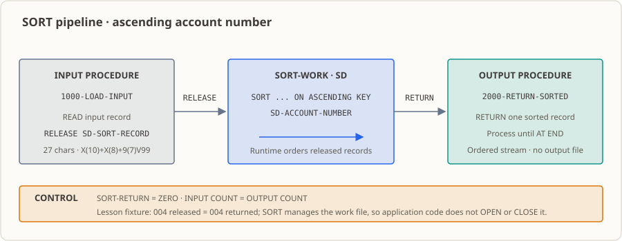

# 第21課：SORTで口座マスターを整列する——未整列入力を整列済み出力へ

第20課の順次照合は、両方の入力が口座番号順に整列済みであることを前提とします。上流から届くマスターは、整列されていないことがあります。この課では `SORT` を使って未整列の4件を並べ替えます。入力手続きが1件ずつ `READ` して `RELEASE` し、出力手続きが `RETURN` すると、口座番号順のレコード流を照合処理へ渡せます。

## 業務の現場

午前2時を少し過ぎたころ、照合作業の第2段階が始まります。口座マスターと当日の取引を一緒に処理する段階です。取引ファイルは発生順に追加されるため整然としています。一方、マスターの順序は一定しません。基幹システムのエクスポート処理は並べ替えず、データページを読み取った順にファイルへ出力します。

運用担当者は共有ディレクトリにファイルを置き、「ファイルはこれです。あとはお願いします」と言います。

このマスターを第20課の照合スキャンへそのまま渡しても、エラーにはなりません。マージスキャンは両方がキー昇順であることを前提にします。順序が乱れていると、実在する口座が相手側にないと判定されることがあります。`口座のみ` と `取引のみ` が、実際には存在しない差分によって増えます。プログラムは終了コード `0` で正常終了し、翌朝、照合担当者は存在しない差分を調べ始めます。

照合の前にファイルを整列する必要があります。この課では、その準備処理を学びます。

（時刻、件数、場面は説明用に作ったもので、実在する機関のデータではありません。）

## 今学ぶ理由

前の課ではファイルの読み書きと、複数ストリームを別々に進める方法を学びました（第15～19課）。第20課ではキー順のマージスキャンで、照合済み、マスターのみ、取引のみを分類しました。ただし、このアルゴリズムには前提があります。**両方のストリームが整列済みであること**です。上流システムが整列済みで出力するとは限りません。

全レコードをメモリーへ読み込んで自分で整列する方法もあります。数百件なら可能ですが、数万件では全件保持とメモリー不足を考慮する必要があります。整列アルゴリズムの性能、同一キー、大量データへの対応も引き受けることになります。これらは業務ルールとは関係ありません。

COBOLでは `SORT` がこの処理を担います。キーとレコードの入出力元を指定し、整列自体は実行環境に任せます。

## 概念と解決する問題

**概念。** `SORT` はレコードを読み込み、キーで整列し、順序どおり返すパイプラインです。ソートキー、入力手続き、出力手続きを用意します。入力手続きは `RELEASE` でレコードをソート作業ファイルへ渡し、出力手続きは `RETURN` で整列済みレコードを取り出します。

**解決する業務上の問題。** 順序を整える処理と、整った順序を使う処理を分離します。上流の順序に関係なく、必要な順序で出力します。照合、マージ、複数ファイル比較はいずれも順序に依存するため、整列処理は一か所で正しく実装します。

**成果物はファイルではありません。** プログラムは出力ファイルを作りません。成果物は整列済みのレコードストリームです。出力手続きが1件ずつ取り出して処理します（この課では表示します）。完全なバッチなら第20課の照合スキャンへ直接渡せます。整列結果のファイル出力は第22課です。

**重複キーの順序を決めつけないこと。** `SORT` が保証するのはキーの昇順です。同じキーのレコードがどちらから先に出るかは規格で定められていません。順序を固定するには第2のキーを宣言します。例えば同じ口座番号の中で残高の降順にします。この課のフィクスチャでは口座番号が一意なので、重複キーの挙動は観察できず、未検証です。

**使わないほうがよい場面。** メモリー上の小さな表や、条件を変えて繰り返し検索するデータには第11～13課の `OCCURS` / `SEARCH` が適します。両ストリームが整列済みでマージだけを行うなら第20課の直接スキャンで十分です。この課ではキー宣言、`RELEASE` / `RETURN` の境界、件数を学ぶため、2つの手続きを使います。`USING` / `GIVING` はそれらを隠すので練習では使いません。

## 修了後にできることと範囲

- ソート作業ファイル（`SELECT ... ASSIGN TO DISK` と `SD`）を宣言し、昇順キーを指定する。
- `INPUT PROCEDURE` で入力を開き、1件ずつ `READ` して `RELEASE` する。
- `OUTPUT PROCEDURE` で `RETURN` により整列済みレコードを取得し、`AT END` で終了する。
- `SORT-RETURN` で成功・失敗を判定し、入力件数と出力件数を確認する。
- ソート作業ファイルを `OPEN` / `CLOSE` してはいけない理由と、結果を第20課の照合入力にできることを説明する。

範囲：整列して表示するだけです。整列結果ファイル、金額集計、照合は扱いません。フィクスチャは口座番号が一意なので同一キー順序を観察できません。ソートキー、重複キー方針、失敗時のバッチ処置はインターフェース上の合意事項です。正式なエラー振り分けは第26課で扱います。

## 実行環境

- GnuCOBOL 3.2.0、標準方言（`-std=cobol85` は付けない）、固定形式ソース。
- Linux端末。データベースや追加ツールは不要。
- `SELECT` は相対ファイル名を使うため、この課のディレクトリから実行します。実行ファイルは `build/` に作ります。

## レコードレイアウトとデータの流れ



[`accounts-unsorted.txt`](./accounts-unsorted.txt) には、未整列の27文字レコードが4件あります。

| フィールド | `PIC` | 長さ |
|---|---|---:|
| 口座番号 | `X(10)` | 10 |
| 顧客番号 | `X(8)` | 8 |
| 残高 | `9(7)V99` | 9 |

暗黙の小数点 `V` は文字数に含まれず、レコード長は `10 + 8 + 9 = 27` です。第17、20課と同じマスターレイアウトです。

プログラムは `SELECT SORT-WORK ASSIGN TO DISK` と `SD SORT-WORK` を宣言します。前者はソート作業ファイル、後者はそのレコードを記述します。通常の入出力ファイルに使う `FD` ではなく `SD` です。

このファイルは `SORT` 文が管理します。**プログラムで `OPEN` / `CLOSE` してはいけません。** 入力手続きは `RELEASE`、出力手続きは `RETURN` を使います。

## ソートの3段階

1. `SORT SORT-WORK ON ASCENDING KEY SD-ACCOUNT-NUMBER` でキーと2つの手続きを指定します。
2. 入力手続き `1000-LOAD-INPUT` が行順入力を開き、1件ずつ読みます。27文字レコードを `SD` 項目へ移し `RELEASE` します。ファイル状態 `10` は正常な終端です。
3. GnuCOBOLが `SD-ACCOUNT-NUMBER` で整列します。
4. 出力手続き `2000-RETURN-SORTED` が `RETURN` を繰り返し、各レコードを表示します。`AT END` はすべて取得済みを意味します。
5. メイン段落が `SORT-RETURN` を確認して入出力件数を表示します。入力読み込みまたはソート失敗なら非ゼロ終了コードです。

件数の不変条件は `入力レコード数 = 出力レコード数` です。この課では `004 = 004`。4件すべてを渡して取得でき、欠落も重複もありません。

## 前提と境界

| 前提 | 保証するもの | この課で検査するか |
|---|---|---|
| 各入力行が27文字レイアウト | フィクスチャ／上流 | いいえ。幅が違うと項目を誤読 |
| 口座番号は先頭ゼロを含む同じ幅 | フィクスチャ設計 | いいえ。同じ幅の文字列順は番号順に一致 |
| 口座番号は一意 | フィクスチャ | いいえ。重複キーは扱わない |
| 同じキーの順序 | 合意なし | **未検証**：重複がないため観察不可。追加キーで決める（発展課題）。 |

最後の項目は重要です。重複データがなければ挙動は観測できません。数件を試して結果を見ただけでは十分な検証になりません。

ソート作業ファイルは `SORT` 文が管理し、プログラムは直接開閉・読み書きしません。入力ファイルは入力手続きで開閉し、出力は端末だけです。整列結果ファイルはありません。

## 実行して確認する

**入力：** 課のディレクトリにある未整列の `accounts-unsorted.txt`（4件）。相対パスを使うため、同ディレクトリから実行します。

```sh
mkdir -p build
cobc -fsyntax-only lesson.cob                  # 構文確認のみ
cobc -x -Wall -o build/lesson_21 lesson.cob    # 実行ファイルを作る
./build/lesson_21                              # 現在のディレクトリのフィクスチャを読む
echo $?                                        # 終了コードを確認
rm -rf build                                   # 実行ファイルを削除
```

期待終了コードは両コマンドとも `0`、診断なしです。標準出力は5行、業務ファイルは作りません。

| 確認項目 | 期待値 |
|---|---|
| `cobc -fsyntax-only` 終了コード | `0` |
| `cobc -x` 終了コード | `0`、コンパイラー診断なし |
| 標準出力 | 5行。4件が口座番号の昇順 |
| プロセス終了コード | `0` |
| 作成される業務ファイル | なし（ソート作業ファイルは実行環境が内部管理） |

```text
ソート済み 口座番号=A000000001 顧客番号=C0001001 残高=0001000.00
ソート済み 口座番号=A000000002 顧客番号=C0001002 残高=0000002.00
ソート済み 口座番号=A000000004 顧客番号=C0001004 残高=0000025.00
ソート済み 口座番号=A000000005 顧客番号=C0001005 残高=0000250.75
入力レコード数=004 出力レコード数=004
```

入力口座番号は `A000000005`、`A000000001`、`A000000004`、`A000000002`。出力は `A000000001`、`A000000002`、`A000000004`、`A000000005` です。整列は順序だけを変え、レコード集合を保ちます。`004 = 004` で欠落も確認できます。

出力ラベルでは `ソート済み` は整列済み、`口座番号` は口座番号、`顧客番号` は顧客番号、`残高` は残高、`入力レコード数` / `出力レコード数` はそれぞれ入出力件数です。

この環境で実行すると標準エラーへ `Warning: program compiled against libxml 212 using older 209` が出ます。リンクライブラリー警告で、プログラムの出力ではありません。原因コンポーネントは特定されていません。

## 変更練習

リポジトリーの `accounts-unsorted.txt` は変更せず、**一時ディレクトリの複製**を使います。

1. 複製の先頭2行を交換します。出力が口座番号順のまま、入出力件数が等しいことを確認します。
2. 元のフィクスチャから新しい複製を作り、口座番号 `A000000006`、顧客番号 `C0001006`、残高数字 `000000001` の27文字レコードを末尾へ追加します。最後に並び、件数が `005` になることを確認します。

詳細は [`exercise.md`](./exercise.md)、解答例は [`answer.md`](./answer.md) にあります。

## 発展課題

ソートキーを追加し、口座番号の昇順、残高の降順で並べます。口座番号が同じで残高が異なるレコードを2件以上用意し、結果を観察します。キーを1つしか宣言しない場合、同一キーの相対順序に依存してよいか説明します。変更後の `SORT` 宣言と全出力を記録してください。`OCCURS` に全件を入れず、2つの手続きを避けるため `USING` / `GIVING` も使わないでください。課題は [`exercise.md`](./exercise.md)。解答はありません。

## 実際の処理フロー

1. 上流が口座マスターと当日取引を出力しますが、順序は保証されません。第19課では2ファイルの同時読み込みを扱いました。
2. **この課で**マスターを `SORT` に通し、キー昇順のストリームを出します。
3. 整列済みの流れを第20課の照合スキャンへ渡し、取引とマージして照合済み／マスターのみ／取引のみを分類します。
4. 結果は検証、ファイル出力、エラー振り分けへ進み、第32課の照合バッチにまとまります。

第2段階と第3段階の間に**ファイルはありません**。整列結果はメモリー内で1件ずつ流れます。この課では表示し、第22課では整列・照合・結果書き込みを一つのプログラムにまとめます。

## 本番で使うとしたら

- **実行：** 夜間バッチスケジューラーが入力準備確認の後、照合ジョブの前に起動します。
- **確認者：** 当番担当者が終了コードと入力／出力件数の一致を確認します。不一致なら当夜に調査します。
- **障害対応：** `SORT-RETURN` 非ゼロや件数不一致を運用担当者へ通知し、開発へ連携します。
- **後続：** 整列済みストリームは照合へ、第22課では結果ファイルへ進みます。
- **起こりやすい事故：** 上流ファイルが整列済みだと思い込むことです。未文書化の順序合意がエクスポート方式変更で崩れ、翌日の照合で発覚します。

この課には結果ファイル、金額集計、拒否分類、本番用再実行・復旧機能はありません。ソートキー、重複キー方針、空ファイル、入力状態、ソート失敗時のバッチ処置は関係者間で合意してください。

## 参考資料

- [GnuCOBOL Programmer’s Guide：File-Based SORT](https://superbol.eu/gnucobpg/chapter7.html#file-based-sort)
- [GnuCOBOL Programmer’s Guide：RELEASE](https://superbol.eu/gnucobpg/chapter7.html#release)
- [GnuCOBOL Programmer’s Guide：RETURN](https://superbol.eu/gnucobpg/chapter7.html#return)
- [GnuCOBOL Programmer’s Guide：SD file description](https://superbol.eu/gnucobpg/chapter6.html#fileasort-description)
- コースホーム：[README.md](../../README.md)
