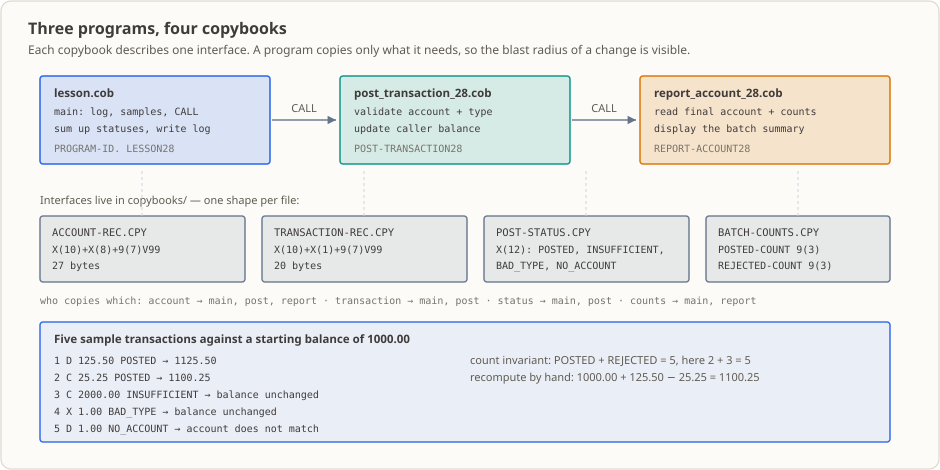

# 第 28 課：モジュール総合——バッチを再現可能にビルドできるプロジェクトにまとめる

本課では新しい構文を教えません。前課までの部品を**一つのプロジェクトに組み立てる方法**を学びます。メインプログラムが制御と件数を管理し、計上と報告を別々のサブプログラムに分け、3 つの間のインターフェースをすべて Copybook から取り込みます。さらに `build.sh` で構文検査、個別コンパイル、リンク、実行、後片付けを 4 つの操作に固定します。つまり、誰もコンパイル順を覚える必要がなく、共有宣言を変更したら全体を再ビルドします。

## 業務の現場

木曜日の午後 4 時、チームリーダーがやって来ます。「清算側が口座レコードにフィールドを 1 つ追加したい。今夜から必要で、後続の報告もそれを使う。」

プロジェクトを開くと、レコード定義はメインプログラムではなく `.CPY` ファイルにありました。「1 か所変えるだけでいい」と、ひと安心します。

しかしその宣言を使っているのは 1 つのプログラムだけではありません。メインプログラム、計上モジュール、報告モジュールが同じ宣言を使います。急いでメインプログラムだけを再コンパイルし、前回の `post_transaction_28.o` と `report_account_28.o` をリンクし直すと、2 つの古いオブジェクトファイルは残高を**以前のバイト位置**にあるものとして扱います。リンカーは止めてくれません。名前や呼び出し形式は確認しますが、同じメモリを双方が同じように解釈しているかまでは見ません。プログラムは動き、終了コードも `0` のままですが、口座残高は間違っています。

本課が解決するのはこの問題です。厄介なのは、**何のエラーも出ない**ことです。コンパイルエラーもファイル状態コードもなく、口座報告の数字は一見もっともらしく見えるかもしれません。誰かが残高の不一致に気付いたときに手元にあるのは実行ファイルだけです。どのオブジェクトファイルを、どの順に使って作ったのか。コンパイル順を記録していないので、その夜には答えられません。

（教育用のデモです。登場人物、時刻、金額は問題の説明用で、実在する機関のデータではありません。）

## この知識項目とは何か、何を解決するか

**この知識項目とは何か。** 平たく言えば、「何でもする」大きなプログラムを 3 つに分けます。メインプログラムは制御と件数を管理し、計上サブプログラムは業務ルールを担当し、報告サブプログラムは結果を読み取って表示するだけです。引数の順番を口頭の取り決めに頼る代わりに、フィールド宣言を Copybook に置き、全モジュールが同じものを `COPY` します。さらにビルドと実行を 4 つのコマンドに固定する入口スクリプトを用意します。技術的には、メインプログラム、呼び出し先のサブプログラム、共有 Copybook からなるモジュール型プロジェクトです。ビルドではモジュールごとにオブジェクトファイルを作り、メインプログラムだけに `-x` を付けて実行ファイルを生成します。

**業務上、何を解決するか。**

- **インターフェース定義を一つにする。** フィールド幅や順序は 1 か所を変更すれば、3 つのモジュールが同じ宣言を使います。節約できるのは入力時間よりも、「変更したのに関係者へ伝え忘れた」という事故です。
- **順序をスクリプトに記録し、記憶に頼らない。** 新人、夜中に呼び出された当直担当者、3 か月後の自分が、同じコマンドを実行します。固定の入口があるからこそ、「今回も前回と同じ手順でビルドした」と言えます。
- **責任範囲を明確にする。** 残高を変更できるのは計上モジュールだけ、件数を変更できるのはメインプログラムだけ、報告モジュールは読み取り専用です。問題が起きたとき、何百行ものコードを探すより「この部分の責任者はどこか」と考えるほうが速くなります。

**いつこのように分割しないか、誤るとどうなるか。**

- ロジックが固まる前にモジュールへ分けると、まだ変化するルールをインターフェースに固定してしまいます。その後の変更ごとに全量再ビルドが必要になり、かえって遅くなることがあります。設計が単純な第 01〜22 課の単一ファイルは、分割しないのが適切な例です。
- コンパイラーが守ってくれると思わないでください。フィールド名や引数の個数といった明らかな不一致はコンパイルやリンクで検出される場合があります。しかし、フィールド幅を変えて 1 つのモジュールしか再コンパイルしなかった場合、`cobc` は確認せず、単に誤った結果を出すことがあります。本当の歯止めは**共有インターフェース定義を一つにし、毎回全量再ビルドすること**です。
- `build.sh` を本番用ビルドシステムと思わないでください。コンパイラーの版を固定せず、ABI を記録せず、成果物の版管理、増分ビルド、依存関係グラフの生成も行いません。本番環境には別の準備が必要です（末尾の「このコードが本番で使われたら」を参照）。

## なぜ今これを学ぶか

第 24 課で `CALL`、第 25 課で `USING` の引数方向、第 23 課で共有宣言、第 26 課で業務拒否とシステム障害の区別、第 27 課でバッチログを学びました。必要な部品はすでに身に付けています。

では本課に残っているのは何でしょうか。構文ではなく、部品をまとめる**規律**です。第 23〜27 課では、Copybook、サブプログラム、ログを単一ファイルのプログラムや最小限のスクリプトで扱いました。どのような順序でコンパイルしてもよく、間違えればすぐに分かりました。しかし実際のプロジェクトはそうはいきません。

- モジュールが 3 つ以上あり、「最初に何をコンパイルし、次に何をするか」を記録しておく必要があります。
- インターフェースは共有されており、1 つの変更がすべての利用側に影響します。「全量再ビルドが必要か」に誰かへ聞かずに答えられなければなりません。
- 実行前に構文検査を通し、実行後は成果物をまとめて削除できる必要があります。そうでなければ、前回の中途半端な生成物がディレクトリにたまり、次に誰もどれを実行しているか確信できなくなります。

「シェルスクリプトを書くというだけでは」と思うかもしれません。そのとおりですが、スクリプトが担うのは次の規律です。**固定の入口、単一のインターフェース定義、再現可能なビルド手順。**

## 本課修了時の能力と限界

本課を修了すると、次のことができます。

- 共有レコードと状態項目を Copybook に置き、メインプログラムとサブプログラムを同じ宣言からコンパイルする。
- バッチ制御、計上ルール、報告を 3 つのプログラム単位に分け、それぞれがどの状態を所有するか説明する。
- `CALL ... USING BY REFERENCE` で更新可能なレコードを渡し、状態項目を書くのは誰か、件数を管理するのは誰かを説明する。
- `build.sh check|build|run|clean` で構文検査、モジュールのコンパイル、リンク、実行、後片付けを行う。
- 標準出力とログを `expected-output.txt`、`expected-batch.log` と 1 行ずつ照合する。

限界：サンプル取引はメインプログラムに固定で書かれており、外部入力ファイルは読みません。ビルドスクリプトは単一マシン上のローカル作業用で、コンパイラーの版、ABI、成果物の版を固定しません。ファイル入力は第 15〜22 課、ログとエラー分類は第 26・27 課、データベースバッチは第 29〜32 課を参照してください。

## 実行環境

- GnuCOBOL 3.2.0、デフォルト方言（`-std=cobol85` は付けない）。ソースは固定形式です。
- Linux 端末 + `bash`。`build.sh` の実行には `PATH` に `cobc` が必要です（別のコンパイラーコマンドを使う場合は `COBC` を設定できます）。
- ビルドディレクトリの既定値は課内の `build/` です（`BUILD_DIR` で変更可能）。`build/` はリポジトリで無視され、`./build.sh clean` で削除できます。プログラムはビルドディレクトリ内で実行するため、`batch.log` とオブジェクトファイルもそこに置かれます。

## プロジェクトの構成




| ファイル | 役割 |
|---|---|
| [`lesson.cob`](./lesson.cob) | メインプログラム：ログを開き、口座を初期化し、5 件のサンプル取引を用意し、計上モジュールを `CALL` し、状態を集計してログを書く |
| [`post_transaction_28.cob`](./post_transaction_28.cob) | 計上モジュール `POST-TRANSACTION28`：口座番号と種別を検証し、成功時は呼び出し元の残高を更新し、結果を状態項目で返す |
| [`report_account_28.cob`](./report_account_28.cob) | 報告モジュール `REPORT-ACCOUNT28`：最終口座とバッチ件数を読み取り、表示する |
| `copybooks/ACCOUNT-REC.CPY` | 口座レコード：口座番号 `X(10)`、顧客番号 `X(8)`、残高 `9(7)V99`（計 27 バイト） |
| `copybooks/TRANSACTION-REC.CPY` | 取引レコード：口座番号 `X(10)`、種別 `X`、金額 `9(7)V99`（計 20 バイト） |
| `copybooks/POST-STATUS.CPY` | 計上結果の状態 `X(12)`：`POSTED`、`INSUFFICIENT`、`BAD_TYPE`、`NO_ACCOUNT` |
| `copybooks/BATCH-COUNTS.CPY` | バッチ件数：`POSTED-COUNT`、`REJECTED-COUNT`（各 `9(3)`） |
| [`build.sh`](./build.sh) | ビルド・実行の入口（`check` / `build` / `run` / `clean`） |

インターフェースはすべて `copybooks/` に置き、3 つのプログラムはそれぞれ必要なものだけ `COPY` します。大きな Copybook 1 つにまとめず、なぜ 4 つに分けるのでしょうか。それぞれが**1 つの**インターフェースの形だけを定義するからです。口座レコード、取引レコード、計上状態、バッチ件数のどれを変更すると、どの範囲に影響するかすぐ分かります。

- 口座レコードは 27 バイト = `X(10)` + `X(8)` + `9(7)V99`。メイン、計上、報告の各モジュールが使います。
- 取引レコードは 20 バイト = `X(10)` + `X(1)` + `9(7)V99`。メインと計上モジュールが使います。
- 状態 `X(12)` は最長の `INSUFFICIENT` を格納でき、メインと計上モジュールが使います。
- 件数は `9(3)` が 2 個なので `002`、`003` と表示されます。メインと報告モジュールが使います。

`9(7)V99` の `V` は**暗黙の小数点**であり、バイトを占めません。そのため 27 バイトと 20 バイトの幅は、どちらも 9 桁の数字だけを数えています。金額は常にこの十進フィールドの契約で渡し、`BINARY-LONG` のようなプラットフォーム依存の二進レイアウトは混ぜません。どのモジュールから見ても「残高」は同じ十進数字の並びです。

## `build.sh` の 4 つの操作

```sh
./build.sh check    # 组合语法检查，不生成任何产物
./build.sh build    # 编译两个子程序为 .o，再链接出 build/lesson_28
./build.sh run      # 构建后在 build/ 里运行，输出与 batch.log 都落在 build/
echo $?             # 查看退出码
./build.sh clean    # 删除 build/（可执行文件、目标文件与日志）
```

各操作の内容を説明します。

- **`check`** は `cobc -I copybooks -fsyntax-only` を呼び出し、3 つのソースをまとめて構文検査します。ファイルは作らず、「解析できるか」だけを確認します。
- **`build`** はまず `check` を実行し、2 つのサブプログラムを個別に `.o` ファイルへコンパイルしてから、`-x` を使ってメインプログラムと 2 つのオブジェクトを `build/lesson_28` にリンクします。
- **`run`** は先に `build` を行い、`build/` に移動して実行ファイルを起動します。`batch.log` は相対ファイル名を使うため、**実行時のカレントディレクトリ**である `build/` に出力されます。
- **`clean`** は `rm -rf build` を実行し、実行ファイル、2 つの `.o`、ログを削除します。

書き残しておかないと間違えやすい点があります。

- `build` は毎回 3 つのソースを最初からコンパイルします。このガードの価値はここにあります。スクリプトを使えば、「新しいメイン + 昨日の古い `.o`」を誤って組み合わせられません。
- 無効な操作名（たとえば `./build.sh unknown`）を指定すると、使い方を表示して `64` を返します。
- `PATH` に `cobc` がない場合、または `COBC` に存在しないコマンドを指定した場合は `127` を返します。

## 5 件の取引を順にたどる

口座の初期残高は `1000.00` です。5 件のサンプル取引は、入金 `125.50`、出金 `25.25`、残高超過の出金 `2000.00`、未知の種別 `X`、存在しない口座 `A000000099` への入金です。成功するのは最初の 2 件だけです。

| 番号 | 種別 | 金額 | 結果状態 | 理由 |
|---:|---|---:|---|---|
| 1 | `D` | 125.50 | `POSTED` | 入金成功 |
| 2 | `C` | 25.25 | `POSTED` | 残高が十分 |
| 3 | `C` | 2000.00 | `INSUFFICIENT` | 現在の残高を超過。残高は変わらない |
| 4 | `X` | 1.00 | `BAD_TYPE` | 種別が `D`/`C` ではない |
| 5 | `D` | 1.00 | `NO_ACCOUNT` | 口座番号がマスターと一致しない |

件数の不変条件は `記帳 + 拒否 = 5` で、本課では `2 + 3 = 5` です。残高も手計算で確認できます。`1000.00 + 125.50 − 25.25 = 1100.25`。

拒否コード 3 種の**性質**をもう一度確認します。特に「プログラムが壊れた」と誤解しやすいからです。`INSUFFICIENT`、`BAD_TYPE`、`NO_ACCOUNT` はすべて**業務上の結果**で、ビルドやファイルシステムの障害ではありません。残高超過の出金は `INSUFFICIENT` を返して残高を変えず、未知の種別は `BAD_TYPE`、口座番号の不一致は `NO_ACCOUNT` を返します。バッチは通常どおり終了し、終了コードは `0` です。

## ソースの読み方

上から 1 行ずつ読むより、「データがどう流れ、状態を誰が変更するか」の順で読むほうが速く理解できます。

1. `0000-MAIN`（[`lesson.cob`](./lesson.cob#L31)、31〜53 行目）：まずログを開きます。ログが正常に開き I/O 障害がない場合だけ、口座と件数を `INITIALIZE` し、5 件の取引を実行して `CALL "REPORT-ACCOUNT28"` を呼び、最後に `BATCH_END` を書いてログを閉じます。`WS-IO-ERROR` または `WS-UNKNOWN-STATUS` が `Y` なら `RETURN-CODE` を `1` にします。
2. `1000-INITIALIZE-BATCH`（54〜58 行目）：口座 `A000000001`、顧客 `C0001001`、残高 `1000.00` を初期化します。本課のデータ源はここだけです。例はここおよび 1100〜1500 の 5 つの設定段落に固定で書かれています。
3. `2000-CALL-POSTER`（84〜98 行目）：各取引の共通呼び出し箇所です。まず `WS-POST-STATUS` を空白にします。これをしないと前の取引の状態が `X(12)` に残ります。続けて口座レコード、取引レコード、状態の 3 項目を `CALL "POST-TRANSACTION28" USING BY REFERENCE` で渡します。
4. `2100-REPORT-RESULT`（99〜114 行目）：`EVALUATE` で状態を分けて件数を更新します。`POSTED` は `記帳` を加算し、3 つの拒否コードは `拒否` を加算します。`WHEN OTHER` は未知状態を記録してゼロ以外の終了コードにします。表示時は `FUNCTION TRIM(... TRAILING)` で `X(12)` の末尾空白を除きます。そうしないと `POSTED` の後ろに空白が並んで見えます。
5. [`post_transaction_28.cob`](./post_transaction_28.cob#L15)（15〜38 行目）：まず口座番号を比較し、不一致なら `NO_ACCOUNT`。一致したら種別を確認します。`D` は残高を加算し、`C` は残高を検査し、それ以外は `BAD_TYPE` です。**残高を変更できるのはこのモジュールだけ**で、件数やログには触れません。
6. [`report_account_28.cob`](./report_account_28.cob#L13)（13〜20 行目）：口座と件数を読み取り、2 行を表示するだけです。読み取り専用の利用側はこのような形になります。
7. `1050-RUN-TRANSACTIONS`（115〜128 行目）：5 件を順に実行し、各取引の前に `WS-IO-ERROR` を確認します。ログ書き込みに失敗したらそこで止まり、後続取引は計上しません。

## 実行と観察

**入力：** 外部入力はありません。5 件のサンプル取引はメインプログラムに固定で書かれています。

**コマンドと用途：** 前節の 4 操作を使います。見落としやすい点は 2 つです。`check` は成果物を作らず、`run` は実行前に再ビルドします。

**期待結果：**

| 観察項目 | 期待値 |
|---|---|
| `./build.sh check` の終了コード | `0`、診断なし |
| `./build.sh build` の終了コード | `0`、コンパイラー警告なし |
| `./build.sh run` の終了コード | `0` |
| 標準出力 | 12 行。[`expected-output.txt`](./expected-output.txt) と全行一致 |
| `build/batch.log` | 7 行。[`expected-batch.log`](./expected-batch.log) と全行一致 |
| 生成ファイル | `build/lesson_28`、2 つの `.o`、`build/batch.log` |

```text
呼出=過帳 口座=A000000001 TYPE=D 金額=0000125.50
呼出=戻り 状態=POSTED
呼出=過帳 口座=A000000001 TYPE=C 金額=0000025.25
呼出=戻り 状態=POSTED
呼出=過帳 口座=A000000001 TYPE=C 金額=0002000.00
呼出=戻り 状態=INSUFFICIENT
呼出=過帳 口座=A000000001 TYPE=X 金額=0000001.00
呼出=戻り 状態=BAD_TYPE
呼出=過帳 口座=A000000099 TYPE=D 金額=0000001.00
呼出=戻り 状態=NO_ACCOUNT
口座=A000000001 CUSTOMER=C0001001 BALANCE=0001100.25
集計 記帳=002 拒否=003
```

**出力ラベルの対訳（実際のラベル → 意味）：** `呼出=過帳` は計上呼び出しを発行（`口座` は口座番号、`TYPE` は種別、`金額` は金額）、`呼出=戻り 状態` は呼び出しから返った状態、`口座`/`CUSTOMER`/`BALANCE` は最終口座報告、`集計 記帳=.. 拒否=..` は計上・拒否件数の集計です。

**`build/batch.log`：**

```text
EVENT=BATCH_START ID=TRAINING-001
EVENT=TRANSACTION NO=001 ACCOUNT=A000000001 TYPE=D STATUS=POSTED
EVENT=TRANSACTION NO=002 ACCOUNT=A000000001 TYPE=C STATUS=POSTED
EVENT=TRANSACTION NO=003 ACCOUNT=A000000001 TYPE=C STATUS=INSUFFICIENT
EVENT=TRANSACTION NO=004 ACCOUNT=A000000001 TYPE=X STATUS=BAD_TYPE
EVENT=TRANSACTION NO=005 ACCOUNT=A000000099 TYPE=D STATUS=NO_ACCOUNT
EVENT=BATCH_END POSTED=002 REJECTED=003 IO_ERROR=N
```

標準出力とログの行数をそれぞれ数えます。画面は 5 取引 × 2 行 + 口座報告 1 行 + 件数 1 行 = 12 行。ログは `BATCH_START` + 取引イベント 5 行 + `BATCH_END` = 7 行です。ログの `NO=003` の状態は、画面の 4 行目 `呼出=戻り` にある `INSUFFICIENT` と一致しなければなりません。異なれば、件数またはログが同じ状態値から作られておらず、バグです。

### 証拠の出典と検証範囲

| シナリオ | クリーンな開始状態 | 期待値 | 実行コマンドと観察結果 | 結論 |
|---|---|---|---|---|
| 正常経路 | `./build.sh clean` 後で `build/` なし | 3 操作すべて終了コード `0`、標準出力 12 行、ログ 7 行 | `./build.sh check`、`build`、`run` の後、2 つの期待ファイルと `diff` | 差分なし。一致 |
| 引数エラー | なし | 使用法を表示して `64` を返す | `./build.sh unknown` | 一致 |
| コンパイラーコマンドなし | なし | `127` を返す | `COBC=no-such-cobc-xyz ./build.sh check` | 一致 |
| ログを開けない | `build/` 内の `batch.log` をディレクトリにして実行 | 終了コード `1`、計上モジュールを呼び出さない | 標準出力は `エラー=ログOPEN 状態=37` の 1 行だけ | 一致 |
| 練習 1 | 元のソースで `1300-POST-OVERDRAFT` の `2000.00` を `1000.00` に変更 | 残高 `0000100.25`、`記帳=003 拒否=002` | `./build.sh run` を実行し、ログの `NO=003` が `POSTED` になることを確認 | 一致 |
| 練習 2 | 元のソースで `1400-POST-UNKNOWN-TYPE` の種別 `"X"` を `"D"` に変更 | 残高 `0001101.25`、`記帳=003 拒否=002` | `./build.sh run` を実行し、ログの `NO=004 ... TYPE=D STATUS=POSTED` を確認 | 一致 |

**未検証の項目（結論として扱わないこと）：**

- **標準エラーに出る `Warning: program compiled against libxml 212 using older 209`。** 実行環境のリンクライブラリの版違いによる警告で、業務出力ではありません。発生元のコンポーネントは特定しておらず、課の結果確認にも不要なので調査していません。実際のプログラム出力は標準出力にあり、終了コードは `0` です。
- **ログの WRITE/CLOSE 失敗の動作はソースコード上の根拠だけで、実行していません。** 安定して検証するには、`OPEN` は受け付けるが `WRITE` を拒否する出力先が必要です。本課にはそのフィクスチャがありません。
- **計上モジュールが未知状態を返す分岐は、サンプルでは到達できません。** サブプログラムが書き込むのは 4 つの固定値だけで、外部入力から 5 つ目の値を作れません。そのため「拒否に数えて終了コードをゼロ以外にする」動作もソースコードだけが根拠です。
- **「Copybook を変えた後、メインだけを再コンパイルすると計上を誤る」はリスクの説明であり、本課の実測結果ではありません。** スクリプトは毎回全量再ビルドするため、意図して古い `.o` を残し、メインだけを手動コンパイルする比較実験は行っていません。実測結果ではなく、本番事故の教訓として理解してください。

## ビルドエラーとログエラー

- ログを開けないと、メインプログラムは `エラー=ログOPEN 状態=37` を報告し、終了コード `1` で終わります。**計上サブプログラムは呼び出しません**（実測済み）。
- ログの WRITE または CLOSE が失敗した場合も、コードはシステムエラーを設定して `1` を返します（ソース上の説明。未注入）。
- `BATCH_END` はログを閉じる**前**に書きます。その後ログの CLOSE が失敗しても、最終行は `IO_ERROR=N` のままかもしれません。その場合は標準出力と終了コードを基準にします（ソース上の説明）。
- ログ自身の OPEN が失敗するとログには書けず、標準出力と終了コードだけで報告します。これはログの固有の境界で、実装上の欠陥ではありません（実測済み）。
- 計上モジュールが未知状態を返すと、メインプログラムは拒否として数えてゼロ以外の終了コードにします（ソース上の説明。サンプルでは到達不能）。

## 変更練習

どちらも元のソースから始めます。`./build.sh run` を再実行し、サブプログラムをコンパイルし直してメインプログラムを再リンクしてください。

1. `1300-POST-OVERDRAFT` の金額を `2000.00` から `1000.00` に変えます。出金が成功し、残高は `0000100.25`、件数は `記帳=003 拒否=002` となり、ログ `NO=003` の状態は `INSUFFICIENT` から `POSTED` に変わります。
2. `1400-POST-UNKNOWN-TYPE` の種別を `"X"` から `"D"` に変えます。未知種別による拒否が有効な入金に変わり、残高は `0001101.25`、件数は `記帳=003 拒否=002` になります。ログ `NO=004` の種別と状態は `TYPE=D STATUS=POSTED` に変わります。

どちらもソースを変更してスクリプトを実行するため、全量再ビルドの目的を確認できます。省略すると、変更したソースと実行したプログラムが一致しません。設問と期待結果は [`exercise.md`](./exercise.md)、参考解答は [`answer.md`](./answer.md) を参照してください。

## 応用練習

サンプル取引をファイル入力に変更し、「読み込み / EOF / 不正レコードの分類」を独立したモジュールに移してください。口座、取引、状態の Copybook を唯一のインターフェース定義として使います。Copybook を変更した後、影響するすべてのモジュールを再コンパイルしてリンクする方法を説明してください。業務拒否をコンパイル失敗のように見せず、Copybook にすでにあるレコードレイアウトを再定義しないこと。問題は [`exercise.md`](./exercise.md)、解答はありません。

## 実際の処理をたどる

夜間処理の全体では、本課は「部品」と「プロジェクト」の間に位置します。

1. **上流はファイルバッチです。** 取引をファイルから読み、EOF と不正レコードを処理する方法は[第 15 課](../15_sequential-file-read/README.md)から[第 22 課](../22_file-processing-practice/README.md)で扱います。本課のサンプルはまだプログラム内に固定されているため、ファイル入力への変更は上の応用練習です。
2. **本課が渡すのはロジックの断片ではなくプロジェクトです。** 成果物は、コンパイル可能な 3 つのモジュール、共有インターフェース定義 1 つ、固定されたビルドコマンド 1 つです。次の[第 29 課](../29_embedded-sql/README.md)では `lesson.cob` の位置にデータベースのスナップショットを組み込みます。ここで決めたモジュール境界と Copybook の契約を利用します。
3. **ログは当直と照合を支えます。** `batch.log` の形式とイベント分類は[第 27 課](../27_logging/README.md)で決めました。本課では各取引の状態とバッチ件数を同じ契約に書き、翌日に上流の件数と照合できるようにします。
4. **インターフェースの変更履歴を追います。** メインと 2 つのサブプログラム間の引数順、方向、状態値は[第 23 課](../23_copybooks/README.md)から[第 25 課](../25_using-parameters/README.md)で作ってきました。プロジェクトとして組み立てた後は、インターフェースを変更するたびに `check` と `build` を再実行します。「ソースを変更して git にコミットした」だけでは終わりません。
5. **さらに先では、**[第 29〜31 課](../29_embedded-sql/README.md)で実際の SQL、カーソル、ファイルとデータベースの同期を加え、[第 32 課](../32_bank-reconciliation-project/README.md)で全体を一つのプロジェクトにまとめます。

一言で言えば、本課は機能を追加するのではなく、これまでの部品について**どこから来て、どう組み合わせ、どう再構築するか**を決めます。

## このコードが本番で使われたら

- **誰がスケジュールするか：** 夜間スケジューラーです。画面ではなく、ビルド成果物のパスと終了コードを見ます。`build.sh` は人と CI 用で、スケジューラーが実行するのはそれが作った `lesson_28` です。
- **誰が出力とログを見るか：** 当直担当者がまず終了コードを確認し、次に `batch.log` の最後の `EVENT=BATCH_END POSTED=.. REJECTED=.. IO_ERROR=..` を見ます。`IO_ERROR=N` でも正常とは限りません。上のログ CLOSE 失敗が反例です。
- **障害時に誰が呼び出されるか：** 終了コードがゼロ以外なら担当者が呼び出されます。最初に「業務拒否」（拒否件数に加算され、終了コードは `0` のまま）と「システム障害」（ログを開けない、書き込み失敗、未知の状態コード）を区別してください。混同すると、顧客の残高不足 1 件で夜中に担当者を呼び出しかねません。
- **次のシステムへの受け渡し：** 本課には出力ファイルがなく、結果は画面とログだけです。実際の処理では計上結果をファイルへ書く（[第 16 課](../16_file-writing/README.md)、[第 22 課](../22_file-processing-practice/README.md)）か、データベースへ保存します（[第 29 課](../29_embedded-sql/README.md)以降）。
- **最初の 1 か月に起こりやすい事故：** 冒頭のケースです。共有宣言を変更したのにメインプログラムしか再コンパイルせず、古い `.o` が古いレイアウトを使い、口座の値を黙って誤ります。2 つ目は「ローカルでコンパイルできた」を「本番用のビルドが整った」と考えることです。
- **まだ実装していないこと：** 成果物の版がない、コンパイラーの版とオプションを固定しない、増分ビルドや依存グラフがない、ログに時刻や一意な実行 ID がない、再実行の冪等性がない、サンプル取引がプログラムに固定されていることです。

本番ビルドには、コンパイラーの版とオプションの固定、モジュール一覧の管理、成果物のバージョンとリリース先、CI で同じ `check`/`build` を実行する手順も必要です。本課が示すのは「ローカルで再現可能なビルド」だけで、残りは実装していません。データベースバッチのビルドとツールチェーンは第 29〜32 課を参照してください。

## 参考資料

- [GnuCOBOL Programmer’s Guide：COPY](https://gnucobol.sourceforge.io/HTML/gnucobpg.html#COPY)
- [GnuCOBOL Programmer’s Guide：CALL](https://gnucobol.sourceforge.io/HTML/gnucobpg.html#CALL)
- [GnuCOBOL Programmer’s Guide：PROCEDURE DIVISION USING](https://gnucobol.sourceforge.io/HTML/gnucobpg.html#PROCEDURE-DIVISION-USING)
- [GnuCOBOL Programmer’s Guide：FILE STATUS](https://gnucobol.sourceforge.io/HTML/gnucobpg.html#SELECT)
- リポジトリのコースホーム：[README.md](../../README.md)
