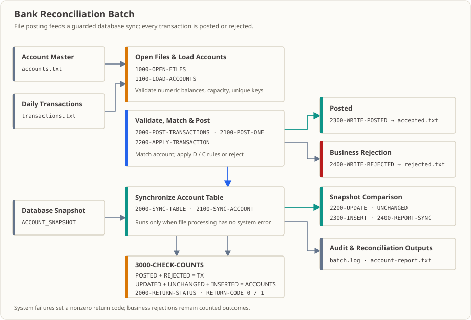

# 第 32 課：銀行口座の照合バッチ——総合課題：ファイル記帳とデータベース同期

## 業務現場

午前 1 時 20 分、日次締めバッチは最後の工程に差しかかっています。手元には 2 つのデータがあります。

- 基幹システムが出力した**取引ファイル**——今日何があったか（入金、出金、振込）が入力順に並び、順序は未整列です。
- システムの主データベースにある**口座スナップショット**——現在記録されている残高です（本課では SQLite を使います。実際の環境では、シェルにすらアクセスできないホストかもしれません）。

順序を間違えずに 2 つの処理を行います。まず取引を口座マスターに適用して、各口座の**あるべき残高**を計算し、受理・拒否の明細を書きます。次に、その結果をデータベースへ同期します。

翌朝には 3 つの担当者から成果物を求められます。

1. **照合担当**は、計算した残高を上流から報告された件数・金額と照合します。
2. **運用担当**は、拒否明細を使って「昨日の振込が入金されていないのはなぜですか」という顧客の質問に答えます。
3. **後続システム**は受理ファイルを受け取り、記帳処理を続けます。

したがって、この工程の合格基準は「プログラムが最後まで動いた」ことではなく、**このバッチを引き渡せること**です。すべての取引に行き先があり、各件数の意味が通り、障害時に何が残ったかを把握できなければなりません。

先に都合の悪い点を明らかにしておきます。2 つの出力ファイルは上書きされます。途中でプロセスが停止すると、ディレクトリには**途中までの結果**が残ります。ロールバックはなく、「失敗時は以前のファイルを残す」という動作もありません。したがって、引き渡す前に件数と行数を必ず確認します。

（機関、時刻、金額は教育用の例であり、実在する機関のデータではありません。）

## なぜ今これを学ぶか

これまでの各課では、ファイル読み込み、ソート、照合、分類、結果の書き出し、データベース接続のように、1 つの能力を確認してきました。それぞれを単独で見ると難しくありません。

難しいのは、**これらすべてを 1 つのバッチとして引き渡すこと**です。ファイル側とデータベース側の結果が照合でき、障害時には説明可能な記録が残り、再実行で金額が二重に加算されないようにする必要があります。本課で一連の工程をまとめ、コース全体の総合課題に取り組みます。最初の 31 課で身につけた技術を、ここで初めて同時に使います。

## この知識項目とは何か、何を解決するか

**この知識項目とは何か。** 個別のバッチ処理工程をつなぎ、ビルド・再実行・照合ができるプロジェクトにします。ファイル記帳とデータベース同期を行う 2 つの COBOL サブプログラム、メインプログラム、共有 Copybook を用意します。`build.sh` がコンパイル、リンク、実行ディレクトリの準備、実行、クリーンアップを担います。さらに `check.sh` で正常系、再実行、ファイル欠落、SQL の途中失敗などのシナリオを実行します。

**業務上、何を解決するか。**

- **すべてのレコードに結果がある：** `記帳 + 拒否 = 取引`、`更新 + 変更なし + 挿入 = 口座`。この 2 つの式があれば、チームリーダーから漏れがないか聞かれたとき、バッチを再実行せずに件数を示せます。
- **障害を説明できる：** 業務上の拒否は理由（`INSUFFICIENT` / `BAD_TYPE` / `NO_ACCOUNT`）とともに拒否ファイルへ出力し、システム障害では終了コードが非ゼロになります。翌日の調査担当者は画面ではなくファイルを確認できます。
- **再実行しても二重記帳しない：** 実行のたびに固定の期首残高から再計算するので、同じ入力を 10 回実行してもデータベース残高は同じです。

**これだけでは足りない場合。** これはトランザクションでも、本番向けの解決策でもありません。ファイル出力とデータベース書き込みは原子的な処理にまとめられていません。`check.sh` では、SQL が途中で失敗したとき、それ以前の SQL 文がすでに反映されており、正しい残高に戻すには再実行が必要なことを確認します。実際のシステムには、バッチ ID、入力チェックサム、並行制御、出力の原子的な引き渡し、運用アラートなども必要です（後述の「障害・復旧と本番運用の境界」を参照）。

## 本課修了時の能力と限界

本課を修了すると、次のことができます。

- 複数の COBOL プログラム、Copybook、固定幅ファイル、Embedded SQL を組み合わせ、スクリプトでビルドできるバッチプロジェクトを作る。
- 業務上の拒否とシステム障害を区別する。残高不足、未知の種別、未知の口座は拒否ファイルへ出力し、ファイルまたは SQL の障害ではプロセスが非ゼロの終了コードを返す。
- 口座番号をキーに、ファイルから計算した結果をデータベースのスナップショットと比較し、更新・変更なし・挿入を個別に処理する。
- 件数の不変条件を照合して、再実行の結果を確認する：`記帳 + 拒否 = 取引`、`更新 + 変更なし + 挿入 = 口座`。
- ファイルとデータベースの間にある復旧上の境界と、なぜこれが**原子的コミットではないか**を説明する。

限界：本プロジェクトは教育用の一方向同期であり、SQLite は再現可能なデモにのみ使います。分散トランザクション、バッチ ID、入力チェックサム、並行制御、運用アラートはありません。入力を再生すると固定の期首残高から再計算するため、取引が二重に加算されることはありません。本番化に必要な制御は後述します。

## 実行環境

- Linux + GnuCOBOL 3.2.x（`cobc`）、GCC、`sqlite3`。
- **プリコンパイラとランタイムライブラリ：** GixSQL 1.0.20b（第 29 課と同じツールチェーン）。未インストールの場合は、先に**第 29 課のディレクトリ**で `../29_embedded-sql/install-toolchain.sh` を実行します。本課の既定パスは `../29_embedded-sql/build/toolchain/usr` です。`GIXSQL_ROOT` で変更できます。
- ビルドおよび実行生成物は本課の `build/` に置かれます（`BUILD_DIR` で変更可能）。このディレクトリはリポジトリで無視されます。
- 前提知識：第 20 課、第 23〜31 課を完了し、`cobc`、Bash、SQLite、`CALL` / `COPY` / Embedded SQL を使えること。所要時間の目安は 3〜4 時間です。

## プロジェクトの入力と業務ルール

プログラムは行順ファイルを 2 つ読み込みます。各レコードは固定幅で、区切り文字はありません。

| ファイル | 幅 | フィールド位置 | ルール |
|---|---:|---|---|
| `accounts.txt` | 27 文字 | 1〜10 口座番号；11〜18 顧客番号；19〜27 残高（セント） | 口座番号は一意；口座は最大 20 件；残高は数字であること |
| `transactions.txt` | 20 文字 | 1〜10 口座番号；11 取引種別；12〜20 金額（セント） | `D` は入金；`C` は出金；金額は数字であること |

金額は整数のセントで受け渡します。たとえば `000012550` は 125.50 を表します。プログラムは金額を `S9(7)V99 COMP-3` に変換し、結果では編集項目を使って小数点以下 2 桁で表示します。

処理ルール：

1. 先に口座マスター全体をメモリ内テーブルに読み込みます。口座の重複、20 件超過、マスター残高の不正はバッチ障害です。
2. 取引ごとにマスター内の口座を検索します。`D` は残高を加算し、`C` は残高が足りる場合にだけ減算します。
3. 数字以外の取引金額、未知の口座、残高不足、未知の種別は業務上の拒否です。`rejected.txt` に書き込み、バッチ自体は正常終了できます。
4. 受理した取引は `accepted.txt` に書き込みます。ファイル処理でシステム障害がなかった場合に限り、データベース同期を開始します。
5. 口座マスターの各口座について、口座番号で `ACCOUNT_SNAPSHOT` を検索します。顧客番号と残高が両方一致すれば `UNCHANGED`、行はあるがどちらかが異なれば `UPDATED`、検索が SQLCODE 100 を返したら挿入して `INSERTED` とします。

これは教育用の一方向同期です。ファイル内の口座マスターと今回の取引から最終残高を計算し、データベースのスナップショットに書き込みます。入力を再生すると同じ固定マスター残高から再計算するので、同じ取引をデータベース残高に二重加算することはありません。

## ビルドと実行

Linux、GnuCOBOL（`cobc`）、GCC、SQLite（`sqlite3`）、および第 29 課で検証済みの GixSQL 1.0.20b プリコンパイラ、SQLite ドライバー、ランタイムライブラリが必要です。未インストールの場合は、先に第 29 課のディレクトリで `../29_embedded-sql/install-toolchain.sh` を実行します。既定のパスは `../29_embedded-sql/build/toolchain/usr` です。別の場所にインストールした場合は `GIXSQL_ROOT` を設定してください。

```sh
../29_embedded-sql/install-toolchain.sh
./build.sh check
./build.sh build
./build.sh run
./build.sh run-existing
```

- `check` は `gixpp` で SQL をプリプロセスし、その後 `cobc` でドライバー、ファイルモジュール、SQL モジュールを検査します。
- `build` は 2 つのサブプログラムをコンパイルし、`lesson_32` にリンクします。
- `run` は `build/lesson32.db` を再作成して `schema.sql` を適用し、入力フィクスチャを `build/run/` にコピーした後、プログラムを実行します。
- `run-existing` はデータベースを保持したまま、実行ディレクトリの入力ファイルだけをリセットして再実行し、既存データベースに対する再生の挙動を確認します。
- `./check.sh` は一時ディレクトリで、正常系、拒否、更新・変更なし・挿入、SQL エラー、復旧、入力ファイル欠落のシナリオを実行します。
- `./build.sh clean` は本課の `build/` にある生成物を削除します。

`fixtures/` のデータを変更したら `./build.sh run` を実行します。新しいフィクスチャがコピーされ、データベースも再作成されます。`run-existing` もフィクスチャをコピーしますが、再生確認のためデータベースは保持します。生成ファイルの確認には `build/run/` を使います。次回スクリプトを実行するとこのディレクトリは再作成されます。生成物は `.gitignore` で除外されます。

## 標準実行結果

`./build.sh run` の標準出力：

```text
POSTED TX=001 ACCOUNT=A000000001 TYPE=D BALANCE=0001125.50
POSTED TX=002 ACCOUNT=A000000001 TYPE=C BALANCE=0001100.25
REJECTED TX=003 ACCOUNT=A000000003 REASON=INSUFFICIENT
REJECTED TX=004 ACCOUNT=A000000005 REASON=BAD_TYPE
REJECTED TX=005 ACCOUNT=A000000009 REASON=NO_ACCOUNT
接続=成功
SYNC UPDATED ACCOUNT=A000000001 BALANCE=0001100.25
SYNC UNCHANGED ACCOUNT=A000000003 BALANCE=0000002.00
SYNC UNCHANGED ACCOUNT=A000000005 BALANCE=0000250.75
切断=成功
集計 口座=03 取引=005 記帳=002 拒否=003 更新=001 変更なし=002 挿入=000
```
**出力ラベルの対照（実際のラベル → 意味）：** `POSTED` = 取引を記帳済み（`TX` は連番、`ACCOUNT` は口座番号、`TYPE` は種別、`BALANCE` は記帳後残高）；`REJECTED` = 業務上の拒否で、`REASON` は `INSUFFICIENT`（残高不足）/`BAD_TYPE`（未知の種別）/`NO_ACCOUNT`（マスターに口座がない）；`接続=成功` / `切断=成功` = データベース接続／切断に成功；`SYNC UPDATED` / `SYNC UNCHANGED` / `SYNC INSERTED` = データベース同期結果（更新／変更なし／挿入）；`集計 口座/取引/記帳/拒否/更新/変更なし/挿入` = 口座数／取引数／記帳数／拒否数／更新数／変更なし数／挿入数。

環境によっては、GixSQL ランタイムが libxml のバージョン警告を標準エラーに出力します。プログラムの標準出力には含まれません。`check.sh` が比較するのは stdout のみです。

生成ファイルは `build/run/` にあります。`accepted.txt` には受理された記帳が 2 件、`rejected.txt` には業務上の拒否が 3 件、`account-report.txt` にはデータベース同期結果が 3 件記録されます。`batch.log` にはバッチ開始、各取引の判定、データベース接続、同期終了が順に記録されます。SQLite の `ACCOUNT_SNAPSHOT` テーブルにある口座 A000000001 の最終残高は 1100.25 です。

2 回目に `./build.sh run-existing` を実行すると口座残高は変わらず、集計は次のようになります。

```text
集計 口座=03 取引=005 記帳=002 拒否=003 更新=000 変更なし=003 挿入=000
```

データベースに A000000005 がない場合、初回の同期では `SYNC INSERTED` が出力されます。再実行すると同じ口座は `UNCHANGED` になります。

## ソースコードの読み方

ソースは従来の固定形式です。以下では宣言と段落ごとに各プログラムの役割を説明します。連続する `MOVE` / `COMPUTE` / `IF` / `WRITE` 文は、それぞれフィールド移動、金額変換、分岐判断、永続化を行います。

### `lesson.cob`：メインプログラム

- プログラム宣言部ではプログラム名を定義し、`BATCH-INTERFACE.CPY` を取り込みます。`WS-ACCOUNT-TABLE` は固定 20 行の共有テーブル、`WS-BATCH-COUNTS` は取引とデータベース同期の件数、`WS-CHECK-COUNT` は検査用の一時数値です。
- メインフローでは `INITIALIZE` でテーブルと件数を初期化し、失敗フラグを明示的に `N` にします。`CALL ... BY REFERENCE` で同じデータ領域を `LOADPOST32` に渡します。共有失敗フラグが `Y` でない場合に限って `SYNCDB32` を呼び出します。その後、件数を検査し、集計を表示し、プロセスの戻りコードを設定します。
- 集計段落は固定形式の集計を表示します。編集項目の `PIC 99` / `PIC 999` により件数の先頭にゼロが付きます。
- 失敗処理段落はシステム障害を `RETURN-CODE` の 1 に対応させます。業務上の拒否では失敗フラグが変わらないため、戻り値は 0 になり得ます。
- 最終検査段落では 2 つの不変条件を確認します。`POSTED + REJECTED = TX`、および同期成功時の `UPDATED + UNCHANGED + INSERTED = ACCOUNTS` です。いずれかが成立しない場合はエラーを報告してプロセスを失敗させます。
- プログラムのコメントにはファイル契約、モジュールの責任、件数の不変条件、テーブル検索のコスト、復旧上の境界が記録されています。メインプログラムは明示的な終了文で終わります。

### `load_post_32.cob`：ファイル検証と取引記帳

- ファイル宣言部では行順ファイルを 5 つ宣言します。入力 2 つ、受理出力、拒否出力、共有バッチログです。それぞれの `FILE STATUS` に個別の `PIC XX` フィールドがあります。
- 作業データ部では取引解析用 Copybook、ファイル状態、EOF／オープンフラグ、検索インデックス、金額、出力バッファを宣言します。`LINKAGE SECTION` の 2 つのグループはメインプログラムのレイアウトと同じです。サブプログラムは `PROCEDURE DIVISION USING` を通じて呼び出し元のデータを受け取ります。
- `1000-OPEN-FILES` は順にファイルを開きます。オープンに成功するたびにフラグを記録し、後で開いたリソースだけを閉じられるようにします。失敗した場合は、残りのファイルを開き続けません。
- `1100-LOAD-ACCOUNTS` はマスターを 1 レコードずつ読み込み、EOF でフラグを設定します。有効なレコードは `1110-STORE-ACCOUNT` に渡します。
- `1110-STORE-ACCOUNT` はまず 20 行の容量を確認し、10 文字の口座番号、8 文字の顧客番号、セント単位の 9 桁金額をテーブルに移します。`IS NUMERIC` で残高を検証してから `NUMVAL(...) / 100` で暗黙小数形式に変換します。ループで追加する口座番号の重複を確認します。重複はシステム入力エラーとして共有失敗フラグを設定します。
- `2000-POST-TRANSACTIONS` は取引ファイルを読み込み、有効な各レコードを `2100-POST-ONE` に渡します。
- `2100-POST-ONE` は取引連番を増やし、固定位置から口座番号、種別、金額のテキストを分割します。`PERFORM VARYING` で口座テーブルを線形検索します。金額が数字であることを検査してから packed decimal に変換します。口座なし、不正な金額、または業務ルール上の拒否理由は `WS-REASON` に設定します。拒否理由がなければ `2300-WRITE-POSTED` を呼び、ある場合は `2400-WRITE-REJECTED` を呼びます。最後に、その取引の判定をログバッファへコピーします。
- `2200-APPLY-TRANSACTION` は `EVALUATE` で種別を振り分けます。`D` は残高に加算し、`C` は金額と残高を比較し、残高不足にならない場合のみ減算します。それ以外の種別は `BAD_TYPE` とします。
- `2300-WRITE-POSTED` と `2400-WRITE-REJECTED` はそれぞれ対応する件数を増やし、口座、連番、処理後残高または拒否理由を 80 文字のバッファに整形します。画面表示してから対応する出力ファイルに書き込みます。書き込み失敗時はシステム失敗フラグを設定します。
- `8000-CLOSE-FILES` はオープンフラグに従ってファイルを閉じ、毎回状態を検査します。閉じる前にログへ `EVENT=POSTING_COMPLETE` を追加します。
- `8200-WRITE-LOG` は 100 文字のログバッファを書き出し、書き込みエラーをシステム障害にします。

### `sync_db_32.cob`：Embedded SQL と同期レポート

- ファイル宣言部ではレポートファイルとログファイルを宣言します。作業データ部には GixSQL のホスト変数、データベース接続状態、同期状態、SQLCA もあります。
- `LINKAGE SECTION` では呼び出し元と同じ口座テーブルおよびバッチ件数のレイアウトを再宣言します。`CALL ... BY REFERENCE` はデータ全体を位置で渡すため、フィールド順を維持してください。末尾の予約バイトは GixSQL 用です。プリプロセス時に最後の linkage 項目がコメントとして出力されるため、予約項目を削除すると `WS-FAILED` が未定義になり、コンパイルに失敗します。
- `MAIN-SYNC` はレポートを開き、バッチログに追記します。ファイルが正常に開けた場合にだけデータベースへ接続します。データベースとファイルは個別に閉じ、接続に成功していれば `9000-DISCONNECT` を実行します。
- `1000-CONNECT-DATABASE` は環境から `DATASRC`、ユーザー名、パスワードを読み込み、GixSQL の `CONNECT` を実行します。実行スクリプトは環境変数を通じて SQLite のパスを渡します。プログラムのソースコードにマシン固有のパスやパスワードは含まれません。
- `2000-SYNC-TABLE` はメモリ内テーブルの口座を順に処理し、失敗したら後続口座の処理を止めます。
- `2100-SYNC-ACCOUNT` は現在の口座フィールドを個別のホスト変数にコピーしてから `SELECT ... INTO` を実行します。SQLCODE 0 の場合は顧客番号と残高を比較します。100 は該当行がないことを示し、挿入へ進みます。それ以外の SQLCODE は失敗とします。分類が成功した場合にのみレポートとログに書き込みます。
- `2200-UPDATE-ACCOUNT` は口座番号を `WHERE` キーとして顧客番号と残高を更新します。SQLCODE が 0 の場合にのみ `UPDATED` 件数を増やします。
- `2300-INSERT-ACCOUNT` はデータベースにない口座を挿入し、`INSERTED` 件数を増やします。
- `2400-REPORT-SYNC` は判定、口座番号、最終残高をレポートファイルとバッチログに書き込みます。
- `8100-WRITE-LOG` はログ書き込みごとに状態を検査します。`9000-DISCONNECT` は GixSQL 接続を閉じます。SQL または切断の失敗では終了状態 1 でプロセスを終えます。GixSQL プリプロセッサが生成するカーソルフッターの境界はコメントで示します。

Java/Python のプログラムでは口座テーブルをオブジェクトのリスト、辞書、DataFrame で表現し、`CALL` を関数呼び出し、`FILE STATUS` を明示的な I/O 例外分岐として捉えることがよくあります。本例ではデータレイアウトを `PIC` とレベル番号で定義し、`LINKAGE SECTION` が呼び出し元のメモリを受け取り、ファイルと SQL の状態をプログラムが明示的に確認します。COBOL のレコードを任意の言語のオブジェクトと同じだと考えないでください。また `BY REFERENCE` による共有データの変更を値のコピーと取り違えないでください。

## 障害・復旧と本番運用の境界

`check.sh` は SQLite のトリガーを使って実際の UPDATE エラーを発生させ、SQLSTATE が報告されてプログラムが 1 を返すことを確認します。トリガーを削除して再実行すると、ファイルを再生し、データベースを同じ最終残高に戻します。口座マスターがない場合も終了コード 1 となり、データベース同期を行いません。

この例ではファイル出力とデータベース書き込みを分散トランザクションでまとめておらず、バッチ全体が原子的であるとも説明していません。後の口座でエラーになる前に、それ以前の SQL 更新が反映される場合があります。入力全体を再実行すれば残高を再照合できますが、すでに書き出した受理・拒否ファイルはロールバックされません。本番システムには、バッチ ID、入力スナップショットとチェックサム、監査記録の保管、明示的なデータベーストランザクションのコミット方針、部分失敗からの復旧手順、並行更新制御、運用アラートも必要です。この練習でそうした設計を代替することはできません。

本課では GixSQL/SQLite を使って実際の Embedded SQL を実行します。`sqlite3` はデータベースの作成と確認に使い、COBOL モジュールは GixSQL を介して接続し、`SELECT` / `UPDATE` / `INSERT` を実行します。SQLite により再現可能な教材になりますが、Oracle/PostgreSQL の並行性、ロック、トランザクション、SQL 方言の挙動を表すものではありません。

## 修正演習（解答あり）

1. `fixtures/transactions.txt` に口座 A000000003 への 1.00 の入金を追加します。処理後残高は 2.00 から 3.00 になるはずです。初回実行で、この口座は `UNCHANGED` ではなく `UPDATED` に分類されるはずです。
2. `schema.sql` から口座 A000000005 を削除し、`./build.sh run` を実行します。この口座が SQLCODE 100 の挿入分岐に入り、`INSERTED` に計上されることを確認します。その後 `./build.sh run-existing` を実行すると `UNCHANGED` に変わることを確認します。

解答はこの 2 問のみです。[`answer.md`](./answer.md) を参照してください。詳しい操作手順は [`exercise.md`](./exercise.md) にあります。

## 発展課題（解答なし）

口座マスターにバッチ日付を追加し、日付の異なるマスターと取引ファイルを処理しないようにします。SQL 同期に楽観的並行制御を加え、2 つのバッチが同じ口座を気付かれないまま上書きしないようにします。「ファイル完了」「データベースコミット」「レポート保管」の 3 段階を区別する、復旧可能なバッチ状態テーブルを設計し、それぞれの失敗点でどう再実行するかを説明してください。

解答はありません。

## 実際の業務フローをたどる

### エンドツーエンドのデータフロー



図は、口座マスターと当日取引がファイル記帳処理を通る流れを示します。マスターを検証して読み込んだ後、取引を 1 件ずつ口座に照合し、記帳または拒否に振り分けます。ファイル処理でシステム障害がなかった場合に限り、計算済み口座をデータベーススナップショットと比較して同期します。レポート、バッチログ、件数検査、終了コードで実行を締めくくります。

この工程を夜間の実際のスケジュールに組み込みます。

1. **0:40** 基幹システムが当日の取引を固定幅ファイルに出力します（第 15、17 課）。口座マスターのスナップショットも出力します。
2. **1:00** スケジューラが本課の `lesson_32` を起動します。`build.sh` は 2 つのサブプログラムを事前にコンパイルしてリンクしています（第 24、28 課）。
3. **1:00〜1:20** ファイル記帳サブプログラムがマスターを読み、取引を 1 件ずつ検証します。受理は `accepted.txt`、拒否は `rejected.txt` に書き（第 16、26 課）、各判定を `batch.log` に記録します（第 27 課）。
4. **1:20** データベース同期サブプログラムがスナップショットデータベースに接続します（第 29 課）。口座を番号順に比較し、値が異なれば `UPDATE`、データベースに口座がなければ `INSERT` します（第 30 課のカーソル／単一行検索方式）。
5. **1:25** 集計を表示し、`BATCH_END` を記録して、ファイルと接続を閉じます。
6. **翌朝：** 照合担当が件数を確認し、運用担当が拒否明細を見て、後続システムが受理ファイルを取得します。「この取引が反映されていないのはなぜか」と電話があれば、`rejected.txt` を開きます。そこに `NO_ACCOUNT` とあります。それが答えです。

## このコードが本番環境に入ったら

- **誰がスケジュールするか：** 「取引ファイル準備完了」と「口座マスター出力完了」の後に実行する日次締めバッチスケジューラです。
- **誰が出力を見るか：** 照合担当が件数と `account-report.txt`（繰り返しますが、これは教材用のレポートファイル名です）を見て、運用担当が拒否明細を確認します。当直担当者はまず終了コードを確認します。
- **障害時に誰が呼び出されるか：** ファイルのオープン失敗または SQL 失敗 → 非ゼロの終了コード → スケジューラが警報を出します。`check.sh` で確認する境界に注意してください。SQL の途中で失敗した場合、それ以前の更新はすでにデータベースに反映されています。自動ロールバックではなく、**再実行**によって正しい残高に戻ります。
- **後続システムはどう接続するか：** 後続の記帳プログラムが受理ファイルを取得し、照会系システムがデータベースの `ACCOUNT_SNAPSHOT` を読みます。
- **最初の 1 か月に起きやすい障害：** ① 整列されていないマスターを照合し、誤った結果を気付かれずに作る。② 上流がフィールド幅を変更したのにメインプログラムだけ再コンパイルし、古いオブジェクトファイルが以前のレイアウトを使い続ける。③ 件数と結果ファイルの行数を確認せず、「正常終了した」ことを「引き渡せる」と考える。
- **本番化にまだ必要なもの：** バッチ ID と冪等キー、入力チェックサム、明確なデータベーストランザクション境界とコミット方針、並行更新制御、出力の原子的な引き渡し、失敗後の再実行手順、ログの保管と秘匿化、運用アラート。本課ではこれらを実装していません。そのまま本番投入することも**推奨しません**。

ここでは「企業実践の補足」のような一般論を述べる必要はありません。上記の各項目は、本課のスクリプト、フィクスチャ、`check.sh` のシナリオで確認できます。

銀行の日次締め記帳では、基幹システムの取引ファイルを口座ごとに検証して残高を集計し、残高を同期して差異レポートと監査ログを作成します。企業融資の返済、保険料の引き落とし、証券資金決済でも、同様のファイル検証とマスターデータ照合が使われます。実際のバッチでは、業務日、冪等キー、重複ファイルの扱い、金額精度、データベーストランザクション範囲、ロック方針、清算期限、エラーキュー、運用監査を明確にする必要があります。これらの制御は各機関の会計と復旧ルールに合わせて設計します。

## 参考資料

- [第 20 課：ソート済みファイルの照合](../20_file-matching/README.md)
- [第 26 課：エラー処理](../26_error-handling/README.md)
- [第 28 課：複数モジュールのバッチプロジェクト](../28_modular-batch-project/README.md)
- [第 29 課：GixSQL Embedded SQL 環境](../29_embedded-sql/README.md)
- [第 30 課：SQL カーソル](../30_sql-cursors/README.md)
- [第 31 課：ファイルとデータベースのスナップショット同期](../31_data-synchronization/README.md)
- [GixSQL README](https://github.com/mridoni/gixsql/blob/main/README.md)
- [GnuCOBOL Programmer’s Guide](https://gnucobol.sourceforge.io/HTML/gnucobpg.html)
